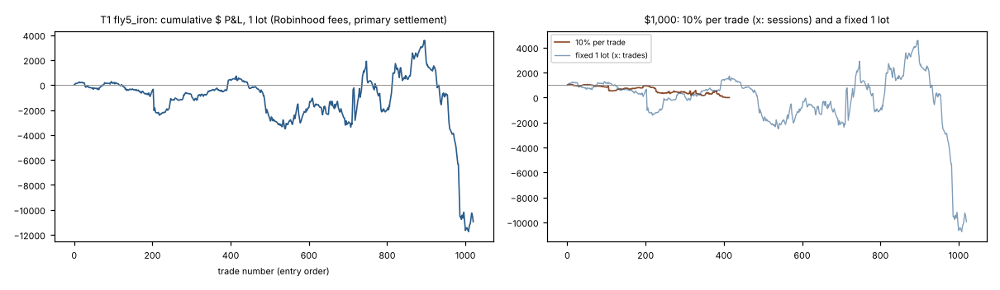
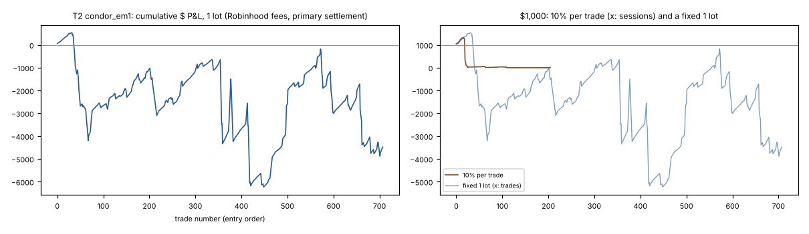
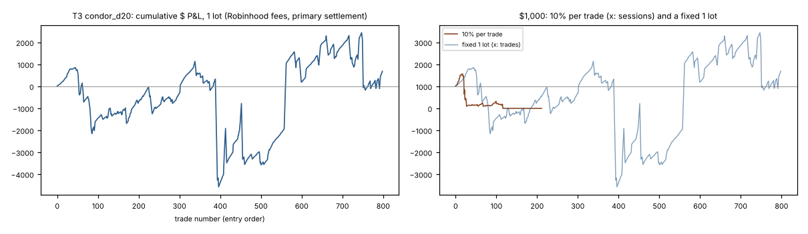
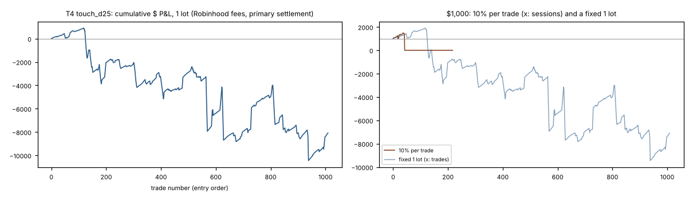
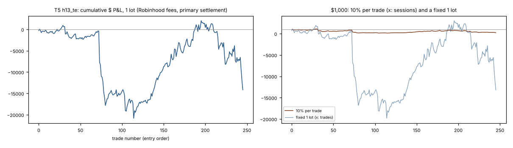
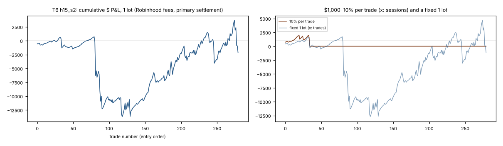
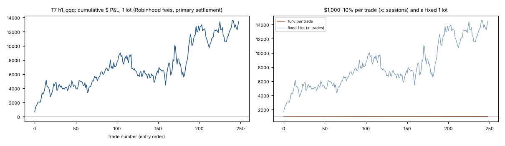

# Compass Final: one clean test, at Robinhood's fees, of every rule the final report left standing

**Repository:** georgeredo, branch `claude/lucid-heisenberg-bpyq7k`. **Prereg:** `PREREG_COMPASS_FINAL.md`, committed alone with its HOLDOUT_LEDGER row in `4bc546f` before any fetch or computation. **Fetch and run code:** `f6d2889` (before T1–T6 were run). **Built:** 2026-10-24 by `report_final.py`; every figure below is read from `out/results.json` and the trade files beside it.

## In plain English

The owner asked for the research to be reverse-engineered "until you figure out a final that works". This study did it the honest way: it picked the survivors from the final report by a rule fixed in advance, and gave each one test, run once, on market data no study had read for that rule, at Robinhood's fees, with nothing tuned.

**Nothing passed.** Seven tests ran, and all seven fail the pre-registered rule. The headline for each, at Robinhood's fees under the pre-registered settlement:

- **T1 — SPY/QQQ iron butterfly ±5 at 15:00 and 15:30 (fly5 iron; hyp C §6):** 1,021 trades, mean -3.32 % of max risk a trade, 95 % interval [-8.95, +2.83], win rate 48 %. **FAIL** (mean > 0, Bonferroni lower end > 0, top-5 ≤ 100 %, ≤ 1 losing year).
- **T2 — SPY 2-wide iron condor at ± the ATM straddle, 11:30–13:30 (condor_em1):** 708 trades, mean -4.38 % of max risk a trade, 95 % interval [-16.19, +9.21], win rate 82 %. **FAIL** (mean > 0, Bonferroni lower end > 0, top-5 ≤ 100 %, ≤ 1 losing year).
- **T3 — SPY 2-wide 20-delta iron condor, 13:00–15:00 (condor_d20):** 799 trades, mean +0.21 % of max risk a trade, 95 % interval [-9.19, +9.79], win rate 81 %. **FAIL** (Bonferroni lower end > 0, top-5 ≤ 100 %, ≤ 1 losing year).
- **T4 — SPY 2-wide 25-delta credit spread at the boundary touch (hyp B touch pick):** 1,010 trades, mean -4.80 % of max risk a trade, 95 % interval [-13.11, +2.63], win rate 83 %. **FAIL** (mean > 0, Bonferroni lower end > 0, top-5 ≤ 100 %, ≤ 1 losing year).
- **T5 — SPXW 13:00 ATM straddle to settlement, ex FOMC/CPI/NFP (T-E, H13):** 246 trades, mean -1.16 % of credit a trade, 95 % interval [-12.26, +12.14], win rate 59 %. **FAIL** (mean > 0, Bonferroni lower end > 0, top-5 ≤ 100 %, ≥ 300 trades, ≤ 1 losing year).
- **T6 — SPXW 14:05 strangle at ±0.5 EM to settlement, ex FOMC and month-end (H15):** 280 trades, mean +2.37 % of credit a trade, 95 % interval [-27.19, +30.73], win rate 73 %. **FAIL** (Bonferroni lower end > 0, top-5 ≤ 100 %, ≥ 300 trades, ≤ 1 losing year).
- **T7 — QQQ overnight reversal of the late-day move (Compass H1):** 249 trades, mean +0.082 % of notional a trade, 95 % interval [-0.007, +0.141], win rate 59 %. **FAIL** (Bonferroni lower end > 0, ≥ 300 trades).

**What sank the SPY/QQQ defined-risk family is the after-hours exercise risk, measured as the owner fixed it.** These structures are held to the close on physically settled ETF options, so an option that is in the money at the close, or that the other side chooses to exercise after the close, turns into 100 shares that gap overnight. Priced the way AFTERHOURS.md priced it (case (b): our longs exercised on the official close, each short assigned if it is in the money at 17:30, the shares marked at the next 09:30 open), the late iron butterfly is **-3.32 %** of max risk a trade. Settled at intrinsic on the official close, which ignores that risk, the same trades read +2.18 % [+0.53, +3.29]: a small edge that exists only on paper. Closing at 15:58 to avoid the risk costs it: -0.90 % [-1.96, +0.05]. The condors and the touch spread show the same shape: they win most of the time (81–83 %) and their average losing trade is 119–144 % of max risk, more than the structure can lose at expiry, because an assignment leaves stock that moves overnight.

**The SPXW lanes (T5, T6) could not pass on count**: the fresh span holds 246 and 280 trades, under the 300 the owner requires (stated in the prereg before anything was read). Their returns also say no: T5 -1.16 % and T6 +2.37 % of the credit, with intervals about ±12 and ±29 points wide. One session, 2018-02-05, cost −$7,318 on T5 and −$6,078 on T6: years of credit gone in an afternoon.

**H1 on QQQ (T7)** is the closest thing to a positive: +0.082 % of notional a trade ($54 a 100-share trade) on 249 trades from 2025-10-13 to 2026-10-22, 95 % interval [-0.007, +0.141]. It still fails: under 300 trades (stated in advance) and its Bonferroni interval [-0.041, +0.175] crosses zero. It agrees with the earlier read (+0.038 %) without proving anything; its forward N at the earlier mean is 2,763 trades, about eleven years.

**S17 index put-writing** had no unread history (its test read all the option data Theta serves), so it goes to the forward test only. It is now in step 8 of the daily job (first roll 2026-11-20, no verdict before 147 closed cycles, about six years). H7 and QQQ's turn of the month were not candidates: they have 77–172 trades, under the 300 the selection rule requires. H7 is already forward-tracked.

**The checks hold.** 70 trades re-derived from the raw files by separate plain-loop code: 490 fields, **0 differences**. The lookahead check: **not run — usage ended** (started, stopped before it finished; no result read). Every run path was first checked on sessions the research had already read and reproduced the committed rows exactly (FETCH_LOG.md).

**What it means.** There is no rule here to trade. The power was low by construction (section 7: every MDE was two to five times the earlier means), so a FAIL is weak evidence that a small edge does not exist. But every family failed on more than its interval: the means are at or below zero, more than one year lost money, and the SPY/QQQ structures lose their paper edge to the after-hours exercise risk. No rulebook is written. The forward paper tests already in the daily job (fly5, condor_em1, condor_d20, H5/H6, H7) keep running to their own N, and S17 joins them.

## The verdict, test by test

k = 7 tests; the Bonferroni interval is the two-sided 1 − 0.05/7 percentile interval of the 20-session moving-block bootstrap (audit_lib, 2,000 draws, seed 20261022). Robinhood fees; the primary settlement (case (b) for SPY/QQQ, Cboe's close for SPXW, the next 09:30 open for T7).

| test | family | trades | sessions traded / in the test | mean a trade | 95 % interval | Bonferroni interval | top-5 share of profit | years ≤ 0 | verdict |
|---|---|---|---|---|---|---|---|---|---|
| T1 | SPY/QQQ late ATM butterflies (rows 21a, 21c, 25, 26b) | 1,021 | 415 / 479 | **-3.32** % of max risk | [-8.95, +2.83] | [-11.62, +4.39] | n/a (total ≤ 0) | 2012, 2014, 2015, 2018, 2019, 2021, 2022 | **FAIL** (mean > 0, Bonferroni lower end > 0, top-5 ≤ 100 %, ≤ 1 losing year) |
| T2 | SPY midday iron condors (rows 20b, 26a, 26c) | 708 | 205 / 266 | **-4.38** % of max risk | [-16.19, +9.21] | [-20.16, +13.21] | n/a (total ≤ 0) | 2018, 2020, 2021, 2022 | **FAIL** (mean > 0, Bonferroni lower end > 0, top-5 ≤ 100 %, ≤ 1 losing year) |
| T3 | SPY midday iron condors (rows 20b, 26a, 26c) | 799 | 212 / 266 | **+0.21** % of max risk | [-9.19, +9.79] | [-13.08, +14.16] | 1199 % | 2018, 2021, 2022 | **FAIL** (Bonferroni lower end > 0, top-5 ≤ 100 %, ≤ 1 losing year) |
| T4 | SPY boundary-touch credit spread (row 20a) | 1,010 | 218 / 266 | **-4.80** % of max risk | [-13.11, +2.63] | [-16.22, +4.98] | n/a (total ≤ 0) | 2018, 2020, 2021 | **FAIL** (mean > 0, Bonferroni lower end > 0, top-5 ≤ 100 %, ≤ 1 losing year) |
| T5 | SPXW 13:00 straddle (row 6d) | 246 | 246 / 297 | **-1.16** % of credit | [-12.26, +12.14] | [-17.46, +16.97] | n/a (total ≤ 0) | 2018, 2021, 2022 | **FAIL** (mean > 0, Bonferroni lower end > 0, top-5 ≤ 100 %, ≥ 300 trades, ≤ 1 losing year) |
| T6 | SPXW 14:05 strangle (row 6e) | 280 | 280 / 297 | **+2.37** % of credit | [-27.19, +30.73] | [-37.98, +39.20] | n/a (total ≤ 0) | 2018, 2021 | **FAIL** (Bonferroni lower end > 0, top-5 ≤ 100 %, ≥ 300 trades, ≤ 1 losing year) |
| T7 | Compass H1 on QQQ (row 32 QQQ) | 249 | 249 / 259 | **+0.082** % of notional | [-0.007, +0.141] | [-0.041, +0.175] | 57 % | none | **FAIL** (Bonferroni lower end > 0, ≥ 300 trades) |

Families with no unread data: **S17** (forward only, wired into the daily job). Not candidates: H7 and QQQ turn of the month (< 300 trades). No test passed, so no rulebook and no new forward N for a passing rule.

## What was tested, and on what (stage 1 and the prereg, in short)

- **Selection rule (fixed first):** a page-1 row with a Robinhood-fee mean > 0, a block-20 lower end > 0 on its own period, ≥ 300 trades, and not vendor-recorded, a preview or a base-trade row. 13 rows passed, in 9 families (prereg §1).
- **Fresh data:** Theta serves SPY bars, SPY EOD and SPX prints from 2017-01-03 and QQQ from 2012-06-01, and SPY/QQQ after-hours bars throughout (stage-1 probes, `out/probe_entitlement*.json`). The fresh span ends 2022-05-12: from 2022-05-13 SPXW was read intraday on every session. Every session on which an earlier study held or read an index-product option inside the family's window (V8, S03, S16b, Compass Close's gate sample) is out; half days are out.
- **Sessions in the test:** SPY 266 (2017-01-04 → 2022-04-27), QQQ 339 (2012-06-01 → 2022-04-27), SPXW 297 (2017-01-03 → 2022-04-27), and QQQ stock 2025-10-13 → 2026-10-22 for T7. 8 QQQ sessions came back empty from Theta twice and carry no trade (FETCH_LOG.md).
- **Fees:** Robinhood (`docs/FEES_ROBINHOOD.md`) primary; each study's own fees as a line. **Fills** at the NBBO: buy at the ask, sell at the bid.
- **Settlement:** physically settled SPY/QQQ held to the close by AFTERHOURS.md's case (b) (the after-hours prices could be fetched, so the 15:59 close-out fallback was not used); SPXW on Cboe's official close; T7 at the next 09:30 open.

## Power: the MDE committed before reading, and at the realised n

| test | planned n (prereg) | realised trades | MDE per trade, prereg SD at realised n | MDE per session, prereg SD | MDE per trade, realised SD | realised SD a trade |
|---|---|---|---|---|---|---|
| T1 | 1,210 | 1,021 | 15.92 | 19.97 | 5.21 | 47.13 |
| T2 | 1,330 | 708 | 17.00 | 24.37 | 13.25 | 99.81 |
| T3 | 1,330 | 799 | 16.00 | 23.96 | 11.86 | 94.94 |
| T4 | 1,601 | 1,010 | 14.23 | 23.63 | 9.12 | 82.09 |
| T5 | 246 | 246 | 18.02 | 18.02 | 19.98 | 88.72 |
| T6 | 281 | 280 | 29.11 | 29.11 | 49.26 | 233.38 |
| T7 | 257 | 249 | 0.179 | 0.179 | 0.188 | 0.839 |

Units as each test's (percentage points of its unit). Every MDE is several times the effect the earlier reads found, as the prereg said it would be.

## T1 — SPY/QQQ iron butterfly ±5 at 15:00 and 15:30 (fly5 iron; hyp C §6)

**Verdict: FAIL** (mean > 0, Bonferroni lower end > 0, top-5 ≤ 100 %, ≤ 1 losing year). Unit: % of max risk. Settlement: case (b).
 Every trade had its official close, decision price and next open (528 name-sessions; decision-price coverage 100 %).

| trades | sessions traded / in test | win % | avg win % | avg loss % | median % | mean % | mean $ | total $ | profit factor | max drawdown $ | longest drawdown (sessions) |
|---|---|---|---|---|---|---|---|---|---|---|---|
| 1,021 | 415 / 479 | 47.6 | +23.10 | -27.32 | -0.80 | **-3.32** | -10.72 | −$10,949 | 0.81 | $15,319 | 227 |

Best trade $1,065 (+252.9 %, 2020-02-21 15:30, SPY iron); worst −$1,106 (-360.3 %, 2022-02-23 15:30, SPY iron).

**$1,000:** at a fixed 1 lot it ends at −$9,949 (low −$10,746, first at or below $0 on 2015-08-21); at 10 % per trade (the final report's method B) it ends at $0, wiped out on 2022-02-23. A case (b) loss can exceed the structure's max risk (shares assigned and gapping overnight), so 10 % of the balance can lose more than 10 %.

| line (no verdict) | trades | mean | 95 % interval | total $ |
|---|---|---|---|---|
| **primary, Robinhood fees** | 1,021 | **-3.32** | [-8.95, +2.83] | −$10,949 |
| (0) intrinsic at the official close [carries the exercise risk it does not price] | 1,021 | +2.18 | [+0.53, +3.29] | $7,936 |
| (a) exercise by exception on C | 1,021 | -2.67 | [-8.68, +1.68] | −$9,725 |
| (c) both sides decided at D | 1,021 | -3.32 | [-8.95, +2.83] | −$10,949 |
| the tracker's 15:58 exit (NBBO, Robinhood both sides) | 1,021 | -0.90 | [-1.96, +0.05] | −$4,048 |
| the study's own convention: (0) at the official close, $0.65 a leg | 1,021 | +1.63 | [-0.01, +2.73] | $5,487 |
| primary settlement at the study's own fees | 1,021 | -3.82 | [-9.45, +2.33] | −$13,166 |
| fly5 call (case (b), Robinhood) | 1,027 | -4.96 | [-10.50, +1.38] | −$20,072 |
| fly5 put (case (b), Robinhood) | 1,026 | -6.09 | [-11.48, -0.23] | −$25,228 |
| SPY alone | 459 | -2.17 | [-9.33, +6.48] | −$2,703 |
| QQQ alone | 562 | -4.26 | [-9.17, +1.22] | −$8,246 |
| sensitivity: Compass Close's P&L-sample sessions out | 436 | +0.11 | [-2.55, +2.14] | $234 |
| sensitivity: EOD-marked sessions out | 0 | — | — | every in-test session carries an EOD mark (stage 1): n = 0 |
| sensitivity: sessions with |official - 15:59 bar| > $0.25 out | 1,017 | -3.50 | [-9.11, +2.83] | −$11,553 |

| by year | 2012 | 2013 | 2014 | 2015 | 2016 | 2017 | 2018 | 2019 | 2020 | 2021 | 2022 |
|---|---|---|---|---|---|---|---|---|---|---|---|
| trades | 29 | 50 | 72 | 85 | 96 | 151 | 120 | 99 | 118 | 147 | 54 |
| mean % | -0.77 | +1.23 | -1.55 | -4.43 | +2.68 | +0.39 | -1.74 | -3.40 | +8.76 | -9.61 | -43.22 |
| total $ | −$105 | $294 | −$527 | −$1,672 | $1,198 | $192 | −$701 | −$1,642 | $3,949 | −$4,926 | −$7,010 |

| by weekday | Mon | Tue | Wed | Thu | Fri |
|---|---|---|---|---|---|
| trades | 147 | 6 | 191 | 25 | 652 |
| mean % | -5.10 | -0.95 | -8.18 | +2.44 | -1.74 |

| by entry time | 15:00 | 15:30 |
|---|---|---|
| trades | 515 | 506 |
| mean % | -2.87 | -3.77 |

## T2 — SPY 2-wide iron condor at ± the ATM straddle, 11:30–13:30 (condor_em1)

**Verdict: FAIL** (mean > 0, Bonferroni lower end > 0, top-5 ≤ 100 %, ≤ 1 losing year). Unit: % of max risk. Settlement: case (b).
 Every trade had its official close, decision price and next open (205 name-sessions; decision-price coverage 100 %).

| trades | sessions traded / in test | win % | avg win % | avg loss % | median % | mean % | mean $ | total $ | profit factor | max drawdown $ | longest drawdown (sessions) |
|---|---|---|---|---|---|---|---|---|---|---|---|
| 708 | 205 / 266 | 82.1 | +26.03 | -143.50 | +12.25 | **-4.38** | -6.32 | −$4,477 | 0.85 | $6,764 | 217 |

Best trade $645 (+408.1 %, 2020-12-18 12:00, SPY condor); worst −$1,147 (-775.0 %, 2022-02-23 11:30, SPY condor).

**$1,000:** at a fixed 1 lot it ends at −$3,477 (low −$5,228, first at or below $0 on 2018-02-07); at 10 % per trade (the final report's method B) it ends at $0, wiped out on 2020-04-06. A case (b) loss can exceed the structure's max risk (shares assigned and gapping overnight), so 10 % of the balance can lose more than 10 %.

| line (no verdict) | trades | mean | 95 % interval | total $ |
|---|---|---|---|---|
| **primary, Robinhood fees** | 708 | **-4.38** | [-16.19, +9.21] | −$4,477 |
| (0) intrinsic at the official close [carries the exercise risk it does not price] | 708 | +1.11 | [-6.21, +7.37] | $1,471 |
| (a) exercise by exception on C | 708 | -5.70 | [-16.62, +4.90] | −$6,068 |
| (c) both sides decided at D | 708 | -3.55 | [-15.28, +9.65] | −$3,463 |
| the tracker's 15:58 exit (NBBO, Robinhood both sides) | 708 | -3.81 | [-10.61, +2.50] | −$4,381 |
| the study's own convention: (0) at the official close, $0.65 a leg | 708 | -0.27 | [-7.61, +5.99] | −$228 |
| primary settlement at the study's own fees | 708 | -5.72 | [-17.51, +7.89] | −$6,123 |
| sensitivity: Compass Close's P&L-sample sessions out | 29 | +9.21 | — | $494 |
| sensitivity: EOD-marked sessions out | 0 | — | — | every in-test session carries an EOD mark (stage 1): n = 0 |
| sensitivity: sessions with |official - 15:59 bar| > $0.25 out | 699 | -3.37 | [-14.58, +9.56] | −$3,259 |

| by year | 2017 | 2018 | 2019 | 2020 | 2021 | 2022 |
|---|---|---|---|---|---|---|
| trades | 35 | 187 | 115 | 166 | 135 | 70 |
| mean % | +6.90 | -11.21 | +11.20 | -5.64 | -3.96 | -15.18 |
| total $ | $446 | −$3,331 | $2,243 | −$1,297 | −$928 | −$1,610 |

| by weekday | Mon | Wed | Thu | Fri |
|---|---|---|---|---|
| trades | 200 | 262 | 10 | 236 |
| mean % | -22.73 | -14.29 | -5.96 | +22.23 |

| by entry time | 11:30 | 12:00 | 12:30 | 13:00 | 13:30 |
|---|---|---|---|---|---|
| trades | 158 | 157 | 138 | 129 | 126 |
| mean % | -6.05 | +1.30 | -8.14 | -1.78 | -7.89 |

## T3 — SPY 2-wide 20-delta iron condor, 13:00–15:00 (condor_d20)

**Verdict: FAIL** (Bonferroni lower end > 0, top-5 ≤ 100 %, ≤ 1 losing year). Unit: % of max risk. Settlement: case (b).
 Every trade had its official close, decision price and next open (212 name-sessions; decision-price coverage 100 %).

| trades | sessions traded / in test | win % | avg win % | avg loss % | median % | mean % | mean $ | total $ | profit factor | max drawdown $ | longest drawdown (sessions) |
|---|---|---|---|---|---|---|---|---|---|---|---|
| 799 | 212 / 266 | 81.4 | +27.74 | -119.87 | +12.51 | **+0.21** | +0.87 | $691 | 1.02 | $5,718 | 97 |

Best trade $642 (+398.6 %, 2020-12-18 13:30, SPY condor); worst −$1,149 (-766.0 %, 2022-02-23 14:00, SPY condor).

**$1,000:** at a fixed 1 lot it ends at $1,691 (low −$3,576, first at or below $0 on 2018-04-04); at 10 % per trade (the final report's method B) it ends at $0, wiped out on 2020-04-06. A case (b) loss can exceed the structure's max risk (shares assigned and gapping overnight), so 10 % of the balance can lose more than 10 %.

| line (no verdict) | trades | mean | 95 % interval | total $ |
|---|---|---|---|---|
| **primary, Robinhood fees** | 799 | **+0.21** | [-9.19, +9.79] | $691 |
| (0) intrinsic at the official close [carries the exercise risk it does not price] | 799 | +3.48 | [-1.22, +7.36] | $4,659 |
| (a) exercise by exception on C | 799 | +0.87 | [-7.73, +8.51] | $1,778 |
| (c) both sides decided at D | 799 | +0.29 | [-9.44, +9.78] | $695 |
| the tracker's 15:58 exit (NBBO, Robinhood both sides) | 799 | -2.09 | [-6.60, +2.14] | −$2,750 |
| the study's own convention: (0) at the official close, $0.65 a leg | 799 | +2.09 | [-2.58, +5.96] | $2,742 |
| primary settlement at the study's own fees | 799 | -1.13 | [-10.53, +8.48] | −$1,157 |
| sensitivity: Compass Close's P&L-sample sessions out | 38 | +11.25 | — | $783 |
| sensitivity: EOD-marked sessions out | 0 | — | — | every in-test session carries an EOD mark (stage 1): n = 0 |
| sensitivity: sessions with |official - 15:59 bar| > $0.25 out | 789 | +1.08 | [-8.22, +10.39] | $1,828 |

| by year | 2017 | 2018 | 2019 | 2020 | 2021 | 2022 |
|---|---|---|---|---|---|---|
| trades | 52 | 187 | 130 | 200 | 160 | 70 |
| mean % | +5.95 | -4.97 | +5.91 | +2.15 | -1.40 | -2.62 |
| total $ | $564 | −$1,554 | $1,267 | $932 | −$328 | −$188 |

| by weekday | Mon | Wed | Thu | Fri |
|---|---|---|---|---|
| trades | 220 | 289 | 18 | 272 |
| mean % | -18.00 | -2.75 | -31.43 | +20.19 |

| by entry time | 13:00 | 13:30 | 14:00 | 14:30 | 15:00 |
|---|---|---|---|---|---|
| trades | 181 | 170 | 158 | 150 | 140 |
| mean % | -0.34 | +0.46 | -7.80 | +5.20 | +4.34 |

## T4 — SPY 2-wide 25-delta credit spread at the boundary touch (hyp B touch pick)

**Verdict: FAIL** (mean > 0, Bonferroni lower end > 0, top-5 ≤ 100 %, ≤ 1 losing year). Unit: % of max risk. Settlement: case (b).
 Every trade had its official close, decision price and next open (218 name-sessions; decision-price coverage 100 %).

| trades | sessions traded / in test | win % | avg win % | avg loss % | median % | mean % | mean $ | total $ | profit factor | max drawdown $ | longest drawdown (sessions) |
|---|---|---|---|---|---|---|---|---|---|---|---|
| 1,010 | 218 / 266 | 83.0 | +18.56 | -118.63 | +8.05 | **-4.80** | -8.01 | −$8,088 | 0.78 | $11,353 | 208 |

Best trade $626 (+353.6 %, 2020-12-18 15:57, SPY call spread); worst −$1,083 (-668.6 %, 2020-04-06 11:49, SPY call spread).

**$1,000:** at a fixed 1 lot it ends at −$7,088 (low −$9,445, first at or below $0 on 2018-02-02); at 10 % per trade (the final report's method B) it ends at $0, wiped out on 2018-02-02. A case (b) loss can exceed the structure's max risk (shares assigned and gapping overnight), so 10 % of the balance can lose more than 10 %.

| line (no verdict) | trades | mean | 95 % interval | total $ |
|---|---|---|---|---|
| **primary, Robinhood fees** | 1,010 | **-4.80** | [-13.11, +2.63] | −$8,088 |
| (0) intrinsic at the official close [carries the exercise risk it does not price] | 1,010 | -0.39 | [-4.22, +2.68] | −$640 |
| (a) exercise by exception on C | 1,010 | -3.39 | [-9.54, +2.25] | −$5,441 |
| (c) both sides decided at D | 1,010 | -3.16 | [-10.66, +3.96] | −$5,206 |
| the study's own convention: the 16:00 bar's close, $0.65 a leg | 1,010 | -0.86 | [-4.94, +2.30] | −$1,447 |
| primary settlement at the study's own fees | 1,010 | -5.42 | [-13.72, +2.01] | −$9,221 |
| sensitivity: Compass Close's P&L-sample sessions out | 92 | +3.81 | — | $665 |
| sensitivity: EOD-marked sessions out | 0 | — | — | every in-test session carries an EOD mark (stage 1): n = 0 |

| by year | 2017 | 2018 | 2019 | 2020 | 2021 | 2022 |
|---|---|---|---|---|---|---|
| trades | 123 | 298 | 118 | 195 | 174 | 102 |
| mean % | +3.01 | -9.75 | +5.77 | -9.05 | -8.46 | +2.39 |
| total $ | $699 | −$5,081 | $1,141 | −$2,602 | −$2,741 | $495 |

| by weekday | Mon | Tue | Wed | Thu | Fri |
|---|---|---|---|---|---|
| trades | 277 | 1 | 377 | 17 | 338 |
| mean % | -8.63 | +4.11 | -14.82 | +4.95 | +8.99 |

| entry hour | 09:00 | 10:00 | 11:00 | 12:00 | 13:00 | 14:00 | 15:00 |
|---|---|---|---|---|---|---|---|
| trades | 6 | 76 | 118 | 104 | 145 | 233 | 328 |
| mean % | +9.34 | -11.31 | -7.51 | -1.99 | -21.84 | -4.35 | +3.74 |

## T5 — SPXW 13:00 ATM straddle to settlement, ex FOMC/CPI/NFP (T-E, H13)

**Verdict: FAIL** (mean > 0, Bonferroni lower end > 0, top-5 ≤ 100 %, ≥ 300 trades, ≤ 1 losing year). Unit: % of credit. Settlement: Cboe close (cash).

| trades | sessions traded / in test | win % | avg win % | avg loss % | median % | mean % | mean $ | total $ | profit factor | max drawdown $ | longest drawdown (sessions) |
|---|---|---|---|---|---|---|---|---|---|---|---|
| 246 | 246 / 297 | 58.9 | +54.78 | -81.48 | +17.09 | **-1.16** | -57.60 | −$14,170 | 0.83 | $21,752 | 194 |

Best trade $2,172 (+86.5 %, 2020-04-15 13:00, SPXW straddle); worst −$7,318 (-567.3 %, 2018-02-05 13:00, SPXW straddle).

**$1,000:** at a fixed 1 lot it ends at −$13,170 (low −$19,819, first at or below $0 on 2017-04-05); at 10 % per trade (the final report's method B) it ends at $238. A short straddle or strangle can lose many times its credit, so 10 % of the balance on the credit can lose far more than 10 %.

| line (no verdict) | trades | mean | 95 % interval | total $ |
|---|---|---|---|---|
| **primary, Robinhood fees** | 246 | **-1.16** | [-12.26, +12.14] | −$14,170 |
| primary settlement at the study's own fees | 246 | -1.12 | [-12.22, +12.19] | −$14,107 |
| sensitivity: Compass Close's P&L-sample sessions out | 52 | -6.83 | [-22.98, +7.42] | −$2,207 |
| sensitivity: EOD-marked sessions out | 0 | — | — | every in-test session carries an EOD mark (stage 1): n = 0 |

| by year | 2017 | 2018 | 2019 | 2020 | 2021 | 2022 |
|---|---|---|---|---|---|---|
| trades | 73 | 43 | 39 | 40 | 38 | 13 |
| mean % | +1.67 | -28.42 | +33.57 | +10.02 | -16.91 | -19.48 |
| total $ | −$386 | −$18,671 | $11,244 | $8,289 | −$6,779 | −$7,866 |

| by weekday | Mon | Tue | Wed | Thu | Fri |
|---|---|---|---|---|---|
| trades | 93 | 9 | 81 | 4 | 59 |
| mean % | +0.52 | -27.72 | -16.13 | -27.08 | +22.55 |

| by entry time | 13:00 |
|---|---|
| trades | 246 |
| mean % | -1.16 |

## T6 — SPXW 14:05 strangle at ±0.5 EM to settlement, ex FOMC and month-end (H15)

**Verdict: FAIL** (Bonferroni lower end > 0, top-5 ≤ 100 %, ≥ 300 trades, ≤ 1 losing year). Unit: % of credit. Settlement: Cboe close (cash).

| trades | sessions traded / in test | win % | avg win % | avg loss % | median % | mean % | mean $ | total $ | profit factor | max drawdown $ | longest drawdown (sessions) |
|---|---|---|---|---|---|---|---|---|---|---|---|
| 280 | 280 / 297 | 72.9 | +90.53 | -234.26 | +97.23 | **+2.37** | -7.68 | −$2,151 | 0.96 | $14,425 | 161 |

Best trade $1,548 (+99.9 %, 2020-04-09 14:05, SPXW strangle); worst −$6,078 (-1146.8 %, 2018-02-05 14:05, SPXW strangle).

**$1,000:** at a fixed 1 lot it ends at −$1,151 (low −$12,695, first at or below $0 on 2017-04-05); at 10 % per trade (the final report's method B) it ends at $0, wiped out on 2017-04-05. A short straddle or strangle can lose many times its credit, so 10 % of the balance on the credit can lose far more than 10 %.

| line (no verdict) | trades | mean | 95 % interval | total $ |
|---|---|---|---|---|
| **primary, Robinhood fees** | 280 | **+2.37** | [-27.19, +30.73] | −$2,151 |
| primary settlement at the study's own fees | 280 | +2.45 | [-27.11, +30.82] | −$2,098 |
| sensitivity: Compass Close's P&L-sample sessions out | 55 | -18.36 | [-129.79, +41.82] | −$1,182 |
| sensitivity: EOD-marked sessions out | 0 | — | — | every in-test session carries an EOD mark (stage 1): n = 0 |

| by year | 2017 | 2018 | 2019 | 2020 | 2021 | 2022 |
|---|---|---|---|---|---|---|
| trades | 80 | 51 | 45 | 46 | 43 | 15 |
| mean % | +15.51 | -60.84 | +53.84 | +3.82 | -2.07 | +1.10 |
| total $ | $730 | −$13,462 | $6,033 | $4,484 | $1,511 | −$1,447 |

| by weekday | Mon | Tue | Wed | Thu | Fri |
|---|---|---|---|---|---|
| trades | 92 | 7 | 90 | 4 | 87 |
| mean % | +3.40 | -16.95 | -42.09 | +11.64 | +48.40 |

| by entry time | 14:05 |
|---|---|
| trades | 280 |
| mean % | +2.37 |

## T7 — QQQ overnight reversal of the late-day move (Compass H1)

**Verdict: FAIL** (Bonferroni lower end > 0, ≥ 300 trades). Unit: % of notional. Settlement: stock, next 09:30 open.

| trades | sessions traded / in test | win % | avg win % | avg loss % | median % | mean % | mean $ | total $ | profit factor | max drawdown $ | longest drawdown (sessions) |
|---|---|---|---|---|---|---|---|---|---|---|---|
| 249 | 249 / 259 | 58.6 | +0.619 | -0.678 | +0.133 | **+0.082** | +54.21 | $13,497 | 1.29 | $4,543 | 65 |

Best trade $2,219 (+3.0 %, 2026-06-22 16:00, QQQ short); worst −$2,014 (-3.4 %, 2026-04-07 16:00, QQQ short).

**$1,000:** at a fixed 1 lot it ends at $14,497 (low $1,000); at 10 % per trade (the final report's method B) it ends at $1,021.

| line (no verdict) | trades | mean | 95 % interval | total $ |
|---|---|---|---|---|
| **primary, Robinhood fees** | 249 | **+0.082** | [-0.007, +0.141] | $13,497 |
| primary settlement at the study's own fees | 249 | +0.081 | [-0.008, +0.140] | $13,345 |

| by year | 2025 | 2026 |
|---|---|---|
| trades | 54 | 195 |
| mean % | +0.137 | +0.067 |
| total $ | $4,493 | $9,004 |

| by weekday | Mon | Tue | Wed | Thu | Fri |
|---|---|---|---|---|---|
| trades | 49 | 52 | 51 | 49 | 48 |
| mean % | +0.166 | +0.040 | +0.073 | +0.051 | +0.086 |

| by entry time | 16:00 |
|---|---|
| trades | 249 |
| mean % | +0.082 |

## Integrity

- **Plain-loop re-derivation** (`verify_plain.py`): 70 trades, 10 a test (seed 20261024), re-derived from the raw files with separate code (pyarrow rows into Python lists; no polars, numpy, run script, engine or fee module): strikes, fills, max risk, C, D, O, the Cboe close, the case (b) and stock P&L at Robinhood's fees. **490 fields, 0 differences** (tolerance 1e-6).
- **Lookahead check** (`lookahead.py`, 10 sessions a family, seed 20261024; every chain row and bar stamped after the entry minute blanked, the settlement inputs kept; control: the chain read one minute later):

| test | entries checked | sessions | unchanged with the future blanked | control changed |
|---|---|---|---|---|
| all | — | — | **not run — usage ended** | — |

- **Units asserted** in the run code (prices per share, $ = 100 × points − fees, % = $ ÷ the unit's $ base); the SPXW P&L is re-asserted against its legs for every trade (`run_t56.py`).
- **Every run path reproduced the committed research rows** on previously read sessions before it touched fresh data (FETCH_LOG.md): the replay 110 of 110 trades, the touch events and hyp B rows exactly, T-E/H15 rows at both fees, H1 21 of 21.
- **Frozen code:** sim.py and load.py from `7dfea57`, sha256 in `out/t56_code_sha256.json`; the tracker at `rules-2026-10-21.1` / `rules-c3-2026-10-21.1`; the engine audit's and hyp B's engines unchanged; AFTERHOURS's `case_pnl` imported.

## Deviations and disclosures

- **Four SDK logins in all:** two for the stage-1 entitlement probes (non-expiry days only, before the prereg), one for the fetch, one for the prereg's retry of the 8 empty QQQ answers (still empty, not filled in).
- **T7 ran before the fetch commit** (`f6d2889`): it needed no fetch, its code is the committed `run_t7.py` unchanged, and it ran once.
- **The lookahead check was not completed: usage ended.** It was started, restarted, and stopped before writing any result; no output was read. The remaining integrity work was skipped for the same reason. The plain-loop re-derivation (0 differences) and the reproduction of the committed rows on previously read sessions did run.
- **QQQ's third Fridays before 2015** are not in the test: the standard monthlies were then dated on the Saturday, and the frozen rules ask for the chain whose expiration is the session (prereg §2.2).
- **Every fresh session carries an end-of-day mark** from the Lifecycle daily tier or the Compass features (not counted as reads, as Compass Close decided), so the "EOD-marked sessions out" sensitivity line has no sessions.
- **The sensitivity line without Compass Close's P&L-sample sessions** leaves few SPY sessions (most fresh SPY sessions are in it); where it has fewer than 60 sessions it prints no interval.
- **T4's by-time table** is by entry hour (a touch can fall on any minute).
- **The study's own fees** are a reported line throughout; no verdict was read at them. Robinhood is cheaper on the ETF options and the stock trades and dearer on SPXW, so the mean at the study's fees is higher only for T5 (+0.04 points), T6 (+0.08 points); no verdict would differ.

## Files

`research_notes/Compass Final/`: `PREREG_COMPASS_FINAL.md` and the stage-1 files (`4bc546f`); `fetch_final.py`, `FETCH_LOG.md` and the run code (`f6d2889`); the trade files `out/t123_trades.parquet`, `out/t4_trades.parquet`, `out/t56_trades.parquet` (+ `t56_skips.csv`), `out/t7_trades.parquet` (+ `t7_sessions.parquet`); `out/results.json`, `out/verify_plain.json`, `out/lookahead.json`, `out/t4_events.json`, `out/t123_replay_days.json`, `charts/`; this report and its PDF (`report_final.py`, `render_final.py`). S17's forward: `forward/s17_forward.py` (step 8 of `scripts/daily_forward.py`), `tests/test_s17_forward.py`. Raw data stay in the scratchpad (`$SP/compass_final/`).
