# Final research report

**Repository:** georgeredo, branch `claude/lucid-heisenberg-bpyq7k`. **Built:** 2026-10-23 by
`research_notes/FINAL REPORT/build/` (`build.py`, then `render.py` for the PDF).
**Inventory of every study:** `INVENTORY.md`, the file beside this one.

This report is read-only with respect to the research. It adds no test, variant or fetch, opens no holdout and
changes no rule. Every metric is recomputed from a study's committed trade-level output, or from the scratchpad copy
that INVENTORY.md names, with one exception: two studies (#31 and #40) were rerun deterministically from their
committed scripts at their own commits, on the same stored inputs. Step 6's rule membership (#17) is recomputed by its committed
`step6/trade.py` `choose()`, on the scratchpad population it was built from. Where a figure cannot be produced, the report
writes "not available — <why>". GeorgeFi's own recorded card returns appear only in sections marked
**vendor-recorded, not re-marked** (#1, and the grade check in #29f).

**Units.** Return per trade is given as:

- % of premium paid, for long options;
- % of max risk, for spreads and butterflies;
- % of the credit received, for naked short straddles and strangles;
- % of cash set aside, for cash-secured puts;
- % of notional, for stock trades. Their "$" column is $ per 100 shares, because every stock trade here is 100 shares.

$ per trade is one lot, after every fee the study charged.

## Page 1. Every strategy, sorted by mean trade

One row per strategy, on the period that carries its verdict, sorted by mean trade (% in each row's own
unit). The table pools all names when a study judged them together, and shows one row per name or variant when it did
not. The interval is the 20-session moving-block bootstrap of the mean % a trade (`audit_lib.session_stats`, 2,000
draws). It is "n/a" when the period has fewer than 60 sessions. "Biggest win/loss" are $ for one trade, with its entry
date. The verdict is the study's own, as pre-registered.

| # | strategy | name | period | trades | win % | avg win | avg loss | mean trade | biggest win | biggest loss | 20-session block 95% (mean %) | verdict |
|---------|------------------------------------------------|------------------|---------------------------|---------------|------------|---------------------|---------------------|---------------------------|------------------------|------------------------|---------------------------|------------------------------------|
| 6e | H15 carry lane: the 14:05 SPXW short strangle at ±0.5 expected move, held to … | SPXW | TEST | 407 | 70.8 | +86.5% / +646 | −147.6% / −1,047 | **+18.02 % credit** / +151.17 | +4,578 (2025-04-10) | −7,131 (2026-03-09) | [+3.54, +29.89] | Open, NOT promotable |
| 1 | GeorgeFi vendor cards (the vendor's own recorded P&L) | all names | Epoch 1 | 546 | 78.8 | +22.8% / +143 | −14.8% / −156 | **+14.82 % prem** / +79.21 | +4,020 (2026-02-06) | −1,375 (2026-02-18) | n/a (< 60 sessions) | Not evidence |
| 41a | EMA system v0: PREVIEW on 2026-10-12 → 16 (5 sessions) | Config A X1 | preview 2026-10-12→16 | 57 | 61.4 | +41.4% / +135 | −38.2% / −103 | **+10.67 % prem** / +43.03 | +717 (2026-10-14) | −773 (2026-10-15) | n/a (< 60 sessions) | PREVIEW |
| 6d | T-E: the 13:00 SPXW ATM straddle held to PM settlement, ex FOMC/CPI/NFP (H13) | SPXW | TEST | 388 | 67.0 | +52.8% / +998 | −80.7% / −1,768 | **+8.75 % credit** / +85.56 | +4,100 (2025-03-06) | −34,022 (2025-04-09) | [+1.86, +14.77] | FAIL |
| 27a | After-hours exercise study: fly5 iron ±5, case (b) the post-market decision | all names | ii | 987 | 55.7 | +95.6% / +325 | −106.2% / −358 | **+6.25 % risk** / +22.52 | +2,196 (2026-06-22) | −2,196 (2026-04-07) | [−5.84, +15.27] | DROP |
| 6c | T-C: the 13:00 SPXW short straddle bought back 15:55 (H11) | SPXW | 2025-06→2026-10 | 339 | 63.4 | +46.5% / +833 | −66.7% / −1,246 | **+5.11 % credit** / +72.43 | +3,371 (2025-09-17) | −8,499 (2026-06-11) | [−0.06, +9.01] | FAIL |
| 26c | Paper tracker: condor_d20 (SPY 2-wide 20-delta iron condor, 13:00–15:00) | SPY | ii | 2,090 | 82.1 | +17.0% / +28 | −51.5% / −84 | **+4.68 % risk** / +7.67 | +60 (2025-04-10) | −190 (2026-04-13) | [+2.43, +6.59] | Positive in ii |
| 21a | Phase 2 hyp C: 15:00 SPY/QQQ P1 iron ±2 butterfly, held to settlement | all names | OOS 2025–26 | 878 | 52.3 | +69.1% / +54 | −66.3% / −52 | **+4.49 % risk** / +3.41 | +153 (2026-01-28) | −133 (2026-01-07) | [−2.96, +12.33] | Not confirmed |
| 20a | Phase 2 hyp B: boundary touch — SPY 2-wide 25-delta credit spread, held (the … | SPY | OOS 2025–26 | 2,600 | 88.1 | +11.9% / +21 | −55.2% / −96 | **+3.91 % risk** / +6.84 | +45 (2025-11-14) | −191 (2026-04-13) | [+1.56, +5.68] | No edge |
| 25 | Phase 3 hyp F: the 15:30 SPY/QQQ long call ±5 butterfly (cash account) | all names | OOS 2025–26 | 879 | 62.2 | +19.0% / +63 | −21.1% / −77 | **+3.85 % risk** / +9.89 | +259 (2026-04-29) | −335 (2025-03-04) | [+1.49, +6.20] | Passes all four, but the cell was named after C's OOS was printed |
| 26b | Paper tracker: fly5 (SPY/QQQ ±5 butterflies at 15:00 and 15:30: iron, call, put) | all names | ii | 5,271 | 60.5 | +21.8% / +70 | −24.2% / −82 | **+3.62 % risk** / +9.64 | +280 (2026-04-29) | −471 (2026-05-12) | [+1.77, +5.47] | Iron clear of zero in i and ii |
| 20b | Phase 2 hyp B: the midday SPY iron condor (em1, mid-VIX), the midday pick | SPY | OOS 2025–26 | 1,202 | 81.6 | +15.5% / +26 | −50.9% / −85 | **+3.25 % risk** / +5.55 | +56 (2026-04-29) | −179 (2026-07-24) | [+0.21, +6.04] | "Needs X" |
| 1 | GeorgeFi vendor cards (the vendor's own recorded P&L) | all names | Epoch 2 | 603 | 48.1 | +32.6% / +191 | −24.2% / −189 | **+3.13 % prem** / −6.23 | +3,313 (2026-07-13) | −3,400 (2026-07-13) | [−0.74, +9.76] | Not evidence |
| 26a | Paper tracker: condor_em1 (SPY 2-wide iron condor at ± the ATM straddle, … | SPY | ii | 2,068 | 80.4 | +17.5% / +28 | −59.1% / −96 | **+2.46 % risk** / +4.10 | +63 (2026-07-29) | −188 (2025-04-09) | [−0.54, +5.02] | Historical periods through zero |
| 27b | After-hours exercise study: condor_d20, case (b) | SPY | ii | 1,176 | 83.3 | +37.0% / +60 | −170.6% / −277 | **+2.37 % risk** / +3.84 | +867 (2026-09-16) | −1,799 (2026-04-07) | [−12.63, +14.57] | DROP |
| 41b | EMA system v1: PREVIEW on three drawn weeks (up, flat, down) | Config A X1 | three weeks pooled | 64 | 54.7 | +39.2% / +167 | −42.4% / −195 | **+2.23 % prem** / +2.98 | +1,357 (2026-02-03) | −873 (2026-02-03) | [−14.91, +28.63] | PREVIEW |
| 21c | Phase 2 hyp C: 15:00 SPY/QQQ P3 call ±5 butterfly, held to settlement | all names | OOS 2025–26 | 878 | 58.5 | +23.1% / +73 | −27.4% / −92 | **+2.15 % risk** / +4.52 | +274 (2026-04-29) | −471 (2026-05-12) | [−0.59, +4.78] | Not confirmed |
| 21b | Phase 2 hyp C: 15:00 SPY/QQQ P2 call ±2 butterfly, held to settlement | all names | OOS 2025–26 | 880 | 51.2 | +66.7% / +53 | −65.8% / −53 | **+2.09 % risk** / +1.34 | +151 (2026-01-28) | −134 (2026-01-07) | [−5.35, +10.06] | Not confirmed |
| 28b | SPXW analogue B: 20-delta iron condor, wings 2×ratio, 13:00–15:00 (condor_d20) | SPXW | selection | 2,157 | 76.8 | +17.5% / +289 | −51.4% / −849 | **+1.49 % risk** / +24.69 | +605 (2026-07-29) | −1,850 (2026-04-13) | [−1.12, +3.46] | FAIL |
| 21d | Phase 2 hyp C: debit vertical 0.70/0.30, universe B, held (the vertical pick) | all names | OOS 2025–26 | 1,761 | 51.6 | +70.7% / +348 | −72.9% / −361 | **+1.25 % prem** / +4.95 | +6,049 (2025-04-11) | −7,091 (2025-04-10) | [−2.84, +4.65] | Loses less than the naked contract but still loses |
| 7j-atm_put | S17 Index put-writing: monthly ATM cash-secured put | all names | 2012-06→2026-10 | 334 | 81.4 | +1.7% / +511 | −4.0% / −1,168 | **+0.65 % capital** / +199.27 | +2,117 (2026-07-17) | −9,871 (2020-02-21) | [+0.16, +1.07] | PASSES A7 for QQQ ATM, 0.30Δ and 0.15Δ and SPY ATM puts; alpha 0 … |
| 6a | T-A: the 13:00 short ATM 0DTE straddle, SPY/QQQ/IWM, bought back 15:55 (H9) | all names | 2025-06→2026-10 | 1,017 | 62.2 | +38.6% / +70 | −62.0% / −108 | **+0.62 % credit** / +2.57 | +343 (2026-06-12) | −1,187 (2026-06-11) | [−4.33, +4.41] | FAIL |
| 7j-put_30d | S17 Index put-writing: monthly 0.30-delta cash-secured put | all names | 2012-06→2026-10 | 334 | 85.6 | +1.1% / +327 | −3.5% / −963 | **+0.46 % capital** / +141.65 | +1,427 (2026-05-15) | −9,371 (2020-02-21) | [+0.02, +0.79] | PASSES A7 for QQQ ATM, 0.30Δ and 0.15Δ and SPY ATM puts; alpha 0 … |
| 37b | Edge H8: turn of the month (SPY, QQQ stock) | QQQ | single test | 172 | 59.3 | +1.8% / +504 | −1.7% / −463 | **+0.387 % notional** / +110.22 | +3,373 (2026-07-30) | −2,370 (2026-01-29) | [+0.006, +0.694] | SPY FAIL; QQQ PASS at 1× only |
| 37b | Edge H8: turn of the month (SPY, QQQ stock) | SPY | single test | 117 | 60.7 | +1.5% / +608 | −1.5% / −597 | **+0.311 % notional** / +134.00 | +2,808 (2026-07-30) | −2,464 (2024-07-30) | [−0.052, +0.642] | SPY FAIL; QQQ PASS at 1× only |
| 7j-put_15d | S17 Index put-writing: monthly 0.15-delta cash-secured put | all names | 2012-06→2026-10 | 334 | 94.0 | +0.5% / +155 | −4.2% / −1,056 | **+0.26 % capital** / +82.52 | +719 (2026-05-15) | −8,446 (2020-02-21) | [−0.10, +0.47] | PASSES A7 for QQQ ATM, 0.30Δ and 0.15Δ and SPY ATM puts; alpha 0 … |
| 37a | Edge H7: the pre-FOMC drift (SPY, QQQ stock) — PASSED | QQQ | single test | 108 | 61.1 | +0.6% / +195 | −0.5% / −128 | **+0.210 % notional** / +69.59 | +1,161 (2024-07-30) | −542 (2026-07-28) | [+0.049, +0.355] | PASS both names |
| 37a | Edge H7: the pre-FOMC drift (SPY, QQQ stock) — PASSED | SPY | single test | 77 | 55.8 | +0.6% / +225 | −0.3% / −125 | **+0.190 % notional** / +70.43 | +823 (2024-07-30) | −620 (2021-01-26) | [+0.059, +0.355] | PASS both names |
| 32 | Compass H1 / edge H1: overnight reversal of the late-day move (SPY, QQQ stock) | SPY | single test | 2,177 | 50.8 | +0.5% / +181 | −0.4% / −165 | **+0.032 % notional** / +11.09 | +3,027 (2020-03-13) | −1,750 (2025-04-07) | [−0.013, +0.084] | FAIL |
| 32 | Compass H1 / edge H1: overnight reversal of the late-day move (SPY, QQQ stock) | QQQ | single test | 3,299 | 50.5 | +0.5% / +134 | −0.5% / −117 | **+0.027 % notional** / +9.42 | +2,401 (2024-08-02) | −1,449 (2025-04-07) | [−0.006, +0.064] | FAIL |
| 35 | Edge H4: market intraday momentum (SPY, QQQ stock) | QQQ | test 2025-10-13→2026-10-22 | 257 | 49.8 | +0.2% / +120 | −0.2% / −99 | **+0.014 % notional** / +10.32 | +902 (2026-07-29) | −378 (2025-11-20) | [−0.016, +0.048] | FAIL |
| 9a | Lifecycle P1: Quick Scalps → cash-secured put sale (portfolio) | all names | hold-out 2025-10→2026-10 | 122 | 63.1 | +0.1% / +51 | −0.2% / −66 | **+0.01 % risk** / +8.09 | +136 (2026-08-03) | −198 (2025-10-14) | [−0.02, +0.03] | Rejected |
| 35 | Edge H4: market intraday momentum (SPY, QQQ stock) | SPY | test 2025-10-13→2026-10-22 | 257 | 45.5 | +0.1% / +89 | −0.1% / −80 | **−0.004 % notional** / −2.95 | +573 (2026-07-29) | −373 (2026-09-30) | [−0.028, +0.020] | FAIL |
| 6b | T-B: gamma-conditioned last-30-minute momentum in SPY shares (H10) | SPY | negative-gamma days 2024-05→2026-10 | 299 | 46.2 | +0.1% / +77 | −0.2% / −102 | **−0.031 % notional** / −19.59 | +522 (2025-04-04) | −699 (2025-03-04) | [−0.056, −0.003] | FAIL |
| 7c | S03 Quick Scalps with weekly expirations (1–7 days) | all names | 2017-06→2026-10 | 818 | 37.7 | +26.6% / +59 | −16.2% / −34 | **−0.08 % prem** / +1.27 | +463 (2020-05-15) | −227 (2020-03-10) | [−1.87, +1.70] | Nothing promoted |
| 4b | GeorgeFi entries with the trail engine (reconstruction C, G2) | all names | ledger E2 | 516 | 39.0 | +18.8% / +93 | −12.2% / −56 | **−0.13 % prem** / +2.27 | +1,753 (2026-07-06) | −777 (2026-03-16) | [−2.08, +3.55] | No robust entry timing |
| 28a | SPXW analogue A: iron fly ±5×ratio at 15:00 and 15:30 (fly5 iron) | SPXW | selection | 882 | 58.8 | +15.0% / +534 | −22.5% / −812 | **−0.41 % risk** / −19.82 | +2,569 (2026-09-16) | −3,550 (2026-03-09) | [−2.28, +1.41] | FAIL |
| 43 | Compass ICT: sweep → displacement/MSS → FVG on SPXW 0DTE | v0 | exploration 2022-05→2026-10-09 | 142 | 37.3 | +35.5% / +955 | −22.4% / −492 | **−0.76 % prem** / +48.26 | +9,735 (2026-07-27) | −3,285 (2025-05-05) | [−7.77, +7.54] | Exploration only |
| 19 | Phase 2 hyp A: the low-moc_mag closing pin (SPXW short call spread, 15:30, held) | SPXW | OOS 2025–26 | 177 | 87.6 | +2.6% / +63 | −29.5% / −709 | **−1.39 % risk** / −33.03 | +174 (2025-04-14) | −2,311 (2025-04-30) | [−3.53, +0.30] | NO EDGE |
| 15 | Step 4: turn-up buy (1.5× the low) + 20% trailing stop, near the money | all names | check 2025–26 | 26,258 | 29.0 | +40.8% / +386 | −19.5% / −161 | **−2.02 % prem** / −2.26 | +21,609 (2025-04-07) | −39,941 (2025-04-09) | [−3.63, −0.05] | A trailing stop beats holding but still loses. |
| 4 | GeorgeFi's own trades re-priced at the NBBO (G1) | all roots | ledger E2 | 594 | 45.1 | +26.4% / +156 | −26.3% / −205 | **−2.54 % prem** / −42.07 | +3,019 (2026-09-21) | −3,462 (2026-07-13) | [−6.22, +2.54] | Not supported after execution |
| 40b | Compass EMA ladder: "take profits are the nearest EMAs" PREVIEW (E1 ATM, E2 … | E1 | preview 2025-02 (fresh) | 1,761 | 30.8 | +15.1% / +16 | −10.7% / −11 | **−2.75 % prem** / −2.49 | +176 (2025-02-03) | −86 (2025-02-07) | n/a (< 60 sessions) | PREVIEW |
| 2b | George rebuild: the best of 144 variants (sweep / ict+gex / morning / … | all names | out-of-sample 2026-03→10 | 385 | 40.3 | +12.2% / +20 | −13.3% / −16 | **−3.04 % prem** / −1.78 | +122 (2026-06-25) | −103 (2026-06-29) | [−4.57, −1.42] | Rejected |
| 5 | Deep research round 1: flow rule F1 on SPY (H2 family) | SPY | 2025-07→2026-10 | 638 | 35.9 | +13.9% / +22 | −13.2% / −19 | **−3.45 % prem** / −4.12 | +176 (2025-12-18) | −84 (2026-07-29) | [−4.53, −2.12] | Rejected |
| 7g | S12b 10:00 long option in the first-half-hour direction | all names | 2022-11→2026-10 | 2,499 | 33.4 | +145.6% / +171 | −78.3% / −93 | **−3.60 % prem** / −4.87 | +2,478 (2025-04-09) | −413 (2026-06-25) | [−9.45, +2.93] | Nothing promoted |
| 7e | S10 Short premium: fade the Quick Scalps signal (single contract, 2× stop, to … | all names | 2022-11→2026-10 | 2,886 | 55.4 | +74.4% / +71 | −100.7% / −87 | **−3.63 % credit** / +0.52 | +456 (2025-04-09) | −426 (2026-06-09) | [−9.79, +2.83] | Nothing promoted |
| 9b | Lifecycle P2: Quick Scalps → credit put spread to expiry (portfolio) | all names | hold-out 2025-10→2026-10 | 196 | 87.8 | +12.5% / +112 | −119.5% / −1,084 | **−3.65 % risk** / −34.72 | +1,945 (2025-10-14) | −5,195 (2026-01-16) | [−16.19, +4.15] | Rejected |
| 7d | S09 Quick Scalps on SPXW 0DTE | SPXW | 2022-05→2026-10 | 1,229 | 33.8 | +37.8% / +318 | −25.0% / −232 | **−3.81 % prem** / −46.18 | +1,484 (2025-04-09) | −1,001 (2026-03-09) | [−5.48, −2.15] | REJECTED |
| 2 | George rebuild: the GeorgeFi-like reference (sweep / ict+gex / all / none / … | all names | out-of-sample 2026-03→10 | 1,399 | 37.2 | +12.8% / +17 | −13.7% / −15 | **−3.84 % prem** / −2.99 | +141 (2026-06-26) | −128 (2026-06-25) | [−5.02, −3.01] | Rejected |
| 17 | Step 6: the six pre-registered runner rules × three exits | B1a | check 2025→2026-10-09 | 6,350 | 41.6 | +31.8% / +686 | −29.5% / −643 | **−3.97 % prem** / −89.48 | +1,957 (2026-06-17) | −2,891 (2025-07-30) | [−4.79, −3.41] | FAIL |
| 29c | Picker, S2: "5 minutes" as a hard exit | all names | whole span (verdict) | 2,943 | 38.3 | +14.1% / +67 | −15.6% / −63 | **−4.18 % prem** / −13.04 | +907 (2025-04-09) | −993 (2026-02-05) | [−5.32, −3.14] | Labelled |
| 7a | S01 Quick Scalps (owner baseline) on index 0DTE | all names | 2022-11→2026-10 | 2,886 | 34.3 | +36.2% / +33 | −26.4% / −23 | **−4.92 % prem** / −4.19 | +346 (2026-06-09) | −157 (2025-04-07) | [−6.31, −3.69] | REJECTED |
| 29d | Picker, S3: SPXW rides to the official close when in the money at 15:58 | SPXW | whole span (verdict) | 908 | 37.0 | +21.9% / +269 | −20.7% / −253 | **−4.96 % prem** / −59.43 | +1,387 (2025-04-09) | −2,953 (2025-04-07) | [−6.73, −3.49] | Labelled |
| 7b | S02 Quick Scalps: 41-variant grid, walk-forward OOS (lower-bound selection) | all names | walk-forward OOS 2024-01→2026-10 | 3,200 | 34.8 | +35.2% / +31 | −26.9% / −22 | **−5.31 % prem** / −3.81 | +346 (2026-06-09) | −163 (2025-04-07) | [−6.87, −3.98] | Nothing promoted |
| 7h | S15 VRP-conditioned 10:00 short ATM 0DTE straddle (unconditional row) | all names | 2022-11→2026-10 | 1,941 | 58.0 | +43.6% / +133 | −73.2% / −220 | **−5.47 % credit** / −15.46 | +660 (2024-08-05) | −3,324 (2025-04-09) | [−9.93, −1.42] | Nothing promoted |
| 29e | Picker, IMPROVED (picked on the cards): PDH sweep → put, 10:00–12:00, +25% or … | all names | whole span (verdict) | 516 | 38.8 | +16.3% / +96 | −19.3% / −91 | **−5.52 % prem** / −18.73 | +477 (2024-08-07) | −1,173 (2026-02-20) | [−8.38, −2.95] | FAIL on every name |
| 29a | Picker (GeorgeFi rule), PRIMARY: opening-range fade, stop 0.68, target 1.25, … | all names | whole span (verdict) | 2,943 | 35.9 | +21.9% / +102 | −21.7% / −92 | **−6.05 % prem** / −22.62 | +1,387 (2025-04-09) | −2,953 (2025-04-07) | [−7.41, −4.82] | FAIL on every name |
| 29b | Picker, SECONDARY: the narrative's +6% breakeven lock and VIX trail | all names | whole span (verdict) | 2,943 | 39.8 | +16.8% / +81 | −21.4% / −88 | **−6.20 % prem** / −21.27 | +1,387 (2025-04-09) | −1,183 (2025-04-23) | [−7.38, −5.02] | Labelled |
| 30d | Compass features BV1b: the V1 veto at 3% (PASSED, Phase B) | 0DTE→60 DTE, 15 names | holdout (opened) | 251,808 | 31.9 | +134.9% / +692 | −73.0% / −363 | **−6.73 % prem** / −26.77 | +45,477 (2026-03-30) | −26,113 (2026-03-30) | [−9.38, −3.86] | PASS |
| 7i | S16b Prior-day fade with a weekly contract (time exit) | all names | 2017-06→2026-10 | 1,041 | 37.8 | +51.7% / +118 | −42.3% / −87 | **−6.78 % prem** / −9.91 | +1,275 (2022-10-13) | −445 (2026-06-12) | [−11.05, −3.10] | Nothing promoted |
| 17 | Step 6: the six pre-registered runner rules × three exits | A1a | check 2025→2026-10-09 | 1,035 | 36.6 | +37.2% / +430 | −33.4% / −287 | **−7.54 % prem** / −24.69 | +4,161 (2025-04-09) | −3,533 (2025-04-04) | [−15.50, −0.10] | FAIL |
| 30b | Compass features V1: veto a spread over 10% of mid (PASSED) | 0DTE→60 DTE, 15 names | holdout (opened) | 474,526 | 29.5 | +153.1% / +676 | −76.1% / −322 | **−8.43 % prem** / −27.16 | +45,477 (2026-03-30) | −29,001 (2026-10-19) | [−11.25, −5.25] | PASS |
| 8e | V8: month-end 13:00 long straddle on unread chains | all names | 2017-06→2022 (unread chains) | 105 | 39.0 | +63.1% / +503 | −55.4% / −463 | **−9.14 % prem** / −86.06 | +3,222 (2022-03-31) | −3,552 (2020-02-28) | [−23.88, +10.99] | Rejected |
| 40a | Compass EMA ladder: PREVIEW 2025-03, 13 versions (rerun) | V1 | preview 2025-03 | 2,781 | 15.5 | +37.5% / +14 | −17.7% / −6 | **−9.20 % prem** / −2.76 | +148 (2025-03-28) | −31 (2025-03-05) | n/a (< 60 sessions) | PREVIEW |
| 8d | V3a: single-name 0DTE short ATM straddle 10:00 → 15:50 | all names | hold-out | 1,622 | 56.4 | +42.1% / +200 | −76.1% / −315 | **−9.47 % prem** / −24.84 | +2,452 (2026-06-12) | −7,240 (2026-07-02) | [−19.41, −2.80] | Rejected |
| 30c | Compass features X3: sell a same-day long option at the 14:00 bid (PASSED) | 0DTE→60 DTE, 15 names | holdout (opened) | 233,454 | 29.0 | +122.0% / +271 | −63.3% / −128 | **−9.51 % prem** / −11.72 | +19,167 (2025-11-20) | −4,253 (2025-11-21) | [−13.87, −7.42] | PASS |
| 30e | Compass features BX3e: the 14:00 exit on the physically settled names only … | 0DTE→60 DTE, 15 names | holdout (opened) | 203,289 | 28.4 | +122.1% / +152 | −63.8% / −80 | **−11.03 % prem** / −14.09 | +7,779 (2026-07-02) | −3,458 (2021-12-17) | [−15.23, −9.12] | PASS |
| 30a | Compass features: the base trades (every feature is judged against them) | 0DTE→60 DTE, 15 names | holdout (opened) | 580,234 | 28.2 | +158.6% / +672 | −77.5% / −307 | **−11.03 % prem** / −31.26 | +45,477 (2026-03-30) | −32,491 (2026-10-19) | [−13.95, −7.83] | Descriptive |
| 7f | S12 Intraday momentum: first-half-hour direction → 10:00–15:00 long option | all names | 2022-11→2026-10 | 2,214 | 30.4 | +100.1% / +62 | −65.3% / −33 | **−15.07 % prem** / −4.36 | +1,188 (2026-07-29) | −222 (2025-04-08) | [−20.45, −9.22] | Nothing promoted |
| 13 | Step 2: buy near the money, sell at +100% or hold (within 0.5% of the price) | all names | check 2025–26 | 227,851 | 40.1 | +80.8% / +621 | −85.2% / −506 | **−18.66 % prem** / −54.46 | +9,039 (2025-04-09) | −18,091 (2025-11-28) | [−20.55, −16.99] | Every group loses before and after fees; near the money 29% double, … |
| 31 | Compass direction: post-earnings drift in 31–60 DTE options (rerun) | single names | exploration (holdout unopened) | 12,114 | 26.1 | +79.5% / +471 | −60.9% / −314 | **−24.29 % prem** / −108.97 | +18,029 (2023-10-30) | −13,866 (2026-06-26) | [−28.19, −19.82] | FAIL |
| 8a | V1 T0: short every monthly ATM straddle across the optionable universe | all names | hold-out | 12,484 | 44.4 | +43.1% / +698 | −78.3% / −994 | **−24.41 % prem** / −243.08 | +30,841 (2026-07-20) | −65,572 (2026-01-20) | [−32.05, −16.96] | Rejected |
| 34 | Edge H3: earnings IV-crush short iron condor (single names) | single names | exploration (holdout unopened) | 2,209 | 30.3 | +21.0% / +118 | −52.5% / −283 | **−30.24 % risk** / −161.54 | +1,560 (2022-04-26) | −6,540 (2022-07-26) | [−32.38, −27.80] | FAIL |
| 8c | V2b: long ATM straddle into the earnings report | single names | hold-out | 3,543 | 10.1 | +23.8% / +486 | −37.2% / −436 | **−31.05 % prem** / −342.34 | +19,712 (2026-05-21) | −11,373 (2026-02-10) | [−34.85, −25.85] | Rejected |
| 8b | V2a: short ATM straddle across the earnings report | single names | hold-out | 3,682 | 25.6 | +23.6% / +345 | −56.5% / −630 | **−35.95 % prem** / −380.58 | +5,017 (2026-08-05) | −22,303 (2026-05-04) | [−38.94, −30.24] | Rejected |

**Studies with no trade-level result** (each has its own short section below):

| # | study | why no metrics | verdict |
|------|------------------------------------------|------------------------------------------------------------------------------------------|------------------------------|
| 3 | George engine audit: the phase 1 reproduction audit of #1–#2 | the audit produced no trades of its own; its trade files are #2's, byte for byte (see #2). | Reproduced |
| 9c | Lifecycle Tier I, daily tier, L-A3, H-FLO (by configuration) | committed as configuration-level cells (grid_by_setup.csv, cells.csv); the trade rows are in the scratchpad (lifecycle/archive, 281 MB) and were not re-run for  | 0 promoted |
| 10 | ATM straddle samples and the independent short-premium prereg (branch compass-research-2026-10-14) | price samples only (no trade with an exit); the pre-registered study never ran. | No result |
| 11 | Price-action catalogue and atlas (43 names) | descriptive tables, no trades. | Descriptive; V6 tested its levels |
| 12 | Step 1: every 0DTE contract broken down | a contract inventory, no trades. | Descriptive. |
| 14 | Step 3: 108 exits × 9 conditions | committed as per-rule summaries (exits.csv, exits_best.csv); the per-trade paths are committed but the exit grid was not re-run here. | Nothing made money in a way that held up; a −50% stop shrank … |
| 16 | Step 5: the runner model (model A/B) and its top 1% picks | the picks are committed as daily sums (top1_daily.csv), not trades. | Runners partly separable |
| 18 | Compass engine audit (six module groups) | the audit committed row-level paths and events (paths_\*.parquet, events_\*.parquet) and per-cell tables; its exit stacks were scored by cell, and no single trade | No directional rule survives after fees. What holds |
| 22 | Phase 2 hyp D: volatility breakout (straddles on the model's top decile) | committed as cells by scan minute and decile (cells_\*.csv, minutes_\*.parquet); no trade list of the pre-registered cell. | No edge |
| 24 | Phase 3 hyp E: short-premium lift of the vol model's quiet deciles | committed as by-scan cells and pooled tables; the candidate was set after the OOS read (see #26 condor_d20 for its trades). | No edge established — not pre-registrable |
| 26d | Paper tracker: fly_spxw (SPX ±5 / ±25 flies) | a one-week sanity run outside the repository; no rows were kept. | Run only as a one-week sanity run outside the repository; replaced … |
| 29f | Picker: flow gate and grade check | one session of flow (5 trades) and the vendor's own recorded returns (see #1, vendor-recorded). | Flow gate |
| 30f | Compass features VN1 (venue SPY vs SPXW) and BC3 (V1 + X3 + D6) | VN1 pairs venues and BC3 needs the D6 direction feature; both are computed inside the study's screen code, and their per-trade arms are not on disk. | PASS |
| 36 | Edge H5 (SPY − SPXW late straddle) and H6 (monthly put spreads), forward only | forward-only: no trade exists. Every metric (trades, win rate, mean, interval, drawdown, by year) is "not available" because no forward session has been counted | No verdict. |
| 38 | Edge H9: overnight drift (forward only, withdrawn) | forward-only: no trade exists. Every metric (trades, win rate, mean, interval, drawdown, by year) is "not available" because no forward session has been counted | No verdict. |
| 39 | Compass scanner (score ≥ 80, SPY/QQQ/IWM 0DTE) | signal-only: the gate failed before any option was priced, so trades, win rate, average win/loss, biggest win/loss, profit factor, drawdown, top-5 share and by- | FAIL at the gate |
| 42 | George A+ entry + EMA targets | the run was stopped before its prereg was committed; no file exists on disk or in history, so every metric is not available. | Never run. |
| 44 | Compass EMA: the owner's three EMA / ORB models | the run was stopped before computing: a partial engine and a session list exist in the scratchpad (compass_ema_partial/), no signal, trade or P&L. | Never computed. |
| 45 | DR-GCE gates 1 and 2 (Mode 1 Gamma Vacuum Squeeze) | signal-only: touch outcomes (signals.csv, gate2_pairs.csv), never traded to an exit; no P&L metric exists. | Gate 1 PASS |
| 46 | Trend-day test | never run (the trend-day share is only described in step 6). | Never registered, never run. |

## The rules that passed, with their numbers

Seven rules passed a pre-registered holdout or single test. None of them makes a losing base set profitable, except H7,
which is a stock trade.

| rule | what it does | the test | result (Δ = with − without, points of the debit a trade; H7 = $ a trade) | forward N (committed) |
|---|---|---|---|---|
| **V1** spread veto | skip a base trade whose (ask − bid) ÷ mid > 10% at entry | Compass features Phase A holdout (a2e14e4, 2a49049) | Δ **+2.61 [+1.76, +3.46]**; −8.43% with vs −11.03% without | 23,960 sessions (out of reach) |
| **X3** 14:00 exit | sell a 0DTE long entered before 14:00 at the 14:00 bid | same | Δ **+7.78 [+4.14, +10.95]**; −9.51% vs −17.29% | 369 sessions |
| **VN1** venue | keep the SPXW/SPY venue with the lower ((ask − mid) + fee ÷ 100) ÷ mid | same (failed on the first, duplicated, read) | Δ **+1.18 [+0.50, +2.20]** | 587 |
| **BV1b** | V1 at 3% | Phase B holdout (b6737c7, e5dd8c6), not virgin | Δ **+4.30 [+2.66, +5.85]**; −6.73% vs −11.03% | 481 |
| **BX3e** | X3 on the physically settled names only | same | Δ **+7.67 [+4.23, +10.69]**; −11.03% vs −18.71% | 265 |
| **BC3** | V1 veto + X3 exit + D6 direction, against all base trades | same | Δ **+6.77 [+4.82, +8.19]**; −4.26% vs −11.03% | 341 |
| **H7** pre-FOMC drift | 100 shares from the close before a 2:00 pm FOMC statement to the 13:58 bar | single test (edca472, 6c94bb8) | SPY **+$70.43 [+14.64, +129.31]**, QQQ **+$69.59 [+23.10, +122.14]**; QQQ clears Bonferroni at m = 13 | 366 SPY / 483 QQQ trades (fcc1f4d) |

These rules are frozen as written:

- Compass's decision layer uses V1, X3 and VN1 exactly as frozen (`FORWARD_RULE.md` b101ae1, `PREREG_PICKER.md` §4
  fees).
- The daily forward job counts every rule here against its N. No verdict is read before a rule reaches its N.

Also positive on a single historical read, but not passed:

- S17's index put-writing passes its carry-lane rule (#7j). It is a carry with alpha 0, not an edge.
- H8 passes for QQQ at 1× only.
- Phase 3 hyp F (#25) passes its four-part rule on the OOS that chose it.

## The holdout ledger (the report's copy)

This is a copy of `research_notes/HOLDOUT_LEDGER.md` (9af93fc) with three rows added after it. The committed ledger is unchanged: nothing in it is wrong, it only predates DR-GCE.

**Holdout A** = index direction data 2017-06-01 → 2022-05-12. **Holdout B** = the 28 drawn months.

| study (commit) | data and span | rules read | A | B |
|---|---|---|---|---|
| S04 (`b037899`) | SPY/QQQ/IWM bars 2017-06-01 → 2026-10-09 | Quick Scalps signal, forward returns (+ ablations, not counted) | 1 | 1 |
| S06 (`4aba507`) | same | 7 triggers × 4 filter sets | 28 | 28 |
| S12 (`be991de`) | bars 2017-06 → 2026-10-09 | first-half-hour momentum, 3 windows | 3 | 3 |
| S12b (`be991de`) | 0DTE 2022-11-11 → 2026-10-09 | 2 option expressions | 0 | 2 |
| S16a | bars 2017-06 → 2026-10-09 | 108 cells ÷ 3 names | 36 | 36 |
| S03, S16b (`3c8d6cb`) | weekly chains, sample 2017-06 → 2026-10-09 | Quick Scalps weekly; prior-day fade 2 cells × 2 exits | 5 | 5 |
| H10 (registry) | SPY bars 2017 → 2026-10-09 | last-30-minute momentum | 1 | 1 |
| H17 (registry) | SPX 2017 → 2026 | 4 day filters | 4 | 4 |
| S17 | SPY/QQQ monthly chains 2012-06 → 2026-10 | 5 structures | 5 | 5 |
| Lifecycle daily tier (`50de62a`) | SPY/QQQ/IWM option EOD 2012-06 → 2026-10 | ≥ 19 walk-forward finalists | ≥ 19 | ≥ 19 |
| V6 / atlas (`0d706b6`, `1660366`) | 43 names incl. SPY/QQQ/IWM bars 2017-06 → 2026-10 | PDH/PDL, round numbers | 2 | 2 |
| V8 (registry) | SPXW 2017-06 → 2022-04, SPY 2017-06 → 2022-10 month-ends | month-end 13:00 straddle | 1 | 1 |
| Compass H1 (`4a02144`) | SPY 2017-01 → 2025-10-10, QQQ 2012-06 → | overnight reversal | 1 | 1 |
| Edge H4 (`dfa575d`) | SPY/QQQ 2012/2017 → 2026-10-22 (exploration context + test) | intraday momentum | 1 | 1 |
| Edge H7, H8 (`6c94bb8`) | SPY 2017 → 2026-09, QQQ 2012/2013 → | pre-FOMC drift; turn of month | 2 | 2 |
| Compass features (`a2e14e4`, `2a49049`, `e5dd8c6`) | ETFs 2012-06 →; SPXW/SPY/QQQ 0DTE 2022 → 2026-10-21; its own 43-month holdout read (twice) | 23 features screened | 23 | 23 |
| Compass scanner signal check (`142fcf4`, `9e3888e`) | SPY/QQQ/IWM bars, Pick 2017-07-05 → 2022-11-18 (its non-held-out months; the 28 never opened) | the scanner score (RSI/VWAP/RVOL/structure family) | 1 | 0 |
| S01, S02 (`5e90201`, `6bf5934`) | SPY/QQQ/IWM 0DTE 2022-11-11 → 2026-10-09 | Quick Scalps + 41 variants | 0 | 42 |
| S09, S10 (`7167541`, `3c8d6cb`) | SPXW 0DTE 2022-05 →; SPY/QQQ/IWM | QS on SPXW; QS fade (≥ 2 cells) | 0 | ≥ 3 |
| S15 (registry) | SPY/QQQ 0DTE 2022-11-11 → 2026-10-09 | 10:00 straddle, 3 conditions | 0 | 3 |
| H9, H11, H13, H15, H16 (registry) | SPY/QQQ/SPXW 0DTE 2022-05 / 2025-06 → 2026-10 | straddles/strangles; grids of 1,890 + 2,736 configs | 0 | ≥ 4,630 |
| Steps 1–5 (`2185eb9` → `491a0c7`) | every 0DTE contract 2022-05-13 → 2026-10-09 | buy/sell-and-hold, times, exits, turn-ups, volume (≥ 1 a step) | 0 | ≥ 5 |
| Lifecycle Tier I (`425c7f4`) | 0DTE SPY/QQQ/IWM/SPXW 2022-05 → 2026-10-09 | 12 setups × 8 structures × 116 policies | 0 | 11,136 |
| V5, V7 (registry) | same-day chains 2022-05/11 → | calibration; event afternoons | 0 | 2 |
| Engine audit, phase 2 (4), phase 3 (E, F), backtest audit, SPXW analogues (`2820bb4`) | 0DTE 2022 → 2026-10-09 | ≥ 1 each | 0 | ≥ 9 |
| Picker (`c502122`, `1e10053`) | SPY/QQQ/IWM/SPXW 0DTE 2022 → 2026-10-21 | opening-range fade + improved | 0 | 2 |
| EMA system v1 preview | bars of 60 sessions before each week (2025-11, 2026-04 bars as warm-up only, no outcome) | — | 0 | 0 |
| Compass EMA ladder (previews 2025-02/03) | not held out; holdout not read | — | 0 | 0 |
| Step 6 (`30babaa`, `44b5547`) | 0DTE 2022-05-13 → 2026-10-09, the 28 months never opened | 18 rules | 0 | 0 |
| Compass ICT (`9d6c37e`, `0943030`) | exploration only; holdouts never opened | — | 0 | 0 |
| Compass EMA (this study, prereg) | not yet read | — | 0 | 0 |
| Compass EMA (`9af93fc`) | prereg only; the run was stopped before computing | — | 0 | 0 |
| DR-GCE gates 1, 2 (`01d5c8e`, `041baba`, `b20eb9c`; `294d4f2`, `00eb3d5`) | SPXW 0DTE exploration 2023-12-01 → 2026-10-09, the 28 months never opened (guard selftest 5/5) | Mode 1 / Mode 2 touch gate; direction vs volatility | 0 | 0 |
| This final report (2026-10-23) | reads only spans already read; reruns #31 (exploration X only) and #40 (2025-02/03 only) | — | 0 | 0 |

**Running count before Compass EMA's read: holdout A ≥ 133 rules; holdout B ≥ 15,966 rules** (11,136 of them Lifecycle
Tier I and ≥ 4,630 the short-premium grids, all in B's 13 option-era months; the 15 pre-2022-05 months carry the A-span
studies' 133 less the scanner's 1 = 132).

Single names, not counted: V3 / V4 (11 singles' same-day chains 2017-06 → 2026-10), S06-TierA (34 names' bars 2017-06 →),
Compass features' singles (2017-06 →, AVGO/MU holdout read), H3 (earnings condors 2019-04 → 2022-12), Compass direction
(X names 2019-04 →; its holdout names never opened).

**What has read each holdout, and what remains unopened**

| holdout | read by | unopened for |
|---|---|---|
| A (2017-06 → 2022-05-12) | ≥ 133 rules (S04, S06, S12, S16a, S03/S16b, H10, H17, S17, the daily tier, V6, V8, Compass H1, H4, H7/H8, Compass features, the scanner's signal check) | every rule from the scanner on: Compass ICT (#43), Compass EMA (#44), the EMA ladder (#40), DR-GCE (#45), step 6 (#17) |
| B (28 months) | ≥ 15,966 rules, before the holdout was defined (steps 1–5, S01/S02, S09/S10, S15, the short-premium grids, Tier I, V5/V7, the engine audit, phases 2–3, the picker) | the rules defined after it: #17, #39, #40, #43, #44, #45 ("unopened for this rule only") |
| Compass features' own (43 months + AVGO, MU, QQQ) | opened: Phase A twice (the first on duplicated rows), Phase B once | — |
| Compass direction: 1,600 names 2019-01 → 2022-12 | — | **unopened** (the screen failed) |
| Edge H3: 1,600 names | — | **unopened** (not fetched) |
| The scanner's held-out tickers AMD, AVGO | — | **unopened** |
| Lifecycle hold-out 2025-10-01 → 2026-10-09 | opened once per group (Tier I, L-A3, H-FLO, the daily tier, P1/P2) | — |
| V1–V8 hold-outs | each opened once | — |
| ThetaData lanes TEST (2025 → 2026-10) | read (T-A, T-B, T-C, T-E, H15) | — |
| Phase 2/3 OOS 2025-01 → 2026-10-09 | read once each; this is the tracker's and the SPXW test's "selection" period | — |
| Forward from 2026-10-12 | the paper tracker (9 sessions to 10-22) | features (0 sessions counted), H5 (none), H6 (from 2026-11-02), H7 (from 2026-10-28) |

## The data inventory

All market data is stored files. Nothing was fetched for this report.

| data | span | where |
|---|---|---|
| Same-day option chains, 1-minute NBBO (every contract) | SPY 989 sessions 2022-11-11 → 2026-10-22; QQQ 989, same span; IWM 629, 2024-04-19 → 2026-10-21; SPXW 1,115, 2022-05-13 → 2026-10-22 | scratchpad `theta/data_full/chains/` (forward sessions 2026-10-12 → 21 also committed in `data/theta_forward/`) |
| Underlying 1-minute bars | SPY 3,687 sessions 2012-06-01 → 2026-10-22; QQQ 3,619; IWM 3,618 | scratchpad `theta/data/underlying/` |
| SPX prints and VIX, 1-minute | SPX 2,362 sessions, VIX 2,395, 2017-06-01 → 2026-10-22 | scratchpad `theta/data/index/` |
| Official closes | Cboe's SPX history 1975 → 2026-10-21; UW daily bars | `data/official_closes/` |
| Option EOD and open interest, every contract | the account's bulk files 2026-10-06 → 12; index-ETF option EOD 2012-06 → 2026-10 | `data_lake/thetadata/flat/`, scratchpad `lifecycle/eod_by_exp` |
| Stock daily bars, every symbol | 2012-06 → 2026-10-13 (26,855 symbols listed) | `data_lake/thetadata/stock_eod/` |
| Unusual Whales per-ticker histories | daily bars, greek exposure, IV rank, realised volatility, VRP, earnings; about one year to 2026-10-13 | `data_lake/unusualwhales/` |
| Unusual Whales recorder (flow, dark pool, net-prem ticks, minute bars, OI by strike) | from 2026-10-21 | `data_recorder/` (git-ignored) |
| Post-market 1-minute bars (UW) | 16 name-sessions fetched once for the after-hours study, plus the backtest cache 2025-05 → 2026-10 | `data/postmarket_1m/`, scratchpad `bt/cache` |
| Macro calendar (FOMC, CPI, payrolls) | 2022 → 2027 | `data/macro_events_2022_2027.csv` |
| GeorgeFi evidence (cards, books, API captures) | 2026-01-20 → 2026-10-13 | `evidence/` at 7dfea57 |
| Trade-level outputs used here and not committed (kept in the scratchpad) | tracker `data_recorder/paper_backtest_official` (316 MB); step 6 population `step6/` (39 MB); features `features_work/{expl,hold}`; direction rerun `dir/work/expl_trades.parquet`; EMA ladder rerun `ema_ladder_out/` | as listed |

## Forward tracking

**The daily job.** `scripts/daily_forward.py` runs after each close, in this order, stopping at the first failure:

1. fetch the session's seven files: the Theta Terminal on the owner's machine, or one SDK login inside the owner's
   window;
2. verify them;
3. merge them;
4. read the official close: UW's daily bar, or Cboe for SPX;
5. read the post-market decision price;
6. replay the session through the live paper tracker (condor_em1, fly5, condor_d20), settled on the official close;
7. append it to `research_notes/Compass phase 3/forward_cumulative.md`;
8. run the Compass features forward test (V1, X3, VN1, BV1b, BX3e, BC3 under `FORWARD_RULE.md` b101ae1);
9. run the edge-search forward tests (H5, H6 and H7).

A session is appended only whole. No verdict is read before a model reaches its committed N. Interim figures are
logged without early stopping.

**Where it stands (2026-10-23).**

- **The paper tracker's period iii:** 9 sessions, 2026-10-12 → 22. Results in that window:
  - condor_em1: 44 trades, +$9.99 a trade.
  - fly5 iron: 36 trades, +$52.93.
  - condor_d20: 41 trades, +$23.38.

  This is an execution and data-quality record. The thresholds are 60 → 120 sessions for condor_em1, 150 for
  condor_d20's D1 re-test, and 250 a name for the flies.
- **The Compass features:** 0 forward sessions counted (from 2026-10-22).
- **H5:** forward from 2026-10-23.
- **H6:** from 2026-11-02.

**H7 live.** The pre-FOMC drift is wired into step 8 of the job (712b0ad). It trades 100 SPY / 100 QQQ from the official
close before each scheduled 2:00 pm statement to the 13:58 bar's close. It runs on the official closes and minute
bars the job already keeps, with the macro calendar and H7's dividend table. The first forward trade is the statement
of 2026-10-28. N is 366 trades for SPY and 483 for QQQ (`FORWARD_RULE_H7.md` fcc1f4d), about 46 and 60 years. The
verdict is read at N only.

**The H9 removal.** H9 (overnight drift) was registered forward-only (edca472) and wired in 712b0ad. The owner withdrew
it on 2026-10-23, and it was removed from the job (c68f389) before any H9 forward row was written. The registered rule
is unchanged.

## Method (every section)

- **Fills.** As each study ran them: ask in, bid out, at the 1-minute NBBO unless the section says otherwise. Older
  studies (#2, #4b, #5) used Unusual Whales bars with a modelled spread. Each section states its fee schedule.
- **Win and loss.** A win is a trade whose P&L after fees is above zero. A breakeven counts as a loss.
- **Session span.** The calendar is every stored SPY minute-file session in the period's span. A session with no trade
  counts as zero.
- **Interval.** The interval is `audit_lib.session_stats` with blocks of 20 sessions (2,000 draws, its own seed), for the
  mean $ and the mean % a trade. A period under 60 sessions gets no interval. Some studies used other intervals, such
  as iid session or trade bootstraps, so the numbers here can differ from a study's own; the verdict is always the
  study's.
- **Drawdown.** Max drawdown is taken on the cumulative $ of session sums. The longest drawdown is the longest run of
  sessions spent below a previous peak.
- **Top-5 share.** This is the five best sessions' share of a positive total. Where the total is ≤ 0, the five best
  sessions' $ and the total without them are printed instead.
- **Random baselines.** Each is quoted from the study that computed it. For S10, S12, S12b and S16b, the mean of the study's own matched-control rows (seeds 11–15) is taken from the same trade file. None was re-simulated.
- **By year.** All periods together, grouped by entry year.
- **Charts.** Cumulative $ per name and pooled, with each period shaded and labelled.

# Part A. Studies before the fresh start (75c29c9), read from 7dfea57

## #1 GeorgeFi vendor cards (the vendor's own recorded P&L)

**Folder:** `evidence/public_api/, research/georgefi_full_history/normalized/ (@7dfea57)`. **Commits:** — / errata 5ed66df / cf555c9. **Dates:** 2026-10-13.

**Hypothesis.** GeorgeFi's published 0DTE and swing calls carry a positive return.

**Rule.** The vendor's own cards: ticker, contract, entry and exit premium, size and P&L as GeorgeFi recorded them (books v2.0.0-ict, trade_now_v1, singles_today_v1, spx_plan_v1).

**Fills and costs.** The vendor's recorded fills; no fee or spread applied by us.

**Data.** 1,149 closed cards, 2026-01-20 → 2026-10-13 (Epoch 1 2026-01-20 → 02-27; Epoch 2 from 2026-03-02).

**Periods and holdouts.** Epoch 1 / Epoch 2, descriptive. No holdout.

**Pass rule (as pre-registered).** None (descriptive). The grade check of the picker test (#29) reads the same cards.

**Verdict.** Not evidence: re-priced at the NBBO (#4) Epoch 1 falls from +$43,248 recorded to +$12,039 executable and Epoch 2 from −$3,757 to −$24,988 (G1).

> **Vendor-recorded, not re-marked.** Every figure below is the vendor's own recorded card P&L, as published; none was re-priced on market quotes.

**Metrics** (return = % of premium; win = P&L > 0 after fees; breakeven is a loss; the interval is audit_lib's 20-session moving-block bootstrap over the period's calendar sessions):

| name | period | trades | sessions (traded / span) | win % | avg win %, $ | avg loss %, $ | median %, $ | mean %, $ | 20-session block 95% (%; $) |
|------------------|------------------------------|---------------|---------------------|------------|------------------------|------------------------|------------------------|------------------------|------------------------------------------------|
| v2.0.0-ict 0DTE | Epoch 1 | 373 | 25 / 29 | 82.6 | +25.5, +161.46 | −23.6, −195.44 | +14.5, +39.00 | **+16.92**, +99.27 | n/a (< 60 sessions); n/a (< 60 sessions) |
| v2.0.0-ict SWING | Epoch 1 | 173 | 10 / 11 | 70.5 | +16.1, +95.18 | −3.6, −105.67 | +10.7, +29.00 | **+10.29**, +35.97 | n/a (< 60 sessions); n/a (< 60 sessions) |
| all names | Epoch 1 | 546 | 28 / 29 | 78.8 | +22.8, +142.65 | −14.8, −155.97 | +13.0, +36.00 | **+14.82**, +79.21 | n/a (< 60 sessions); n/a (< 60 sessions) |
| singles_today_v1 0DTE | Epoch 2 | 29 | 6 / 7 | 20.7 | +43.3, +46.33 | −45.8, −61.30 | −50.0, −24.00 | **−27.35**, −39.03 | n/a (< 60 sessions); n/a (< 60 sessions) |
| singles_today_v1 SWING | Epoch 2 | 19 | 4 / 7 | 57.9 | +20.3, +40.18 | −16.2, −19.13 | +8.2, +4.00 | **+4.94**, +15.21 | n/a (< 60 sessions); n/a (< 60 sessions) |
| spx_plan_v1 0DTE | Epoch 2 | 11 | 7 / 7 | 54.5 | +97.4, +902.50 | −79.0, −480.00 | +54.1, +200.00 | **+17.23**, +274.09 | n/a (< 60 sessions); n/a (< 60 sessions) |
| trade_now_v1 0DTE | Epoch 2 | 55 | 35 / 69 | 25.5 | +90.5, +1,247.32 | −35.0, −667.44 | −13.9, −130.00 | **−3.06**, −180.05 | [−32.03, +25.54]; [−540.38, +201.06] |
| v2.0.0-ict 0DTE | Epoch 2 | 429 | 113 / 159 | 51.0 | +28.5, +129.99 | −19.3, −120.22 | +0.9, +3.00 | **+5.13**, +7.51 | [−0.81, +12.76]; [−17.29, +30.78] |
| v2.0.0-ict SWING | Epoch 2 | 60 | 28 / 121 | 56.7 | +25.9, +94.03 | −19.9, −94.02 | +6.1, +22.00 | **+6.06**, +12.54 | [−8.91, +14.87]; [−57.80, +24.30] |
| all names | Epoch 2 | 603 | 132 / 162 | 48.1 | +32.6, +190.56 | −24.2, −188.56 | +0.0, +0.00 | **+3.13**, −6.23 | [−0.74, +9.76]; [−62.87, +13.75] |

| name | period | biggest win ($, %, date, contract) | biggest loss ($, %, date, contract) | profit factor | max DD $ | longest DD (sessions) | top-5 days' share of profit |
|------------------|------------------------------|------------------------------------------------------------------|------------------------------------------------------------------|------------|---------------|---------------|------------------------------------|
| v2.0.0-ict 0DTE | Epoch 1 | +4,020.00, +1,057.9%, 2026-02-06, O:SPX260206C06930000 | −1,375.00, −78.6%, 2026-02-18, O:SPXW260218P06860000 | 3.91 | 310 | 1 | 60% |
| v2.0.0-ict SWING | Epoch 1 | +910.00, +59.6%, 2026-01-29, O:USAR260130P00023000 | −810.00, −21.4%, 2026-01-21, O:COIN260123P00230000 | 2.15 | 579 | 3 | 109% |
| all names | Epoch 1 | +4,020.00, +1,057.9%, 2026-02-06, O:SPX260206C06930000 | −1,375.00, −78.6%, 2026-02-18, O:SPXW260218P06860000 | 3.39 | 310 | 1 | 62% |
| singles_today_v1 0DTE | Epoch 2 | +104.00, +50.5%, 2026-10-07, O:MU261007C01085000 | −216.00, −63.5%, 2026-10-09, O:MU261009P01005000 | 0.20 | 1,132 | 7 | total ≤ 0 (best 5 days −671; without them −461) |
| singles_today_v1 SWING | Epoch 2 | +144.00, +38.9%, 2026-10-08, O:GOOGL261009P00347500 | −70.00, −53.8%, 2026-10-08, O:TQQQ261009C00084000 | 2.89 | 0 | 0 | 100% |
| spx_plan_v1 0DTE | Epoch 2 | +1,750.00, +140.0%, 2026-10-09, O:SPXW261009C07800000 | −935.00, −94.4%, 2026-10-06, O:SPXW261006P07815000 | 2.26 | 2,140 | 5 | 162% |
| trade_now_v1 0DTE | Epoch 2 | +3,312.50, +160.6%, 2026-07-13, O:SPXW260713P07505000 | −3,400.00, −60.7%, 2026-07-13, O:SPXW260713C07570000 | 0.64 | 15,740 | 67 | total ≤ 0 (best 5 days +8,318; without them −18,220) |
| v2.0.0-ict 0DTE | Epoch 2 | +2,055.00, +24.9%, 2026-03-04, O:SPXW260304C06815000 | −2,015.00, −24.7%, 2026-03-05, O:SPXW260305P06840000 | 1.13 | 4,066 | 63 | 227% |
| v2.0.0-ict SWING | Epoch 2 | +501.00, +68.1%, 2026-03-04, O:IWM260313P00261000 | −475.00, −19.2%, 2026-03-17, O:COIN260320C00210000 | 1.31 | 1,445 | 112 | 320% |
| all names | Epoch 2 | +3,312.50, +160.6%, 2026-07-13, O:SPXW260713P07505000 | −3,400.00, −60.7%, 2026-07-13, O:SPXW260713C07570000 | 0.94 | 14,299 | 101 | total ≤ 0 (best 5 days +13,434; without them −17,191) |

**Random baseline:** not available — no random baseline was computed by this study

**Exit reasons (share of trades):**

- Epoch 1: ICT: Take profit at MAJOR liquidity pool 6.8%; TIER A +10% (1/5) 4.8%; EOD AUTO-CLOSE (3:58 PM) 4.6%; ICT TIER 1 PROFIT +11% (PARTIAL) 3.7%; ICT TIER 1 PROFIT +12% (PARTIAL) 3.3%; TIER A +10% (1/4) 2.9%; ICT TIER 1 PROFIT +13% (PARTIAL) 2.9%; TIER A +10% (2/8) 2.6%
- Epoch 2: ICT: Take profit at MAJOR liquidity pool 5.6%; SINGLES_TODAY_TRAIL 4.3%; STOP LOSS (-12%) 4.1%; GEX EXIT: Accelerator reversed against B 3.8%; SINGLES_TODAY_STOP 2.3%; STOP LOSS (0%) 2.0%; GEX REGIME SHIFT: NEG→POS while losing ( 1.8%; SWING PROFIT_TARGET PARTIAL EXIT (25%):  1.8%

**By year** (all periods together, labelled by entry year):

| year | name | trades | win % | mean % | mean $ | total $ |
|---|---|---|---|---|---|---|
| 2026 | singles_today_v1 0DTE | 29 | 20.7 | −27.35 | −39.03 | −1,132 |
| 2026 | singles_today_v1 SWING | 19 | 57.9 | +4.94 | +15.21 | +289 |
| 2026 | spx_plan_v1 0DTE | 11 | 54.5 | +17.23 | +274.09 | +3,015 |
| 2026 | trade_now_v1 0DTE | 55 | 25.5 | −3.06 | −180.05 | −9,902 |
| 2026 | v2.0.0-ict 0DTE | 802 | 65.7 | +10.62 | +50.18 | +40,247 |
| 2026 | v2.0.0-ict SWING | 233 | 67.0 | +9.20 | +29.93 | +6,975 |
| 2026 | all names | 1,149 | 62.7 | +8.68 | +34.37 | +39,492 |

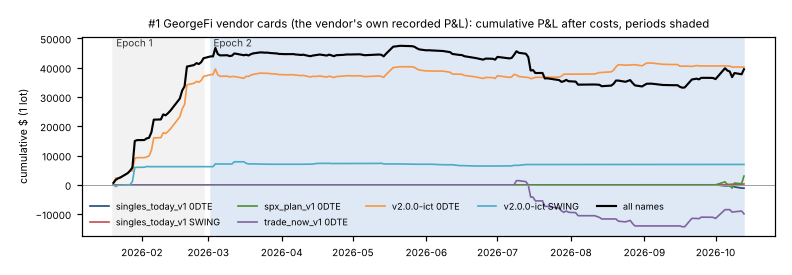

**Amendments, deviations and integrity checks.** pnl_reported is used as recorded; 24 cards carry a data_error flag and are kept, as the vendor kept them.

**What it showed.** The vendor's record is positive in Epoch 1 and near zero in Epoch 2; the same rows re-priced at the market's quotes are a loss in Epoch 2 (#4).

## #2 George rebuild: the GeorgeFi-like reference (sweep / ict+gex / all / none / ladder)

**Folder:** `backtest/, BACKTEST_RESULTS.md (@7dfea57)`. **Commits:** — / — / 8f5b067. **Dates:** 2026-10-13.

**Hypothesis.** A level-sweep reversal into the nearest-strike 0DTE contract, managed by GeorgeFi's ladder, makes money after costs.

**Rule.** Levels PDH/PDL, PWH/PWL, PMH/PML, ORH/ORL and the prior-day call/put walls; a sweep within the last 3 bars closed back inside by max(0.25 ATR14, 0.02%) → buy the nearest-strike 0DTE call (low swept) or put (high swept) at the next bar's VWAP; ladder exit: stop −25%, T1 +25% half, T2 +45%, breakeven lock at +6%, trail at 65% of the high-water mark from +15%, 30-minute time stop, flat 15:55.

**Fills and costs.** The "spread" model: a half-spread of 1% (SPY, QQQ) or 2% (IWM) of premium each side plus $0.70 a contract each side; one contract. (Unusual Whales 1-minute bars, no NBBO.)

**Data.** SPY, QQQ, IWM 0DTE, 345 sessions 2025-06-02 → 2026-10-09 (SPX excluded: no index bars on the plan).

**Periods and holdouts.** In-sample < 2026-03-02, out-of-sample 2026-03-02 → 2026-10-09 (read). No holdout.

**Pass rule (as pre-registered).** None pre-registered (an exploratory grid of 144 variants).

**Verdict.** Rejected: 0 of 144 variants positive after costs (registry H1).

**Metrics** (return = % of premium; win = P&L > 0 after fees; breakeven is a loss; the interval is audit_lib's 20-session moving-block bootstrap over the period's calendar sessions):

| name | period | trades | sessions (traded / span) | win % | avg win %, $ | avg loss %, $ | median %, $ | mean %, $ | 20-session block 95% (%; $) |
|------------------|------------------------------|---------------|---------------------|------------|------------------------|------------------------|------------------------|------------------------|------------------------------------------------|
| IWM | in-sample 2025-06→2026-02 | 504 | 175 / 192 | 35.1 | +11.7, +7.50 | −18.7, −11.21 | −6.2, −3.60 | **−8.06**, −4.64 | [−9.87, −6.89]; [−5.99, −3.78] |
| QQQ | in-sample 2025-06→2026-02 | 526 | 165 / 192 | 35.0 | +14.3, +18.93 | −12.8, −16.36 | −3.1, −3.44 | **−3.32**, −4.02 | [−4.73, −2.65]; [−5.98, −2.72] |
| SPY | in-sample 2025-06→2026-02 | 550 | 172 / 192 | 37.6 | +13.6, +16.40 | −12.7, −14.62 | −3.0, −3.21 | **−2.79**, −2.95 | [−4.25, −1.51]; [−4.84, −1.36] |
| all names | in-sample 2025-06→2026-02 | 1,580 | 184 / 192 | 35.9 | +13.2, +14.45 | −14.7, −14.11 | −3.3, −3.40 | **−4.65**, −3.84 | [−5.64, −4.20]; [−4.95, −3.16] |
| IWM | out-of-sample 2026-03→10 | 483 | 143 / 160 | 41.6 | +11.2, +8.79 | −17.1, −11.13 | −5.6, −3.16 | **−5.30**, −2.84 | [−7.54, −3.82]; [−4.49, −1.88] |
| QQQ | out-of-sample 2026-03→10 | 461 | 142 / 160 | 36.9 | +13.6, +25.28 | −11.5, −18.63 | −2.7, −4.00 | **−2.21**, −2.44 | [−4.23, −0.59]; [−4.68, −0.12] |
| SPY | out-of-sample 2026-03→10 | 455 | 144 / 160 | 32.7 | +13.9, +20.02 | −12.6, −15.26 | −3.1, −3.70 | **−3.94**, −3.71 | [−4.92, −3.04]; [−4.74, −2.58] |
| all names | out-of-sample 2026-03→10 | 1,399 | 155 / 160 | 37.2 | +12.8, +17.40 | −13.7, −15.05 | −3.0, −3.68 | **−3.84**, −2.99 | [−5.02, −3.01]; [−3.83, −2.31] |

| name | period | biggest win ($, %, date, contract) | biggest loss ($, %, date, contract) | profit factor | max DD $ | longest DD (sessions) | top-5 days' share of profit |
|------------------|------------------------------|------------------------------------------------------------------|------------------------------------------------------------------|------------|---------------|---------------|------------------------------------|
| IWM | in-sample 2025-06→2026-02 | +27.99, +28.9%, 2026-01-14, IWM260114C00260000 | −62.96, −29.1%, 2025-09-17, IWM250917P00240000 | 0.36 | 2,350 | 192 | total ≤ 0 (best 5 days +173; without them −2,510) |
| QQQ | in-sample 2025-06→2026-02 | +100.79, +32.2%, 2025-11-20, QQQ251120P00600000 | −104.39, −27.1%, 2025-11-20, QQQ251120C00593000 | 0.62 | 2,263 | 177 | total ≤ 0 (best 5 days +432; without them −2,544) |
| SPY | in-sample 2025-06→2026-02 | +89.69, +32.1%, 2025-10-17, SPY251017C00658000 | −84.59, −27.2%, 2025-11-20, SPY251120C00660000 | 0.68 | 1,700 | 180 | total ≤ 0 (best 5 days +340; without them −1,961) |
| all names | in-sample 2025-06→2026-02 | +100.79, +32.2%, 2025-11-20, QQQ251120P00600000 | −104.39, −27.1%, 2025-11-20, QQQ251120C00593000 | 0.57 | 6,127 | 185 | total ≤ 0 (best 5 days +513; without them −6,584) |
| IWM | out-of-sample 2026-03→10 | +49.81, +29.5%, 2026-03-11, IWM260311C00251000 | −44.72, −29.4%, 2026-06-11, IWM260611P00289000 | 0.56 | 1,437 | 151 | total ≤ 0 (best 5 days +223; without them −1,595) |
| QQQ | out-of-sample 2026-03→10 | +141.28, +32.3%, 2026-06-26, QQQ260626C00705000 | −127.93, −27.0%, 2026-06-25, QQQ260625C00711000 | 0.79 | 1,213 | 159 | total ≤ 0 (best 5 days +676; without them −1,801) |
| SPY | out-of-sample 2026-03→10 | +104.71, +32.2%, 2026-06-25, SPY260625C00730000 | −81.11, −27.2%, 2026-04-02, SPY260402P00655000 | 0.64 | 1,720 | 160 | total ≤ 0 (best 5 days +299; without them −1,985) |
| all names | out-of-sample 2026-03→10 | +141.28, +32.3%, 2026-06-26, QQQ260626C00705000 | −127.93, −27.0%, 2026-06-25, QQQ260625C00711000 | 0.68 | 4,276 | 159 | total ≤ 0 (best 5 days +634; without them −4,817) |

**Random baseline:** random-time entries, same contract choice and ladder (9,896 trades): −$3.20 a trade [−3.70, −2.70] under the spread model; the reference is −$3.44 [−4.23, −2.70]. No percentile was computed.

**Exit reasons (share of trades):**

- in-sample 2025-06→2026-02: BREAKEVEN 36.8%; STOP 26.1%; TRAIL 22.0%; T1+TRAIL 9.9%; T1+T2 4.2%; TIME_STOP 0.9%
- out-of-sample 2026-03→10: BREAKEVEN 38.5%; STOP 23.7%; TRAIL 23.6%; T1+TRAIL 10.4%; T1+T2 3.4%; TIME_STOP 0.6%

**By year** (all periods together, labelled by entry year):

| year | name | trades | win % | mean % | mean $ | total $ |
|---|---|---|---|---|---|---|
| 2025 | IWM | 399 | 34.1 | −8.71 | −4.98 | −1,988 |
| 2026 | IWM | 588 | 41.2 | −5.36 | −2.93 | −1,722 |
| 2025 | QQQ | 425 | 35.5 | −3.40 | −3.62 | −1,537 |
| 2026 | QQQ | 562 | 36.1 | −2.34 | −3.02 | −1,700 |
| 2025 | SPY | 444 | 38.3 | −2.29 | −2.22 | −986 |
| 2026 | SPY | 561 | 33.2 | −4.11 | −4.14 | −2,321 |
| 2025 | all names | 1,268 | 36.0 | −4.68 | −3.56 | −4,511 |
| 2026 | all names | 1,711 | 36.9 | −3.96 | −3.36 | −5,743 |

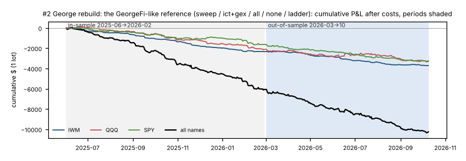

**Amendments, deviations and integrity checks.** Reproduced byte for byte by the phase 1 audit (#3): trades.csv sha256 0e8c41c819e74eb0… on both runs.

**What it showed.** The reference variant loses $3.44 a trade, no better than random entry times with the same exits.

## #2b George rebuild: the best of 144 variants (sweep / ict+gex / morning / posgamma_fade / trail)

**Folder:** `backtest/ (@7dfea57)`. **Commits:** — / — / 8f5b067. **Dates:** 2026-10-13.

**Hypothesis.** The best-ranked of the 144 variants (selected in sample) holds out of sample.

**Rule.** As #2 but 10:00–12:00 only, sweep reversals only when spot is above the prior-day gamma flip, and the trail engine (no profit targets).

**Fills and costs.** As #2 (spread model).

**Data.** As #2.

**Periods and holdouts.** As #2.

**Pass rule (as pre-registered).** None pre-registered.

**Verdict.** Rejected: −$2.41 a trade [−4.10, −0.47]; out of sample −$1.8 [−4.5, +0.9].

**Metrics** (return = % of premium; win = P&L > 0 after fees; breakeven is a loss; the interval is audit_lib's 20-session moving-block bootstrap over the period's calendar sessions):

| name | period | trades | sessions (traded / span) | win % | avg win %, $ | avg loss %, $ | median %, $ | mean %, $ | 20-session block 95% (%; $) |
|------------------|------------------------------|---------------|---------------------|------------|------------------------|------------------------|------------------------|------------------------|------------------------------------------------|
| IWM | in-sample 2025-06→2026-02 | 134 | 91 / 187 | 29.9 | +12.6, +8.43 | −16.1, −11.12 | −6.1, −4.06 | **−7.51**, −5.29 | [−10.05, −5.20]; [−6.90, −3.75] |
| QQQ | in-sample 2025-06→2026-02 | 161 | 98 / 189 | 32.3 | +16.5, +25.71 | −12.4, −16.02 | −3.1, −3.64 | **−3.11**, −2.54 | [−7.01, −0.26]; [−7.17, +2.10] |
| SPY | in-sample 2025-06→2026-02 | 154 | 96 / 186 | 36.4 | +16.8, +23.80 | −12.6, −15.68 | −3.1, −3.46 | **−1.91**, −1.33 | [−4.22, +0.67]; [−4.90, +3.61] |
| all names | in-sample 2025-06→2026-02 | 449 | 145 / 191 | 33.0 | +15.6, +20.32 | −13.6, −14.38 | −3.3, −3.60 | **−4.01**, −2.94 | [−5.87, −2.66]; [−5.23, −0.81] |
| IWM | out-of-sample 2026-03→10 | 131 | 79 / 160 | 39.7 | +10.4, +9.25 | −17.4, −14.23 | −5.7, −3.92 | **−6.41**, −4.91 | [−8.92, −4.38]; [−6.62, −3.47] |
| QQQ | out-of-sample 2026-03→10 | 122 | 76 / 157 | 45.9 | +12.4, +28.48 | −10.2, −18.51 | −2.6, −4.07 | **+0.17**, +3.06 | [−1.94, +2.98]; [−1.14, +8.89] |
| SPY | out-of-sample 2026-03→10 | 132 | 76 / 160 | 35.6 | +14.0, +21.29 | −11.8, −16.66 | −2.9, −3.94 | **−2.65**, −3.15 | [−5.03, −0.65]; [−6.96, −0.25] |
| all names | out-of-sample 2026-03→10 | 385 | 116 / 160 | 40.3 | +12.2, +19.85 | −13.3, −16.36 | −2.8, −3.98 | **−3.04**, −1.78 | [−4.57, −1.42]; [−3.61, +0.21] |

| name | period | biggest win ($, %, date, contract) | biggest loss ($, %, date, contract) | profit factor | max DD $ | longest DD (sessions) | top-5 days' share of profit |
|------------------|------------------------------|------------------------------------------------------------------|------------------------------------------------------------------|------------|---------------|---------------|------------------------------------|
| IWM | in-sample 2025-06→2026-02 | +37.21, +53.2%, 2026-01-02, IWM260102P00248000 | −35.88, −29.7%, 2025-11-21, IWM251121P00231000 | 0.32 | 709 | 187 | total ≤ 0 (best 5 days +111; without them −819) |
| QQQ | in-sample 2025-06→2026-02 | +264.54, +84.5%, 2025-11-20, QQQ251120P00600000 | −88.87, −27.2%, 2025-11-21, QQQ251121C00588000 | 0.77 | 608 | 182 | total ≤ 0 (best 5 days +647; without them −1,056) |
| SPY | in-sample 2025-06→2026-02 | +199.58, +71.5%, 2025-10-17, SPY251017C00658000 | −83.26, −27.2%, 2025-11-21, SPY251121C00655000 | 0.87 | 329 | 84 | total ≤ 0 (best 5 days +468; without them −673) |
| all names | in-sample 2025-06→2026-02 | +264.54, +84.5%, 2025-11-20, QQQ251120P00600000 | −88.87, −27.2%, 2025-11-21, QQQ251121C00588000 | 0.69 | 1,485 | 185 | total ≤ 0 (best 5 days +774; without them −2,095) |
| IWM | out-of-sample 2026-03→10 | +45.99, +33.6%, 2026-03-25, IWM260325C00250000 | −43.58, −29.4%, 2026-06-25, IWM260625P00300000 | 0.43 | 665 | 140 | total ≤ 0 (best 5 days +136; without them −780) |
| QQQ | out-of-sample 2026-03→10 | +121.71, +29.8%, 2026-06-25, QQQ260625C00711000 | −103.32, −27.1%, 2026-06-29, QQQ260629C00712000 | 1.31 | 211 | 40 | 146% |
| SPY | out-of-sample 2026-03→10 | +76.74, +42.9%, 2026-04-06, SPY260406P00658000 | −81.11, −27.2%, 2026-04-02, SPY260402P00655000 | 0.71 | 517 | 143 | total ≤ 0 (best 5 days +242; without them −657) |
| all names | out-of-sample 2026-03→10 | +121.71, +29.8%, 2026-06-25, QQQ260625C00711000 | −103.32, −27.1%, 2026-06-29, QQQ260629C00712000 | 0.82 | 872 | 133 | total ≤ 0 (best 5 days +607; without them −1,293) |

**Random baseline:** random-time baseline −$3.20 a trade (as #2); the best variant beats it by about $0.8, inside its interval.

**Exit reasons (share of trades):**

- in-sample 2025-06→2026-02: BREAKEVEN 40.5%; TRAIL 33.0%; STOP 25.4%; TIME_STOP 1.1%
- out-of-sample 2026-03→10: TRAIL 40.3%; BREAKEVEN 36.9%; STOP 22.3%; TIME_STOP 0.5%

**By year** (all periods together, labelled by entry year):

| year | name | trades | win % | mean % | mean $ | total $ |
|---|---|---|---|---|---|---|
| 2025 | IWM | 98 | 30.6 | −8.38 | −5.84 | −572 |
| 2026 | IWM | 167 | 37.1 | −6.13 | −4.67 | −780 |
| 2025 | QQQ | 136 | 30.9 | −2.85 | −1.86 | −252 |
| 2026 | QQQ | 147 | 44.9 | −0.62 | +1.48 | +217 |
| 2025 | SPY | 124 | 37.1 | −1.39 | +0.03 | +4 |
| 2026 | SPY | 162 | 35.2 | −2.92 | −3.85 | −624 |
| 2025 | all names | 358 | 33.0 | −3.86 | −2.29 | −820 |
| 2026 | all names | 476 | 38.9 | −3.34 | −2.49 | −1,187 |

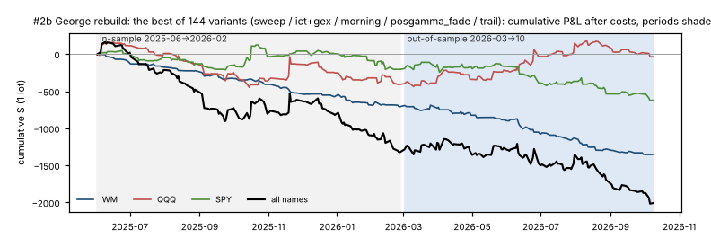

**Amendments, deviations and integrity checks.** Selected as the best of 144 on the full sample (a selection effect the numbers include).

**What it showed.** Even the best of 144 variants loses after costs.

## #3 George engine audit: the phase 1 reproduction audit of #1–#2

**Folder:** `audit/phase1/ (@7dfea57)`. **Commits:** — / — / 5ed66df (+ e95177c deterministic T5 rerun). **Dates:** 2026-10-13.

**Hypothesis.** The rebuild (#2) and the GeorgeFi validation tests T1–T7 reproduce from their artifacts.

**Rule.** Rerun of backtest/run.py and the validation scripts; byte comparison of outputs.

**Fills and costs.** —

**Data.** As #2.

**Periods and holdouts.** —

**Pass rule (as pre-registered).** Reproduction (no trading rule).

**Verdict.** Reproduced: the regenerated trades and baseline files are byte-identical once decompressed.

**Metrics.** not available — the audit produced no trades of its own; its trade files are #2's, byte for byte (see #2).

**Amendments, deviations and integrity checks.** Fixes the audit motivated were added, never overwritten (trading-days path, signals.json, deterministic T5 iteration).

**What it showed.** The rebuild is deterministic and reproducible; no new strategy was tested.

## #4 GeorgeFi's own trades re-priced at the NBBO (G1)

**Folder:** `research/georgefi_full_history/results/F_nbbo_\*.csv (@7dfea57)`. **Commits:** — / — / c27ff28. **Dates:** 2026-10-13.

**Hypothesis.** The vendor's recorded trades were executable at the prices it recorded.

**Rule.** Each card's own entry and exit second, filled at ThetaData's NBBO (ask in, bid out), the card's own size.

**Fills and costs.** NBBO at the reported second; no fee added.

**Data.** 1,220 cards with both sides quoted, 2026-01-20 → 2026-10-13, every root the vendor traded.

**Periods and holdouts.** ledger Epoch 1, ledger Epoch 2, paper book. Descriptive.

**Pass rule (as pre-registered).** None (an execution check).

**Verdict.** Not supported after execution: Epoch 1 +$22.2 a trade [day CI −11.2, +66.2], Epoch 2 −$42.1 [−78.8, −9.6], paper −$73.9 (registry G1); 58% of Epoch 1 rows filled better than the market.

**Metrics** (return = % of premium; win = P&L > 0 after fees; breakeven is a loss; the interval is audit_lib's 20-session moving-block bootstrap over the period's calendar sessions):

| name | period | trades | sessions (traded / span) | win % | avg win %, $ | avg loss %, $ | median %, $ | mean %, $ | 20-session block 95% (%; $) |
|------------------|------------------------------|---------------|---------------------|------------|------------------------|------------------------|------------------------|------------------------|------------------------------------------------|
| all roots | ledger E1 | 492 | 27 / 29 | 64.4 | +15.2, +117.84 | −23.1, −144.69 | +6.7, +20.10 | **+1.55**, +24.46 | n/a (< 60 sessions); n/a (< 60 sessions) |
| all roots | ledger E2 | 594 | 132 / 162 | 45.1 | +26.4, +156.24 | −26.3, −205.09 | −2.8, −7.90 | **−2.54**, −42.07 | [−6.22, +2.54]; [−121.60, −8.30] |
| all roots | paper book | 84 | 38 / 61 | 36.9 | +36.3, +132.66 | −31.7, −194.74 | −26.4, −77.80 | **−6.58**, −73.92 | [−12.81, −0.49]; [−96.33, −55.14] |

| name | period | biggest win ($, %, date, contract) | biggest loss ($, %, date, contract) | profit factor | max DD $ | longest DD (sessions) | top-5 days' share of profit |
|------------------|------------------------------|------------------------------------------------------------------|------------------------------------------------------------------|------------|---------------|---------------|------------------------------------|
| all roots | ledger E1 | +1,988.80, +38.2%, 2026-02-20, SPXW PUT y3bxx2s50sc0nh8 | −1,660.00, −88.5%, 2026-02-18, SPXW PUT 2k5f36h32m9rqf7 | 1.48 | 5,114 | 12 | 118% |
| all roots | ledger E2 | +3,018.60, +392.0%, 2026-09-21, SPXW CALL dni7it4jw9zjisg | −3,462.40, −61.8%, 2026-07-13, SPXW CALL vkmuy6n1j94hoee | 0.63 | 31,551 | 159 | total ≤ 0 (best 5 days +10,353; without them −35,340) |
| all roots | paper book | +598.60, +89.3%, 2026-10-01, SPXW PUT 4oduouxg1tp6xd2 | −462.80, −36.2%, 2026-08-06, SPXW PUT qoxj9ry0ux3n0cz | 0.40 | 6,665 | 61 | total ≤ 0 (best 5 days +1,532; without them −7,741) |

**Random baseline:** not available — no random baseline was computed by this study

**Exit reasons (share of trades):**

- ledger E1: vendor exit time, filled at the NBBO 100.0%
- ledger E2: vendor exit time, filled at the NBBO 100.0%
- paper book: vendor exit time, filled at the NBBO 100.0%

**By year** (all periods together, labelled by entry year):

| year | name | trades | win % | mean % | mean $ | total $ |
|---|---|---|---|---|---|---|
| 2026 | all roots | 1,170 | 52.6 | −1.11 | −16.38 | −19,161 |

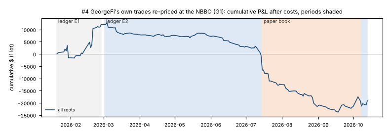

**Amendments, deviations and integrity checks.** Cards with a side unquoted, and the stock rows, are left out (as F_nbbo_trades.csv flags them).

**What it showed.** At the market's own quotes the vendor's live epoch loses $42 a trade.

## #4b GeorgeFi entries with the trail engine (reconstruction C, G2)

**Folder:** `research/georgefi_full_history/results/C_trades.csv (@7dfea57)`. **Commits:** — / — / 5ed66df. **Dates:** 2026-10-13.

**Hypothesis.** GeorgeFi's entry minutes carry timing information when managed by a fixed trail engine.

**Rule.** The vendor's entry minute, the reconstructed contract, entry at the bar VWAP, the paper-lane trail engine.

**Fills and costs.** Spread model of #2 (half-spread + $0.70 a side).

**Data.** 972 reconstructed trades, 2026-01 → 2026-10.

**Periods and holdouts.** ledger Epoch 1 / Epoch 2 / paper.

**Pass rule (as pre-registered).** None (descriptive).

**Verdict.** No robust entry timing: Epoch 1 +$5.8 a contract [−5.7, +16.3], Epoch 2 +$2.3 [−10.5, +14.9]; MFE percentile against time-matched random minutes 53 and 48 (G2).

**Metrics** (return = % of premium; win = P&L > 0 after fees; breakeven is a loss; the interval is audit_lib's 20-session moving-block bootstrap over the period's calendar sessions):

| name | period | trades | sessions (traded / span) | win % | avg win %, $ | avg loss %, $ | median %, $ | mean %, $ | 20-session block 95% (%; $) |
|------------------|------------------------------|---------------|---------------------|------------|------------------------|------------------------|------------------------|------------------------|------------------------------------------------|
| AAPL | ledger E1 | 1 | 1 / 1 | 100.0 | +6.5, +1.38 | —, — | +6.5, +1.38 | **+6.49**, +1.38 | n/a (< 60 sessions); n/a (< 60 sessions) |
| COIN | ledger E1 | 5 | 2 / 6 | 40.0 | +10.7, +5.12 | −27.9, −46.34 | −27.9, −28.76 | **−12.50**, −25.75 | n/a (< 60 sessions); n/a (< 60 sessions) |
| CRCL | ledger E1 | 12 | 1 / 1 | 0.0 | —, — | −27.9, −47.57 | −27.9, −47.57 | **−27.94**, −47.57 | n/a (< 60 sessions); n/a (< 60 sessions) |
| CRM | ledger E1 | 1 | 1 / 1 | 100.0 | +62.4, +49.54 | —, — | +62.4, +49.54 | **+62.43**, +49.54 | n/a (< 60 sessions); n/a (< 60 sessions) |
| CRML | ledger E1 | 14 | 1 / 1 | 78.6 | +14.8, +1.62 | −27.9, −8.72 | +14.8, +1.62 | **+5.65**, −0.59 | n/a (< 60 sessions); n/a (< 60 sessions) |
| CVNA | ledger E1 | 1 | 1 / 1 | 0.0 | —, — | −27.9, −205.75 | −27.9, −205.75 | **−27.94**, −205.75 | n/a (< 60 sessions); n/a (< 60 sessions) |
| GOOGL | ledger E1 | 3 | 1 / 1 | 0.0 | —, — | −27.9, −21.64 | −27.9, −21.64 | **−27.94**, −21.64 | n/a (< 60 sessions); n/a (< 60 sessions) |
| HOOD | ledger E1 | 3 | 1 / 1 | 66.7 | +11.5, +6.67 | −27.9, −42.15 | +11.5, +6.67 | **−1.67**, −9.61 | n/a (< 60 sessions); n/a (< 60 sessions) |
| IWM | ledger E1 | 65 | 15 / 28 | 64.6 | +26.2, +56.03 | −9.1, −15.44 | +7.1, +11.06 | **+13.74**, +30.74 | n/a (< 60 sessions); n/a (< 60 sessions) |
| NVDA | ledger E1 | 14 | 2 / 3 | 57.1 | +28.7, +24.94 | −3.9, −5.48 | +28.7, +24.94 | **+14.71**, +11.90 | n/a (< 60 sessions); n/a (< 60 sessions) |
| OKLO | ledger E1 | 1 | 1 / 1 | 0.0 | —, — | −27.9, −50.70 | −27.9, −50.70 | **−27.94**, −50.70 | n/a (< 60 sessions); n/a (< 60 sessions) |
| QQQ | ledger E1 | 63 | 11 / 29 | 30.2 | +13.2, +23.46 | −6.5, −16.15 | −2.0, −5.22 | **−0.60**, −4.21 | n/a (< 60 sessions); n/a (< 60 sessions) |
| RDDT | ledger E1 | 2 | 1 / 1 | 50.0 | +55.6, +83.69 | −27.9, −38.16 | +13.8, +22.76 | **+13.84**, +22.76 | n/a (< 60 sessions); n/a (< 60 sessions) |
| RKLB | ledger E1 | 28 | 2 / 6 | 64.3 | +20.0, +18.09 | −3.9, −6.92 | +6.2, +8.33 | **+11.45**, +9.16 | n/a (< 60 sessions); n/a (< 60 sessions) |
| RUTW | ledger E1 | 8 | 1 / 1 | 87.5 | +8.3, +21.82 | −3.0, −8.00 | +8.2, +20.99 | **+6.86**, +18.09 | n/a (< 60 sessions); n/a (< 60 sessions) |
| SLV | ledger E1 | 3 | 1 / 1 | 0.0 | —, — | −3.9, −6.96 | −3.9, −6.96 | **−3.92**, −6.96 | n/a (< 60 sessions); n/a (< 60 sessions) |
| SPXW | ledger E1 | 59 | 11 / 25 | 55.9 | +11.3, +140.45 | −14.4, −150.45 | +6.5, +6.48 | **−0.02**, +12.25 | n/a (< 60 sessions); n/a (< 60 sessions) |
| SPY | ledger E1 | 89 | 16 / 24 | 42.7 | +13.7, +33.69 | −8.0, −22.63 | −2.0, −4.08 | **+1.29**, +1.41 | n/a (< 60 sessions); n/a (< 60 sessions) |
| all names | ledger E1 | 372 | 25 / 29 | 49.2 | +17.6, +52.28 | −10.9, −39.16 | −2.0, −2.72 | **+3.15**, +5.83 | n/a (< 60 sessions); n/a (< 60 sessions) |
| AAPL | ledger E2 | 2 | 2 / 8 | 50.0 | +5.7, +4.28 | −3.9, −5.04 | +0.9, −0.38 | **+0.91**, −0.38 | n/a (< 60 sessions); n/a (< 60 sessions) |
| AMD | ledger E2 | 1 | 1 / 1 | 0.0 | —, — | −27.9, −37.02 | −27.9, −37.02 | **−27.94**, −37.02 | n/a (< 60 sessions); n/a (< 60 sessions) |
| AMZN | ledger E2 | 6 | 5 / 42 | 16.7 | +15.7, +9.81 | −8.7, −11.14 | −3.9, −6.88 | **−4.65**, −7.65 | n/a (< 60 sessions); n/a (< 60 sessions) |
| AVGO | ledger E2 | 5 | 5 / 152 | 40.0 | +7.4, +13.37 | −19.9, −14.65 | −3.9, −3.52 | **−9.00**, −3.44 | [−12.65, +5.61]; [−8.54, +16.97] |
| BAC | ledger E2 | 1 | 1 / 1 | 0.0 | —, — | −27.9, −4.54 | −27.9, −4.54 | **−27.94**, −4.54 | n/a (< 60 sessions); n/a (< 60 sessions) |
| COIN | ledger E2 | 1 | 1 / 1 | 100.0 | +7.9, +21.60 | —, — | +7.9, +21.60 | **+7.91**, +21.60 | n/a (< 60 sessions); n/a (< 60 sessions) |
| GLD | ledger E2 | 17 | 12 / 150 | 47.1 | +29.3, +35.65 | −11.9, −21.32 | −3.9, −2.28 | **+7.49**, +5.49 | [+0.00, +32.98]; [−2.26, +35.60] |
| GOOGL | ledger E2 | 10 | 8 / 142 | 20.0 | +13.8, +13.85 | −10.5, −12.76 | −3.9, −6.88 | **−5.62**, −7.44 | [−8.57, +8.89]; [−11.85, +8.27] |
| HOOD | ledger E2 | 1 | 1 / 1 | 0.0 | —, — | −27.9, −9.95 | −27.9, −9.95 | **−27.94**, −9.95 | n/a (< 60 sessions); n/a (< 60 sessions) |
| IBIT | ledger E2 | 2 | 2 / 6 | 0.0 | —, — | −7.9, −4.73 | −7.9, −4.73 | **−7.92**, −4.73 | n/a (< 60 sessions); n/a (< 60 sessions) |
| IWM | ledger E2 | 19 | 10 / 68 | 36.8 | +12.7, +29.26 | −13.9, −30.69 | −3.9, −7.44 | **−4.12**, −8.60 | [−8.20, +13.22]; [−17.07, +28.02] |
| META | ledger E2 | 17 | 6 / 39 | 35.3 | +6.7, +14.51 | −10.5, −24.59 | −3.9, −17.12 | **−4.40**, −10.79 | n/a (< 60 sessions); n/a (< 60 sessions) |
| MSFT | ledger E2 | 1 | 1 / 1 | 100.0 | +9.5, +37.38 | —, — | +9.5, +37.38 | **+9.51**, +37.38 | n/a (< 60 sessions); n/a (< 60 sessions) |
| MU | ledger E2 | 4 | 2 / 3 | 50.0 | +16.6, +30.31 | −15.9, −24.27 | +3.2, +10.43 | **+0.31**, +3.02 | n/a (< 60 sessions); n/a (< 60 sessions) |
| NDXP | ledger E2 | 16 | 14 / 44 | 56.2 | +49.0, +445.57 | −23.8, −230.46 | +15.9, +98.25 | **+17.18**, +149.80 | n/a (< 60 sessions); n/a (< 60 sessions) |
| QQQ | ledger E2 | 103 | 56 / 158 | 36.9 | +15.6, +28.47 | −12.4, −23.47 | −2.0, −4.08 | **−2.11**, −4.31 | [−5.66, +2.78]; [−11.15, +5.33] |
| RUTW | ledger E2 | 23 | 17 / 77 | 56.5 | +25.2, +157.01 | −15.1, −91.68 | +9.1, +53.44 | **+7.67**, +48.88 | [−1.20, +14.07]; [+5.86, +67.82] |
| SLV | ledger E2 | 3 | 3 / 29 | 66.7 | +15.0, +5.40 | −3.9, −2.52 | +10.7, +3.73 | **+8.70**, +2.76 | n/a (< 60 sessions); n/a (< 60 sessions) |
| SMCI | ledger E2 | 1 | 1 / 1 | 0.0 | —, — | −27.9, −18.78 | −27.9, −18.78 | **−27.94**, −18.78 | n/a (< 60 sessions); n/a (< 60 sessions) |
| SMH | ledger E2 | 1 | 1 / 1 | 0.0 | —, — | −3.9, −5.80 | −3.9, −5.80 | **−3.92**, −5.80 | n/a (< 60 sessions); n/a (< 60 sessions) |
| SPXW | ledger E2 | 206 | 90 / 160 | 40.3 | +20.1, +124.82 | −11.8, −90.46 | −3.0, −12.41 | **+1.03**, −3.72 | [−1.75, +4.20]; [−23.91, +9.77] |
| SPY | ledger E2 | 65 | 31 / 158 | 29.2 | +10.3, +20.36 | −10.0, −24.76 | −2.0, −4.72 | **−4.05**, −11.57 | [−5.86, −1.98]; [−14.63, −4.11] |
| TSLA | ledger E2 | 8 | 6 / 126 | 62.5 | +5.7, +6.64 | −3.9, −11.07 | +5.5, +2.69 | **+2.11**, +0.00 | [−3.92, +1.72]; [−12.08, +0.00] |
| UBER | ledger E2 | 1 | 1 / 1 | 0.0 | —, — | −27.9, −7.67 | −27.9, −7.67 | **−27.94**, −7.67 | n/a (< 60 sessions); n/a (< 60 sessions) |
| UCO | ledger E2 | 1 | 1 / 1 | 0.0 | —, — | −27.9, −20.49 | −27.9, −20.49 | **−27.94**, −20.49 | n/a (< 60 sessions); n/a (< 60 sessions) |
| USO | ledger E2 | 1 | 1 / 1 | 100.0 | +27.5, +39.30 | —, — | +27.5, +39.30 | **+27.52**, +39.30 | n/a (< 60 sessions); n/a (< 60 sessions) |
| all names | ledger E2 | 516 | 131 / 162 | 39.0 | +18.8, +93.18 | −12.2, −55.73 | −2.0, −4.98 | **−0.13**, +2.27 | [−2.08, +3.55]; [−9.81, +20.03] |

| name | period | biggest win ($, %, date, contract) | biggest loss ($, %, date, contract) | profit factor | max DD $ | longest DD (sessions) | top-5 days' share of profit |
|------------------|------------------------------|------------------------------------------------------------------|------------------------------------------------------------------|------------|---------------|---------------|------------------------------------|
| AAPL | ledger E1 | +1.38, +6.5%, 2026-02-06, AAPL PUT 955xs5861je0sz7 | +1.38, +6.5%, 2026-02-06, AAPL PUT 955xs5861je0sz7 | ∞ | 0 | 0 | 100% |
| COIN | ledger E1 | +5.12, +10.7%, 2026-01-23, COIN PUT j55nf3xhhgeu4hi | −81.49, −27.9%, 2026-01-30, COIN PUT 09x52w4963s144b | 0.07 | 129 | 6 | total ≤ 0 (best 5 days −129; without them +0) |
| CRCL | ledger E1 | −47.57, −27.9%, 2026-01-30, CRCL PUT 0g311hmh7608g99 | −47.57, −27.9%, 2026-01-30, CRCL PUT 0g311hmh7608g99 | 0.00 | 571 | 1 | total ≤ 0 (best 5 days −571; without them +0) |
| CRM | ledger E1 | +49.54, +62.4%, 2026-01-30, CRM PUT 78506oa5o61r701 | +49.54, +62.4%, 2026-01-30, CRM PUT 78506oa5o61r701 | ∞ | 0 | 0 | 100% |
| CRML | ledger E1 | +1.62, +14.8%, 2026-01-30, CRML PUT 163cd9t5w354tz2 | −11.09, −27.9%, 2026-01-30, CRML PUT btik9xf95i8b0pt | 0.68 | 8 | 1 | total ≤ 0 (best 5 days −8; without them +0) |
| CVNA | ledger E1 | −205.75, −27.9%, 2026-01-30, CVNA PUT 3gris210t7m2b5w | −205.75, −27.9%, 2026-01-30, CVNA PUT 3gris210t7m2b5w | 0.00 | 206 | 1 | total ≤ 0 (best 5 days −206; without them +0) |
| GOOGL | ledger E1 | −21.64, −27.9%, 2026-01-30, GOOGL PUT 3afgh5f7vn4ui47 | −21.64, −27.9%, 2026-01-30, GOOGL PUT 3afgh5f7vn4ui47 | 0.00 | 65 | 1 | total ≤ 0 (best 5 days −65; without them +0) |
| HOOD | ledger E1 | +6.67, +11.5%, 2026-01-30, HOOD PUT 2co12g52z4bgs33 | −42.15, −27.9%, 2026-01-30, HOOD PUT 774ne079d7stl33 | 0.32 | 29 | 1 | total ≤ 0 (best 5 days −29; without them +0) |
| IWM | ledger E1 | +369.33, +163.0%, 2026-02-12, IWM PUT 3591zk0339o8xj8 | −80.06, −27.9%, 2026-02-13, IWM PUT 960e22lsdv24ai6 | 6.63 | 183 | 11 | 112% |
| NVDA | ledger E1 | +24.94, +28.7%, 2026-02-06, NVDA CALL 10qr749120v26gj | −5.48, −3.9%, 2026-02-04, NVDA PUT 1848jkd063c3950 | 6.07 | 33 | 2 | 100% |
| OKLO | ledger E1 | −50.70, −27.9%, 2026-01-30, OKLO PUT 9xy7jas7kw9524i | −50.70, −27.9%, 2026-01-30, OKLO PUT 9xy7jas7kw9524i | 0.00 | 51 | 1 | total ≤ 0 (best 5 days −51; without them +0) |
| QQQ | ledger E1 | +42.32, +19.1%, 2026-02-20, QQQ CALL 72421cl1l5e521n | −121.77, −26.5%, 2026-02-18, QQQ CALL 402z467697wj3ie | 0.63 | 470 | 29 | total ≤ 0 (best 5 days +299; without them −564) |
| RDDT | ledger E1 | +83.69, +55.6%, 2026-01-30, RDDT PUT 5725tnis6i49604 | −38.16, −27.9%, 2026-01-30, RDDT PUT 485pwz3e339pbdj | 2.19 | 0 | 0 | 100% |
| RKLB | ledger E1 | +32.58, +37.0%, 2026-01-30, RKLB PUT 0gi7xw49q6uthdz | −6.92, −3.9%, 2026-01-30, RKLB PUT 02rl903c51x3m7l | 4.70 | 0 | 0 | 100% |
| RUTW | ledger E1 | +26.82, +8.2%, 2026-01-27, RUTW CALL 1891h5gtbs11ue7 | −8.00, −3.0%, 2026-01-27, RUTW CALL 592b74h07fy9i2j | 19.09 | 0 | 0 | 100% |
| SLV | ledger E1 | −6.96, −3.9%, 2026-02-06, SLV PUT ar9594rv59q1lpa | −6.96, −3.9%, 2026-02-06, SLV PUT ar9594rv59q1lpa | 0.00 | 21 | 1 | total ≤ 0 (best 5 days −21; without them +0) |
| SPXW | ledger E1 | +640.20, +21.7%, 2026-02-17, SPXW PUT 0vsr61tk6e355f0 | −853.91, −27.2%, 2026-02-19, SPXW PUT u3a2f8rxkb60t4x | 1.18 | 740 | 7 | 287% |
| SPY | ledger E1 | +158.38, +63.8%, 2026-02-24, SPY CALL 894j813el751a5q | −130.56, −17.9%, 2026-02-10, SPY CALL 9zf937w5328f71i | 1.11 | 459 | 17 | 620% |
| all names | ledger E1 | +640.20, +21.7%, 2026-02-17, SPXW PUT 0vsr61tk6e355f0 | −853.91, −27.2%, 2026-02-19, SPXW PUT u3a2f8rxkb60t4x | 1.29 | 814 | 9 | 173% |
| AAPL | ledger E2 | +4.28, +5.7%, 2026-03-18, AAPL PUT yco9879mvrod1qa | −5.04, −3.9%, 2026-03-27, AAPL PUT lf35l8q98xq5m4i | 0.85 | 5 | 1 | total ≤ 0 (best 5 days −1; without them +0) |
| AMD | ledger E2 | −37.02, −27.9%, 2026-10-09, AMD PUT i3b03ewpkryh99v | −37.02, −27.9%, 2026-10-09, AMD PUT i3b03ewpkryh99v | 0.00 | 37 | 1 | total ≤ 0 (best 5 days −37; without them +0) |
| AMZN | ledger E2 | +9.81, +15.7%, 2026-09-23, AMZN PUT t5exm42pv39sbea | −29.90, −27.9%, 2026-08-17, AMZN PUT 9jcbom24ks2h5nl | 0.18 | 46 | 42 | total ≤ 0 (best 5 days −46; without them +0) |
| AVGO | ledger E2 | +16.97, +5.6%, 2026-03-13, AVGO PUT rvd99u8867d6qku | −29.04, −27.9%, 2026-10-12, AVGO PUT ekylizkrfb48uzw | 0.61 | 40 | 2 | total ≤ 0 (best 5 days −17; without them +0) |
| BAC | ledger E2 | −4.54, −27.9%, 2026-10-09, BAC CALL x0z4k4fwb8gos4x | −4.54, −27.9%, 2026-10-09, BAC CALL x0z4k4fwb8gos4x | 0.00 | 5 | 1 | total ≤ 0 (best 5 days −5; without them +0) |
| COIN | ledger E2 | +21.60, +7.9%, 2026-10-09, COIN CALL 9oyzh2v0xe3d9bs | +21.60, +7.9%, 2026-10-09, COIN CALL 9oyzh2v0xe3d9bs | ∞ | 0 | 0 | 100% |
| GLD | ledger E2 | +141.62, +92.9%, 2026-09-14, GLD CALL kw39iz49kt101o8 | −78.64, −27.9%, 2026-03-18, GLD CALL 4hc062it0yxcvu4 | 1.49 | 79 | 128 | 277% |
| GOOGL | ledger E2 | +24.50, +21.7%, 2026-08-21, GOOGL CALL xk0nrxpvlxtv0rk | −43.01, −27.9%, 2026-03-27, GOOGL PUT i83o4578nx3v13m | 0.27 | 74 | 142 | total ≤ 0 (best 5 days −1; without them −74) |
| HOOD | ledger E2 | −9.95, −27.9%, 2026-10-09, HOOD CALL 5dewoq9m3lm21bz | −9.95, −27.9%, 2026-10-09, HOOD CALL 5dewoq9m3lm21bz | 0.00 | 10 | 1 | total ≤ 0 (best 5 days −10; without them +0) |
| IBIT | ledger E2 | −3.68, −3.9%, 2026-10-05, IBIT PUT mz572iaej6prqxd | −5.78, −11.9%, 2026-10-12, IBIT PUT ens8uikr9j4xd0u | 0.00 | 9 | 6 | total ≤ 0 (best 5 days −9; without them +0) |
| IWM | ledger E2 | +80.92, +27.0%, 2026-03-19, IWM CALL 1794163he39p5c3 | −80.34, −27.9%, 2026-03-09, IWM CALL 9417g6bc21he872 | 0.56 | 245 | 67 | total ≤ 0 (best 5 days +108; without them −271) |
| META | ledger E2 | +18.87, +10.2%, 2026-09-04, META CALL kmr87mdhotjnbzb | −68.38, −27.9%, 2026-09-16, META CALL u8myue00egjv6ch | 0.32 | 183 | 39 | total ≤ 0 (best 5 days −14; without them −170) |
| MSFT | ledger E2 | +37.38, +9.5%, 2026-03-27, MSFT PUT 8o6nv14p53b063h | +37.38, +9.5%, 2026-03-27, MSFT PUT 8o6nv14p53b063h | ∞ | 0 | 0 | 100% |
| MU | ledger E2 | +30.51, +10.4%, 2026-10-07, MU CALL z6ss0x4wo8gjj9g | −39.30, −27.9%, 2026-10-09, MU PUT cmzm0ywaiod9jxm | 1.25 | 39 | 1 | 100% |
| NDXP | ledger E2 | +1,753.39, +122.4%, 2026-07-06, NDXP PUT fugmhxmitbyc9jl | −589.81, −27.2%, 2026-06-12, NDXP PUT 744n57ni3vvbc5v | 2.49 | 780 | 23 | 142% |
| QQQ | ledger E2 | +150.16, +104.2%, 2026-05-11, QQQ PUT n65jjs8fech846i | −100.91, −26.5%, 2026-07-10, QQQ CALL g8rhxc7ftrxf8ox | 0.71 | 750 | 154 | total ≤ 0 (best 5 days +541; without them −985) |
| RUTW | ledger E2 | +355.75, +39.1%, 2026-07-13, RUTW PUT hh5gls5egcdlfbb | −301.13, −27.2%, 2026-07-28, RUTW PUT kekqioeqylgb4kl | 2.23 | 301 | 14 | 115% |
| SLV | ledger E2 | +7.07, +19.3%, 2026-09-11, SLV CALL m2eeuqdcs6jl3xr | −2.52, −3.9%, 2026-10-07, SLV CALL 2ti9rbrixeb0oze | 4.29 | 3 | 1 | 100% |
| SMCI | ledger E2 | −18.78, −27.9%, 2026-10-09, SMCI PUT u0lsesrgx6ikwsj | −18.78, −27.9%, 2026-10-09, SMCI PUT u0lsesrgx6ikwsj | 0.00 | 19 | 1 | total ≤ 0 (best 5 days −19; without them +0) |
| SMH | ledger E2 | −5.80, −3.9%, 2026-10-12, SMH PUT c4i07emq4fnytre | −5.80, −3.9%, 2026-10-12, SMH PUT c4i07emq4fnytre | 0.00 | 6 | 1 | total ≤ 0 (best 5 days −6; without them +0) |
| SPXW | ledger E2 | +824.13, +56.4%, 2026-09-29, SPXW CALL 4cwxg2xbhvss79h | −777.11, −27.2%, 2026-03-16, SPXW CALL r98xgo27bdx4g5f | 0.93 | 3,099 | 159 | total ≤ 0 (best 5 days +3,304; without them −4,070) |
| SPY | ledger E2 | +39.10, +20.6%, 2026-08-18, SPY PUT kgrcrt2va87cvcl | −158.15, −26.5%, 2026-03-27, SPY PUT 5zy0jk44ra6yh18 | 0.34 | 752 | 158 | total ≤ 0 (best 5 days +112; without them −864) |
| TSLA | ledger E2 | +16.54, +6.2%, 2026-09-04, TSLA PUT mpxpmm8qv0ehcv0 | −16.12, −3.9%, 2026-08-21, TSLA CALL v71km1xj03uovgs | 1.00 | 33 | 123 | 322500% |
| UBER | ledger E2 | −7.67, −27.9%, 2026-10-09, UBER CALL lk1w0emiuxfqtk7 | −7.67, −27.9%, 2026-10-09, UBER CALL lk1w0emiuxfqtk7 | 0.00 | 8 | 1 | total ≤ 0 (best 5 days −8; without them +0) |
| UCO | ledger E2 | −20.49, −27.9%, 2026-03-20, UCO CALL 0c63wm0dox7wy65 | −20.49, −27.9%, 2026-03-20, UCO CALL 0c63wm0dox7wy65 | 0.00 | 20 | 1 | total ≤ 0 (best 5 days −20; without them +0) |
| USO | ledger E2 | +39.30, +27.5%, 2026-03-20, USO CALL 4ug6m04x120lnp8 | +39.30, +27.5%, 2026-03-20, USO CALL 4ug6m04x120lnp8 | ∞ | 0 | 0 | 100% |
| all names | ledger E2 | +1,753.39, +122.4%, 2026-07-06, NDXP PUT fugmhxmitbyc9jl | −777.11, −27.2%, 2026-03-16, SPXW CALL r98xgo27bdx4g5f | 1.07 | 3,800 | 88 | 424% |

**Random baseline:** time-matched random minutes, trail engine: MFE percentile 53 [47.5, 59.2] (Epoch 1) and 48 (Epoch 2).

**Exit reasons (share of trades):**

- ledger E1: TRAIL 48.7%; BREAKEVEN 32.3%; STOP 16.4%; TIME_STOP 1.6%; CLOSE 1.1%
- ledger E2: TRAIL 39.0%; BREAKEVEN 37.0%; STOP 23.4%; TIME_STOP 0.6%

**By year** (all periods together, labelled by entry year):

| year | name | trades | win % | mean % | mean $ | total $ |
|---|---|---|---|---|---|---|
| 2026 | AAPL | 3 | 66.7 | +2.77 | +0.20 | +1 |
| 2026 | AMD | 1 | 0.0 | −27.94 | −37.02 | −37 |
| 2026 | AMZN | 6 | 16.7 | −4.65 | −7.65 | −46 |
| 2026 | AVGO | 5 | 40.0 | −9.00 | −3.44 | −17 |
| 2026 | BAC | 1 | 0.0 | −27.94 | −4.54 | −5 |
| 2026 | COIN | 6 | 50.0 | −9.10 | −17.86 | −107 |
| 2026 | CRCL | 12 | 0.0 | −27.94 | −47.57 | −571 |
| 2026 | CRM | 1 | 100.0 | +62.43 | +49.54 | +50 |
| 2026 | CRML | 14 | 78.6 | +5.65 | −0.59 | −8 |
| 2026 | CVNA | 1 | 0.0 | −27.94 | −205.75 | −206 |
| 2026 | GLD | 17 | 47.1 | +7.49 | +5.49 | +93 |
| 2026 | GOOGL | 13 | 15.4 | −10.77 | −10.71 | −139 |
| 2026 | HOOD | 4 | 50.0 | −8.24 | −9.69 | −39 |
| 2026 | IBIT | 2 | 0.0 | −7.92 | −4.73 | −9 |
| 2026 | IWM | 84 | 58.3 | +9.70 | +21.84 | +1,834 |
| 2026 | META | 17 | 35.3 | −4.40 | −10.79 | −183 |
| 2026 | MSFT | 1 | 100.0 | +9.51 | +37.38 | +37 |
| 2026 | MU | 4 | 50.0 | +0.31 | +3.02 | +12 |
| 2026 | NDXP | 16 | 56.2 | +17.18 | +149.80 | +2,397 |
| 2026 | NVDA | 14 | 57.1 | +14.71 | +11.90 | +167 |
| 2026 | OKLO | 1 | 0.0 | −27.94 | −50.70 | −51 |
| 2026 | QQQ | 166 | 34.3 | −1.53 | −4.27 | −709 |
| 2026 | RDDT | 2 | 50.0 | +13.84 | +22.76 | +46 |
| 2026 | RKLB | 28 | 64.3 | +11.45 | +9.16 | +256 |
| 2026 | RUTW | 31 | 64.5 | +7.46 | +40.94 | +1,269 |
| 2026 | SLV | 6 | 33.3 | +2.39 | −2.10 | −13 |
| 2026 | SMCI | 1 | 0.0 | −27.94 | −18.78 | −19 |
| 2026 | SMH | 1 | 0.0 | −3.92 | −5.80 | −6 |
| 2026 | SPXW | 265 | 43.8 | +0.79 | −0.16 | −44 |
| 2026 | SPY | 154 | 37.0 | −0.96 | −4.07 | −626 |
| 2026 | TSLA | 8 | 62.5 | +2.11 | +0.00 | +0 |
| 2026 | UBER | 1 | 0.0 | −27.94 | −7.67 | −8 |
| 2026 | UCO | 1 | 0.0 | −27.94 | −20.49 | −20 |
| 2026 | USO | 1 | 100.0 | +27.52 | +39.30 | +39 |
| 2026 | all names | 888 | 43.2 | +1.24 | +3.76 | +3,339 |

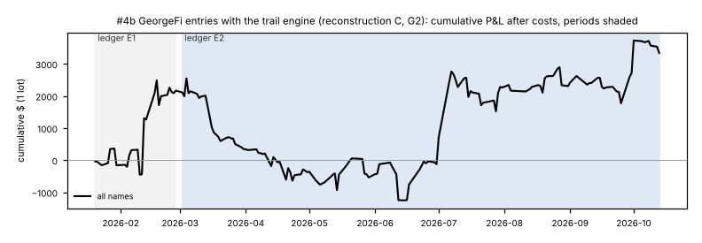

**Amendments, deviations and integrity checks.** —

**What it showed.** The entries are as good as random minutes once the exit is fixed.

## #5 Deep research round 1: flow rule F1 on SPY (H2 family)

**Folder:** `research/flow_predictors/ (@7dfea57); report "Finding a 0DTE options edge"`. **Commits:** — / — / 96a2c09…fb4205f, 5208c8f. **Dates:** 2026-10-13.

**Hypothesis.** Options-flow imbalances (net premium, net delta, market tide, dark pool) lead the underlying.

**Rule.** F1: the flow predictor's signal minute on SPY → buy the 0DTE contract in its direction, trail engine (as #4b).

**Fills and costs.** Spread model of #2 (1% half-spread + $0.70 a side), entry at the VWAP of the first option bar after the signal.

**Data.** SPY, Unusual Whales flow and bars 2025-07-01 → 2026-10-09; F1 = 15-minute net premium against its trailing-20-session 20th/80th percentiles, every 5 minutes 09:45–15:00, at most 2 a day.

**Periods and holdouts.** One span (descriptive test 5).

**Pass rule (as pre-registered).** Multiple-testing correction across 62 cells (exploratory).

**Verdict.** Rejected: 0 of 62 cells survive correction; forward ICs ≤ 0.02 (registry H2). The other round-1 notes (GEX regime and exit grid of 576 configurations, short-vol session T1–T5) kept results by configuration only; their verdicts: H4 rejected, H6 rejected, H7 0 of 576 exit configurations positive (White p = 1), H8 every option expression negative.

**Metrics** (return = % of premium; win = P&L > 0 after fees; breakeven is a loss; the interval is audit_lib's 20-session moving-block bootstrap over the period's calendar sessions):

| name | period | trades | sessions (traded / span) | win % | avg win %, $ | avg loss %, $ | median %, $ | mean %, $ | 20-session block 95% (%; $) |
|------------------|------------------------------|---------------|---------------------|------------|------------------------|------------------------|------------------------|------------------------|------------------------------------------------|
| SPY | 2025-07→2026-10 | 638 | 319 / 331 | 35.9 | +13.9, +21.94 | −13.2, −18.71 | −2.9, −3.90 | **−3.45**, −4.12 | [−4.53, −2.12]; [−5.77, −2.02] |

| name | period | biggest win ($, %, date, contract) | biggest loss ($, %, date, contract) | profit factor | max DD $ | longest DD (sessions) | top-5 days' share of profit |
|------------------|------------------------------|------------------------------------------------------------------|------------------------------------------------------------------|------------|---------------|---------------|------------------------------------|
| SPY | 2025-07→2026-10 | +175.91, +84.6%, 2025-12-18, SPY251218C00676000 | −83.79, −27.2%, 2026-07-29, SPY260729C00736000 | 0.66 | 2,631 | 331 | total ≤ 0 (best 5 days +634; without them −3,261) |

**Random baseline:** random minutes matched per day, random side, same exits and costs (574 trades): −$3.34 a trade, −2.26% (the rule −$4.12, −2.38%).

**Exit reasons (share of trades):**

- 2025-07→2026-10: BREAKEVEN 37.8%; TRAIL 35.9%; STOP 26.0%; TIME_STOP 0.3%

**By year** (all periods together, labelled by entry year):

| year | name | trades | win % | mean % | mean $ | total $ |
|---|---|---|---|---|---|---|
| 2025 | SPY | 250 | 36.4 | −4.04 | −3.75 | −938 |
| 2026 | SPY | 388 | 35.6 | −3.07 | −4.35 | −1,689 |

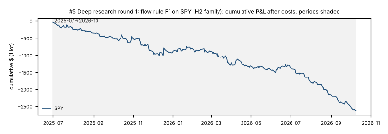

**Amendments, deviations and integrity checks.** —

**What it showed.** The one flow rule with a trade list loses after costs.

## #6a T-A: the 13:00 short ATM 0DTE straddle, SPY/QQQ/IWM, bought back 15:55 (H9)

**Folder:** `research/thetadata/straddle_nbbo/ (@7dfea57)`. **Commits:** — / gate v2 924aee9 / ebde6ae. **Dates:** 2026-10-13.

**Hypothesis.** Selling the 13:00 at-the-money straddle harvests intraday variance premium after measured costs.

**Rule.** Sell the same-day ATM straddle at the 13:00 bids, buy it back at the 15:55 asks.

**Fills and costs.** Measured ThetaData NBBO both ways (the round trip $12.93 a SPY/QQQ straddle); return as % of the credit received.

**Data.** SPY, QQQ, IWM 0DTE, 339 sessions each, 2025-06-02 → 2026-10-09.

**Periods and holdouts.** One span; no holdout ("previously analysed").

**Pass rule (as pre-registered).** Gate v2: a positive lower bound at measured NBBO (T-A).

**Verdict.** FAIL: +$8.60 a straddle [−6.07, +22.45] SPY/QQQ (n 678); IWM −$9.50 [−18.69, −0.44].

**Metrics** (return = % of the credit received; win = P&L > 0 after fees; breakeven is a loss; the interval is audit_lib's 20-session moving-block bootstrap over the period's calendar sessions):

| name | period | trades | sessions (traded / span) | win % | avg win %, $ | avg loss %, $ | median %, $ | mean %, $ | 20-session block 95% (%; $) |
|------------------|------------------------------|---------------|---------------------|------------|------------------------|------------------------|------------------------|------------------------|------------------------------------------------|
| IWM | 2025-06→2026-10 | 339 | 339 / 352 | 57.2 | +38.2, +41.81 | −72.0, −78.15 | +14.5, +12.20 | **−8.94**, −9.50 | [−16.30, −3.87]; [−19.66, −2.02] |
| QQQ | 2025-06→2026-10 | 339 | 339 / 352 | 65.2 | +38.6, +88.50 | −54.6, −134.05 | +19.6, +45.20 | **+6.15**, +11.03 | [+1.12, +10.94]; [−3.30, +23.67] |
| SPY | 2025-06→2026-10 | 339 | 339 / 352 | 64.3 | +39.0, +75.80 | −57.3, −119.28 | +19.4, +36.20 | **+4.64**, +6.17 | [−0.30, +8.72]; [−6.78, +16.87] |
| all names | 2025-06→2026-10 | 1,017 | 339 / 352 | 62.2 | +38.6, +69.82 | −62.0, −108.29 | +17.9, +25.20 | **+0.62**, +2.57 | [−4.33, +4.41]; [−8.76, +11.76] |

| name | period | biggest win ($, %, date, contract) | biggest loss ($, %, date, contract) | profit factor | max DD $ | longest DD (sessions) | top-5 days' share of profit |
|------------------|------------------------------|------------------------------------------------------------------|------------------------------------------------------------------|------------|---------------|---------------|------------------------------------|
| IWM | 2025-06→2026-10 | +328.20, +80.8%, 2026-07-29, IWM 13:00 short straddle 289 | −405.80, −240.1%, 2026-06-11, IWM 13:00 short straddle 285 | 0.72 | 4,041 | 346 | total ≤ 0 (best 5 days +1,025; without them −4,246) |
| QQQ | 2025-06→2026-10 | +343.20, +76.6%, 2026-06-12, QQQ 13:00 short straddle 722 | −1,186.80, −225.2%, 2026-06-11, QQQ 13:00 short straddle 700 | 1.24 | 2,612 | 140 | 42% |
| SPY | 2025-06→2026-10 | +319.20, +66.8%, 2025-09-17, SPY 13:00 short straddle 658 | −766.80, −197.1%, 2026-06-11, SPY 13:00 short straddle 727 | 1.14 | 2,399 | 148 | 59% |
| all names | 2025-06→2026-10 | +343.20, +76.6%, 2026-06-12, QQQ 13:00 short straddle 722 | −1,186.80, −225.2%, 2026-06-11, QQQ 13:00 short straddle 700 | 1.06 | 6,712 | 212 | 135% |

**Random baseline:** random entry times: +$13.10 [−2.42, +29.14] against a $12.93 round trip (registry H9).

**Exit reasons (share of trades):**

- 2025-06→2026-10: bought back 15:55 100.0%

**By year** (all periods together, labelled by entry year):

| year | name | trades | win % | mean % | mean $ | total $ |
|---|---|---|---|---|---|---|
| 2025 | IWM | 145 | 55.9 | −10.23 | −9.53 | −1,382 |
| 2026 | IWM | 194 | 58.2 | −7.98 | −9.48 | −1,839 |
| 2025 | QQQ | 145 | 69.7 | +11.02 | +22.07 | +3,200 |
| 2026 | QQQ | 194 | 61.9 | +2.51 | +2.78 | +540 |
| 2025 | SPY | 145 | 68.3 | +9.48 | +17.90 | +2,595 |
| 2026 | SPY | 194 | 61.3 | +1.02 | −2.59 | −503 |
| 2025 | all names | 435 | 64.6 | +3.43 | +10.14 | +4,413 |
| 2026 | all names | 582 | 60.5 | −1.48 | −3.10 | −1,803 |

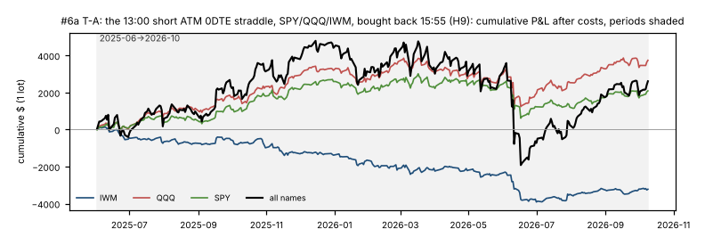

**Amendments, deviations and integrity checks.** The modelled-spread result (+$8.36) was optimistic by about $5 a straddle.

**What it showed.** The 13:00 short straddle is positive on SPY/QQQ with an interval through zero and negative on IWM.

## #6b T-B: gamma-conditioned last-30-minute momentum in SPY shares (H10)

**Folder:** `research/thetadata/index_tests/tb_momentum/ (@7dfea57)`. **Commits:** — / — / b209f7b. **Dates:** 2026-10-13.

**Hypothesis.** On negative-gamma days the last 30 minutes continue the session's move.

**Rule.** On days with dealer gamma below the flip (prior-day UW levels): 100 SPY in the direction of the open→15:30 move, 15:30 → official close.

**Fills and costs.** Net of the study's cost per day (0.4 bp).

**Data.** SPY, 299 negative-gamma days 2024-05-14 → 2026-10-07.

**Periods and holdouts.** One span.

**Pass rule (as pre-registered).** T-B: positive mean with a positive lower bound.

**Verdict.** FAIL (wrong sign): −3.07 bp a day [−5.73, −0.52], Sharpe −2.15.

**Metrics** (return = % of notional ($ = per 100 sh); win = P&L > 0 after fees; breakeven is a loss; the interval is audit_lib's 20-session moving-block bootstrap over the period's calendar sessions):

| name | period | trades | sessions (traded / span) | win % | avg win %, $ | avg loss %, $ | median %, $ | mean %, $ | 20-session block 95% (%; $) |
|------------------|------------------------------|---------------|---------------------|------------|------------------------|------------------------|------------------------|------------------------|------------------------------------------------|
| SPY | negative-gamma days 2024-05→2026-10 | 299 | 299 / 620 | 46.2 | +0.127, +76.97 | −0.166, −102.36 | −0.014, −8.33 | **−0.031**, −19.59 | [−0.056, −0.003]; [−34.03, −4.03] |

| name | period | biggest win ($, %, date, contract) | biggest loss ($, %, date, contract) | profit factor | max DD $ | longest DD (sessions) | top-5 days' share of profit |
|------------------|------------------------------|------------------------------------------------------------------|------------------------------------------------------------------|------------|---------------|---------------|------------------------------------|
| SPY | negative-gamma days 2024-05→2026-10 | +522.48, +1.0%, 2025-04-04, 100 SPY short 15:30→close | −699.16, −1.2%, 2025-03-04, 100 SPY long 15:30→close | 0.64 | 6,320 | 620 | total ≤ 0 (best 5 days +2,015; without them −7,874) |

**Random baseline:** not available — no random baseline was computed by this study

**Exit reasons (share of trades):**

- negative-gamma days 2024-05→2026-10: official close 100.0%

**By year** (all periods together, labelled by entry year):

| year | name | trades | win % | mean % | mean $ | total $ |
|---|---|---|---|---|---|---|
| 2024 | SPY | 77 | 50.6 | −0.04 | −19.36 | −1,491 |
| 2025 | SPY | 125 | 43.2 | −0.02 | −16.58 | −2,073 |
| 2026 | SPY | 97 | 46.4 | −0.03 | −23.66 | −2,295 |

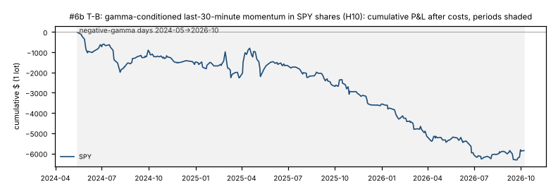

**Amendments, deviations and integrity checks.** The two gamma proxies agree on the regime 52% of days.

**What it showed.** The effect has the wrong sign.

## #6c T-C: the 13:00 SPXW short straddle bought back 15:55 (H11)

**Folder:** `research/thetadata/index_tests/tc_spxw_straddle/ (@7dfea57)`. **Commits:** — / — / b209f7b. **Dates:** 2026-10-13.

**Hypothesis.** As T-A on SPXW (cash-settled).

**Rule.** Sell the SPXW ATM straddle at 13:00 (bids), buy back at 15:55 (asks).

**Fills and costs.** Measured NBBO; return as % of the credit.

**Data.** SPXW 0DTE, 339 sessions 2025-06-02 → 2026-10-09.

**Periods and holdouts.** One span.

**Pass rule (as pre-registered).** T-C: positive lower bound.

**Verdict.** FAIL: +$72.4 a day [−75.8, +214.2], max drawdown −$21,180, worst day −$8,499.

**Metrics** (return = % of the credit received; win = P&L > 0 after fees; breakeven is a loss; the interval is audit_lib's 20-session moving-block bootstrap over the period's calendar sessions):

| name | period | trades | sessions (traded / span) | win % | avg win %, $ | avg loss %, $ | median %, $ | mean %, $ | 20-session block 95% (%; $) |
|------------------|------------------------------|---------------|---------------------|------------|------------------------|------------------------|------------------------|------------------------|------------------------------------------------|
| SPXW | 2025-06→2026-10 | 339 | 339 / 352 | 63.4 | +46.5, +832.56 | −66.7, −1,245.53 | +26.2, +396.00 | **+5.11**, +72.43 | [−0.06, +9.01]; [−55.98, +173.90] |

| name | period | biggest win ($, %, date, contract) | biggest loss ($, %, date, contract) | profit factor | max DD $ | longest DD (sessions) | top-5 days' share of profit |
|------------------|------------------------------|------------------------------------------------------------------|------------------------------------------------------------------|------------|---------------|---------------|------------------------------------|
| SPXW | 2025-06→2026-10 | +3,371.00, +71.7%, 2025-09-17, SPXW 13:00 short straddle 6590.0 | −8,499.00, −230.3%, 2026-06-11, SPXW 13:00 short straddle 7275.0 | 1.16 | 21,181 | 91 | 54% |

**Random baseline:** random entry: +$40.6 [−73.4, +164.2] against a $68.9 cost.

**Exit reasons (share of trades):**

- 2025-06→2026-10: bought back 15:55 100.0%

**By year** (all periods together, labelled by entry year):

| year | name | trades | win % | mean % | mean $ | total $ |
|---|---|---|---|---|---|---|
| 2025 | SPXW | 145 | 63.4 | +7.63 | +153.76 | +22,295 |
| 2026 | SPXW | 194 | 63.4 | +3.22 | +11.64 | +2,259 |

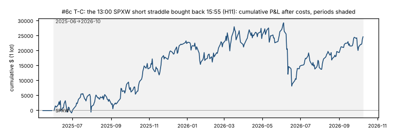

**Amendments, deviations and integrity checks.** —

**What it showed.** Positive mean, interval through zero, large tail days.

## #6d T-E: the 13:00 SPXW ATM straddle held to PM settlement, ex FOMC/CPI/NFP (H13)

**Folder:** `research/thetadata/hwr_grid/spxw_v2/ (@7dfea57)`. **Commits:** protocol sha256 in protocol_sha256.txt / — / 01ee3f3, 5f253c6 (full chains). **Dates:** 2026-10-14.

**Hypothesis.** Holding the short straddle to cash settlement adds the last hour's decay.

**Rule.** Sell the SPXW ATM straddle at 13:00, hold to the PM settlement (Cboe close), skip FOMC/CPI/NFP days.

**Fills and costs.** Measured NBBO in; settlement value out.

**Data.** SPXW 0DTE 2022-05-13 → 2026-10-09 on complete chains.

**Periods and holdouts.** TRAIN 2022-05→2024 / TEST 2025→2026-10 (TEST read).

**Pass rule (as pre-registered).** T-E gate on TEST.

**Verdict.** FAIL: +$26.94 a day [−136.73, +170.75]; 2025-04-09 alone −$33,667 a lot; trails random entry in both windows.

**Metrics** (return = % of the credit received; win = P&L > 0 after fees; breakeven is a loss; the interval is audit_lib's 20-session moving-block bootstrap over the period's calendar sessions):

| name | period | trades | sessions (traded / span) | win % | avg win %, $ | avg loss %, $ | median %, $ | mean %, $ | 20-session block 95% (%; $) |
|------------------|------------------------------|---------------|---------------------|------------|------------------------|------------------------|------------------------|------------------------|------------------------------------------------|
| SPXW | TRAIN | 575 | 575 / 683 | 60.2 | +54.3, +881.35 | −81.0, −1,228.82 | +22.1, +354.00 | **+0.42**, +40.95 | [−6.12, +6.49]; [−56.54, +135.92] |
| SPXW | TEST | 388 | 388 / 457 | 67.0 | +52.8, +997.84 | −80.7, −1,767.52 | +28.1, +487.00 | **+8.75**, +85.56 | [+1.86, +14.77]; [−115.71, +252.73] |

| name | period | biggest win ($, %, date, contract) | biggest loss ($, %, date, contract) | profit factor | max DD $ | longest DD (sessions) | top-5 days' share of profit |
|------------------|------------------------------|------------------------------------------------------------------|------------------------------------------------------------------|------------|---------------|---------------|------------------------------------|
| SPXW | TRAIN | +2,927.00, +96.3%, 2022-05-13, SPXW 13:00 4025P/4025C | −9,211.00, −860.8%, 2024-04-04, SPXW 13:00 5250P/5250C | 1.08 | 22,411 | 526 | 58% |
| SPXW | TEST | +4,100.00, +96.5%, 2025-03-06, SPXW 13:00 5740P/5740C | −34,022.00, −392.4%, 2025-04-09, SPXW 13:00 5030P/5030C | 1.15 | 38,494 | 175 | 53% |

**Random baseline:** not available — no random baseline was computed by this study

**Exit reasons (share of trades):**

- TRAIN: settle 100.0%
- TEST: settle 100.0%

**By year** (all periods together, labelled by entry year):

| year | name | trades | win % | mean % | mean $ | total $ |
|---|---|---|---|---|---|---|
| 2022 | SPXW | 140 | 61.4 | +4.60 | +103.02 | +14,423 |
| 2023 | SPXW | 217 | 58.5 | −1.47 | +1.88 | +409 |
| 2024 | SPXW | 218 | 61.0 | −0.38 | +39.98 | +8,716 |
| 2025 | SPXW | 218 | 69.3 | +10.33 | +97.98 | +21,359 |
| 2026 | SPXW | 170 | 64.1 | +6.73 | +69.63 | +11,837 |

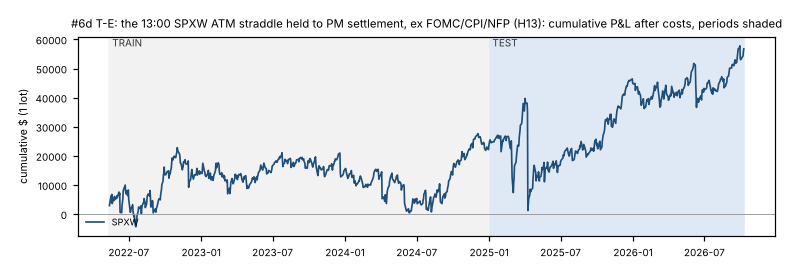

**Amendments, deviations and integrity checks.** Re-run on complete chains (5f253c6, 8fb5bad): no TEST figure changed.

**What it showed.** One day can erase years; no edge.

## #6e H15 carry lane: the 14:05 SPXW short strangle at ±0.5 expected move, held to settlement

**Folder:** `research/thetadata/hwr_grid/spxw_v2/ (@7dfea57); report "High win rate 0DTE lanes"`. **Commits:** protocol_sha256.txt / — / 01ee3f3, 97e685a, 6691368. **Dates:** 2026-10-14.

**Hypothesis.** A 70%+ win-rate short strangle with a positive cost-realistic lower bound exists.

**Rule.** 14:05 sell the SPXW strangle at ±0.5 × the 14:05 expected move, held to cash settlement, skip FOMC and month-end (selection S2 on TRAIN).

**Fills and costs.** Measured NBBO in; settlement out.

**Data.** SPXW 0DTE 2022-05-13 → 2026-10-09.

**Periods and holdouts.** TRAIN (selection) / TEST (read). The deciding test T-G (forward paper ≥ 150 sessions) was never started.

**Pass rule (as pre-registered).** Positive TEST lower bound after the two selections; then T-G forward.

**Verdict.** Open, NOT promotable: TEST +$151.17 a lot [+42.15, +251.73], win 70.8%; the pre-registered reselection on complete TRAIN picks a different S2 that fails (+$52.54 [−22.24, +122.49]); ±10% shock ≈ −$65k a lot.

**Metrics** (return = % of the credit received; win = P&L > 0 after fees; breakeven is a loss; the interval is audit_lib's 20-session moving-block bootstrap over the period's calendar sessions):

| name | period | trades | sessions (traded / span) | win % | avg win %, $ | avg loss %, $ | median %, $ | mean %, $ | 20-session block 95% (%; $) |
|------------------|------------------------------|---------------|---------------------|------------|------------------------|------------------------|------------------------|------------------------|------------------------------------------------|
| SPXW | TRAIN | 606 | 606 / 682 | 72.1 | +83.9, +528.42 | −166.6, −921.84 | +97.4, +348.00 | **+14.03**, +123.98 | [+1.62, +24.85]; [+60.26, +188.45] |
| SPXW | TEST | 407 | 407 / 457 | 70.8 | +86.5, +646.35 | −147.6, −1,047.27 | +95.9, +353.00 | **+18.02**, +151.17 | [+3.54, +29.89]; [+34.16, +263.93] |

| name | period | biggest win ($, %, date, contract) | biggest loss ($, %, date, contract) | profit factor | max DD $ | longest DD (sessions) | top-5 days' share of profit |
|------------------|------------------------------|------------------------------------------------------------------|------------------------------------------------------------------|------------|---------------|---------------|------------------------------------|
| SPXW | TRAIN | +1,828.00, +99.9%, 2024-08-05, SPXW 14:05 5175P/5215C | −7,146.00, −1,125.4%, 2024-04-04, SPXW 14:05 5225P/5240C | 1.48 | 10,092 | 91 | 10% |
| SPXW | TEST | +4,578.00, +100.0%, 2025-04-10, SPXW 14:05 5245P/5335C | −7,131.00, −735.2%, 2026-03-09, SPXW 14:05 6690P/6715C | 1.49 | 13,022 | 157 | 28% |

**Random baseline:** matched random: +$22.60 [−147.61, +261.12].

**Exit reasons (share of trades):**

- TRAIN: settle 100.0%
- TEST: settle 100.0%

**By year** (all periods together, labelled by entry year):

| year | name | trades | win % | mean % | mean $ | total $ |
|---|---|---|---|---|---|---|
| 2022 | SPXW | 146 | 73.3 | +20.73 | +217.40 | +31,741 |
| 2023 | SPXW | 228 | 67.1 | +5.43 | +38.84 | +8,856 |
| 2024 | SPXW | 232 | 76.3 | +18.25 | +148.84 | +34,532 |
| 2025 | SPXW | 228 | 71.9 | +22.53 | +228.60 | +52,121 |
| 2026 | SPXW | 179 | 69.3 | +12.29 | +52.54 | +9,404 |

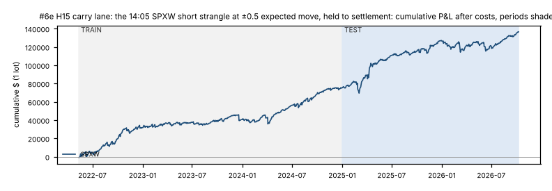

**Amendments, deviations and integrity checks.** All historical data has been used for selection; no further historical re-selection allowed (registry).

**What it showed.** Positive on TEST, but the reselection fails and the tail risk is unbounded.

## #7a S01 Quick Scalps (owner baseline) on index 0DTE

**Folder:** `research/compass/studies/, results/v1/ (@7dfea57)`. **Commits:** protocol 113cad7 / — / 5e90201. **Dates:** 2026-10-14.

**Hypothesis.** The owner's Quick Scalps signal (RSI14 cross 55/45 + EMA9 lead, 5m EMA20 + VWAP confirm, 15m EMA alignment) predicts 0DTE moves.

**Rule.** Signal → buy the 0DTE contract in a delta band at the ask; exits: stop, two targets, VWAP loss, invalidation, time.

**Fills and costs.** $0.70 a contract each side (protocol 113cad7), entry at the ask, exit at the bid, 1-minute NBBO

**Data.** SPY/QQQ/IWM 0DTE 2022-11-11 → 2026-10-08.

**Periods and holdouts.** Walk-forward by calendar year (protocol 113cad7); reads counted in holdout B (ledger).

**Pass rule (as pre-registered).** Positive net expectancy with a positive lower bound (protocol).

**Verdict.** REJECTED: −$4.19 a contract [−5.68, −2.81].

**Metrics** (return = % of premium; win = P&L > 0 after fees; breakeven is a loss; the interval is audit_lib's 20-session moving-block bootstrap over the period's calendar sessions):

| name | period | trades | sessions (traded / span) | win % | avg win %, $ | avg loss %, $ | median %, $ | mean %, $ | 20-session block 95% (%; $) |
|------------------|------------------------------|---------------|---------------------|------------|------------------------|------------------------|------------------------|------------------------|------------------------------------------------|
| IWM | 2022-11→2026-10 | 685 | 274 / 638 | 33.3 | +36.5, +20.47 | −28.3, −15.40 | −27.5, −10.40 | **−6.74**, −3.46 | [−9.19, −4.39]; [−4.91, −2.13] |
| QQQ | 2022-11→2026-10 | 1,075 | 421 / 1,009 | 35.0 | +36.5, +39.99 | −26.4, −27.36 | −23.4, −15.40 | **−4.38**, −3.80 | [−6.34, −2.71]; [−5.82, −1.96] |
| SPY | 2022-11→2026-10 | 1,126 | 444 / 1,009 | 34.3 | +35.7, +32.62 | −25.2, −24.61 | −19.5, −13.40 | **−4.32**, −4.99 | [−6.19, −2.60]; [−7.33, −3.05] |
| all names | 2022-11→2026-10 | 2,886 | 614 / 1,009 | 34.3 | +36.2, +32.62 | −26.4, −23.41 | −22.7, −12.40 | **−4.92**, −4.19 | [−6.31, −3.69]; [−5.79, −2.88] |

| name | period | biggest win ($, %, date, contract) | biggest loss ($, %, date, contract) | profit factor | max DD $ | longest DD (sessions) | top-5 days' share of profit |
|------------------|------------------------------|------------------------------------------------------------------|------------------------------------------------------------------|------------|---------------|---------------|------------------------------------|
| IWM | 2022-11→2026-10 | +71.10, +50.1%, 2026-06-12, IWM 2026-06-12 292.0CALL | −60.40, −30.2%, 2025-04-07, IWM 2025-04-07 178.0PUT | 0.66 | 2,450 | 571 | total ≤ 0 (best 5 days +373; without them −2,745) |
| QQQ | 2022-11→2026-10 | +345.60, +111.8%, 2026-06-09, QQQ 2026-06-09 692.0PUT | −157.40, −34.5%, 2025-04-07, QQQ 2025-04-07 417.0PUT | 0.79 | 4,610 | 1,007 | total ≤ 0 (best 5 days +1,370; without them −5,457) |
| SPY | 2022-11→2026-10 | +144.60, +51.3%, 2025-03-11, SPY 2025-03-11 557.0PUT | −115.40, −25.1%, 2025-04-09, SPY 2025-04-09 495.0PUT | 0.69 | 5,838 | 972 | total ≤ 0 (best 5 days +751; without them −6,372) |
| all names | 2022-11→2026-10 | +345.60, +111.8%, 2026-06-09, QQQ 2026-06-09 692.0PUT | −157.40, −34.5%, 2025-04-07, QQQ 2025-04-07 417.0PUT | 0.73 | 12,320 | 991 | total ≤ 0 (best 5 days +1,506; without them −13,587) |

**Random baseline:** not available — no random baseline was computed by this study

**Exit reasons (share of trades):**

- 2022-11→2026-10: stop 51.9%; target_2 26.3%; vwap_loss 15.3%; time 5.4%; invalidation 1.1%

**By year** (all periods together, labelled by entry year):

| year | name | trades | win % | mean % | mean $ | total $ |
|---|---|---|---|---|---|---|
| 2024 | IWM | 157 | 35.7 | −5.66 | −1.77 | −277 |
| 2025 | IWM | 311 | 33.8 | −5.80 | −3.38 | −1,051 |
| 2026 | IWM | 217 | 30.9 | −8.85 | −4.81 | −1,044 |
| 2022 | QQQ | 34 | 32.4 | −5.95 | −4.96 | −169 |
| 2023 | QQQ | 293 | 31.1 | −7.48 | −5.21 | −1,527 |
| 2024 | QQQ | 287 | 35.5 | −4.04 | −3.50 | −1,004 |
| 2025 | QQQ | 241 | 37.3 | −2.60 | −3.80 | −915 |
| 2026 | QQQ | 220 | 37.3 | −2.41 | −2.15 | −473 |
| 2022 | SPY | 40 | 42.5 | +1.63 | +0.99 | +40 |
| 2023 | SPY | 285 | 31.9 | −6.51 | −4.52 | −1,289 |
| 2024 | SPY | 281 | 34.5 | −3.73 | −3.74 | −1,050 |
| 2025 | SPY | 282 | 35.8 | −3.94 | −6.02 | −1,698 |
| 2026 | SPY | 238 | 33.6 | −3.83 | −6.82 | −1,624 |
| 2022 | all names | 74 | 37.8 | −1.85 | −1.74 | −129 |
| 2023 | all names | 578 | 31.5 | −7.00 | −4.87 | −2,816 |
| 2024 | all names | 725 | 35.2 | −4.27 | −3.22 | −2,331 |
| 2025 | all names | 834 | 35.5 | −4.25 | −4.39 | −3,664 |
| 2026 | all names | 675 | 33.9 | −4.98 | −4.65 | −3,141 |

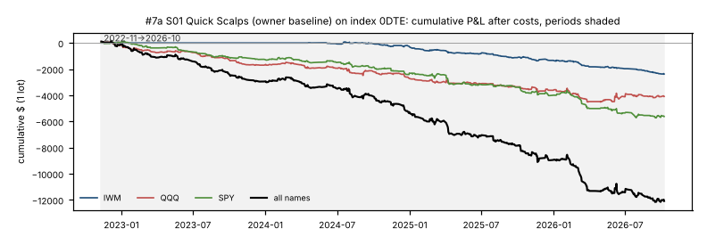

**Amendments, deviations and integrity checks.** Status ≠ filled rows (no chain, in position, no expiry) are not trades.

**What it showed.** The baseline loses $4 a contract after costs.

## #7b S02 Quick Scalps: 41-variant grid, walk-forward OOS (lower-bound selection)

**Folder:** `research/compass/studies/, results/v1/ (@7dfea57)`. **Commits:** 113cad7 / — / 6bf5934. **Dates:** 2026-10-14.

**Hypothesis.** A single-factor variant of the baseline holds out of sample.

**Rule.** Each year, the variant with the best lower bound on the years before is traded the next year (walk-forward).

**Fills and costs.** $0.70 a contract each side (protocol 113cad7), entry at the ask, exit at the bid, 1-minute NBBO

**Data.** SPY/QQQ/IWM 0DTE, OOS 2024-01 → 2026-10.

**Periods and holdouts.** Walk-forward OOS years 2024–2026.

**Pass rule (as pre-registered).** Positive OOS lower bound, better than matched random.

**Verdict.** Nothing promoted: OOS −$3.81 [−5.23, −2.35]; no variant positive or better than random.

**Metrics** (return = % of premium; win = P&L > 0 after fees; breakeven is a loss; the interval is audit_lib's 20-session moving-block bootstrap over the period's calendar sessions):

| name | period | trades | sessions (traded / span) | win % | avg win %, $ | avg loss %, $ | median %, $ | mean %, $ | 20-session block 95% (%; $) |
|------------------|------------------------------|---------------|---------------------|------------|------------------------|------------------------|------------------------|------------------------|------------------------------------------------|
| IWM | walk-forward OOS 2024-01→2026-10 | 935 | 314 / 638 | 32.2 | +35.3, +18.96 | −28.3, −14.23 | −27.5, −8.40 | **−7.85**, −3.55 | [−10.10, −5.79]; [−4.73, −2.46] |
| QQQ | walk-forward OOS 2024-01→2026-10 | 1,117 | 352 / 715 | 36.6 | +35.3, +39.77 | −26.7, −27.00 | −22.5, −11.40 | **−3.97**, −2.55 | [−5.94, −2.21]; [−4.85, −0.27] |
| SPY | walk-forward OOS 2024-01→2026-10 | 1,148 | 373 / 715 | 35.1 | +35.0, +31.48 | −25.9, −25.09 | −19.7, −11.40 | **−4.55**, −5.23 | [−6.76, −2.77]; [−8.05, −2.99] |
| all names | walk-forward OOS 2024-01→2026-10 | 3,200 | 488 / 715 | 34.8 | +35.2, +31.14 | −26.9, −22.44 | −23.6, −10.40 | **−5.31**, −3.81 | [−6.87, −3.98]; [−5.45, −2.46] |

| name | period | biggest win ($, %, date, contract) | biggest loss ($, %, date, contract) | profit factor | max DD $ | longest DD (sessions) | top-5 days' share of profit |
|------------------|------------------------------|------------------------------------------------------------------|------------------------------------------------------------------|------------|---------------|---------------|------------------------------------|
| IWM | walk-forward OOS 2024-01→2026-10 | +108.60, +197.5%, 2025-02-07, IWM 227.5PUT no_15m | −120.40, −71.2%, 2025-09-17, IWM 239.0PUT no_15m | 0.63 | 3,339 | 634 | total ≤ 0 (best 5 days +531; without them −3,846) |
| QQQ | walk-forward OOS 2024-01→2026-10 | +345.60, +111.8%, 2026-06-09, QQQ 692.0PUT no_15m | −157.40, −34.5%, 2025-04-07, QQQ 417.0PUT no_15m | 0.85 | 2,992 | 668 | total ≤ 0 (best 5 days +1,679; without them −4,532) |
| SPY | walk-forward OOS 2024-01→2026-10 | +172.10, +40.0%, 2025-04-10, SPY 516.0PUT no_15m | −163.40, −23.6%, 2025-04-07, SPY 496.0PUT no_15m | 0.68 | 6,234 | 692 | total ≤ 0 (best 5 days +914; without them −6,922) |
| all names | walk-forward OOS 2024-01→2026-10 | +345.60, +111.8%, 2026-06-09, QQQ 692.0PUT no_15m | −163.40, −23.6%, 2025-04-07, SPY 496.0PUT no_15m | 0.74 | 12,295 | 673 | total ≤ 0 (best 5 days +1,987; without them −14,163) |

**Random baseline:** not available — no random baseline was computed by this study

**Exit reasons (share of trades):**

- walk-forward OOS 2024-01→2026-10: stop 52.8%; target_2 24.4%; vwap_loss 14.3%; ema_target 4.2%; time 3.6%; invalidation 0.8%; settlement 0.0%

**By year** (all periods together, labelled by entry year):

| year | name | trades | win % | mean % | mean $ | total $ |
|---|---|---|---|---|---|---|
| 2024 | IWM | 150 | 31.3 | −10.02 | −2.09 | −313 |
| 2025 | IWM | 475 | 33.7 | −6.10 | −2.97 | −1,413 |
| 2026 | IWM | 310 | 30.3 | −9.46 | −5.13 | −1,589 |
| 2024 | QQQ | 317 | 32.2 | −6.64 | −3.03 | −960 |
| 2025 | QQQ | 429 | 40.8 | −1.82 | −0.81 | −347 |
| 2026 | QQQ | 371 | 35.6 | −4.17 | −4.17 | −1,546 |
| 2024 | SPY | 300 | 31.3 | −6.87 | −3.36 | −1,008 |
| 2025 | SPY | 475 | 38.3 | −3.68 | −5.61 | −2,667 |
| 2026 | SPY | 373 | 34.0 | −3.79 | −6.26 | −2,334 |
| 2024 | all names | 767 | 31.7 | −7.39 | −2.97 | −2,281 |
| 2025 | all names | 1,379 | 37.5 | −3.94 | −3.21 | −4,427 |
| 2026 | all names | 1,054 | 33.5 | −5.59 | −5.19 | −5,469 |

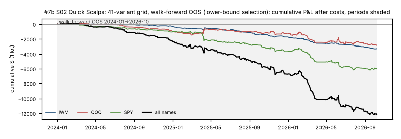

**Amendments, deviations and integrity checks.** —

**What it showed.** Variant selection does not rescue the signal.

## #7c S03 Quick Scalps with weekly expirations (1–7 days)

**Folder:** `research/compass/studies/, results/v1/ (@7dfea57)`. **Commits:** 113cad7 / — / 3c8d6cb. **Dates:** 2026-10-14.

**Hypothesis.** The signal works on weekly contracts.

**Rule.** Quick Scalps signal → nearest Friday contract, OI > 250.

**Fills and costs.** $0.70 a contract each side (protocol 113cad7), entry at the ask, exit at the bid, 1-minute NBBO

**Data.** SPY/QQQ/IWM weekly chains, sampled sessions 2017-06 → 2026-10.

**Periods and holdouts.** Walk-forward by calendar year (protocol 113cad7); reads counted in holdout B (ledger).

**Pass rule (as pre-registered).** As S01.

**Verdict.** Nothing promoted: +$1.27 a contract [−3.69, +6.25] (= random).

**Metrics** (return = % of premium; win = P&L > 0 after fees; breakeven is a loss; the interval is audit_lib's 20-session moving-block bootstrap over the period's calendar sessions):

| name | period | trades | sessions (traded / span) | win % | avg win %, $ | avg loss %, $ | median %, $ | mean %, $ | 20-session block 95% (%; $) |
|------------------|------------------------------|---------------|---------------------|------------|------------------------|------------------------|------------------------|------------------------|------------------------------------------------|
| IWM | 2017-06→2026-10 | 239 | 141 / 2,394 | 40.6 | +27.2, +39.75 | −15.0, −23.63 | −4.8, −7.40 | **+2.14**, +2.09 | [−1.42, +5.76]; [−2.85, +8.14] |
| QQQ | 2017-06→2026-10 | 217 | 135 / 2,386 | 36.9 | +23.0, +64.11 | −16.3, −40.82 | −7.7, −14.40 | **−1.82**, −2.13 | [−4.84, +1.90]; [−11.95, +9.23] |
| SPY | 2017-06→2026-10 | 362 | 221 / 2,393 | 36.2 | +28.4, +70.90 | −16.9, −35.87 | −7.2, −9.40 | **−0.50**, +2.76 | [−2.94, +2.05]; [−3.17, +9.82] |
| all names | 2017-06→2026-10 | 818 | 376 / 2,399 | 37.7 | +26.6, +59.33 | −16.2, −33.79 | −6.5, −9.40 | **−0.08**, +1.27 | [−1.87, +1.70]; [−2.78, +5.63] |

| name | period | biggest win ($, %, date, contract) | biggest loss ($, %, date, contract) | profit factor | max DD $ | longest DD (sessions) | top-5 days' share of profit |
|------------------|------------------------------|------------------------------------------------------------------|------------------------------------------------------------------|------------|---------------|---------------|------------------------------------|
| IWM | 2017-06→2026-10 | +167.60, +39.2%, 2025-04-08, IWM 2025-04-11 176.0PUT | −100.40, −22.1%, 2020-06-12, IWM 2020-06-19 134.5PUT | 1.15 | 631 | 1,446 | 146% |
| QQQ | 2017-06→2026-10 | +415.60, +39.7%, 2025-04-08, QQQ 2025-04-11 423.0PUT | −168.40, −33.8%, 2026-02-05, QQQ 2026-02-06 594.0PUT | 0.92 | 1,953 | 1,975 | total ≤ 0 (best 5 days +1,651; without them −2,114) |
| SPY | 2017-06→2026-10 | +463.10, +120.0%, 2020-05-15, SPY 2020-05-22 286.0CALL | −227.40, −31.9%, 2020-03-10, SPY 2020-03-13 273.0PUT | 1.12 | 1,057 | 919 | 177% |
| all names | 2017-06→2026-10 | +463.10, +120.0%, 2020-05-15, SPY 2020-05-22 286.0CALL | −227.40, −31.9%, 2020-03-10, SPY 2020-03-13 273.0PUT | 1.06 | 1,214 | 1,595 | 235% |

**Random baseline:** not available — no random baseline was computed by this study

**Exit reasons (share of trades):**

- 2017-06→2026-10: vwap_loss 50.6%; data_end 17.6%; target_2 17.5%; stop 8.6%; invalidation 5.4%; time 0.4%

**By year** (all periods together, labelled by entry year):

| year | name | trades | win % | mean % | mean $ | total $ |
|---|---|---|---|---|---|---|
| 2017 | IWM | 20 | 35.0 | −4.52 | −4.73 | −95 |
| 2018 | IWM | 30 | 50.0 | +7.35 | +8.18 | +245 |
| 2019 | IWM | 15 | 40.0 | +1.58 | +2.57 | +39 |
| 2020 | IWM | 34 | 35.3 | +1.82 | −2.09 | −71 |
| 2021 | IWM | 29 | 37.9 | +1.78 | +0.58 | +17 |
| 2022 | IWM | 20 | 20.0 | −3.67 | −12.17 | −243 |
| 2023 | IWM | 31 | 35.5 | −2.78 | −6.16 | −191 |
| 2024 | IWM | 17 | 41.2 | +2.55 | +5.69 | +97 |
| 2025 | IWM | 24 | 66.7 | +15.82 | +31.81 | +763 |
| 2026 | IWM | 19 | 42.1 | −0.99 | −3.19 | −61 |
| 2017 | QQQ | 14 | 14.3 | −9.39 | −5.29 | −74 |
| 2018 | QQQ | 21 | 76.2 | +14.05 | +26.15 | +549 |
| 2019 | QQQ | 16 | 37.5 | −9.44 | −9.49 | −152 |
| 2020 | QQQ | 32 | 37.5 | −4.50 | −17.85 | −571 |
| 2021 | QQQ | 27 | 18.5 | −12.66 | −23.49 | −634 |
| 2022 | QQQ | 26 | 30.8 | −1.24 | −11.23 | −292 |
| 2023 | QQQ | 26 | 34.6 | −1.36 | −7.17 | −186 |
| 2024 | QQQ | 23 | 30.4 | +1.96 | +1.51 | +35 |
| 2025 | QQQ | 22 | 54.5 | +7.67 | +53.03 | +1,167 |
| 2026 | QQQ | 10 | 30.0 | −6.81 | −30.35 | −304 |
| 2017 | SPY | 32 | 25.0 | −5.54 | −1.62 | −52 |
| 2018 | SPY | 75 | 29.3 | −3.79 | −6.74 | −506 |
| 2019 | SPY | 46 | 21.7 | −8.48 | −9.25 | −425 |
| 2020 | SPY | 39 | 41.0 | +5.28 | +22.73 | +886 |
| 2021 | SPY | 51 | 41.2 | −0.74 | +2.49 | +127 |
| 2022 | SPY | 36 | 38.9 | +2.84 | +8.48 | +305 |
| 2023 | SPY | 30 | 53.3 | +7.92 | +17.80 | +534 |
| 2024 | SPY | 21 | 57.1 | +7.82 | +16.60 | +349 |
| 2025 | SPY | 17 | 35.3 | −3.13 | −16.99 | −289 |
| 2026 | SPY | 15 | 40.0 | +3.50 | +4.73 | +71 |
| 2017 | all names | 66 | 25.8 | −6.05 | −3.34 | −220 |
| 2018 | all names | 126 | 42.1 | +1.83 | +2.29 | +289 |
| 2019 | all names | 77 | 28.6 | −6.72 | −7.00 | −539 |
| 2020 | all names | 105 | 38.1 | +1.18 | +2.32 | +244 |
| 2021 | all names | 107 | 34.6 | −3.06 | −4.58 | −490 |
| 2022 | all names | 82 | 31.7 | −0.04 | −2.81 | −230 |
| 2023 | all names | 87 | 41.4 | +1.33 | +1.80 | +157 |
| 2024 | all names | 61 | 42.6 | +4.14 | +7.87 | +480 |
| 2025 | all names | 63 | 54.0 | +7.86 | +26.05 | +1,641 |
| 2026 | all names | 44 | 38.6 | −0.78 | −6.66 | −293 |

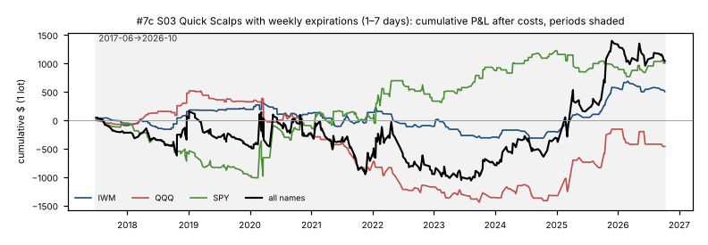

**Amendments, deviations and integrity checks.** A cut-short pull is a uniform sample by strata (d706328).

**What it showed.** Indistinguishable from zero.

## #7d S09 Quick Scalps on SPXW 0DTE

**Folder:** `research/compass/studies/, results/v1/ (@7dfea57)`. **Commits:** 113cad7 / — / 7167541. **Dates:** 2026-10-14.

**Hypothesis.** The baseline on SPXW.

**Rule.** As S01, signals on SPX values with SPY volume.

**Fills and costs.** $0.70 a contract each side (protocol 113cad7), entry at the ask, exit at the bid, 1-minute NBBO; SPXW per its fees

**Data.** SPXW 0DTE 2022-05-19 → 2026-10-08, 1,229 fills on 481 days.

**Periods and holdouts.** Walk-forward by calendar year (protocol 113cad7); reads counted in holdout B (ledger).

**Pass rule (as pre-registered).** As S01.

**Verdict.** REJECTED: −$46.18 a contract [−63.19, −30.02], −$24 against matched random.

**Metrics** (return = % of premium; win = P&L > 0 after fees; breakeven is a loss; the interval is audit_lib's 20-session moving-block bootstrap over the period's calendar sessions):

| name | period | trades | sessions (traded / span) | win % | avg win %, $ | avg loss %, $ | median %, $ | mean %, $ | 20-session block 95% (%; $) |
|------------------|------------------------------|---------------|---------------------|------------|------------------------|------------------------|------------------------|------------------------|------------------------------------------------|
| SPXW | 2022-05→2026-10 | 1,229 | 481 / 1,135 | 33.8 | +37.8, +317.77 | −25.0, −231.74 | −22.1, −141.40 | **−3.81**, −46.18 | [−5.48, −2.15]; [−62.89, −30.83] |

| name | period | biggest win ($, %, date, contract) | biggest loss ($, %, date, contract) | profit factor | max DD $ | longest DD (sessions) | top-5 days' share of profit |
|------------------|------------------------------|------------------------------------------------------------------|------------------------------------------------------------------|------------|---------------|---------------|------------------------------------|
| SPXW | 2022-05→2026-10 | +1,483.60, +41.0%, 2025-04-09, SPXW 2025-04-09 5380.0CALL | −1,001.40, −40.5%, 2026-03-09, SPXW 2026-03-09 6640.0PUT | 0.70 | 57,686 | 1,135 | total ≤ 0 (best 5 days +8,081; without them −64,842) |

**Random baseline:** not available — no random baseline was computed by this study

**Exit reasons (share of trades):**

- 2022-05→2026-10: stop 52.7%; target_2 26.2%; vwap_loss 15.3%; time 3.3%; invalidation 2.4%

**By year** (all periods together, labelled by entry year):

| year | name | trades | win % | mean % | mean $ | total $ |
|---|---|---|---|---|---|---|
| 2022 | SPXW | 159 | 27.7 | −7.46 | −91.62 | −14,568 |
| 2023 | SPXW | 300 | 34.3 | −3.47 | −29.22 | −8,765 |
| 2024 | SPXW | 279 | 37.6 | −1.20 | −15.80 | −4,408 |
| 2025 | SPXW | 266 | 33.8 | −5.33 | −58.93 | −15,675 |
| 2026 | SPXW | 225 | 32.4 | −3.14 | −59.31 | −13,345 |

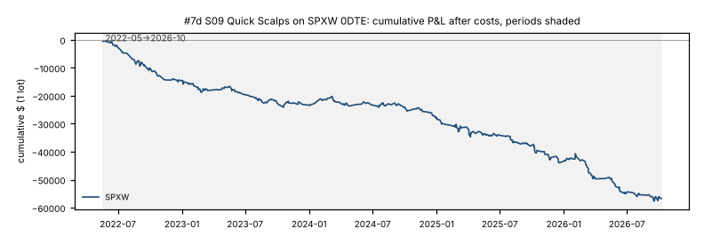

**Amendments, deviations and integrity checks.** —

**What it showed.** Loses on SPXW too.

## #7e S10 Short premium: fade the Quick Scalps signal (single contract, 2× stop, to 15:50)

**Folder:** `research/compass/studies/, results/v1/ (@7dfea57)`. **Commits:** A4 912b415 / rerun 1ecdfd5 / cf124a0, 3c8d6cb. **Dates:** 2026-10-14.

**Hypothesis.** Selling the contract the signal would buy earns its premium.

**Rule.** Sell the signal's contract at the bid, buy back at 15:50 or at a 2× credit stop (the best cell).

**Fills and costs.** $0.70 a contract each side (protocol 113cad7), entry at the ask, exit at the bid, 1-minute NBBO

**Data.** SPY/QQQ/IWM 0DTE 2022-11 → 2026-10.

**Periods and holdouts.** Walk-forward by calendar year (protocol 113cad7); reads counted in holdout B (ledger).

**Pass rule (as pre-registered).** Positive lower bound and better than random.

**Verdict.** Nothing promoted: breakeven at best (+$0.52 a contract).

**Metrics** (return = % of the credit received; win = P&L > 0 after fees; breakeven is a loss; the interval is audit_lib's 20-session moving-block bootstrap over the period's calendar sessions):

| name | period | trades | sessions (traded / span) | win % | avg win %, $ | avg loss %, $ | median %, $ | mean %, $ | 20-session block 95% (%; $) |
|------------------|------------------------------|---------------|---------------------|------------|------------------------|------------------------|------------------------|------------------------|------------------------------------------------|
| IWM | 2022-11→2026-10 | 685 | 274 / 638 | 51.4 | +80.4, +48.29 | −104.8, −53.66 | +14.1, +7.60 | **−9.63**, −1.27 | [−20.09, +0.58]; [−6.87, +4.01] |
| QQQ | 2022-11→2026-10 | 1,075 | 421 / 1,009 | 56.3 | +72.3, +79.79 | −98.6, −104.04 | +24.4, +19.60 | **−2.40**, −0.58 | [−10.34, +7.08]; [−11.23, +10.76] |
| SPY | 2022-11→2026-10 | 1,126 | 444 / 1,009 | 57.1 | +73.0, +74.48 | −99.9, −92.94 | +32.3, +21.60 | **−1.17**, +2.67 | [−8.30, +5.93]; [−4.58, +10.41] |
| all names | 2022-11→2026-10 | 2,886 | 614 / 1,009 | 55.4 | +74.4, +70.73 | −100.7, −86.83 | +28.1, +17.60 | **−3.63**, +0.52 | [−9.79, +2.83]; [−5.54, +7.20] |

| name | period | biggest win ($, %, date, contract) | biggest loss ($, %, date, contract) | profit factor | max DD $ | longest DD (sessions) | top-5 days' share of profit |
|------------------|------------------------------|------------------------------------------------------------------|------------------------------------------------------------------|------------|---------------|---------------|------------------------------------|
| IWM | 2022-11→2026-10 | +185.60, +98.7%, 2025-04-09, IWM short 173.0PUT | −195.40, −107.4%, 2025-09-17, IWM short 241.0CALL | 0.95 | 3,163 | 362 | total ≤ 0 (best 5 days +1,283; without them −2,156) |
| QQQ | 2022-11→2026-10 | +418.60, +92.6%, 2025-04-07, QQQ short 417.0PUT | −426.40, −138.9%, 2026-06-09, QQQ short 692.0PUT | 0.99 | 7,281 | 399 | total ≤ 0 (best 5 days +3,940; without them −4,567) |
| SPY | 2022-11→2026-10 | +455.60, +99.3%, 2025-04-09, SPY short 495.0PUT | −414.40, −101.3%, 2025-04-11, SPY short 527.0CALL | 1.07 | 3,255 | 390 | 116% |
| all names | 2022-11→2026-10 | +455.60, +99.3%, 2025-04-09, SPY short 495.0PUT | −426.40, −138.9%, 2026-06-09, QQQ short 692.0PUT | 1.01 | 9,276 | 364 | 470% |

**Random baseline:** the study's matched random controls (5 seeds, same symbols, sessions and exits, 14,218 trades): mean −5.71 dollars and −10.27% a trade (no percentile was computed).

**Exit reasons (share of trades):**

- 2022-11→2026-10: session_cutoff 61.9%; stop 38.1%

**By year** (all periods together, labelled by entry year):

| year | name | trades | win % | mean % | mean $ | total $ |
|---|---|---|---|---|---|---|
| 2024 | IWM | 157 | 55.4 | −3.84 | +0.08 | +13 |
| 2025 | IWM | 311 | 46.9 | −17.46 | −4.48 | −1,392 |
| 2026 | IWM | 217 | 54.8 | −2.58 | +2.33 | +506 |
| 2022 | QQQ | 34 | 67.6 | +21.67 | +19.69 | +669 |
| 2023 | QQQ | 293 | 53.9 | −2.85 | −0.81 | −237 |
| 2024 | QQQ | 287 | 59.6 | −1.80 | +2.90 | +832 |
| 2025 | QQQ | 241 | 59.3 | +2.56 | +7.87 | +1,896 |
| 2026 | QQQ | 220 | 50.0 | −11.75 | −17.21 | −3,787 |
| 2022 | SPY | 40 | 50.0 | −9.73 | −11.18 | −447 |
| 2023 | SPY | 285 | 58.9 | +4.07 | +5.61 | +1,598 |
| 2024 | SPY | 281 | 57.7 | −6.70 | +0.88 | +248 |
| 2025 | SPY | 282 | 58.2 | +1.43 | +6.05 | +1,706 |
| 2026 | SPY | 238 | 54.2 | −2.54 | −0.43 | −101 |
| 2022 | all names | 74 | 58.1 | +4.69 | +3.01 | +222 |
| 2023 | all names | 578 | 56.4 | +0.56 | +2.35 | +1,361 |
| 2024 | all names | 725 | 57.9 | −4.14 | +1.51 | +1,093 |
| 2025 | all names | 834 | 54.3 | −5.29 | +2.65 | +2,209 |
| 2026 | all names | 675 | 53.0 | −5.55 | −5.01 | −3,382 |

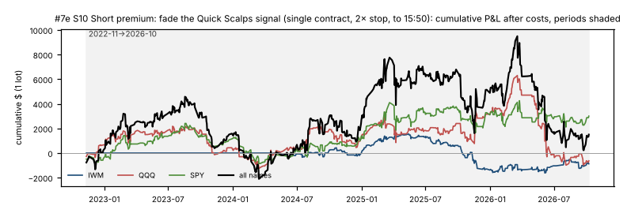

**Amendments, deviations and integrity checks.** The vertical rows were superseded after the protective-leg fix; the single-contract rows (shown) are unchanged.

**What it showed.** The fade is about breakeven.

## #7f S12 Intraday momentum: first-half-hour direction → 10:00–15:00 long option

**Folder:** `research/compass/studies/, results/v1/ (@7dfea57)`. **Commits:** A5 fe93f87 / — / 2430c9b. **Dates:** 2026-10-14.

**Hypothesis.** The first half hour's direction continues (Gao et al.).

**Rule.** Buy the 0DTE contract in the first-half-hour direction at 10:00, exit 15:00.

**Fills and costs.** $0.70 a contract each side (protocol 113cad7), entry at the ask, exit at the bid, 1-minute NBBO

**Data.** SPY/QQQ/IWM 2022-11 → 2026-10 (options).

**Periods and holdouts.** Walk-forward by calendar year (protocol 113cad7); reads counted in holdout B (ledger).

**Pass rule (as pre-registered).** Two-part promotion rule (A1).

**Verdict.** Nothing promoted (QQQ-only underlying effect, not batch-robust; option cell negative).

**Metrics** (return = % of premium; win = P&L > 0 after fees; breakeven is a loss; the interval is audit_lib's 20-session moving-block bootstrap over the period's calendar sessions):

| name | period | trades | sessions (traded / span) | win % | avg win %, $ | avg loss %, $ | median %, $ | mean %, $ | 20-session block 95% (%; $) |
|------------------|------------------------------|---------------|---------------------|------------|------------------------|------------------------|------------------------|------------------------|------------------------------------------------|
| IWM | 2022-11→2026-10 | 388 | 388 / 638 | 28.1 | +115.2, +42.25 | −73.7, −23.32 | −64.3, −14.90 | **−20.62**, −4.90 | [−31.88, −9.17]; [−9.04, −0.40] |
| QQQ | 2022-11→2026-10 | 920 | 920 / 1,010 | 30.9 | +95.4, +66.78 | −64.1, −36.51 | −44.4, −20.40 | **−14.88**, −4.62 | [−21.50, −8.59]; [−9.62, +0.68] |
| SPY | 2022-11→2026-10 | 906 | 906 / 1,010 | 30.8 | +99.1, +64.33 | −62.7, −34.22 | −43.3, −18.40 | **−12.89**, −3.87 | [−18.58, −5.60]; [−7.90, +1.30] |
| all names | 2022-11→2026-10 | 2,214 | 961 / 1,010 | 30.4 | +100.1, +61.78 | −65.3, −33.19 | −47.1, −18.40 | **−15.07**, −4.36 | [−20.45, −9.22]; [−8.13, +0.06] |

| name | period | biggest win ($, %, date, contract) | biggest loss ($, %, date, contract) | profit factor | max DD $ | longest DD (sessions) | top-5 days' share of profit |
|------------------|------------------------------|------------------------------------------------------------------|------------------------------------------------------------------|------------|---------------|---------------|------------------------------------|
| IWM | 2022-11→2026-10 | +370.60, +741.2%, 2026-07-29, IWM 293.0PUT | −109.40, −100.4%, 2024-09-18, IWM 222.0CALL | 0.71 | 2,237 | 636 | total ≤ 0 (best 5 days +1,184; without them −3,084) |
| QQQ | 2022-11→2026-10 | +1,187.60, +860.6%, 2026-07-29, QQQ 678.0PUT | −177.40, −78.5%, 2025-04-07, QQQ 424.0CALL | 0.82 | 6,078 | 1,008 | total ≤ 0 (best 5 days +3,412; without them −7,666) |
| SPY | 2022-11→2026-10 | +971.60, +299.0%, 2025-04-09, SPY 532.0CALL | −222.40, −98.0%, 2025-04-08, SPY 502.0CALL | 0.84 | 4,959 | 1,010 | total ≤ 0 (best 5 days +3,040; without them −6,547) |
| all names | 2022-11→2026-10 | +1,187.60, +860.6%, 2026-07-29, QQQ 678.0PUT | −222.40, −98.0%, 2025-04-08, SPY 502.0CALL | 0.81 | 12,425 | 1,010 | total ≤ 0 (best 5 days +7,095; without them −16,757) |

**Random baseline:** the study's matched random controls (5 seeds, same symbols, sessions and exits, 10,984 trades): mean −5.53 dollars and −14.32% a trade (no percentile was computed).

**Exit reasons (share of trades):**

- 2022-11→2026-10: session_cutoff 98.5%; settlement 1.5%

**By year** (all periods together, labelled by entry year):

| year | name | trades | win % | mean % | mean $ | total $ |
|---|---|---|---|---|---|---|
| 2024 | IWM | 98 | 30.6 | −14.28 | −1.41 | −138 |
| 2025 | IWM | 166 | 27.1 | −26.24 | −6.90 | −1,145 |
| 2026 | IWM | 124 | 27.4 | −18.10 | −4.97 | −617 |
| 2022 | QQQ | 31 | 16.1 | −26.55 | −15.59 | −483 |
| 2023 | QQQ | 225 | 29.8 | −25.79 | −11.09 | −2,496 |
| 2024 | QQQ | 236 | 28.0 | −18.94 | −8.35 | −1,970 |
| 2025 | QQQ | 239 | 33.1 | −10.22 | −1.30 | −312 |
| 2026 | QQQ | 189 | 35.4 | −0.80 | +5.33 | +1,007 |
| 2022 | SPY | 33 | 9.1 | −60.86 | −34.79 | −1,148 |
| 2023 | SPY | 217 | 27.6 | −16.78 | −7.52 | −1,633 |
| 2024 | SPY | 233 | 30.0 | −13.07 | −5.92 | −1,379 |
| 2025 | SPY | 236 | 31.8 | −11.06 | −0.51 | −120 |
| 2026 | SPY | 187 | 38.0 | −2.00 | +4.13 | +773 |
| 2022 | all names | 64 | 12.5 | −44.24 | −25.49 | −1,632 |
| 2023 | all names | 442 | 28.7 | −21.36 | −9.34 | −4,129 |
| 2024 | all names | 567 | 29.3 | −15.72 | −6.15 | −3,488 |
| 2025 | all names | 641 | 31.0 | −14.68 | −2.46 | −1,577 |
| 2026 | all names | 500 | 34.4 | −5.54 | +2.33 | +1,164 |

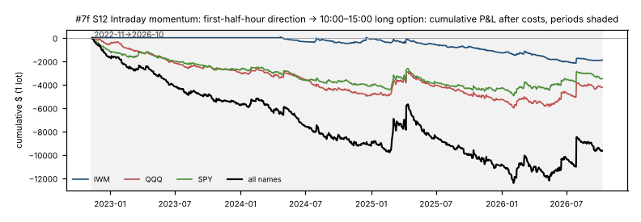

**Amendments, deviations and integrity checks.** seed 0 = the signal; 11–15 random.

**What it showed.** The option expression loses.

## #7g S12b 10:00 long option in the first-half-hour direction

**Folder:** `research/compass/studies/, results/v1/ (@7dfea57)`. **Commits:** A5.1 b9b9206 / — / be991de. **Dates:** 2026-10-14.

**Hypothesis.** As S12 with the baseline rule's contract.

**Rule.** Buy the baseline-rule 0DTE contract at 10:00 in the first-half-hour direction; exit 15:00.

**Fills and costs.** $0.70 a contract each side (protocol 113cad7), entry at the ask, exit at the bid, 1-minute NBBO

**Data.** SPY/QQQ/IWM 2022-11 → 2026-10.

**Periods and holdouts.** Walk-forward by calendar year (protocol 113cad7); reads counted in holdout B (ledger).

**Pass rule (as pre-registered).** As S12.

**Verdict.** Nothing promoted: −$4.87 a contract [−14.18, +4.87].

**Metrics** (return = % of premium; win = P&L > 0 after fees; breakeven is a loss; the interval is audit_lib's 20-session moving-block bootstrap over the period's calendar sessions):

| name | period | trades | sessions (traded / span) | win % | avg win %, $ | avg loss %, $ | median %, $ | mean %, $ | 20-session block 95% (%; $) |
|------------------|------------------------------|---------------|---------------------|------------|------------------------|------------------------|------------------------|------------------------|------------------------------------------------|
| IWM | 2022-11→2026-10 | 564 | 564 / 639 | 32.8 | +143.1, +109.85 | −83.1, −60.77 | −75.5, −41.40 | **−8.94**, −4.81 | [−19.12, +4.50]; [−13.87, +6.44] |
| QQQ | 2022-11→2026-10 | 964 | 964 / 1,010 | 32.7 | +149.0, +207.97 | −76.8, −109.79 | −62.1, −71.90 | **−3.05**, −5.96 | [−9.98, +4.00]; [−16.14, +4.07] |
| SPY | 2022-11→2026-10 | 971 | 971 / 1,010 | 34.4 | +143.7, +168.87 | −77.0, −94.40 | −61.0, −58.40 | **−1.04**, −3.84 | [−7.66, +6.24]; [−12.79, +7.75] |
| all names | 2022-11→2026-10 | 2,499 | 971 / 1,010 | 33.4 | +145.6, +170.54 | −78.3, −92.74 | −64.6, −55.40 | **−3.60**, −4.87 | [−9.45, +2.93]; [−12.95, +4.17] |

| name | period | biggest win ($, %, date, contract) | biggest loss ($, %, date, contract) | profit factor | max DD $ | longest DD (sessions) | top-5 days' share of profit |
|------------------|------------------------------|------------------------------------------------------------------|------------------------------------------------------------------|------------|---------------|---------------|------------------------------------|
| IWM | 2022-11→2026-10 | +858.60, +397.5%, 2025-04-09, IWM 176.0CALL | −181.40, −100.8%, 2025-04-23, IWM 194.0CALL | 0.88 | 3,344 | 425 | total ≤ 0 (best 5 days +3,043; without them −5,754) |
| QQQ | 2022-11→2026-10 | +2,477.60, +482.0%, 2025-04-09, QQQ 423.0CALL | −413.40, −99.9%, 2026-06-25, QQQ 704.0PUT | 0.92 | 7,404 | 987 | total ≤ 0 (best 5 days +6,398; without them −12,140) |
| SPY | 2022-11→2026-10 | +2,330.60, +411.0%, 2025-04-09, SPY 502.0CALL | −377.40, −100.4%, 2025-04-08, SPY 524.0CALL | 0.94 | 4,483 | 835 | total ≤ 0 (best 5 days +5,593; without them −9,323) |
| all names | 2022-11→2026-10 | +2,477.60, +482.0%, 2025-04-09, QQQ 423.0CALL | −413.40, −99.9%, 2026-06-25, QQQ 704.0PUT | 0.92 | 13,595 | 987 | total ≤ 0 (best 5 days +13,068; without them −25,251) |

**Random baseline:** the study's matched random controls (5 seeds, same symbols, sessions and exits, 12,446 trades): mean −11.99 dollars and −9.75% a trade (no percentile was computed).

**Exit reasons (share of trades):**

- 2022-11→2026-10: time 95.5%; settlement 4.5%

**By year** (all periods together, labelled by entry year):

| year | name | trades | win % | mean % | mean $ | total $ |
|---|---|---|---|---|---|---|
| 2024 | IWM | 144 | 29.9 | −17.42 | −10.60 | −1,527 |
| 2025 | IWM | 227 | 35.2 | +0.80 | +5.78 | +1,312 |
| 2026 | IWM | 193 | 32.1 | −14.05 | −12.93 | −2,496 |
| 2022 | QQQ | 31 | 45.2 | +15.39 | +21.73 | +674 |
| 2023 | QQQ | 247 | 30.0 | −10.02 | −10.61 | −2,620 |
| 2024 | QQQ | 248 | 32.7 | +2.78 | −0.13 | −32 |
| 2025 | QQQ | 246 | 33.7 | −3.65 | −4.25 | −1,046 |
| 2026 | QQQ | 192 | 32.8 | −3.80 | −14.15 | −2,717 |
| 2022 | SPY | 33 | 27.3 | −5.41 | −19.70 | −650 |
| 2023 | SPY | 248 | 33.5 | −7.24 | −6.21 | −1,540 |
| 2024 | SPY | 249 | 34.9 | −0.27 | −4.77 | −1,187 |
| 2025 | SPY | 247 | 37.7 | +5.91 | +11.57 | +2,857 |
| 2026 | SPY | 194 | 32.0 | −2.23 | −16.55 | −3,211 |
| 2022 | all names | 64 | 35.9 | +4.67 | +0.37 | +23 |
| 2023 | all names | 495 | 31.7 | −8.63 | −8.40 | −4,160 |
| 2024 | all names | 641 | 32.9 | −2.94 | −4.28 | −2,745 |
| 2025 | all names | 720 | 35.6 | +1.03 | +4.34 | +3,123 |
| 2026 | all names | 579 | 32.3 | −6.69 | −14.55 | −8,424 |

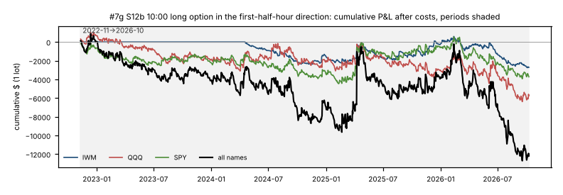

**Amendments, deviations and integrity checks.** —

**What it showed.** Negative.

## #7h S15 VRP-conditioned 10:00 short ATM 0DTE straddle (unconditional row)

**Folder:** `research/compass/studies/, results/v1/ (@7dfea57)`. **Commits:** A5 6dfba60 / — / 6ed12b6. **Dates:** 2026-10-14.

**Hypothesis.** Rich implied vs trailing realised volatility marks sellable straddles.

**Rule.** Sell the 10:00 ATM straddle at the bids, buy back at 15:50 at the asks.

**Fills and costs.** $0.70 a contract each side (protocol 113cad7), entry at the ask, exit at the bid, 1-minute NBBO

**Data.** SPY/QQQ 0DTE, 970/971 sessions 2022-11 → 2026-10.

**Periods and holdouts.** Walk-forward by calendar year (protocol 113cad7); reads counted in holdout B (ledger).

**Pass rule (as pre-registered).** A conditioned cell with a positive lower bound.

**Verdict.** Nothing promoted: unconditional −$15.46 a straddle [−32.68, +0.29]; rich implied forecasts large moves.

**Metrics** (return = % of the credit received; win = P&L > 0 after fees; breakeven is a loss; the interval is audit_lib's 20-session moving-block bootstrap over the period's calendar sessions):

| name | period | trades | sessions (traded / span) | win % | avg win %, $ | avg loss %, $ | median %, $ | mean %, $ | 20-session block 95% (%; $) |
|------------------|------------------------------|---------------|---------------------|------------|------------------------|------------------------|------------------------|------------------------|------------------------------------------------|
| QQQ | 2022-11→2026-10 | 971 | 971 / 1,010 | 58.1 | +44.1, +144.20 | −74.2, −236.12 | +13.8, +41.20 | **−5.49**, −15.22 | [−10.37, −0.97]; [−34.86, +1.25] |
| SPY | 2022-11→2026-10 | 970 | 970 / 1,010 | 57.9 | +43.1, +121.18 | −72.3, −204.23 | +13.9, +36.20 | **−5.44**, −15.70 | [−9.91, −1.65]; [−34.02, −1.83] |
| all names | 2022-11→2026-10 | 1,941 | 971 / 1,010 | 58.0 | +43.6, +132.71 | −73.2, −220.16 | +13.8, +39.20 | **−5.47**, −15.46 | [−9.93, −1.42]; [−33.96, −0.83] |

| name | period | biggest win ($, %, date, contract) | biggest loss ($, %, date, contract) | profit factor | max DD $ | longest DD (sessions) | top-5 days' share of profit |
|------------------|------------------------------|------------------------------------------------------------------|------------------------------------------------------------------|------------|---------------|---------------|------------------------------------|
| QQQ | 2022-11→2026-10 | +660.20, +75.7%, 2024-08-05, QQQ 10:00 short straddle 433.0 | −3,323.80, −279.1%, 2025-04-09, QQQ 10:00 short straddle 421.0 | 0.85 | 19,527 | 1,003 | total ≤ 0 (best 5 days +2,652; without them −17,426) |
| SPY | 2022-11→2026-10 | +658.20, +76.2%, 2024-08-05, SPY 10:00 short straddle 515.0 | −3,099.80, −230.8%, 2025-04-09, SPY 10:00 short straddle 500.0 | 0.82 | 17,307 | 999 | total ≤ 0 (best 5 days +2,515; without them −17,741) |
| all names | 2022-11→2026-10 | +660.20, +75.7%, 2024-08-05, QQQ 10:00 short straddle 433.0 | −3,323.80, −279.1%, 2025-04-09, QQQ 10:00 short straddle 421.0 | 0.83 | 35,674 | 1,003 | total ≤ 0 (best 5 days +5,055; without them −35,055) |

**Random baseline:** not available — no random baseline was computed by this study

**Exit reasons (share of trades):**

- 2022-11→2026-10: bought back 15:50 100.0%

**By year** (all periods together, labelled by entry year):

| year | name | trades | win % | mean % | mean $ | total $ |
|---|---|---|---|---|---|---|
| 2022 | QQQ | 33 | 45.5 | −15.07 | −40.22 | −1,327 |
| 2023 | QQQ | 248 | 51.6 | −12.00 | −24.15 | −5,990 |
| 2024 | QQQ | 249 | 63.5 | +0.66 | +3.55 | +884 |
| 2025 | QQQ | 247 | 58.3 | −7.12 | −32.12 | −7,935 |
| 2026 | QQQ | 194 | 61.3 | −1.38 | −2.09 | −405 |
| 2022 | SPY | 33 | 51.5 | −6.35 | −15.86 | −523 |
| 2023 | SPY | 248 | 57.3 | −6.51 | −10.36 | −2,568 |
| 2024 | SPY | 248 | 63.7 | −1.15 | −2.22 | −550 |
| 2025 | SPY | 247 | 54.7 | −7.84 | −33.25 | −8,212 |
| 2026 | SPY | 194 | 56.7 | −6.35 | −17.38 | −3,372 |
| 2022 | all names | 66 | 48.5 | −10.71 | −28.04 | −1,851 |
| 2023 | all names | 496 | 54.4 | −9.25 | −17.26 | −8,559 |
| 2024 | all names | 497 | 63.6 | −0.24 | +0.67 | +333 |
| 2025 | all names | 494 | 56.5 | −7.48 | −32.68 | −16,146 |
| 2026 | all names | 388 | 59.0 | −3.87 | −9.74 | −3,777 |

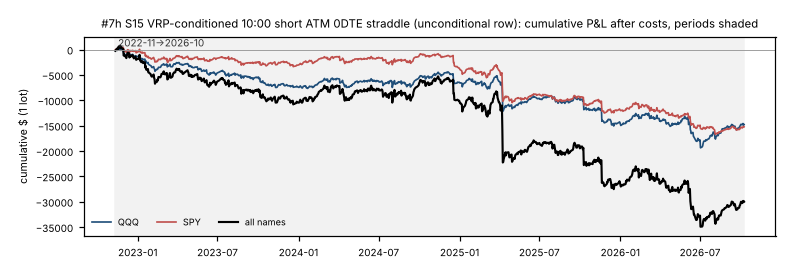

**Amendments, deviations and integrity checks.** —

**What it showed.** The 10:00 short straddle loses.

## #7i S16b Prior-day fade with a weekly contract (time exit)

**Folder:** `research/compass/studies/, results/v1/ (@7dfea57)`. **Commits:** A5 fe93f87 / — / 5cabc13, 3c8d6cb. **Dates:** 2026-10-14.

**Hypothesis.** The prior session's close-to-close move reverses.

**Rule.** Buy the weekly contract against the prior move at the 09:31 close; time exit.

**Fills and costs.** $0.70 a contract each side (protocol 113cad7), entry at the ask, exit at the bid, 1-minute NBBO

**Data.** SPY/QQQ/IWM weekly chains 2017-06 → 2026-10.

**Periods and holdouts.** Walk-forward by calendar year (protocol 113cad7); reads counted in holdout B (ledger).

**Pass rule (as pre-registered).** As S12.

**Verdict.** Nothing promoted: −$9.91 a contract [−19.31, −0.26].

**Metrics** (return = % of premium; win = P&L > 0 after fees; breakeven is a loss; the interval is audit_lib's 20-session moving-block bootstrap over the period's calendar sessions):

| name | period | trades | sessions (traded / span) | win % | avg win %, $ | avg loss %, $ | median %, $ | mean %, $ | 20-session block 95% (%; $) |
|------------------|------------------------------|---------------|---------------------|------------|------------------------|------------------------|------------------------|------------------------|------------------------------------------------|
| IWM | 2017-06→2026-10 | 287 | 287 / 2,411 | 36.6 | +47.6, +76.59 | −42.0, −65.66 | −17.5, −23.40 | **−9.21**, −13.62 | [−14.76, −3.11]; [−22.82, −3.73] |
| QQQ | 2017-06→2026-10 | 290 | 290 / 2,411 | 38.3 | +46.3, +134.29 | −41.5, −104.91 | −14.3, −28.90 | **−7.85**, −13.36 | [−13.53, −1.97]; [−30.61, +4.83] |
| SPY | 2017-06→2026-10 | 464 | 464 / 2,419 | 38.1 | +57.5, +131.77 | −42.9, −90.10 | −15.9, −24.40 | **−4.60**, −5.46 | [−11.77, +1.69]; [−21.15, +9.49] |
| all names | 2017-06→2026-10 | 1,041 | 699 / 2,419 | 37.8 | +51.7, +117.74 | −42.3, −87.33 | −16.4, −25.40 | **−6.78**, −9.91 | [−11.05, −3.10]; [−18.95, −0.47] |

| name | period | biggest win ($, %, date, contract) | biggest loss ($, %, date, contract) | profit factor | max DD $ | longest DD (sessions) | top-5 days' share of profit |
|------------------|------------------------------|------------------------------------------------------------------|------------------------------------------------------------------|------------|---------------|---------------|------------------------------------|
| IWM | 2017-06→2026-10 | +375.60, +220.9%, 2026-05-20, IWM 275.0CALL | −278.40, −72.9%, 2025-04-08, IWM 186.0CALL | 0.67 | 4,113 | 1,453 | total ≤ 0 (best 5 days +1,234; without them −5,142) |
| QQQ | 2017-06→2026-10 | +1,174.60, +123.6%, 2025-04-08, QQQ 435.0PUT | −445.40, −66.1%, 2026-06-12, QQQ 713.0PUT | 0.79 | 3,887 | 2,362 | total ≤ 0 (best 5 days +2,966; without them −6,839) |
| SPY | 2017-06→2026-10 | +1,274.60, +404.6%, 2022-10-13, SPY 350.0CALL | −416.40, −89.9%, 2022-05-04, SPY 415.0PUT | 0.90 | 4,600 | 2,387 | total ≤ 0 (best 5 days +4,189; without them −6,725) |
| all names | 2017-06→2026-10 | +1,274.60, +404.6%, 2022-10-13, SPY 350.0CALL | −445.40, −66.1%, 2026-06-12, QQQ 713.0PUT | 0.82 | 11,188 | 2,388 | total ≤ 0 (best 5 days +4,588; without them −14,905) |

**Random baseline:** the study's matched random controls (5 seeds, same symbols, sessions and exits, 5,218 trades): mean −9.80 dollars and −4.48% a trade (no percentile was computed).

**Exit reasons (share of trades):**

- 2017-06→2026-10: data_end 88.1%; time 11.9%

**By year** (all periods together, labelled by entry year):

| year | name | trades | win % | mean % | mean $ | total $ |
|---|---|---|---|---|---|---|
| 2017 | IWM | 16 | 18.8 | −29.60 | −17.96 | −287 |
| 2018 | IWM | 30 | 50.0 | +7.71 | +6.00 | +180 |
| 2019 | IWM | 32 | 34.4 | −4.32 | −1.84 | −59 |
| 2020 | IWM | 28 | 42.9 | −1.86 | −1.26 | −35 |
| 2021 | IWM | 31 | 38.7 | −15.39 | −24.24 | −751 |
| 2022 | IWM | 32 | 50.0 | −1.03 | +5.26 | +168 |
| 2023 | IWM | 31 | 38.7 | −2.67 | −7.37 | −228 |
| 2024 | IWM | 31 | 29.0 | −15.87 | −26.63 | −825 |
| 2025 | IWM | 32 | 21.9 | −31.25 | −53.93 | −1,726 |
| 2026 | IWM | 24 | 33.3 | −5.23 | −14.32 | −344 |
| 2017 | QQQ | 17 | 23.5 | −21.99 | −9.34 | −159 |
| 2018 | QQQ | 31 | 32.3 | −18.24 | −21.72 | −673 |
| 2019 | QQQ | 31 | 29.0 | −8.21 | −6.88 | −213 |
| 2020 | QQQ | 30 | 46.7 | +1.27 | −13.13 | −394 |
| 2021 | QQQ | 31 | 38.7 | −9.14 | −18.17 | −563 |
| 2022 | QQQ | 32 | 43.8 | −1.60 | −0.15 | −5 |
| 2023 | QQQ | 31 | 38.7 | −2.45 | +0.21 | +7 |
| 2024 | QQQ | 31 | 38.7 | −7.82 | −25.50 | −790 |
| 2025 | QQQ | 32 | 40.6 | −10.49 | −13.31 | −426 |
| 2026 | QQQ | 24 | 45.8 | −5.52 | −27.32 | −656 |
| 2017 | SPY | 58 | 43.1 | −0.06 | −0.71 | −41 |
| 2018 | SPY | 62 | 33.9 | −21.05 | −26.74 | −1,658 |
| 2019 | SPY | 64 | 34.4 | +4.95 | +9.12 | +583 |
| 2020 | SPY | 60 | 45.0 | +1.16 | +16.17 | +970 |
| 2021 | SPY | 64 | 29.7 | −10.72 | −13.95 | −893 |
| 2022 | SPY | 37 | 40.5 | −3.63 | −21.16 | −783 |
| 2023 | SPY | 32 | 34.4 | −15.11 | −41.74 | −1,336 |
| 2024 | SPY | 31 | 35.5 | −8.72 | −24.66 | −764 |
| 2025 | SPY | 31 | 48.4 | +8.62 | +32.83 | +1,018 |
| 2026 | SPY | 25 | 44.0 | +3.74 | +14.72 | +368 |
| 2017 | all names | 91 | 35.2 | −9.35 | −5.36 | −487 |
| 2018 | all names | 123 | 37.4 | −13.33 | −17.49 | −2,151 |
| 2019 | all names | 127 | 33.1 | −0.60 | +2.45 | +311 |
| 2020 | all names | 118 | 44.9 | +0.47 | +4.58 | +541 |
| 2021 | all names | 126 | 34.1 | −11.48 | −17.52 | −2,207 |
| 2022 | all names | 101 | 44.6 | −2.16 | −6.13 | −619 |
| 2023 | all names | 94 | 37.2 | −6.83 | −16.57 | −1,558 |
| 2024 | all names | 93 | 34.4 | −10.80 | −25.59 | −2,380 |
| 2025 | all names | 95 | 36.8 | −11.25 | −11.94 | −1,134 |
| 2026 | all names | 73 | 41.1 | −2.25 | −8.65 | −631 |

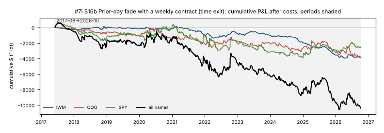

**Amendments, deviations and integrity checks.** —

**What it showed.** Negative.

## #7j-atm_put S17 Index put-writing: monthly ATM cash-secured put

**Folder:** `research/compass/studies/, results/v1/ (@7dfea57)`. **Commits:** A7 c81522a / wording 9ea4adf / 5e7e1bd. **Dates:** 2026-10-15.

**Hypothesis.** Index put-writing earns the variance risk premium (Cboe PUT).

**Rule.** Sell the standard monthly ATM put at the bid at expiry roll, hold to expiration, cash-secured.

**Fills and costs.** Bid in; settlement out; $0.70 a contract.

**Data.** SPY and QQQ standard monthlies 2012-06 → 2026-10.

**Periods and holdouts.** One span (2012–2026); no holdout.

**Pass rule (as pre-registered).** A7 carry-lane rule (positive mean with a positive lower bound per cell).

**Verdict.** PASSES A7 for QQQ ATM, 0.30Δ and 0.15Δ and SPY ATM puts; alpha 0 against the index, crash risk stated (a carry lane, not an edge).

**Metrics** (return = % of the cash set aside; win = P&L > 0 after fees; breakeven is a loss; the interval is audit_lib's 20-session moving-block bootstrap over the period's calendar sessions):

| name | period | trades | sessions (traded / span) | win % | avg win %, $ | avg loss %, $ | median %, $ | mean %, $ | 20-session block 95% (%; $) |
|------------------|------------------------------|---------------|---------------------|------------|------------------------|------------------------|------------------------|------------------------|------------------------------------------------|
| QQQ | 2012-06→2026-10 | 167 | 167 / 3,633 | 80.2 | +1.9, +495.15 | −4.1, −1,004.52 | +1.6, +215.60 | **+0.72**, +198.81 | [+0.20, +1.16]; [+56.08, +321.56] |
| SPY | 2012-06→2026-10 | 167 | 166 / 3,633 | 82.6 | +1.5, +526.40 | −3.9, −1,354.73 | +1.2, +329.60 | **+0.59**, +199.73 | [+0.07, +1.01]; [+19.36, +346.51] |
| all names | 2012-06→2026-10 | 334 | 167 / 3,633 | 81.4 | +1.7, +511.00 | −4.0, −1,168.33 | +1.4, +266.60 | **+0.65**, +199.27 | [+0.16, +1.07]; [+41.16, +332.55] |

| name | period | biggest win ($, %, date, contract) | biggest loss ($, %, date, contract) | profit factor | max DD $ | longest DD (sessions) | top-5 days' share of profit |
|------------------|------------------------------|------------------------------------------------------------------|------------------------------------------------------------------|------------|---------------|---------------|------------------------------------|
| QQQ | 2012-06→2026-10 | +2,116.60, +3.0%, 2026-07-17, QQQ 2026-08-21 695.0 | −5,457.40, −23.7%, 2020-02-21, QQQ 2020-03-20 230.0 | 2.00 | 7,626 | 581 | 24% |
| SPY | 2012-06→2026-10 | +1,692.60, +2.3%, 2026-05-15, SPY 2026-07-17 735.0 | −9,871.40, −29.6%, 2020-02-21, SPY 2020-03-20 333.0 | 1.85 | 9,871 | 586 | 22% |
| all names | 2012-06→2026-10 | +2,116.60, +3.0%, 2026-07-17, QQQ 2026-08-21 695.0 | −9,871.40, −29.6%, 2020-02-21, SPY 2020-03-20 333.0 | 1.92 | 15,329 | 581 | 23% |

**Random baseline:** not available — no random baseline was computed by this study

**Exit reasons (share of trades):**

- 2012-06→2026-10: held to expiration 100.0%

**By year** (all periods together, labelled by entry year):

| year | name | trades | win % | mean % | mean $ | total $ |
|---|---|---|---|---|---|---|
| 2012 | QQQ | 7 | 71.4 | +0.31 | +15.10 | +106 |
| 2013 | QQQ | 12 | 91.7 | +0.87 | +64.31 | +772 |
| 2014 | QQQ | 12 | 75.0 | +0.43 | +35.72 | +429 |
| 2015 | QQQ | 12 | 66.7 | −0.15 | −25.02 | −300 |
| 2016 | QQQ | 12 | 91.7 | +1.40 | +152.14 | +1,826 |
| 2017 | QQQ | 12 | 91.7 | +1.05 | +146.27 | +1,755 |
| 2018 | QQQ | 12 | 66.7 | −0.21 | −44.90 | −539 |
| 2019 | QQQ | 11 | 90.9 | +1.58 | +290.87 | +3,200 |
| 2020 | QQQ | 12 | 83.3 | +0.71 | +182.93 | +2,195 |
| 2021 | QQQ | 12 | 66.7 | +0.33 | +75.27 | +903 |
| 2022 | QQQ | 11 | 54.5 | −0.52 | −241.67 | −2,658 |
| 2023 | QQQ | 12 | 83.3 | +1.31 | +422.85 | +5,074 |
| 2024 | QQQ | 12 | 91.7 | +1.31 | +616.02 | +7,392 |
| 2025 | QQQ | 11 | 90.9 | +1.08 | +609.96 | +6,710 |
| 2026 | QQQ | 7 | 85.7 | +1.33 | +905.31 | +6,337 |
| 2012 | SPY | 7 | 71.4 | +0.74 | +99.03 | +693 |
| 2013 | SPY | 12 | 83.3 | +0.71 | +114.52 | +1,374 |
| 2014 | SPY | 12 | 83.3 | +0.53 | +95.02 | +1,140 |
| 2015 | SPY | 12 | 83.3 | +0.29 | +56.14 | +674 |
| 2016 | SPY | 12 | 91.7 | +1.24 | +253.02 | +3,036 |
| 2017 | SPY | 12 | 91.7 | +0.70 | +171.14 | +2,054 |
| 2018 | SPY | 12 | 66.7 | −0.53 | −160.32 | −1,924 |
| 2019 | SPY | 11 | 90.9 | +1.17 | +338.69 | +3,726 |
| 2020 | SPY | 12 | 83.3 | +0.01 | −77.65 | −932 |
| 2021 | SPY | 12 | 83.3 | +1.18 | +474.35 | +5,692 |
| 2022 | SPY | 11 | 63.6 | −0.32 | −183.45 | −2,018 |
| 2023 | SPY | 12 | 75.0 | +0.48 | +188.85 | +2,266 |
| 2024 | SPY | 12 | 91.7 | +1.05 | +577.77 | +6,933 |
| 2025 | SPY | 11 | 90.9 | +0.95 | +599.87 | +6,599 |
| 2026 | SPY | 7 | 85.7 | +0.80 | +577.46 | +4,042 |
| 2012 | all names | 14 | 71.4 | +0.52 | +57.06 | +799 |
| 2013 | all names | 24 | 87.5 | +0.79 | +89.41 | +2,146 |
| 2014 | all names | 24 | 79.2 | +0.48 | +65.37 | +1,569 |
| 2015 | all names | 24 | 75.0 | +0.07 | +15.56 | +373 |
| 2016 | all names | 24 | 91.7 | +1.32 | +202.58 | +4,862 |
| 2017 | all names | 24 | 91.7 | +0.88 | +158.70 | +3,809 |
| 2018 | all names | 24 | 66.7 | −0.37 | −102.61 | −2,463 |
| 2019 | all names | 22 | 90.9 | +1.37 | +314.78 | +6,925 |
| 2020 | all names | 24 | 83.3 | +0.36 | +52.64 | +1,263 |
| 2021 | all names | 24 | 75.0 | +0.75 | +274.81 | +6,595 |
| 2022 | all names | 22 | 59.1 | −0.42 | −212.56 | −4,676 |
| 2023 | all names | 24 | 79.2 | +0.89 | +305.85 | +7,340 |
| 2024 | all names | 24 | 91.7 | +1.18 | +596.89 | +14,325 |
| 2025 | all names | 22 | 90.9 | +1.02 | +604.92 | +13,308 |
| 2026 | all names | 14 | 85.7 | +1.06 | +741.39 | +10,379 |

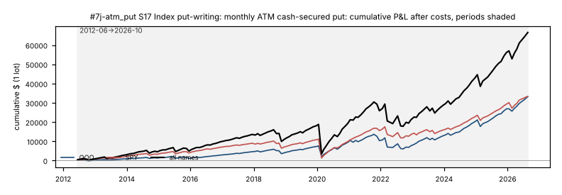

**Amendments, deviations and integrity checks.** Covered calls not significantly negative (9ea4adf).

**What it showed.** Put-writing earned its premium like the index it is short; a carry, not an edge.

## #7j-put_30d S17 Index put-writing: monthly 0.30-delta cash-secured put

**Folder:** `research/compass/studies/, results/v1/ (@7dfea57)`. **Commits:** A7 c81522a / wording 9ea4adf / 5e7e1bd. **Dates:** 2026-10-15.

**Hypothesis.** Index put-writing earns the variance risk premium (Cboe PUT).

**Rule.** Sell the standard monthly 0.30-delta put at the bid at expiry roll, hold to expiration, cash-secured.

**Fills and costs.** Bid in; settlement out; $0.70 a contract.

**Data.** SPY and QQQ standard monthlies 2012-06 → 2026-10.

**Periods and holdouts.** One span (2012–2026); no holdout.

**Pass rule (as pre-registered).** A7 carry-lane rule (positive mean with a positive lower bound per cell).

**Verdict.** PASSES A7 for QQQ ATM, 0.30Δ and 0.15Δ and SPY ATM puts; alpha 0 against the index, crash risk stated (a carry lane, not an edge).

**Metrics** (return = % of the cash set aside; win = P&L > 0 after fees; breakeven is a loss; the interval is audit_lib's 20-session moving-block bootstrap over the period's calendar sessions):

| name | period | trades | sessions (traded / span) | win % | avg win %, $ | avg loss %, $ | median %, $ | mean %, $ | 20-session block 95% (%; $) |
|------------------|------------------------------|---------------|---------------------|------------|------------------------|------------------------|------------------------|------------------------|------------------------------------------------|
| QQQ | 2012-06→2026-10 | 167 | 167 / 3,633 | 85.6 | +1.2, +317.04 | −3.7, −835.30 | +1.0, +155.60 | **+0.51**, +151.44 | [+0.11, +0.86]; [+43.50, +238.72] |
| SPY | 2012-06→2026-10 | 167 | 166 / 3,633 | 85.6 | +1.0, +337.16 | −3.3, −1,091.40 | +0.8, +222.60 | **+0.40**, +131.86 | [−0.08, +0.72]; [−22.88, +240.91] |
| all names | 2012-06→2026-10 | 334 | 167 / 3,633 | 85.6 | +1.1, +327.10 | −3.5, −963.35 | +0.9, +185.60 | **+0.46**, +141.65 | [+0.02, +0.79]; [+15.02, +238.25] |

| name | period | biggest win ($, %, date, contract) | biggest loss ($, %, date, contract) | profit factor | max DD $ | longest DD (sessions) | top-5 days' share of profit |
|------------------|------------------------------|------------------------------------------------------------------|------------------------------------------------------------------|------------|---------------|---------------|------------------------------------|
| QQQ | 2012-06→2026-10 | +1,426.60, +2.1%, 2026-05-15, QQQ 2026-07-17 675.0 | −5,031.40, −22.5%, 2020-02-21, QQQ 2020-03-20 224.0 | 2.26 | 5,031 | 368 | 22% |
| SPY | 2012-06→2026-10 | +1,115.60, +1.6%, 2026-05-15, SPY 2026-07-17 715.0 | −9,371.40, −28.7%, 2020-02-21, SPY 2020-03-20 326.0 | 1.84 | 9,371 | 408 | 20% |
| all names | 2012-06→2026-10 | +1,426.60, +2.1%, 2026-05-15, QQQ 2026-07-17 675.0 | −9,371.40, −28.7%, 2020-02-21, SPY 2020-03-20 326.0 | 2.02 | 14,403 | 343 | 21% |

**Random baseline:** not available — no random baseline was computed by this study

**Exit reasons (share of trades):**

- 2012-06→2026-10: held to expiration 100.0%

**By year** (all periods together, labelled by entry year):

| year | name | trades | win % | mean % | mean $ | total $ |
|---|---|---|---|---|---|---|
| 2012 | QQQ | 7 | 71.4 | +0.09 | +1.53 | +11 |
| 2013 | QQQ | 12 | 91.7 | +0.50 | +36.47 | +438 |
| 2014 | QQQ | 12 | 75.0 | +0.32 | +25.47 | +306 |
| 2015 | QQQ | 12 | 75.0 | −0.22 | −29.03 | −348 |
| 2016 | QQQ | 12 | 91.7 | +0.98 | +104.35 | +1,252 |
| 2017 | QQQ | 12 | 100.0 | +0.77 | +106.52 | +1,278 |
| 2018 | QQQ | 12 | 75.0 | −0.07 | −16.65 | −200 |
| 2019 | QQQ | 11 | 100.0 | +1.10 | +198.60 | +2,185 |
| 2020 | QQQ | 12 | 83.3 | −0.10 | −15.90 | −191 |
| 2021 | QQQ | 12 | 75.0 | +0.58 | +174.77 | +2,097 |
| 2022 | QQQ | 11 | 81.8 | +0.17 | −13.04 | −143 |
| 2023 | QQQ | 12 | 83.3 | +0.87 | +274.35 | +3,292 |
| 2024 | QQQ | 12 | 91.7 | +0.87 | +400.85 | +4,810 |
| 2025 | QQQ | 11 | 90.9 | +0.75 | +419.60 | +4,616 |
| 2026 | QQQ | 7 | 100.0 | +1.32 | +841.17 | +5,888 |
| 2012 | SPY | 7 | 85.7 | +0.65 | +87.46 | +612 |
| 2013 | SPY | 12 | 83.3 | +0.48 | +77.35 | +928 |
| 2014 | SPY | 12 | 91.7 | +0.39 | +69.35 | +832 |
| 2015 | SPY | 12 | 83.3 | +0.22 | +41.60 | +499 |
| 2016 | SPY | 12 | 91.7 | +0.87 | +175.39 | +2,105 |
| 2017 | SPY | 12 | 91.7 | +0.55 | +130.68 | +1,568 |
| 2018 | SPY | 12 | 66.7 | −0.45 | −130.90 | −1,571 |
| 2019 | SPY | 11 | 90.9 | +0.80 | +227.78 | +2,506 |
| 2020 | SPY | 12 | 91.7 | −0.71 | −293.65 | −3,524 |
| 2021 | SPY | 12 | 91.7 | +0.99 | +400.10 | +4,801 |
| 2022 | SPY | 11 | 72.7 | +0.09 | −5.31 | −58 |
| 2023 | SPY | 12 | 75.0 | +0.36 | +139.35 | +1,672 |
| 2024 | SPY | 12 | 91.7 | +0.69 | +373.18 | +4,478 |
| 2025 | SPY | 11 | 90.9 | +0.63 | +392.24 | +4,315 |
| 2026 | SPY | 7 | 85.7 | +0.58 | +408.17 | +2,857 |
| 2012 | all names | 14 | 78.6 | +0.37 | +44.49 | +623 |
| 2013 | all names | 24 | 87.5 | +0.49 | +56.91 | +1,366 |
| 2014 | all names | 24 | 83.3 | +0.35 | +47.41 | +1,138 |
| 2015 | all names | 24 | 79.2 | +0.00 | +6.29 | +151 |
| 2016 | all names | 24 | 91.7 | +0.92 | +139.87 | +3,357 |
| 2017 | all names | 24 | 95.8 | +0.66 | +118.60 | +2,846 |
| 2018 | all names | 24 | 70.8 | −0.26 | −73.77 | −1,771 |
| 2019 | all names | 22 | 95.5 | +0.95 | +213.19 | +4,690 |
| 2020 | all names | 24 | 87.5 | −0.40 | −154.77 | −3,715 |
| 2021 | all names | 24 | 83.3 | +0.78 | +287.43 | +6,898 |
| 2022 | all names | 22 | 77.3 | +0.13 | −9.17 | −202 |
| 2023 | all names | 24 | 79.2 | +0.61 | +206.85 | +4,964 |
| 2024 | all names | 24 | 91.7 | +0.78 | +387.02 | +9,288 |
| 2025 | all names | 22 | 90.9 | +0.69 | +405.92 | +8,930 |
| 2026 | all names | 14 | 92.9 | +0.95 | +624.67 | +8,745 |

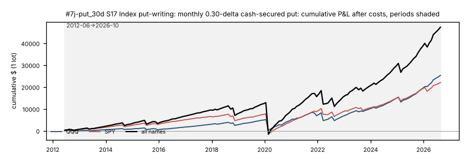

**Amendments, deviations and integrity checks.** Covered calls not significantly negative (9ea4adf).

**What it showed.** Put-writing earned its premium like the index it is short; a carry, not an edge.

## #7j-put_15d S17 Index put-writing: monthly 0.15-delta cash-secured put

**Folder:** `research/compass/studies/, results/v1/ (@7dfea57)`. **Commits:** A7 c81522a / wording 9ea4adf / 5e7e1bd. **Dates:** 2026-10-15.

**Hypothesis.** Index put-writing earns the variance risk premium (Cboe PUT).

**Rule.** Sell the standard monthly 0.15-delta put at the bid at expiry roll, hold to expiration, cash-secured.

**Fills and costs.** Bid in; settlement out; $0.70 a contract.

**Data.** SPY and QQQ standard monthlies 2012-06 → 2026-10.

**Periods and holdouts.** One span (2012–2026); no holdout.

**Pass rule (as pre-registered).** A7 carry-lane rule (positive mean with a positive lower bound per cell).

**Verdict.** PASSES A7 for QQQ ATM, 0.30Δ and 0.15Δ and SPY ATM puts; alpha 0 against the index, crash risk stated (a carry lane, not an edge).

**Metrics** (return = % of the cash set aside; win = P&L > 0 after fees; breakeven is a loss; the interval is audit_lib's 20-session moving-block bootstrap over the period's calendar sessions):

| name | period | trades | sessions (traded / span) | win % | avg win %, $ | avg loss %, $ | median %, $ | mean %, $ | 20-session block 95% (%; $) |
|------------------|------------------------------|---------------|---------------------|------------|------------------------|------------------------|------------------------|------------------------|------------------------------------------------|
| QQQ | 2012-06→2026-10 | 167 | 167 / 3,633 | 93.4 | +0.6, +150.58 | −3.9, −781.85 | +0.5, +85.60 | **+0.30**, +89.16 | [−0.01, +0.51]; [+18.70, +137.29] |
| SPY | 2012-06→2026-10 | 167 | 166 / 3,633 | 94.6 | +0.5, +159.43 | −4.6, −1,391.07 | +0.4, +113.60 | **+0.22**, +75.87 | [−0.19, +0.45]; [−48.89, +147.70] |
| all names | 2012-06→2026-10 | 334 | 167 / 3,633 | 94.0 | +0.5, +155.03 | −4.2, −1,056.00 | +0.5, +106.10 | **+0.26**, +82.52 | [−0.10, +0.47]; [−15.66, +141.14] |

| name | period | biggest win ($, %, date, contract) | biggest loss ($, %, date, contract) | profit factor | max DD $ | longest DD (sessions) | top-5 days' share of profit |
|------------------|------------------------------|------------------------------------------------------------------|------------------------------------------------------------------|------------|---------------|---------------|------------------------------------|
| QQQ | 2012-06→2026-10 | +718.60, +1.1%, 2026-05-15, QQQ 2026-07-17 635.0 | −4,191.40, −19.6%, 2020-02-21, QQQ 2020-03-20 214.0 | 2.73 | 4,191 | 408 | 18% |
| SPY | 2012-06→2026-10 | +527.60, +0.8%, 2026-05-15, SPY 2026-07-17 675.0 | −8,446.40, −26.8%, 2020-02-21, SPY 2020-03-20 315.0 | 2.01 | 8,543 | 1,336 | 17% |
| all names | 2012-06→2026-10 | +718.60, +1.1%, 2026-05-15, QQQ 2026-07-17 635.0 | −8,446.40, −26.8%, 2020-02-21, SPY 2020-03-20 315.0 | 2.30 | 12,638 | 776 | 17% |

**Random baseline:** not available — no random baseline was computed by this study

**Exit reasons (share of trades):**

- 2012-06→2026-10: held to expiration 100.0%

**By year** (all periods together, labelled by entry year):

| year | name | trades | win % | mean % | mean $ | total $ |
|---|---|---|---|---|---|---|
| 2012 | QQQ | 7 | 85.7 | +0.16 | +7.89 | +55 |
| 2013 | QQQ | 12 | 91.7 | +0.30 | +21.31 | +256 |
| 2014 | QQQ | 12 | 91.7 | +0.17 | +12.93 | +155 |
| 2015 | QQQ | 12 | 83.3 | −0.06 | −9.52 | −114 |
| 2016 | QQQ | 12 | 100.0 | +0.51 | +52.43 | +629 |
| 2017 | QQQ | 12 | 100.0 | +0.37 | +50.10 | +601 |
| 2018 | QQQ | 12 | 83.3 | +0.17 | +26.43 | +317 |
| 2019 | QQQ | 11 | 100.0 | +0.54 | +93.33 | +1,027 |
| 2020 | QQQ | 12 | 91.7 | −0.68 | −144.48 | −1,734 |
| 2021 | QQQ | 12 | 100.0 | +0.72 | +231.18 | +2,774 |
| 2022 | QQQ | 11 | 81.8 | +0.14 | +12.42 | +137 |
| 2023 | QQQ | 12 | 100.0 | +0.57 | +182.77 | +2,193 |
| 2024 | QQQ | 12 | 100.0 | +0.52 | +228.43 | +2,741 |
| 2025 | QQQ | 11 | 90.9 | +0.46 | +241.69 | +2,659 |
| 2026 | QQQ | 7 | 100.0 | +0.76 | +456.31 | +3,194 |
| 2012 | SPY | 7 | 100.0 | +0.45 | +59.17 | +414 |
| 2013 | SPY | 12 | 100.0 | +0.35 | +55.18 | +662 |
| 2014 | SPY | 12 | 91.7 | +0.20 | +35.27 | +423 |
| 2015 | SPY | 12 | 91.7 | +0.23 | +41.93 | +503 |
| 2016 | SPY | 12 | 100.0 | +0.45 | +87.18 | +1,046 |
| 2017 | SPY | 12 | 100.0 | +0.30 | +71.35 | +856 |
| 2018 | SPY | 12 | 83.3 | −0.24 | −65.57 | −787 |
| 2019 | SPY | 11 | 100.0 | +0.45 | +123.33 | +1,357 |
| 2020 | SPY | 12 | 91.7 | −1.38 | −472.40 | −5,669 |
| 2021 | SPY | 12 | 100.0 | +0.59 | +234.43 | +2,813 |
| 2022 | SPY | 11 | 81.8 | +0.36 | +123.05 | +1,354 |
| 2023 | SPY | 12 | 91.7 | +0.40 | +157.02 | +1,884 |
| 2024 | SPY | 12 | 100.0 | +0.38 | +199.10 | +2,389 |
| 2025 | SPY | 11 | 90.9 | +0.44 | +258.96 | +2,849 |
| 2026 | SPY | 7 | 100.0 | +0.55 | +367.89 | +2,575 |
| 2012 | all names | 14 | 92.9 | +0.31 | +33.53 | +469 |
| 2013 | all names | 24 | 95.8 | +0.32 | +38.25 | +918 |
| 2014 | all names | 24 | 91.7 | +0.18 | +24.10 | +578 |
| 2015 | all names | 24 | 87.5 | +0.09 | +16.20 | +389 |
| 2016 | all names | 24 | 100.0 | +0.48 | +69.81 | +1,675 |
| 2017 | all names | 24 | 100.0 | +0.34 | +60.73 | +1,457 |
| 2018 | all names | 24 | 83.3 | −0.04 | −19.57 | −470 |
| 2019 | all names | 22 | 100.0 | +0.49 | +108.33 | +2,383 |
| 2020 | all names | 24 | 91.7 | −1.03 | −308.44 | −7,403 |
| 2021 | all names | 24 | 100.0 | +0.66 | +232.81 | +5,587 |
| 2022 | all names | 22 | 81.8 | +0.25 | +67.74 | +1,490 |
| 2023 | all names | 24 | 95.8 | +0.49 | +169.89 | +4,077 |
| 2024 | all names | 24 | 100.0 | +0.45 | +213.77 | +5,130 |
| 2025 | all names | 22 | 90.9 | +0.45 | +250.33 | +5,507 |
| 2026 | all names | 14 | 100.0 | +0.66 | +412.10 | +5,769 |

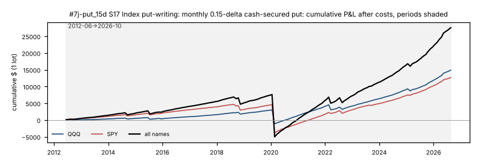

**Amendments, deviations and integrity checks.** Covered calls not significantly negative (9ea4adf).

**What it showed.** Put-writing earned its premium like the index it is short; a carry, not an edge.

## #8a V1 T0: short every monthly ATM straddle across the optionable universe

**Folder:** `research/compass/intel/, studies/v*.py, results/v1/ (@7dfea57)`. **Commits:** A8 29f20e3 (A8.1–A8.4) / — / aff15d9, df4fe32. **Dates:** 2026-10-15.

**Hypothesis.** Single-name monthly straddles are overpriced (volatility risk premium).

**Rule.** Sell the ATM straddle of every optionable name at the cycle's entry, hold to expiration (adverse fill: one tick worse).

**Fills and costs.** $0.70 a contract each side; mid ± one tick ("adv").

**Data.** The optionable universe 2023-11 → 2026-08, 44,447 name-cycles.

**Periods and holdouts.** development / validation / hold-out (each hold-out opened once).

**Pass rule (as pre-registered).** A8: negative T0 with sorts (T1 IV/RV, T2 term slope, T3 skew) adding a positive long-short.

**Verdict.** Rejected: T0 −13.2% of premium dev+val [−22.4, −5.0], −23.6% hold-out; T1–T3 add nothing.

**Metrics** (return = % of premium; win = P&L > 0 after fees; breakeven is a loss; the interval is audit_lib's 20-session moving-block bootstrap over the period's calendar sessions):

| name | period | trades | sessions (traded / span) | win % | avg win %, $ | avg loss %, $ | median %, $ | mean %, $ | 20-session block 95% (%; $) |
|------------------|------------------------------|---------------|---------------------|------------|------------------------|------------------------|------------------------|------------------------|------------------------------------------------|
| ADR | development | 731 | 14 / 283 | 50.8 | +46.8, +306.71 | −77.2, −433.68 | +0.6, +4.60 | **−14.31**, −57.92 | [−29.64, −4.41]; [−175.12, +24.87] |
| Common Stock | development | 12,281 | 14 / 283 | 54.6 | +47.3, +505.35 | −73.7, −746.99 | +8.1, +35.60 | **−7.69**, −63.56 | [−9.11, +0.46]; [−110.62, +9.05] |
| ETF | development | 2,642 | 14 / 283 | 50.5 | +44.5, +257.26 | −61.3, −253.01 | +0.8, +2.60 | **−7.86**, +4.83 | [−18.67, +8.12]; [−60.93, +83.28] |
| Structured Product | development | 12 | 12 / 283 | 75.0 | +50.5, +154.93 | −43.3, −109.73 | +34.5, +94.60 | **+27.04**, +88.77 | [−7.09, +49.70]; [−15.04, +128.61] |
| Unit | development | 51 | 14 / 283 | 58.8 | +40.6, +38.37 | −95.8, −94.92 | +13.2, +10.60 | **−15.55**, −16.52 | [−32.77, +21.79]; [−26.56, +23.01] |
| stock | development | 14 | 14 / 283 | 57.1 | +54.5, +104.10 | −49.3, −78.57 | +18.2, +25.60 | **+10.02**, +25.81 | [−18.20, +40.54]; [−27.96, +81.22] |
| all names | development | 15,731 | 14 / 283 | 53.7 | +46.8, +455.05 | −71.7, −640.06 | +6.7, +23.60 | **−8.01**, −51.47 | [−10.10, +0.41]; [−91.60, +11.71] |
| ADR | validation | 761 | 12 / 239 | 50.2 | +43.9, +357.50 | −85.8, −581.61 | +0.9, +3.60 | **−20.69**, −110.21 | [−32.48, −5.20]; [−190.84, +30.48] |
| Common Stock | validation | 12,557 | 12 / 239 | 48.5 | +45.6, +573.59 | −82.5, −939.24 | −3.0, −13.40 | **−20.38**, −205.54 | [−35.64, −5.51]; [−395.03, −27.17] |
| ETF | validation | 2,832 | 12 / 239 | 45.4 | +43.2, +288.52 | −78.8, −497.04 | −8.1, −21.40 | **−23.43**, −140.32 | [−52.31, −1.38]; [−395.08, +27.44] |
| Other | validation | 2 | 2 / 21 | 0.0 | —, — | −101.1, −336.90 | −101.1, −336.90 | **−101.09**, −336.90 | n/a (< 60 sessions); n/a (< 60 sessions) |
| Structured Product | validation | 12 | 12 / 239 | 58.3 | +43.8, +240.46 | −121.6, −748.00 | +21.0, +106.10 | **−25.09**, −171.40 | [−139.90, +22.16]; [−757.83, +126.42] |
| Unit | validation | 45 | 12 / 239 | 57.8 | +50.2, +73.02 | −76.6, −91.56 | +25.0, +26.60 | **−3.33**, +3.53 | [−43.01, +37.34]; [−49.35, +53.67] |
| stock | validation | 23 | 12 / 239 | 34.8 | +44.5, +150.10 | −103.9, −377.07 | −34.4, −121.40 | **−52.24**, −193.70 | [−104.78, −7.46]; [−283.60, −13.73] |
| all names | validation | 16,232 | 12 / 239 | 48.0 | +45.1, +513.59 | −82.0, −838.93 | −3.8, −15.40 | **−20.93**, −189.08 | [−38.05, −5.29]; [−374.52, −19.12] |
| ADR | hold-out | 588 | 8 / 155 | 46.3 | +40.7, +556.16 | −82.1, −793.25 | −10.2, −34.40 | **−25.31**, −169.03 | [−46.43, −12.36]; [−504.30, +6.57] |
| Common Stock | hold-out | 9,500 | 8 / 155 | 46.0 | +43.8, +772.61 | −78.3, −1,105.96 | −8.2, −45.40 | **−22.12**, −241.42 | [−26.76, −14.02]; [−378.73, −38.93] |
| ETF | hold-out | 2,296 | 8 / 155 | 37.1 | +40.2, +375.90 | −77.9, −662.00 | −24.7, −78.90 | **−34.11**, −277.31 | [−53.44, −22.80]; [−496.93, −184.25] |
| Other | hold-out | 11 | 7 / 155 | 45.5 | +40.5, +347.40 | −44.3, −419.90 | −10.0, −170.40 | **−5.76**, −71.13 | [−53.95, +36.37]; [−460.90, +388.60] |
| Structured Product | hold-out | 8 | 8 / 155 | 62.5 | +44.8, +166.60 | −25.2, −110.07 | +16.2, +41.60 | **+18.57**, +62.85 | [−18.81, +44.93]; [−90.70, +131.46] |
| Unit | hold-out | 34 | 8 / 155 | 44.1 | +38.1, +59.73 | −81.1, −105.77 | −11.0, −19.40 | **−28.55**, −32.75 | [−55.00, +7.31]; [−69.69, +10.54] |
| stock | hold-out | 47 | 8 / 155 | 42.6 | +58.3, +659.05 | −63.1, −623.03 | −4.1, −41.40 | **−11.47**, −77.46 | [−51.92, +4.60]; [−611.61, +116.11] |
| all names | hold-out | 12,484 | 8 / 155 | 44.4 | +43.1, +697.78 | −78.3, −993.71 | −11.1, −50.40 | **−24.41**, −243.08 | [−32.05, −16.96]; [−369.04, −70.18] |

| name | period | biggest win ($, %, date, contract) | biggest loss ($, %, date, contract) | profit factor | max DD $ | longest DD (sessions) | top-5 days' share of profit |
|------------------|------------------------------|------------------------------------------------------------------|------------------------------------------------------------------|------------|---------------|---------------|------------------------------------|
| ADR | development | +4,424.60, +66.0%, 2024-07-22, ASML 2024-08-16 940.0 straddle | −11,415.40, −224.7%, 2024-01-22, ASML 2024-02-16 765.0 straddle | 0.73 | 57,903 | 283 | total ≤ 0 (best 5 days +30,869; without them −73,206) |
| Common Stock | development | +19,754.60, +36.9%, 2024-03-18, MSTR 2024-04-19 1500.0 straddle | −95,327.40, −739.7%, 2024-02-20, MSTR 2024-03-15 705.0 straddle | 0.81 | 849,895 | 283 | total ≤ 0 (best 5 days +263,308; without them −1,043,946) |
| ETF | development | +2,698.60, +41.9%, 2024-11-18, MSTX 2024-12-20 115.0 straddle | −5,421.40, −209.3%, 2024-05-20, NVDX 2024-06-21 105.0 straddle | 1.04 | 118,222 | 282 | 958% |
| Structured Product | development | +489.60, +90.8%, 2024-12-23, VXX 2025-01-17 44.0 straddle | −182.40, −97.0%, 2024-04-22, VXX 2024-05-17 14.5 straddle | 4.24 | 182 | 109 | 105% |
| Unit | development | +116.60, +72.9%, 2024-08-19, WES 2024-09-20 39.0 straddle | −444.40, −191.1%, 2023-11-20, NEP 2023-12-15 23.5 straddle | 0.58 | 892 | 217 | total ≤ 0 (best 5 days +665; without them −1,507) |
| stock | development | +190.60, +88.7%, 2024-10-21, SPLG 2024-11-15 69.0 straddle | −155.40, −84.0%, 2024-04-22, SPLG 2024-05-17 59.0 straddle | 1.77 | 407 | 237 | 196% |
| all names | development | +19,754.60, +36.9%, 2024-03-18, MSTR 2024-04-19 1500.0 straddle | −95,327.40, −739.7%, 2024-02-20, MSTR 2024-03-15 705.0 straddle | 0.83 | 935,320 | 283 | total ≤ 0 (best 5 days +337,989; without them −1,147,618) |
| ADR | validation | +4,875.60, +87.1%, 2025-05-19, ASML 2025-06-20 750.0 straddle | −23,248.40, −315.7%, 2025-12-22, ASML 2026-01-16 1055.0 straddle | 0.62 | 99,037 | 195 | total ≤ 0 (best 5 days +25,684; without them −109,551) |
| Common Stock | validation | +21,041.60, +68.0%, 2025-05-19, BKNG 2025-06-20 5380.0 straddle | −45,598.40, −100.8%, 2025-04-21, BKNG 2025-05-16 4440.0 straddle | 0.58 | 2,580,922 | 239 | total ≤ 0 (best 5 days +57,393; without them −2,638,314) |
| ETF | validation | +4,381.60, +87.3%, 2025-08-18, ETHU 2025-09-19 155.0 straddle | −8,802.40, −210.3%, 2025-04-21, VGT 2025-05-16 490.0 straddle | 0.48 | 418,065 | 239 | total ≤ 0 (best 5 days +121,592; without them −518,978) |
| Other | validation | −199.40, −67.6%, 2025-06-23, RDW 2025-07-18 15.0 straddle | −474.40, −134.6%, 2025-07-21, RDW 2025-08-15 17.0 straddle | 0.00 | 674 | 21 | total ≤ 0 (best 5 days −674; without them +0) |
| Structured Product | validation | +532.60, +70.8%, 2025-05-19, VXX 2025-06-20 52.5 straddle | −2,174.40, −453.9%, 2025-03-24, VXX 2025-04-17 45.5 straddle | 0.45 | 3,233 | 195 | total ≤ 0 (best 5 days +1,471; without them −3,528) |
| Unit | validation | +201.60, +92.7%, 2025-07-21, MPLX 2025-08-15 50.0 straddle | −261.40, −126.0%, 2025-03-24, MPLX 2025-04-17 55.0 straddle | 1.09 | 944 | 105 | 816% |
| stock | validation | +410.60, +56.6%, 2025-07-21, HIMZ 2025-08-15 19.0 straddle | −1,176.40, −162.3%, 2025-12-22, Q 2026-01-16 80.0 straddle | 0.21 | 4,606 | 215 | total ≤ 0 (best 5 days +705; without them −5,161) |
| all names | validation | +21,041.60, +68.0%, 2025-05-19, BKNG 2025-06-20 5380.0 straddle | −45,598.40, −100.8%, 2025-04-21, BKNG 2025-05-16 4440.0 straddle | 0.57 | 3,069,201 | 239 | total ≤ 0 (best 5 days +112,574; without them −3,181,775) |
| ADR | hold-out | +21,362.60, +87.6%, 2026-07-20, ASML 2026-08-21 1740.0 straddle | −29,899.40, −178.8%, 2026-05-18, ASML 2026-06-18 1470.0 straddle | 0.60 | 125,168 | 155 | total ≤ 0 (best 5 days +21,649; without them −121,041) |
| Common Stock | hold-out | +30,840.60, +58.9%, 2026-07-20, SNDK 2026-08-21 1390.0 straddle | −65,572.40, −189.2%, 2026-01-20, BKNG 2026-02-20 5050.0 straddle | 0.60 | 2,538,940 | 155 | total ≤ 0 (best 5 days −797,645; without them −1,495,846) |
| ETF | hold-out | +7,361.60, +95.7%, 2026-07-20, SMH 2026-08-21 560.0 straddle | −47,329.40, −266.6%, 2026-05-18, MUU 2026-06-18 445.0 straddle | 0.33 | 646,925 | 131 | total ≤ 0 (best 5 days −168,315; without them −468,381) |
| Other | hold-out | +743.60, +43.0%, 2026-05-18, FCFS 2026-06-18 220.0 straddle | −1,185.40, −67.5%, 2026-04-20, FCFS 2026-05-15 200.0 straddle | 0.69 | 1,583 | 111 | total ≤ 0 (best 5 days +1,079; without them −1,862) |
| Structured Product | hold-out | +351.60, +60.6%, 2026-01-20, VXX 2026-02-20 29.5 straddle | −216.40, −43.6%, 2026-02-23, VXX 2026-03-20 29.5 straddle | 2.52 | 216 | 85 | 166% |
| Unit | hold-out | +193.60, +73.8%, 2026-04-20, MPLX 2026-05-15 55.0 straddle | −297.40, −241.8%, 2026-01-20, EPD 2026-02-20 32.5 straddle | 0.45 | 1,458 | 155 | total ≤ 0 (best 5 days +303; without them −1,416) |
| stock | hold-out | +2,136.60, +74.8%, 2026-07-20, Q 2026-08-21 135.0 straddle | −1,753.40, −174.5%, 2026-06-22, SOLS 2026-07-17 85.0 straddle | 0.78 | 9,338 | 155 | total ≤ 0 (best 5 days +6,697; without them −10,338) |
| all names | hold-out | +30,840.60, +58.9%, 2026-07-20, SNDK 2026-08-21 1390.0 straddle | −65,572.40, −189.2%, 2026-01-20, BKNG 2026-02-20 5050.0 straddle | 0.56 | 3,291,177 | 155 | total ≤ 0 (best 5 days −1,258,337; without them −1,776,277) |

**Random baseline:** not available — no random baseline was computed by this study

**Exit reasons (share of trades):**

- development: held to expiration 100.0%
- validation: held to expiration 100.0%
- hold-out: held to expiration 100.0%

**By year** (all periods together, labelled by entry year):

| year | name | trades | win % | mean % | mean $ | total $ |
|---|---|---|---|---|---|---|
| 2023 | ADR | 106 | 47.2 | −14.16 | −69.15 | −7,330 |
| 2024 | ADR | 625 | 51.4 | −14.34 | −56.01 | −35,007 |
| 2025 | ADR | 761 | 50.2 | −20.69 | −110.21 | −83,866 |
| 2026 | ADR | 588 | 46.3 | −25.31 | −169.03 | −99,392 |
| 2023 | Common Stock | 1,681 | 51.9 | −23.11 | −135.18 | −227,229 |
| 2024 | Common Stock | 10,600 | 55.0 | −5.24 | −52.21 | −553,408 |
| 2025 | Common Stock | 12,557 | 48.5 | −20.38 | −205.54 | −2,580,922 |
| 2026 | Common Stock | 9,500 | 46.0 | −22.12 | −241.42 | −2,293,491 |
| 2023 | ETF | 404 | 39.6 | −33.22 | −92.67 | −37,440 |
| 2024 | ETF | 2,238 | 52.5 | −3.28 | +22.43 | +50,202 |
| 2025 | ETF | 2,832 | 45.4 | −23.43 | −140.32 | −397,386 |
| 2026 | ETF | 2,296 | 37.1 | −34.11 | −277.31 | −636,696 |
| 2025 | Other | 2 | 0.0 | −101.09 | −336.90 | −674 |
| 2026 | Other | 11 | 45.5 | −5.76 | −71.13 | −782 |
| 2023 | Structured Product | 2 | 50.0 | +16.33 | +34.10 | +68 |
| 2024 | Structured Product | 10 | 80.0 | +29.18 | +99.70 | +997 |
| 2025 | Structured Product | 12 | 58.3 | −25.09 | −171.40 | −2,057 |
| 2026 | Structured Product | 8 | 62.5 | +18.57 | +62.85 | +503 |
| 2023 | Unit | 7 | 71.4 | +2.15 | −44.97 | −315 |
| 2024 | Unit | 44 | 56.8 | −18.36 | −11.99 | −528 |
| 2025 | Unit | 45 | 57.8 | −3.33 | +3.53 | +159 |
| 2026 | Unit | 34 | 44.1 | −28.55 | −32.75 | −1,114 |
| 2023 | stock | 2 | 50.0 | −24.62 | −33.40 | −67 |
| 2024 | stock | 12 | 58.3 | +15.79 | +35.68 | +428 |
| 2025 | stock | 23 | 34.8 | −52.24 | −193.70 | −4,455 |
| 2026 | stock | 47 | 42.6 | −11.47 | −77.46 | −3,641 |
| 2023 | all names | 2,202 | 49.5 | −24.42 | −123.67 | −272,313 |
| 2024 | all names | 13,529 | 54.4 | −5.34 | −39.72 | −537,315 |
| 2025 | all names | 16,232 | 48.0 | −20.93 | −189.08 | −3,069,201 |
| 2026 | all names | 12,484 | 44.4 | −24.41 | −243.08 | −3,034,614 |

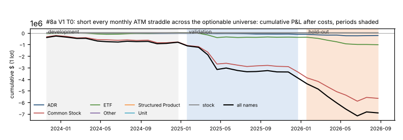

**Amendments, deviations and integrity checks.** Corporate actions detected from the options market (A8.1–A8.3c).

**What it showed.** Selling every straddle lost; the spread takes the premium.

## #8b V2a: short ATM straddle across the earnings report

**Folder:** `research/compass/intel/, studies/v*.py, results/v1/ (@7dfea57)`. **Commits:** A9 47c2c2f / — / 4ed84d4, 152f786. **Dates:** 2026-10-15.

**Hypothesis.** Earnings straddles are overpriced.

**Rule.** Sell the ATM straddle at the close before the report, buy back after it (adverse fill).

**Fills and costs.** $0.70 a contract each side; adverse tick.

**Data.** 1,578 names, reports 2023-11 → 2026-09.

**Periods and holdouts.** development / validation / hold-out (each hold-out opened once).

**Pass rule (as pre-registered).** A9.

**Verdict.** Rejected: −26.1% dev+val [−28.5, −23.3], −34.2% hold-out.

**Metrics** (return = % of premium; win = P&L > 0 after fees; breakeven is a loss; the interval is audit_lib's 20-session moving-block bootstrap over the period's calendar sessions):

| name | period | trades | sessions (traded / span) | win % | avg win %, $ | avg loss %, $ | median %, $ | mean %, $ | 20-session block 95% (%; $) |
|------------------|------------------------------|---------------|---------------------|------------|------------------------|------------------------|------------------------|------------------------|------------------------------------------------|
| single names | development | 3,558 | 234 / 276 | 39.2 | +27.6, +306.54 | −60.1, −615.66 | −13.1, −54.80 | **−25.67**, −253.83 | [−28.33, −22.08]; [−290.45, −216.70] |
| single names | validation | 4,244 | 218 / 246 | 32.5 | +26.2, +359.56 | −56.5, −550.99 | −18.1, −88.80 | **−29.62**, −255.34 | [−33.80, −24.38]; [−317.68, −195.13] |
| single names | hold-out | 3,682 | 165 / 191 | 25.6 | +23.6, +344.83 | −56.5, −630.33 | −24.4, −149.30 | **−35.95**, −380.58 | [−38.94, −30.24]; [−413.48, −334.88] |

| name | period | biggest win ($, %, date, contract) | biggest loss ($, %, date, contract) | profit factor | max DD $ | longest DD (sessions) | top-5 days' share of profit |
|------------------|------------------------------|------------------------------------------------------------------|------------------------------------------------------------------|------------|---------------|---------------|------------------------------------|
| single names | development | +5,620.60, +31.6%, 2024-05-02, BKNG 2024-05-03 3475.0 | −23,115.40, −129.2%, 2024-02-22, BKNG 2024-02-23 3900.0 | 0.32 | 907,257 | 266 | total ≤ 0 (best 5 days +22,304; without them −925,432) |
| single names | validation | +26,832.60, +84.4%, 2025-02-20, BKNG 2025-02-21 5020.0 | −18,093.80, −406.1%, 2025-09-09, SNPS 2025-09-12 605.0 | 0.31 | 1,085,137 | 244 | total ≤ 0 (best 5 days +43,589; without them −1,127,248) |
| single names | hold-out | +5,017.20, +30.3%, 2026-08-05, SNDK 2026-08-07 1350.0 | −22,302.80, −330.7%, 2026-05-04, STRL 2026-05-15 530.0 | 0.19 | 1,408,044 | 191 | total ≤ 0 (best 5 days +19,461; without them −1,420,756) |

**Random baseline:** not available — no random baseline was computed by this study

**Exit reasons (share of trades):**

- development: closed after the report 100.0%
- validation: closed after the report 100.0%
- hold-out: closed after the report 100.0%

**By year** (all periods together, labelled by entry year):

| year | name | trades | win % | mean % | mean $ | total $ |
|---|---|---|---|---|---|---|
| 2023 | single names | 71 | 47.9 | −20.34 | −101.65 | −7,217 |
| 2024 | single names | 3,487 | 39.1 | −25.77 | −256.93 | −895,910 |
| 2025 | single names | 4,244 | 32.5 | −29.62 | −255.34 | −1,083,659 |
| 2026 | single names | 3,682 | 25.6 | −35.95 | −380.58 | −1,401,295 |

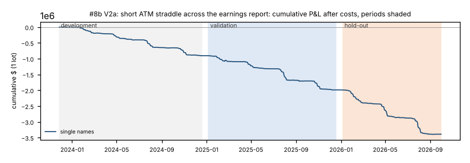

**Amendments, deviations and integrity checks.** Friday-only expiry probe checked on all names (95c90f9: no change).

**What it showed.** Selling earnings straddles lost a quarter of the premium.

## #8c V2b: long ATM straddle into the earnings report

**Folder:** `research/compass/intel/, studies/v*.py, results/v1/ (@7dfea57)`. **Commits:** A9 47c2c2f / — / 152f786. **Dates:** 2026-10-15.

**Hypothesis.** Buying into the report captures the run-up in implied volatility.

**Rule.** Buy the ATM straddle five sessions before the report, sell at the report.

**Fills and costs.** As V2a.

**Data.** As V2a.

**Periods and holdouts.** development / validation / hold-out (each hold-out opened once).

**Pass rule (as pre-registered).** A9.

**Verdict.** Rejected: −20.9% / −29.3%.

**Metrics** (return = % of premium; win = P&L > 0 after fees; breakeven is a loss; the interval is audit_lib's 20-session moving-block bootstrap over the period's calendar sessions):

| name | period | trades | sessions (traded / span) | win % | avg win %, $ | avg loss %, $ | median %, $ | mean %, $ | 20-session block 95% (%; $) |
|------------------|------------------------------|---------------|---------------------|------------|------------------------|------------------------|------------------------|------------------------|------------------------------------------------|
| single names | development | 3,485 | 234 / 277 | 20.3 | +18.2, +211.15 | −22.8, −231.84 | −13.8, −76.80 | **−14.51**, −141.84 | [−16.48, −11.70]; [−167.85, −104.26] |
| single names | validation | 4,100 | 217 / 246 | 9.0 | +20.2, +277.25 | −34.6, −370.66 | −27.0, −196.80 | **−29.71**, −312.50 | [−33.51, −25.43]; [−359.55, −266.38] |
| single names | hold-out | 3,543 | 164 / 191 | 10.1 | +23.8, +486.49 | −37.2, −435.80 | −29.1, −234.80 | **−31.05**, −342.34 | [−34.85, −25.85]; [−396.10, −270.55] |

| name | period | biggest win ($, %, date, contract) | biggest loss ($, %, date, contract) | profit factor | max DD $ | longest DD (sessions) | top-5 days' share of profit |
|------------------|------------------------------|------------------------------------------------------------------|------------------------------------------------------------------|------------|---------------|---------------|------------------------------------|
| single names | development | +8,232.20, +93.4%, 2024-10-30, TPL 2024-11-15 1150.0 | −11,697.80, −50.7%, 2024-04-22, MSTR 2024-05-03 1320.0 | 0.23 | 494,784 | 277 | total ≤ 0 (best 5 days +22,371; without them −516,696) |
| single names | validation | +10,492.20, +99.0%, 2025-02-18, AXON 2025-03-21 710.0 | −10,932.80, −32.1%, 2025-07-22, BKNG 2025-08-01 5775.0 | 0.07 | 1,281,270 | 246 | total ≤ 0 (best 5 days +3,772; without them −1,285,042) |
| single names | hold-out | +19,712.20, +71.8%, 2026-05-21, AZO 2026-06-18 3450.0 | −11,372.80, −36.5%, 2026-02-10, BKNG 2026-02-20 4300.0 | 0.13 | 1,212,924 | 191 | total ≤ 0 (best 5 days +27,492; without them −1,240,416) |

**Random baseline:** not available — no random baseline was computed by this study

**Exit reasons (share of trades):**

- development: closed at the report 100.0%
- validation: closed at the report 100.0%
- hold-out: closed at the report 100.0%

**By year** (all periods together, labelled by entry year):

| year | name | trades | win % | mean % | mean $ | total $ |
|---|---|---|---|---|---|---|
| 2023 | single names | 76 | 15.8 | −9.58 | −98.33 | −7,473 |
| 2024 | single names | 3,417 | 20.4 | −14.66 | −143.04 | −488,758 |
| 2025 | single names | 4,101 | 9.0 | −29.72 | −312.65 | −1,282,158 |
| 2026 | single names | 3,534 | 10.1 | −31.03 | −342.43 | −1,210,131 |

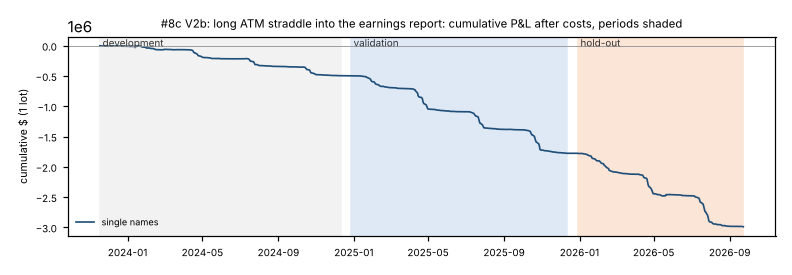

**Amendments, deviations and integrity checks.** —

**What it showed.** Both sides of the earnings straddle lose.

## #8d V3a: single-name 0DTE short ATM straddle 10:00 → 15:50

**Folder:** `research/compass/intel/, studies/v*.py, results/v1/ (@7dfea57)`. **Commits:** A10–A10.4 9c476c5, 048d33a / — / e4e4cea. **Dates:** 2026-10-16.

**Hypothesis.** Single-name same-day premium is overpriced.

**Rule.** Sell the ATM straddle at 10:00, buy back 15:50 (adverse).

**Fills and costs.** $0.70 a contract each side; adverse tick.

**Data.** 11 Mon/Wed/Fri names 2017-06 → 2026-10.

**Periods and holdouts.** development / validation / hold-out (each hold-out opened once).

**Pass rule (as pre-registered).** A10.

**Verdict.** Rejected: −19.8% dev+val [−25.5, −14.7], −7.4% hold-out.

**Metrics** (return = % of premium; win = P&L > 0 after fees; breakeven is a loss; the interval is audit_lib's 20-session moving-block bootstrap over the period's calendar sessions):

| name | period | trades | sessions (traded / span) | win % | avg win %, $ | avg loss %, $ | median %, $ | mean %, $ | 20-session block 95% (%; $) |
|------------------|------------------------------|---------------|---------------------|------------|------------------------|------------------------|------------------------|------------------------|------------------------------------------------|
| AAPL | development | 283 | 283 / 1,446 | 49.1 | +44.7, +82.80 | −81.5, −153.15 | −1.9, −2.80 | **−19.52**, −37.26 | [−28.35, −5.92]; [−58.95, −13.76] |
| AMD | development | 284 | 284 / 1,446 | 48.2 | +35.7, +44.08 | −79.9, −74.50 | −3.9, −1.80 | **−24.12**, −17.30 | [−32.87, −14.20]; [−29.55, −6.15] |
| AMZN | development | 283 | 283 / 1,446 | 51.6 | +40.2, +799.45 | −81.3, −1,487.27 | +3.1, +21.20 | **−18.63**, −307.55 | [−26.79, −7.45]; [−523.37, −98.21] |
| AVGO | development | 284 | 284 / 1,446 | 31.0 | +33.2, +130.00 | −96.9, −369.60 | −38.4, −128.80 | **−56.57**, −214.80 | [−67.43, −43.02]; [−265.19, −161.55] |
| GOOGL | development | 283 | 283 / 1,446 | 41.7 | +36.5, +470.72 | −89.5, −1,072.12 | −14.9, −106.80 | **−36.98**, −428.81 | [−46.44, −24.19]; [−586.02, −274.06] |
| INTC | development | 283 | 283 / 1,446 | 39.9 | +31.3, +17.65 | −91.2, −44.69 | −17.4, −8.80 | **−42.26**, −19.80 | [−54.48, −29.44]; [−26.32, −13.52] |
| META | development | 284 | 284 / 1,446 | 52.1 | +42.2, +106.42 | −71.2, −168.63 | +3.8, +10.20 | **−12.07**, −25.29 | [−18.45, −2.33]; [−44.89, −3.05] |
| MSFT | development | 284 | 284 / 1,446 | 43.7 | +37.0, +66.68 | −92.9, −140.57 | −12.0, −13.30 | **−36.16**, −50.08 | [−46.26, −24.48]; [−69.69, −31.86] |
| MU | development | 284 | 284 / 1,446 | 50.7 | +35.5, +30.07 | −84.4, −69.10 | +0.5, +0.20 | **−23.59**, −18.82 | [−32.65, −12.50]; [−27.11, −10.11] |
| NVDA | development | 283 | 283 / 1,446 | 55.8 | +40.2, +165.80 | −72.5, −331.71 | +9.6, +34.20 | **−9.58**, −53.95 | [−17.63, −1.10]; [−96.45, −10.54] |
| TSLA | development | 282 | 282 / 1,446 | 57.1 | +46.6, +479.89 | −85.1, −861.43 | +17.0, +97.20 | **−9.89**, −95.64 | [−18.72, −1.20]; [−217.76, +20.18] |
| all names | development | 3,117 | 284 / 1,446 | 47.4 | +39.0, +227.00 | −85.1, −423.22 | −5.8, −7.80 | **−26.32**, −115.32 | [−30.82, −19.20]; [−151.58, −75.22] |
| AAPL | validation | 102 | 102 / 512 | 60.8 | +47.6, +74.26 | −65.0, −106.85 | +21.7, +36.70 | **+3.45**, +3.24 | [−2.56, +19.29]; [−6.38, +29.09] |
| AMD | validation | 102 | 102 / 512 | 57.8 | +46.2, +98.81 | −79.8, −165.47 | +19.3, +30.20 | **−6.93**, −12.60 | [−16.69, +10.03]; [−41.08, +20.78] |
| AMZN | validation | 102 | 102 / 512 | 52.9 | +43.6, +74.27 | −70.4, −109.76 | +4.7, +7.70 | **−10.03**, −12.33 | [−18.30, +6.15]; [−25.37, +13.60] |
| AVGO | validation | 101 | 101 / 512 | 47.5 | +36.7, +323.08 | −88.1, −802.71 | −1.4, −13.80 | **−28.79**, −267.68 | [−46.02, −10.45]; [−449.15, −98.76] |
| GOOGL | validation | 102 | 102 / 512 | 52.9 | +40.7, +53.50 | −88.5, −110.76 | +7.0, +8.70 | **−20.12**, −23.80 | [−33.58, −3.41]; [−37.76, −2.12] |
| INTC | validation | 102 | 102 / 512 | 59.8 | +31.7, +15.30 | −90.9, −39.65 | +10.4, +3.70 | **−17.56**, −6.79 | [−27.04, −2.17]; [−12.00, +0.00] |
| META | validation | 102 | 102 / 512 | 56.9 | +48.5, +222.82 | −98.4, −389.30 | +17.1, +60.20 | **−14.87**, −41.23 | [−33.14, +1.23]; [−122.21, +30.79] |
| MSFT | validation | 102 | 102 / 512 | 50.0 | +38.5, +116.28 | −72.7, −200.02 | +0.1, +0.20 | **−17.09**, −41.87 | [−32.02, −2.96]; [−79.24, −3.42] |
| MU | validation | 102 | 102 / 512 | 54.9 | +35.8, +43.56 | −70.6, −84.06 | +6.1, +7.70 | **−12.21**, −14.00 | [−19.70, +1.67]; [−24.70, +3.38] |
| NVDA | validation | 101 | 101 / 512 | 54.5 | +46.7, +237.09 | −90.9, −650.23 | +3.6, +11.20 | **−16.01**, −167.04 | [−30.76, +6.52]; [−367.08, −8.52] |
| TSLA | validation | 102 | 102 / 512 | 54.9 | +51.0, +216.65 | −72.0, −265.23 | +13.4, +39.20 | **−4.47**, −0.67 | [−15.41, +12.65]; [−46.85, +65.81] |
| all names | validation | 1,120 | 102 / 512 | 54.8 | +42.6, +130.68 | −80.7, −275.60 | +7.9, +9.70 | **−13.13**, −52.87 | [−19.02, −2.17]; [−90.96, −11.87] |
| AAPL | hold-out | 161 | 161 / 456 | 53.4 | +44.2, +108.53 | −80.5, −191.27 | +5.3, +12.20 | **−13.89**, −31.13 | [−30.49, −1.41]; [−69.21, −0.05] |
| AMD | hold-out | 116 | 116 / 456 | 60.3 | +44.2, +253.19 | −71.0, −325.63 | +20.1, +76.20 | **−1.50**, +23.66 | [−15.86, +8.01]; [−42.34, +72.50] |
| AMZN | hold-out | 161 | 161 / 456 | 60.9 | +39.6, +99.20 | −75.7, −184.61 | +16.4, +34.20 | **−5.53**, −11.86 | [−18.28, +5.86]; [−40.24, +14.71] |
| AVGO | hold-out | 159 | 159 / 456 | 53.5 | +37.0, +183.58 | −57.5, −321.06 | +7.1, +32.20 | **−7.00**, −51.28 | [−15.63, +1.50]; [−106.34, −1.74] |
| GOOGL | hold-out | 159 | 159 / 456 | 51.6 | +45.3, +143.43 | −73.7, −218.79 | +4.3, +11.20 | **−12.32**, −31.98 | [−26.47, −2.39]; [−75.35, +0.07] |
| INTC | hold-out | 116 | 116 / 456 | 51.7 | +36.6, +57.92 | −75.0, −94.35 | +1.9, +2.20 | **−17.28**, −15.59 | [−34.85, −4.09]; [−38.02, +1.97] |
| META | hold-out | 159 | 159 / 456 | 55.3 | +37.0, +290.43 | −71.8, −502.31 | +3.5, +26.20 | **−11.56**, −63.56 | [−26.18, −3.73]; [−162.39, −11.26] |
| MSFT | hold-out | 159 | 159 / 456 | 50.9 | +44.7, +176.63 | −78.0, −283.17 | +6.7, +25.20 | **−15.47**, −48.93 | [−35.07, −2.94]; [−124.55, +1.12] |
| MU | hold-out | 115 | 115 / 456 | 60.0 | +41.2, +535.04 | −89.2, −742.39 | +11.2, +55.20 | **−10.96**, +24.07 | [−28.77, +5.92]; [−153.77, +232.75] |
| NVDA | hold-out | 158 | 158 / 456 | 63.3 | +44.9, +108.63 | −82.0, −185.61 | +21.4, +52.20 | **−1.71**, +0.62 | [−16.12, +10.93]; [−32.21, +30.32] |
| TSLA | hold-out | 159 | 159 / 456 | 59.7 | +47.1, +290.07 | −87.8, −524.97 | +21.5, +115.20 | **−7.21**, −37.99 | [−20.89, +5.22]; [−117.97, +40.83] |
| all names | hold-out | 1,622 | 161 / 456 | 56.4 | +42.1, +200.02 | −76.1, −315.12 | +10.1, +30.20 | **−9.47**, −24.84 | [−19.41, −2.80]; [−64.98, +5.67] |

| name | period | biggest win ($, %, date, contract) | biggest loss ($, %, date, contract) | profit factor | max DD $ | longest DD (sessions) | top-5 days' share of profit |
|------------------|------------------------------|------------------------------------------------------------------|------------------------------------------------------------------|------------|---------------|---------------|------------------------------------|
| AAPL | development | +436.20, +59.5%, 2020-08-28, AAPL 10:00 short straddle 505.0 | −1,149.80, −146.5%, 2020-03-20, AAPL 10:00 short straddle 250.0 | 0.52 | 10,672 | 1,446 | total ≤ 0 (best 5 days +1,609; without them −12,153) |
| AMD | development | +221.20, +73.2%, 2022-05-06, AMD 10:00 short straddle 95.0 | −840.80, −263.2%, 2022-02-11, AMD 10:00 short straddle 123.0 | 0.55 | 5,479 | 1,446 | total ≤ 0 (best 5 days +1,017; without them −5,930) |
| AMZN | development | +3,217.20, +46.9%, 2020-09-04, AMZN 10:00 short straddle 3275.0 | −7,895.80, −413.4%, 2021-10-15, AMZN 10:00 short straddle 3310.0 | 0.57 | 91,362 | 1,446 | total ≤ 0 (best 5 days +13,705; without them −100,742) |
| AVGO | development | +410.20, +55.1%, 2022-06-10, AVGO 10:00 short straddle 545.0 | −1,893.80, −244.4%, 2022-08-26, AVGO 10:00 short straddle 547.5 | 0.16 | 61,600 | 1,446 | total ≤ 0 (best 5 days +1,842; without them −62,844) |
| GOOGL | development | +2,031.20, +67.9%, 2022-07-15, GOOGL 10:00 short straddle 2225.0 | −6,483.80, −498.8%, 2021-09-10, GOOGL 10:00 short straddle 2890.0 | 0.31 | 122,845 | 1,446 | total ≤ 0 (best 5 days +8,907; without them −130,261) |
| INTC | development | +92.20, +60.5%, 2020-07-24, INTC 10:00 short straddle 50.0 | −384.80, −538.2%, 2018-03-29, INTC 10:00 short straddle 50.0 | 0.26 | 5,603 | 1,446 | total ≤ 0 (best 5 days +325; without them −5,928) |
| META | development | +322.20, +64.0%, 2021-12-03, META 10:00 short straddle 305.0 | −893.80, −222.1%, 2020-06-26, META 10:00 short straddle 227.5 | 0.69 | 7,534 | 1,446 | total ≤ 0 (best 5 days +1,520; without them −8,703) |
| MSFT | development | +265.20, +49.8%, 2022-01-21, MSFT 10:00 short straddle 300.0 | −846.80, −227.3%, 2022-08-26, MSFT 10:00 short straddle 280.0 | 0.37 | 14,274 | 1,446 | total ≤ 0 (best 5 days +1,187; without them −15,410) |
| MU | development | +118.20, +64.2%, 2022-01-21, MU 10:00 short straddle 82.5 | −343.80, −302.9%, 2020-06-12, MU 10:00 short straddle 50.0 | 0.45 | 5,424 | 1,446 | total ≤ 0 (best 5 days +432; without them −5,776) |
| NVDA | development | +660.20, +75.9%, 2020-05-22, NVDA 10:00 short straddle 360.0 | −2,159.80, −244.0%, 2020-11-06, NVDA 10:00 short straddle 557.5 | 0.63 | 15,583 | 1,441 | total ≤ 0 (best 5 days +2,817; without them −18,084) |
| TSLA | development | +2,872.20, +50.6%, 2020-08-21, TSLA 10:00 short straddle 2060.0 | −12,864.80, −442.9%, 2020-07-10, TSLA 10:00 short straddle 1385.0 | 0.74 | 28,054 | 1,441 | total ≤ 0 (best 5 days +10,845; without them −37,816) |
| all names | development | +3,217.20, +46.9%, 2020-09-04, AMZN 10:00 short straddle 3275.0 | −12,864.80, −442.9%, 2020-07-10, TSLA 10:00 short straddle 1385.0 | 0.48 | 361,761 | 1,446 | total ≤ 0 (best 5 days +27,174; without them −386,617) |
| AAPL | validation | +196.20, +54.8%, 2024-08-02, AAPL 10:00 short straddle 222.5 | −453.80, −214.6%, 2024-12-20, AAPL 10:00 short straddle 247.5 | 1.08 | 601 | 120 | 233% |
| AMD | validation | +258.20, +79.9%, 2024-01-26, AMD 10:00 short straddle 177.5 | −875.80, −329.9%, 2024-01-19, AMD 10:00 short straddle 162.5 | 0.82 | 1,812 | 453 | total ≤ 0 (best 5 days +1,173; without them −2,459) |
| AMZN | validation | +199.20, +74.3%, 2023-10-27, AMZN 10:00 short straddle 128.0 | −339.80, −244.5%, 2024-02-09, AMZN 10:00 short straddle 170.0 | 0.76 | 1,441 | 512 | total ≤ 0 (best 5 days +802; without them −2,060) |
| AVGO | validation | +1,856.20, +67.0%, 2024-06-21, AVGO 10:00 short straddle 1680.0 | −4,833.80, −406.2%, 2023-05-26, AVGO 10:00 short straddle 755.0 | 0.36 | 27,435 | 512 | total ≤ 0 (best 5 days +5,475; without them −32,511) |
| GOOGL | validation | +127.20, +76.9%, 2024-12-27, GOOGL 10:00 short straddle 192.5 | −507.80, −206.0%, 2024-12-20, GOOGL 10:00 short straddle 185.0 | 0.54 | 2,555 | 512 | total ≤ 0 (best 5 days +591; without them −3,019) |
| INTC | validation | +52.20, +50.0%, 2024-08-02, INTC 10:00 short straddle 21.0 | −177.80, −219.5%, 2024-03-08, INTC 10:00 short straddle 46.0 | 0.57 | 754 | 512 | total ≤ 0 (best 5 days +193; without them −886) |
| META | validation | +964.20, +84.8%, 2024-02-02, META 10:00 short straddle 475.0 | −1,495.80, −323.8%, 2024-07-05, META 10:00 short straddle 522.5 | 0.75 | 5,116 | 512 | total ≤ 0 (best 5 days +3,123; without them −7,329) |
| MSFT | validation | +334.20, +66.6%, 2024-08-02, MSFT 10:00 short straddle 407.5 | −773.80, −358.2%, 2023-04-06, MSFT 10:00 short straddle 282.5 | 0.58 | 4,964 | 512 | total ≤ 0 (best 5 days +1,265; without them −5,536) |
| MU | validation | +133.20, +67.4%, 2024-04-05, MU 10:00 short straddle 123.0 | −358.80, −138.3%, 2024-08-02, MU 10:00 short straddle 96.0 | 0.63 | 1,484 | 512 | total ≤ 0 (best 5 days +550; without them −1,978) |
| NVDA | validation | +1,066.20, +77.0%, 2024-05-03, NVDA 10:00 short straddle 887.5 | −6,704.80, −541.8%, 2024-04-19, NVDA 10:00 short straddle 840.0 | 0.44 | 17,933 | 378 | total ≤ 0 (best 5 days +4,315; without them −21,186) |
| TSLA | validation | +571.20, +68.8%, 2024-11-15, TSLA 10:00 short straddle 317.5 | −1,071.80, −291.3%, 2023-01-27, TSLA 10:00 short straddle 165.0 | 0.99 | 2,569 | 343 | total ≤ 0 (best 5 days +2,332; without them −2,401) |
| all names | validation | +1,856.20, +67.0%, 2024-06-21, AVGO 10:00 short straddle 1680.0 | −6,704.80, −541.8%, 2024-04-19, NVDA 10:00 short straddle 840.0 | 0.58 | 61,185 | 512 | total ≤ 0 (best 5 days +9,262; without them −68,474) |
| AAPL | hold-out | +334.20, +60.7%, 2026-09-09, AAPL 10:00 short straddle 317.5 | −735.80, −419.3%, 2025-10-10, AAPL 10:00 short straddle 255.0 | 0.65 | 6,733 | 443 | total ≤ 0 (best 5 days +1,168; without them −6,180) |
| AMD | hold-out | +843.20, +58.6%, 2026-06-12, AMD 10:00 short straddle 510.0 | −2,434.80, −199.6%, 2026-07-02, AMD 10:00 short straddle 545.0 | 1.18 | 3,533 | 252 | 131% |
| AMZN | hold-out | +301.20, +72.4%, 2026-08-03, AMZN 10:00 short straddle 285.0 | −915.80, −495.0%, 2025-10-10, AMZN 10:00 short straddle 227.5 | 0.84 | 3,973 | 293 | total ≤ 0 (best 5 days +1,373; without them −3,282) |
| AVGO | hold-out | +436.20, +57.8%, 2026-05-15, AVGO 10:00 short straddle 425.0 | −3,668.80, −137.2%, 2026-09-02, AVGO 10:00 short straddle 375.0 | 0.66 | 8,212 | 447 | total ≤ 0 (best 5 days +2,044; without them −10,198) |
| GOOGL | hold-out | +395.20, +80.7%, 2026-02-06, GOOGL 10:00 short straddle 322.5 | −1,530.80, −385.6%, 2026-08-05, GOOGL 10:00 short straddle 380.0 | 0.70 | 6,158 | 277 | total ≤ 0 (best 5 days +1,609; without them −6,694) |
| INTC | hold-out | +236.20, +71.6%, 2026-04-24, INTC 10:00 short straddle 82.0 | −897.80, −259.9%, 2026-07-02, INTC 10:00 short straddle 130.0 | 0.66 | 2,361 | 456 | total ≤ 0 (best 5 days +967; without them −2,776) |
| META | hold-out | +1,093.20, +76.7%, 2025-04-11, META 10:00 short straddle 542.5 | −2,419.80, −223.0%, 2026-09-21, META 10:00 short straddle 712.5 | 0.72 | 13,784 | 438 | total ≤ 0 (best 5 days +3,812; without them −13,918) |
| MSFT | hold-out | +410.20, +63.4%, 2026-07-31, MSFT 10:00 short straddle 462.5 | −954.80, −270.1%, 2026-06-17, MSFT 10:00 short straddle 390.0 | 0.65 | 11,145 | 438 | total ≤ 0 (best 5 days +1,775; without them −9,555) |
| MU | hold-out | +2,452.20, +71.7%, 2026-06-12, MU 10:00 short straddle 985.0 | −7,239.80, −237.0%, 2026-07-02, MU 10:00 short straddle 1060.0 | 1.08 | 9,849 | 361 | 319% |
| NVDA | hold-out | +269.20, +83.1%, 2026-06-08, NVDA 10:00 short straddle 207.5 | −805.80, −380.1%, 2025-10-10, NVDA 10:00 short straddle 195.0 | 1.01 | 2,489 | 155 | 1291% |
| TSLA | hold-out | +796.20, +77.1%, 2025-11-21, TSLA 10:00 short straddle 395.0 | −1,994.80, −427.6%, 2026-04-15, TSLA 10:00 short straddle 370.0 | 0.82 | 10,250 | 456 | total ≤ 0 (best 5 days +3,457; without them −9,498) |
| all names | hold-out | +2,452.20, +71.7%, 2026-06-12, MU 10:00 short straddle 985.0 | −7,239.80, −237.0%, 2026-07-02, MU 10:00 short straddle 1060.0 | 0.82 | 60,074 | 443 | total ≤ 0 (best 5 days +18,099; without them −58,386) |

**Random baseline:** not available — no random baseline was computed by this study

**Exit reasons (share of trades):**

- development: bought back 15:50 100.0%
- validation: bought back 15:50 100.0%
- hold-out: bought back 15:50 100.0%

**By year** (all periods together, labelled by entry year):

| year | name | trades | win % | mean % | mean $ | total $ |
|---|---|---|---|---|---|---|
| 2017 | AAPL | 30 | 53.3 | −41.28 | −30.00 | −900 |
| 2018 | AAPL | 51 | 45.1 | −27.59 | −40.58 | −2,070 |
| 2019 | AAPL | 51 | 58.8 | −7.30 | −15.82 | −807 |
| 2020 | AAPL | 49 | 42.9 | −19.01 | −87.27 | −4,276 |
| 2021 | AAPL | 51 | 49.0 | −15.45 | −14.17 | −723 |
| 2022 | AAPL | 51 | 47.1 | −15.43 | −34.68 | −1,769 |
| 2023 | AAPL | 51 | 58.8 | +4.32 | +7.36 | +375 |
| 2024 | AAPL | 51 | 62.7 | +2.58 | −0.88 | −45 |
| 2025 | AAPL | 50 | 50.0 | −25.15 | −55.36 | −2,768 |
| 2026 | AAPL | 111 | 55.0 | −8.82 | −20.21 | −2,244 |
| 2017 | AMD | 30 | 43.3 | −41.95 | −10.37 | −311 |
| 2018 | AMD | 51 | 37.3 | −48.34 | −20.47 | −1,044 |
| 2019 | AMD | 51 | 45.1 | −20.77 | −9.49 | −484 |
| 2020 | AMD | 50 | 48.0 | −23.67 | −28.68 | −1,434 |
| 2021 | AMD | 51 | 51.0 | −17.02 | −21.35 | −1,089 |
| 2022 | AMD | 51 | 62.7 | −0.30 | −10.82 | −552 |
| 2023 | AMD | 51 | 54.9 | −11.14 | −10.35 | −528 |
| 2024 | AMD | 51 | 60.8 | −2.73 | −14.86 | −758 |
| 2025 | AMD | 50 | 54.0 | −14.60 | −22.26 | −1,113 |
| 2026 | AMD | 66 | 65.2 | +8.42 | +58.44 | +3,857 |
| 2017 | AMZN | 30 | 46.7 | −50.16 | −325.10 | −9,753 |
| 2018 | AMZN | 51 | 52.9 | −21.56 | −382.68 | −19,517 |
| 2019 | AMZN | 51 | 64.7 | −2.16 | −32.78 | −1,672 |
| 2020 | AMZN | 50 | 44.0 | −19.62 | −446.40 | −22,320 |
| 2021 | AMZN | 51 | 51.0 | −22.50 | −441.33 | −22,508 |
| 2022 | AMZN | 50 | 48.0 | −8.57 | −225.36 | −11,268 |
| 2023 | AMZN | 51 | 52.9 | −10.08 | −9.27 | −473 |
| 2024 | AMZN | 51 | 52.9 | −9.98 | −15.39 | −785 |
| 2025 | AMZN | 50 | 70.0 | −4.94 | −3.30 | −165 |
| 2026 | AMZN | 111 | 56.8 | −5.80 | −15.71 | −1,744 |
| 2017 | AVGO | 30 | 33.3 | −92.88 | −206.43 | −6,193 |
| 2018 | AVGO | 51 | 31.4 | −33.57 | −90.90 | −4,636 |
| 2019 | AVGO | 51 | 49.0 | −18.78 | −40.39 | −2,060 |
| 2020 | AVGO | 50 | 20.0 | −69.24 | −269.16 | −13,458 |
| 2021 | AVGO | 51 | 15.7 | −100.21 | −403.25 | −20,566 |
| 2022 | AVGO | 51 | 37.3 | −39.94 | −276.27 | −14,090 |
| 2023 | AVGO | 51 | 43.1 | −41.25 | −351.58 | −17,931 |
| 2024 | AVGO | 50 | 52.0 | −16.07 | −182.10 | −9,105 |
| 2025 | AVGO | 50 | 56.0 | −7.93 | −38.34 | −1,917 |
| 2026 | AVGO | 109 | 52.3 | −6.58 | −57.22 | −6,237 |
| 2017 | GOOGL | 30 | 33.3 | −61.82 | −291.67 | −8,750 |
| 2018 | GOOGL | 51 | 33.3 | −47.24 | −464.78 | −23,704 |
| 2019 | GOOGL | 51 | 51.0 | −15.37 | −85.27 | −4,349 |
| 2020 | GOOGL | 50 | 42.0 | −34.86 | −428.38 | −21,419 |
| 2021 | GOOGL | 51 | 43.1 | −45.69 | −742.35 | −37,860 |
| 2022 | GOOGL | 50 | 44.0 | −26.92 | −505.46 | −25,273 |
| 2023 | GOOGL | 51 | 56.9 | −19.95 | −15.88 | −810 |
| 2024 | GOOGL | 51 | 49.0 | −20.29 | −31.72 | −1,618 |
| 2025 | GOOGL | 50 | 58.0 | −13.96 | −13.96 | −698 |
| 2026 | GOOGL | 109 | 48.6 | −11.57 | −40.25 | −4,387 |
| 2017 | INTC | 29 | 20.7 | −72.89 | −18.56 | −538 |
| 2018 | INTC | 51 | 29.4 | −86.87 | −42.88 | −2,187 |
| 2019 | INTC | 51 | 52.9 | −15.12 | −6.33 | −323 |
| 2020 | INTC | 50 | 42.0 | −38.99 | −22.40 | −1,120 |
| 2021 | INTC | 51 | 45.1 | −36.63 | −21.84 | −1,114 |
| 2022 | INTC | 51 | 41.2 | −16.20 | −6.31 | −322 |
| 2023 | INTC | 51 | 52.9 | −21.22 | −8.58 | −438 |
| 2024 | INTC | 51 | 66.7 | −13.91 | −5.00 | −255 |
| 2025 | INTC | 50 | 42.0 | −36.62 | −18.96 | −948 |
| 2026 | INTC | 66 | 59.1 | −2.63 | −13.04 | −861 |
| 2017 | META | 30 | 43.3 | −34.02 | −32.30 | −969 |
| 2018 | META | 51 | 41.2 | −21.68 | −41.13 | −2,098 |
| 2019 | META | 51 | 66.7 | +5.30 | +10.49 | +535 |
| 2020 | META | 50 | 48.0 | −22.99 | −63.46 | −3,173 |
| 2021 | META | 51 | 56.9 | −2.22 | −7.39 | −377 |
| 2022 | META | 51 | 52.9 | −6.05 | −21.60 | −1,102 |
| 2023 | META | 51 | 49.0 | −27.44 | −84.80 | −4,325 |
| 2024 | META | 51 | 64.7 | −2.30 | +2.34 | +119 |
| 2025 | META | 50 | 38.0 | −15.69 | −81.48 | −4,074 |
| 2026 | META | 109 | 63.3 | −9.66 | −55.34 | −6,032 |
| 2017 | MSFT | 30 | 43.3 | −87.18 | −33.70 | −1,011 |
| 2018 | MSFT | 51 | 37.3 | −60.07 | −49.23 | −2,511 |
| 2019 | MSFT | 51 | 49.0 | −13.47 | −13.23 | −675 |
| 2020 | MSFT | 50 | 40.0 | −28.09 | −51.70 | −2,585 |
| 2021 | MSFT | 51 | 45.1 | −20.39 | −52.66 | −2,686 |
| 2022 | MSFT | 51 | 47.1 | −28.60 | −93.25 | −4,756 |
| 2023 | MSFT | 51 | 49.0 | −25.22 | −61.53 | −3,138 |
| 2024 | MSFT | 51 | 51.0 | −8.95 | −22.21 | −1,133 |
| 2025 | MSFT | 50 | 42.0 | −18.65 | −58.92 | −2,946 |
| 2026 | MSFT | 109 | 55.0 | −14.01 | −44.35 | −4,834 |
| 2017 | MU | 30 | 36.7 | −61.78 | −26.37 | −791 |
| 2018 | MU | 51 | 47.1 | −19.64 | −14.43 | −736 |
| 2019 | MU | 51 | 51.0 | −10.75 | −5.90 | −301 |
| 2020 | MU | 50 | 54.0 | −43.78 | −37.18 | −1,859 |
| 2021 | MU | 51 | 56.9 | −16.62 | −24.21 | −1,235 |
| 2022 | MU | 51 | 52.9 | −5.07 | −8.29 | −423 |
| 2023 | MU | 51 | 54.9 | −11.48 | −9.66 | −493 |
| 2024 | MU | 51 | 54.9 | −12.93 | −18.33 | −935 |
| 2025 | MU | 50 | 46.0 | −31.48 | −51.64 | −2,582 |
| 2026 | MU | 65 | 70.8 | +4.83 | +82.31 | +5,350 |
| 2017 | NVDA | 30 | 50.0 | −25.80 | −73.50 | −2,205 |
| 2018 | NVDA | 51 | 56.9 | −8.07 | −19.43 | −991 |
| 2019 | NVDA | 51 | 68.6 | +6.07 | +15.16 | +773 |
| 2020 | NVDA | 50 | 36.0 | −36.95 | −250.40 | −12,520 |
| 2021 | NVDA | 50 | 68.0 | +7.50 | +27.90 | +1,395 |
| 2022 | NVDA | 51 | 52.9 | −7.10 | −33.72 | −1,720 |
| 2023 | NVDA | 51 | 54.9 | −17.64 | −82.23 | −4,194 |
| 2024 | NVDA | 50 | 54.0 | −14.34 | −253.54 | −12,677 |
| 2025 | NVDA | 50 | 66.0 | −0.98 | +6.44 | +322 |
| 2026 | NVDA | 108 | 62.0 | −2.05 | −2.08 | −224 |
| 2017 | TSLA | 30 | 63.3 | −27.24 | −89.00 | −2,670 |
| 2018 | TSLA | 51 | 54.9 | −8.86 | −61.64 | −3,144 |
| 2019 | TSLA | 51 | 58.8 | −8.15 | −47.72 | −2,434 |
| 2020 | TSLA | 49 | 61.2 | −1.24 | −129.90 | −6,365 |
| 2021 | TSLA | 51 | 54.9 | −5.32 | −47.00 | −2,397 |
| 2022 | TSLA | 50 | 52.0 | −15.42 | −199.22 | −9,961 |
| 2023 | TSLA | 51 | 54.9 | −7.48 | −6.74 | −344 |
| 2024 | TSLA | 51 | 54.9 | −1.47 | +5.40 | +275 |
| 2025 | TSLA | 50 | 66.0 | −4.35 | −5.18 | −259 |
| 2026 | TSLA | 109 | 56.9 | −8.52 | −53.05 | −5,782 |
| 2017 | all names | 329 | 42.6 | −54.22 | −103.62 | −34,091 |
| 2018 | all names | 561 | 42.4 | −34.86 | −111.65 | −62,636 |
| 2019 | all names | 561 | 56.0 | −9.14 | −21.02 | −11,795 |
| 2020 | all names | 548 | 43.4 | −30.84 | −165.20 | −90,529 |
| 2021 | all names | 560 | 48.8 | −25.02 | −159.21 | −89,158 |
| 2022 | all names | 558 | 48.9 | −15.41 | −127.66 | −71,234 |
| 2023 | all names | 561 | 52.9 | −17.14 | −57.57 | −32,297 |
| 2024 | all names | 559 | 56.7 | −9.10 | −48.15 | −26,915 |
| 2025 | all names | 550 | 53.5 | −15.85 | −31.18 | −17,148 |
| 2026 | all names | 1,072 | 57.8 | −6.19 | −21.58 | −23,139 |

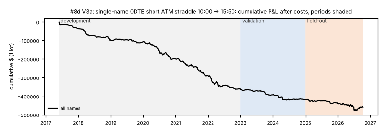

**Amendments, deviations and integrity checks.** —

**What it showed.** Negative.

## #8e V8: month-end 13:00 long straddle on unread chains

**Folder:** `research/compass/intel/, studies/v*.py, results/v1/ (@7dfea57)`. **Commits:** A15 8bc3baf / — / e4e4cea. **Dates:** 2026-10-16.

**Hypothesis.** Month-end afternoons move more than priced (from V7).

**Rule.** Buy the ATM straddle at 13:00 on the month's last session, hold to settlement.

**Fills and costs.** Ask in (adverse); settlement out.

**Data.** SPXW 2017-06 → 2022-04, SPY 2017-06 → 2022-10 (chains no study had read).

**Periods and holdouts.** One unread span.

**Pass rule (as pre-registered).** A15.

**Verdict.** Rejected: SPXW −6.6% [−24.5, +12.6], SPY −8.4% [−27.2, +11.3].

**Metrics** (return = % of premium; win = P&L > 0 after fees; breakeven is a loss; the interval is audit_lib's 20-session moving-block bootstrap over the period's calendar sessions):

| name | period | trades | sessions (traded / span) | win % | avg win %, $ | avg loss %, $ | median %, $ | mean %, $ | 20-session block 95% (%; $) |
|------------------|------------------------------|---------------|---------------------|------------|------------------------|------------------------|------------------------|------------------------|------------------------------------------------|
| SPXW | 2017-06→2022 (unread chains) | 56 | 56 / 1,251 | 41.1 | +62.0, +811.30 | −57.5, −807.70 | −24.6, −288.40 | **−8.42**, −142.76 | [−26.64, +11.50]; [−474.45, +119.46] |
| SPY | 2017-06→2022 (unread chains) | 49 | 49 / 1,382 | 36.7 | +64.6, +108.32 | −53.2, −96.51 | −30.4, −40.40 | **−9.96**, −21.27 | [−24.94, +12.12]; [−53.44, +19.42] |
| all names | 2017-06→2022 (unread chains) | 105 | 62 / 1,382 | 39.0 | +63.1, +502.67 | −55.4, −463.22 | −29.1, −55.90 | **−9.14**, −86.06 | [−23.88, +10.99]; [−259.18, +99.44] |

| name | period | biggest win ($, %, date, contract) | biggest loss ($, %, date, contract) | profit factor | max DD $ | longest DD (sessions) | top-5 days' share of profit |
|------------------|------------------------------|------------------------------------------------------------------|------------------------------------------------------------------|------------|---------------|---------------|------------------------------------|
| SPXW | 2017-06→2022 (unread chains) | +3,221.60, +154.1%, 2022-03-31, SPXW 13:00 long straddle 4585.0 | −3,552.40, −78.9%, 2020-02-28, SPXW 13:00 long straddle 2945.0 | 0.70 | 15,908 | 971 | total ≤ 0 (best 5 days +11,965; without them −19,959) |
| SPY | 2017-06→2022 (unread chains) | +302.60, +133.3%, 2022-03-31, SPY 13:00 long straddle 457.0 | −378.40, −78.5%, 2020-02-28, SPY 13:00 long straddle 295.0 | 0.65 | 1,872 | 1,190 | total ≤ 0 (best 5 days +1,330; without them −2,372) |
| all names | 2017-06→2022 (unread chains) | +3,221.60, +154.1%, 2022-03-31, SPXW 13:00 long straddle 4585.0 | −3,552.40, −78.9%, 2020-02-28, SPXW 13:00 long straddle 2945.0 | 0.70 | 17,762 | 1,102 | total ≤ 0 (best 5 days +13,096; without them −22,132) |

**Random baseline:** not available — no random baseline was computed by this study

**Exit reasons (share of trades):**

- 2017-06→2022 (unread chains): held to settlement 100.0%

**By year** (all periods together, labelled by entry year):

| year | name | trades | win % | mean % | mean $ | total $ |
|---|---|---|---|---|---|---|
| 2017 | SPXW | 7 | 42.9 | −25.04 | −94.97 | −665 |
| 2018 | SPXW | 11 | 45.5 | +10.59 | +45.05 | +496 |
| 2019 | SPXW | 10 | 30.0 | −23.51 | −235.90 | −2,359 |
| 2020 | SPXW | 12 | 41.7 | −2.99 | −367.15 | −4,406 |
| 2021 | SPXW | 12 | 33.3 | −31.25 | −540.48 | −6,486 |
| 2022 | SPXW | 4 | 75.0 | +58.35 | +1,356.35 | +5,425 |
| 2017 | SPY | 3 | 33.3 | −5.21 | −1.40 | −4 |
| 2018 | SPY | 9 | 33.3 | +14.41 | +5.38 | +48 |
| 2019 | SPY | 6 | 16.7 | −53.15 | −49.90 | −299 |
| 2020 | SPY | 11 | 45.5 | −0.24 | −44.95 | −494 |
| 2021 | SPY | 10 | 30.0 | −42.53 | −64.80 | −648 |
| 2022 | SPY | 10 | 50.0 | +14.48 | +35.55 | +356 |
| 2017 | all names | 10 | 40.0 | −19.09 | −66.90 | −669 |
| 2018 | all names | 20 | 40.0 | +12.31 | +27.20 | +544 |
| 2019 | all names | 16 | 25.0 | −34.63 | −166.15 | −2,658 |
| 2020 | all names | 23 | 43.5 | −1.67 | −213.05 | −4,900 |
| 2021 | all names | 22 | 31.8 | −36.38 | −324.26 | −7,134 |
| 2022 | all names | 14 | 57.1 | +27.01 | +412.92 | +5,781 |

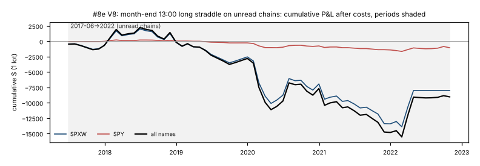

**Amendments, deviations and integrity checks.** Read once on unread chains.

**What it showed.** The month-end effect V7 suggested did not appear on unread data.

## #9a Lifecycle P1: Quick Scalps → cash-secured put sale (portfolio)

**Folder:** `research/compass/lifecycle/ (@7dfea57)`. **Commits:** protocol 1f99d75 / L-A4 8bd322a / 425c7f4, b9d04b5. **Dates:** 2026-10-15.

**Hypothesis.** The Tier I finalists, run as a portfolio, earn after costs.

**Rule.** QS signal → sell a cash-secured put (s20 policy), one unit, the lifecycle position engine.

**Fills and costs.** $0.70 a contract each side, NBBO.

**Data.** SPY/QQQ/IWM 0DTE 2022-11 → 2026-10.

**Periods and holdouts.** development + validation / hold-out 2025-10-01 → 2026-10-09 (opened once).

**Pass rule (as pre-registered).** R1–R6 promotion rules (Holm; R2 random-day control).

**Verdict.** Rejected: hold-out +$987 (about 1% a year, collateral-bound).

**Metrics** (return = % of max risk; win = P&L > 0 after fees; breakeven is a loss; the interval is audit_lib's 20-session moving-block bootstrap over the period's calendar sessions):

| name | period | trades | sessions (traded / span) | win % | avg win %, $ | avg loss %, $ | median %, $ | mean %, $ | 20-session block 95% (%; $) |
|------------------|------------------------------|---------------|---------------------|------------|------------------------|------------------------|------------------------|------------------------|------------------------------------------------|
| IWM | development + validation | 88 | 78 / 318 | 56.8 | +0.1, +25.15 | −0.2, −38.64 | +0.0, +9.10 | **−0.01**, −2.39 | [−0.05, +0.02]; [−10.81, +5.62] |
| QQQ | development + validation | 165 | 157 / 738 | 61.8 | +0.1, +44.54 | −0.2, −60.21 | +0.1, +26.60 | **+0.01**, +4.54 | [−0.01, +0.03]; [−3.74, +12.04] |
| SPY | development + validation | 155 | 148 / 742 | 62.6 | +0.1, +45.51 | −0.1, −60.64 | +0.1, +26.60 | **+0.01**, +5.79 | [−0.00, +0.03]; [−2.86, +13.35] |
| all names | development + validation | 408 | 269 / 742 | 61.0 | +0.1, +41.02 | −0.1, −55.21 | +0.1, +21.10 | **+0.01**, +3.52 | [−0.01, +0.02]; [−1.36, +7.79] |
| IWM | hold-out 2025-10→2026-10 | 51 | 48 / 259 | 49.0 | +0.1, +31.76 | −0.2, −43.17 | −0.1, −14.40 | **−0.02**, −6.44 | [−0.06, +0.02]; [−16.78, +4.00] |
| QQQ | hold-out 2025-10→2026-10 | 32 | 32 / 252 | 81.2 | +0.1, +70.56 | −0.2, −99.40 | +0.1, +58.60 | **+0.06**, +38.69 | [+0.02, +0.10]; [+16.00, +68.00] |
| SPY | hold-out 2025-10→2026-10 | 39 | 35 / 240 | 66.7 | +0.1, +50.48 | −0.1, −95.02 | +0.0, +33.60 | **+0.00**, +1.98 | [−0.04, +0.04]; [−25.34, +26.50] |
| all names | hold-out 2025-10→2026-10 | 122 | 89 / 262 | 63.1 | +0.1, +51.18 | −0.2, −65.64 | +0.1, +29.10 | **+0.01**, +8.09 | [−0.02, +0.03]; [−6.89, +21.87] |

| name | period | biggest win ($, %, date, contract) | biggest loss ($, %, date, contract) | profit factor | max DD $ | longest DD (sessions) | top-5 days' share of profit |
|------------------|------------------------------|------------------------------------------------------------------|------------------------------------------------------------------|------------|---------------|---------------|------------------------------------|
| IWM | development + validation | +97.60, +0.4%, 2025-09-17, IWM CSP m85 | −85.40, −0.4%, 2024-07-17, IWM CSP m16 | 0.86 | 526 | 318 | total ≤ 0 (best 5 days +280; without them −491) |
| QQQ | development + validation | +170.60, +0.4%, 2025-04-11, QQQ CSP m181 | −168.40, −0.4%, 2025-04-23, QQQ CSP m54 | 1.20 | 523 | 217 | 77% |
| SPY | development + validation | +242.60, +0.5%, 2025-04-11, SPY CSP m75 | −198.40, −0.4%, 2025-04-10, SPY CSP m309 | 1.26 | 459 | 218 | 76% |
| all names | development + validation | +242.60, +0.5%, 2025-04-11, SPY CSP m75 | −198.40, −0.4%, 2025-04-10, SPY CSP m309 | 1.16 | 970 | 200 | 70% |
| IWM | hold-out 2025-10→2026-10 | +90.60, +0.3%, 2026-06-12, IWM CSP m21 | −115.40, −0.5%, 2025-10-29, IWM CSP m139 | 0.71 | 334 | 248 | total ≤ 0 (best 5 days +267; without them −595) |
| QQQ | hold-out 2025-10→2026-10 | +135.60, +0.2%, 2026-08-03, QQQ CSP m15 | −167.40, −0.3%, 2025-10-29, QQQ CSP m44 | 3.08 | 216 | 129 | 48% |
| SPY | hold-out 2025-10→2026-10 | +90.60, +0.1%, 2026-04-01, SPY CSP m38 | −198.40, −0.3%, 2025-10-14, SPY CSP m283 | 1.06 | 514 | 147 | 532% |
| all names | hold-out 2025-10→2026-10 | +135.60, +0.2%, 2026-08-03, QQQ CSP m15 | −198.40, −0.3%, 2025-10-14, SPY CSP m283 | 1.33 | 834 | 171 | 71% |

**Random baseline:** not available — no random baseline was computed by this study

**Exit reasons (share of trades):**

- development + validation: policy 100.0%
- hold-out 2025-10→2026-10: policy 100.0%

**By year** (all periods together, labelled by entry year):

| year | name | trades | win % | mean % | mean $ | total $ |
|---|---|---|---|---|---|---|
| 2024 | IWM | 36 | 58.3 | −0.01 | −1.40 | −50 |
| 2025 | IWM | 66 | 54.5 | −0.02 | −3.97 | −262 |
| 2026 | IWM | 37 | 48.6 | −0.02 | −6.13 | −227 |
| 2022 | QQQ | 6 | 83.3 | +0.07 | +18.93 | +114 |
| 2023 | QQQ | 76 | 57.9 | +0.00 | +1.19 | +91 |
| 2024 | QQQ | 48 | 62.5 | +0.01 | +6.95 | +334 |
| 2025 | QQQ | 40 | 65.0 | +0.01 | +2.72 | +109 |
| 2026 | QQQ | 27 | 85.2 | +0.07 | +49.67 | +1,341 |
| 2022 | SPY | 7 | 85.7 | +0.08 | +31.31 | +219 |
| 2023 | SPY | 59 | 55.9 | +0.01 | +2.09 | +123 |
| 2024 | SPY | 54 | 68.5 | +0.02 | +11.20 | +605 |
| 2025 | SPY | 47 | 61.7 | −0.01 | −2.74 | −129 |
| 2026 | SPY | 27 | 66.7 | +0.01 | +5.79 | +156 |
| 2022 | all names | 13 | 84.6 | +0.08 | +25.60 | +333 |
| 2023 | all names | 135 | 57.0 | +0.00 | +1.59 | +214 |
| 2024 | all names | 138 | 63.8 | +0.01 | +6.44 | +888 |
| 2025 | all names | 153 | 59.5 | −0.01 | −1.84 | −282 |
| 2026 | all names | 91 | 64.8 | +0.01 | +13.96 | +1,271 |

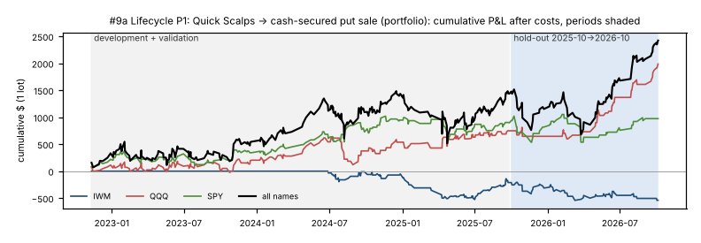

**Amendments, deviations and integrity checks.** A superseded hold-out file is kept separately.

**What it showed.** The put sale earns cents on the cash it ties up.

## #9b Lifecycle P2: Quick Scalps → credit put spread to expiry (portfolio)

**Folder:** `research/compass/lifecycle/ (@7dfea57)`. **Commits:** 1f99d75 / L-A4 / d8a7ebb. **Dates:** 2026-10-15.

**Hypothesis.** As P1 with a defined-risk spread.

**Rule.** QS signal → credit put spread held to expiry.

**Fills and costs.** As P1.

**Data.** SPY/QQQ/IWM/SPXW 0DTE.

**Periods and holdouts.** As P1.

**Pass rule (as pre-registered).** As P1.

**Verdict.** Rejected: hold-out −$6,805.

**Metrics** (return = % of max risk; win = P&L > 0 after fees; breakeven is a loss; the interval is audit_lib's 20-session moving-block bootstrap over the period's calendar sessions):

| name | period | trades | sessions (traded / span) | win % | avg win %, $ | avg loss %, $ | median %, $ | mean %, $ | 20-session block 95% (%; $) |
|------------------|------------------------------|---------------|---------------------|------------|------------------------|------------------------|------------------------|------------------------|------------------------------------------------|
| IWM | development + validation | 80 | 80 / 335 | 93.8 | +12.1, +105.99 | −68.3, −621.20 | +7.4, +68.00 | **+7.11**, +60.54 | [+4.68, +12.45]; [+38.69, +107.46] |
| QQQ | development + validation | 173 | 173 / 738 | 89.6 | +13.2, +117.62 | −108.8, −965.87 | +9.1, +83.00 | **+0.52**, +4.89 | [−6.78, +7.22]; [−61.15, +64.64] |
| SPXW | development + validation | 182 | 182 / 844 | 85.2 | +12.1, +106.90 | −79.7, −702.76 | +11.6, +103.60 | **−1.56**, −13.21 | [−7.24, +3.13]; [−63.22, +28.20] |
| SPY | development + validation | 169 | 169 / 742 | 92.3 | +12.8, +113.84 | −98.9, −836.83 | +8.5, +78.00 | **+4.17**, +40.71 | [−2.65, +10.65]; [−18.78, +97.33] |
| all names | development + validation | 604 | 299 / 844 | 89.6 | +12.6, +111.85 | −91.1, −799.13 | +9.7, +85.80 | **+1.79**, +16.83 | [−2.76, +5.49]; [−22.82, +49.32] |
| IWM | hold-out 2025-10→2026-10 | 53 | 53 / 259 | 79.2 | +7.0, +60.59 | −87.9, −802.14 | +5.6, +48.00 | **−12.68**, −118.47 | [−24.08, −3.92]; [−222.66, −37.98] |
| QQQ | hold-out 2025-10→2026-10 | 48 | 48 / 252 | 95.8 | +16.1, +140.89 | −101.6, −896.50 | +9.7, +83.00 | **+11.17**, +97.67 | [−2.07, +20.92]; [−22.54, +185.73] |
| SPXW | hold-out 2025-10→2026-10 | 47 | 47 / 261 | 89.4 | +11.2, +99.79 | −99.7, −882.06 | +11.0, +98.60 | **−0.64**, −4.66 | [−11.14, +8.75]; [−97.84, +78.53] |
| SPY | hold-out 2025-10→2026-10 | 48 | 48 / 261 | 87.5 | +15.4, +142.83 | −199.7, −1,832.25 | +9.1, +83.00 | **−11.45**, −104.05 | [−45.74, +7.48]; [−422.46, +71.95] |
| all names | hold-out 2025-10→2026-10 | 196 | 91 / 262 | 87.8 | +12.5, +111.72 | −119.5, −1,084.18 | +9.1, +78.30 | **−3.65**, −34.72 | [−16.19, +4.15]; [−150.83, +35.98] |

| name | period | biggest win ($, %, date, contract) | biggest loss ($, %, date, contract) | profit factor | max DD $ | longest DD (sessions) | top-5 days' share of profit |
|------------------|------------------------------|------------------------------------------------------------------|------------------------------------------------------------------|------------|---------------|---------------|------------------------------------|
| IWM | development + validation | +1,564.50, +178.8%, 2024-07-25, IWM CPS m163 | −894.00, −101.6%, 2024-07-24, IWM CPS m140 | 2.56 | 894 | 45 | 68% |
| QQQ | development + validation | +1,759.50, +187.2%, 2024-03-06, QQQ CPS m226 | −2,160.50, −238.7%, 2023-02-03, QQQ CPS m105 | 1.05 | 6,229 | 695 | 654% |
| SPXW | development + validation | +158.60, +18.9%, 2024-07-31, SPXW CPS m76 | −942.80, −100.3%, 2024-07-12, SPXW CPS m311 | 0.87 | 5,324 | 416 | total ≤ 0 (best 5 days +758; without them −3,163) |
| SPY | development + validation | +2,454.50, +283.8%, 2025-06-05, SPY CPS m85 | −1,510.50, −168.8%, 2023-02-03, SPY CPS m92 | 1.63 | 4,848 | 304 | 75% |
| all names | development + validation | +2,454.50, +283.8%, 2025-06-05, SPY CPS m85 | −2,160.50, −238.7%, 2023-02-03, QQQ CPS m105 | 1.20 | 10,333 | 505 | 85% |
| IWM | hold-out 2025-10→2026-10 | +108.00, +12.2%, 2026-03-31, IWM CPS m225 | −2,360.50, −256.6%, 2026-01-16, IWM CPS m187 | 0.29 | 6,753 | 241 | total ≤ 0 (best 5 days +515; without them −6,794) |
| QQQ | hold-out 2025-10→2026-10 | +1,774.50, +196.1%, 2026-02-10, QQQ CPS m61 | −909.00, −101.6%, 2026-08-28, QQQ CPS m123 | 3.61 | 909 | 56 | 70% |
| SPXW | hold-out 2025-10→2026-10 | +138.60, +16.1%, 2026-08-27, SPXW CPS m21 | −897.80, −100.3%, 2025-10-14, SPXW CPS m283 | 0.95 | 1,826 | 203 | total ≤ 0 (best 5 days +638; without them −857) |
| SPY | hold-out 2025-10→2026-10 | +1,944.50, +203.6%, 2025-10-14, SPY CPS m283 | −5,195.50, −558.7%, 2026-01-16, SPY CPS m316 | 0.55 | 8,720 | 250 | total ≤ 0 (best 5 days +3,048; without them −8,043) |
| all names | hold-out 2025-10→2026-10 | +1,944.50, +203.6%, 2025-10-14, SPY CPS m283 | −5,195.50, −558.7%, 2026-01-16, SPY CPS m316 | 0.74 | 12,260 | 251 | total ≤ 0 (best 5 days +5,166; without them −11,970) |

**Random baseline:** not available — no random baseline was computed by this study

**Exit reasons (share of trades):**

- development + validation: policy 100.0%
- hold-out 2025-10→2026-10: policy 100.0%

**By year** (all periods together, labelled by entry year):

| year | name | trades | win % | mean % | mean $ | total $ |
|---|---|---|---|---|---|---|
| 2024 | IWM | 31 | 96.8 | +11.37 | +92.82 | +2,877 |
| 2025 | IWM | 62 | 90.3 | +1.82 | +15.33 | +950 |
| 2026 | IWM | 40 | 77.5 | −14.20 | −131.59 | −5,263 |
| 2022 | QQQ | 6 | 100.0 | +10.56 | +94.70 | +568 |
| 2023 | QQQ | 68 | 85.3 | −7.00 | −65.38 | −4,446 |
| 2024 | QQQ | 53 | 88.7 | +5.11 | +50.58 | +2,681 |
| 2025 | QQQ | 56 | 94.6 | +5.65 | +50.10 | +2,806 |
| 2026 | QQQ | 38 | 97.4 | +11.86 | +103.29 | +3,925 |
| 2022 | SPXW | 28 | 85.7 | −2.76 | −23.39 | −655 |
| 2023 | SPXW | 51 | 86.3 | +2.39 | +20.97 | +1,070 |
| 2024 | SPXW | 56 | 80.4 | −6.50 | −57.36 | −3,212 |
| 2025 | SPXW | 57 | 87.7 | −1.27 | −9.99 | −569 |
| 2026 | SPXW | 37 | 91.9 | +2.11 | +20.07 | +743 |
| 2022 | SPY | 7 | 100.0 | +13.78 | +112.79 | +790 |
| 2023 | SPY | 54 | 92.6 | +2.94 | +27.27 | +1,473 |
| 2024 | SPY | 61 | 86.9 | −3.13 | −17.25 | −1,052 |
| 2025 | SPY | 58 | 94.8 | +12.26 | +111.06 | +6,442 |
| 2026 | SPY | 37 | 89.2 | −16.78 | −155.81 | −5,765 |
| 2022 | all names | 41 | 90.2 | +2.01 | +17.14 | +703 |
| 2023 | all names | 173 | 87.9 | −1.13 | −11.00 | −1,904 |
| 2024 | all names | 201 | 87.1 | +0.34 | +6.44 | +1,294 |
| 2025 | all names | 233 | 91.8 | +4.58 | +41.32 | +9,628 |
| 2026 | all names | 152 | 88.8 | −4.34 | −41.85 | −6,361 |

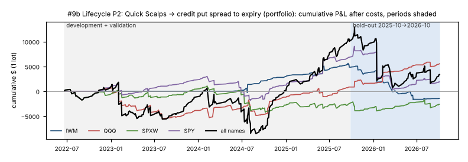

**Amendments, deviations and integrity checks.** —

**What it showed.** Loses on the hold-out.

## #9c Lifecycle Tier I, daily tier, L-A3, H-FLO (by configuration)

**Folder:** `research/compass/lifecycle/ (@7dfea57)`. **Commits:** 1f99d75 / L-A2, L-A3 889691a, L-A4 8bd322a, L-A4.1 f815d27 / 425c7f4, f6d5a98, d8a7ebb, 66bc5c9, 50de62a. **Dates:** 2026-10-15.

**Hypothesis.** Some of 12 setups × 8 structures × 116 management policies (Tier I) or daily setups (Tier D) survive a hold-out.

**Rule.** Grids; finalists chosen on development + validation.

**Fills and costs.** $0.70 a contract each side, NBBO.

**Data.** 0DTE SPY/QQQ/IWM/SPXW; index-ETF option EOD 2012-06 → 2026-10.

**Periods and holdouts.** hold-out 2025-10-01 → 2026-10-09, opened once per group.

**Pass rule (as pre-registered).** R1–R6.

**Verdict.** 0 promoted: Tier I no long-premium policy with a positive lower bound, finalists all put sales; L-A3 debit call spread +$64.37 [−18.16, +138.67] p 0.064 (fail); daily tier 19 finalists, all fail R2 (random day); H-FLO a regime descriptor, not an edge.

**Metrics.** not available — committed as configuration-level cells (grid_by_setup.csv, cells.csv); the trade rows are in the scratchpad (lifecycle/archive, 281 MB) and were not re-run for this report.

**Amendments, deviations and integrity checks.** Random-minute look-ahead corrected (L-A2) before the hold-out.

**What it showed.** No configuration survived the hold-out.

## #10 ATM straddle samples and the independent short-premium prereg (branch compass-research-2026-10-14)

**Folder:** `research/compass_2026_10_14/ on origin/compass-research-2026-10-14`. **Commits:** short_premium PREREG 2f97a0c / — / BLOCKED. **Dates:** 2026-10-14 → 15.

**Hypothesis.** (Measurement) what short-dated ATM straddles cost on 10 names.

**Rule.** —

**Fills and costs.** —

**Data.** 8–19 sessions a name.

**Periods and holdouts.** —

**Pass rule (as pre-registered).** —

**Verdict.** No result: the short-premium study was blocked (ThetaData session invalidated off-box).

**Metrics.** not available — price samples only (no trade with an exit); the pre-registered study never ran.

**Amendments, deviations and integrity checks.** —

**What it showed.** Medians of ATM straddle prices; no strategy.

## #11 Price-action catalogue and atlas (43 names)

**Folder:** `research/compass/intel/04, 06, 07 (@7dfea57)`. **Commits:** — / — / 048d33a, 0d706b6, 98fa5f0. **Dates:** 2026-10-15.

**Hypothesis.** (Descriptive) how price action behaves around levels.

**Rule.** —

**Fills and costs.** —

**Data.** 43 names 2017–2026 bars.

**Periods and holdouts.** —

**Pass rule (as pre-registered).** —

**Verdict.** Descriptive; V6 tested its levels (rejected).

**Metrics.** not available — descriptive tables, no trades.

**Amendments, deviations and integrity checks.** —

**What it showed.** No strategy.

# Part B. Studies after the fresh start

## #12 Step 1: every 0DTE contract broken down

**Folder:** `step1/`. **Commits:** — / — / 2185eb9. **Dates:** 2026-10-16.

**Hypothesis.** (Descriptive) the anatomy of 1,176,935 same-day contracts over 3,687 sessions.

**Rule.** —

**Fills and costs.** —

**Data.** SPY, QQQ, IWM, SPX 0DTE.

**Periods and holdouts.** —

**Pass rule (as pre-registered).** —

**Verdict.** Descriptive.

**Metrics.** not available — a contract inventory, no trades.

**Amendments, deviations and integrity checks.** Checked against the raw quotes (verify.py).

**What it showed.** No strategy.

## #13 Step 2: buy near the money, sell at +100% or hold (within 0.5% of the price)

**Folder:** `step2/`. **Commits:** — / — / b15b56b. **Dates:** 2026-10-16.

**Hypothesis.** A same-day contract that can double pays for those that do not.

**Rule.** Buy every contract within 0.5% of the underlying at the ask at 9:31, 10:00, 10:30, 11:00, 12:00, 1:00, 2:00, 3:00, 3:30; sell the first minute the bid reaches 2× the price paid (at exactly 2×), else hold to the close (worth intrinsic).

**Fills and costs.** $0.65 a contract on the buy and on the sale; none when it expires worthless.

**Data.** SPY, QQQ, IWM, SPX 0DTE 2022-05-13 → 2026-10-09 (the near-the-money slice of 10,547,433 trades).

**Periods and holdouts.** pick 2022–24 / check 2025–26 (no holdout; holdout B months read).

**Pass rule (as pre-registered).** None pre-registered (a population study).

**Verdict.** Every group loses before and after fees; near the money 29% double, below the share needed to break even.

**Metrics** (return = % of premium; win = P&L > 0 after fees; breakeven is a loss; the interval is audit_lib's 20-session moving-block bootstrap over the period's calendar sessions):

| name | period | trades | sessions (traded / span) | win % | avg win %, $ | avg loss %, $ | median %, $ | mean %, $ | 20-session block 95% (%; $) |
|------------------|------------------------------|---------------|---------------------|------------|------------------------|------------------------|------------------------|------------------------|------------------------------------------------|
| IWM | pick 2022–24 | 6,960 | 177 / 182 | 37.5 | +81.2, +54.07 | −87.3, −49.62 | −64.5, −14.30 | **−24.05**, −10.71 | [−28.15, −21.15]; [−12.89, −9.10] |
| QQQ | pick 2022–24 | 39,574 | 536 / 553 | 38.5 | +81.3, +94.74 | −86.6, −86.84 | −60.6, −24.30 | **−21.90**, −16.90 | [−23.39, −20.69]; [−20.04, −14.50] |
| SPXW | pick 2022–24 | 109,721 | 662 / 683 | 41.3 | +83.3, +914.78 | −85.2, −810.27 | −46.6, −120.65 | **−15.61**, −97.77 | [−16.94, −14.47]; [−116.73, −78.73] |
| SPY | pick 2022–24 | 46,425 | 536 / 553 | 39.0 | +78.6, +87.63 | −86.3, −78.41 | −54.3, −16.65 | **−21.94**, −13.58 | [−23.48, −20.59]; [−15.77, −11.70] |
| all names | pick 2022–24 | 202,680 | 662 / 683 | 40.1 | +81.8, +548.95 | −85.8, −467.39 | −51.8, −32.30 | **−18.58**, −59.71 | [−19.90, −17.44]; [−72.48, −48.05] |
| IWM | check 2025–26 | 20,177 | 444 / 457 | 40.0 | +81.7, +61.46 | −88.7, −55.58 | −57.2, −12.65 | **−20.51**, −8.74 | [−22.95, −18.65]; [−10.37, −7.55] |
| QQQ | check 2025–26 | 48,342 | 444 / 457 | 39.2 | +81.4, +140.39 | −86.1, −125.05 | −56.8, −27.65 | **−20.52**, −21.07 | [−22.70, −18.63]; [−23.99, −18.95] |
| SPXW | check 2025–26 | 106,236 | 444 / 457 | 41.1 | +81.5, +1,168.53 | −84.0, −982.07 | −42.5, −105.65 | **−15.96**, −97.67 | [−17.79, −14.25]; [−123.19, −77.45] |
| SPY | check 2025–26 | 53,096 | 444 / 457 | 38.9 | +78.5, +120.19 | −85.5, −102.36 | −51.6, −18.30 | **−21.68**, −15.78 | [−23.83, −19.76]; [−18.70, −13.65] |
| all names | check 2025–26 | 227,851 | 444 / 457 | 40.1 | +80.8, +620.52 | −85.2, −506.22 | −48.9, −30.65 | **−18.66**, −54.46 | [−20.55, −16.99]; [−67.74, −44.13] |

| name | period | biggest win ($, %, date, contract) | biggest loss ($, %, date, contract) | profit factor | max DD $ | longest DD (sessions) | top-5 days' share of profit |
|------------------|------------------------------|------------------------------------------------------------------|------------------------------------------------------------------|------------|---------------|---------------|------------------------------------|
| IWM | pick 2022–24 | +375.70, +99.7%, 2024-08-05, IWM 197.0C m1 | −336.65, −100.2%, 2024-07-24, IWM 220.0C m30 | 0.65 | 74,836 | 180 | total ≤ 0 (best 5 days +2,626; without them −77,159) |
| QQQ | pick 2022–24 | +760.70, +99.8%, 2024-08-05, QQQ 423.0C m1 | −700.65, −100.1%, 2024-08-05, QQQ 426.0P m1 | 0.68 | 669,065 | 551 | total ≤ 0 (best 5 days +20,716; without them −689,459) |
| SPXW | pick 2022–24 | +7,668.70, +100.0%, 2024-08-05, SPXW 5095.0C m1 | −6,890.65, −100.0%, 2024-08-05, SPXW 5145.0P m1 | 0.79 | 10,727,818 | 683 | total ≤ 0 (best 5 days +721,445; without them −11,449,263) |
| SPY | pick 2022–24 | +708.70, +99.8%, 2024-08-05, SPY 509.0C m1 | −678.65, −100.1%, 2024-08-05, SPY 513.0P m1 | 0.72 | 630,388 | 553 | total ≤ 0 (best 5 days +26,913; without them −657,302) |
| all names | pick 2022–24 | +7,668.70, +100.0%, 2024-08-05, SPXW 5095.0C m1 | −6,890.65, −100.0%, 2024-08-05, SPXW 5145.0P m1 | 0.79 | 12,101,482 | 683 | total ≤ 0 (best 5 days +757,666; without them −12,859,148) |
| IWM | check 2025–26 | +343.70, +99.6%, 2025-04-07, IWM 173.0C m1 | −340.65, −100.2%, 2025-04-07, IWM 179.0P m60 | 0.74 | 176,478 | 457 | total ≤ 0 (best 5 days +6,579; without them −183,016) |
| QQQ | check 2025–26 | +786.70, +99.8%, 2025-04-09, QQQ 415.0C m1 | −792.65, −100.1%, 2025-04-09, QQQ 418.0P m1 | 0.72 | 1,018,725 | 457 | total ≤ 0 (best 5 days +53,297; without them −1,072,022) |
| SPXW | check 2025–26 | +9,038.70, +100.0%, 2025-04-09, SPXW 4940.0C m1 | −18,090.65, −100.0%, 2025-11-28, SPXW 6845.0P m1 | 0.83 | 10,392,716 | 457 | total ≤ 0 (best 5 days +911,348; without them −11,286,896) |
| SPY | check 2025–26 | +930.70, +99.9%, 2025-04-09, SPY 492.0C m1 | −880.65, −100.1%, 2025-04-09, SPY 496.0P m1 | 0.75 | 837,710 | 457 | total ≤ 0 (best 5 days +45,406; without them −883,041) |
| all names | check 2025–26 | +9,038.70, +100.0%, 2025-04-09, SPXW 4940.0C m1 | −18,090.65, −100.0%, 2025-11-28, SPXW 6845.0P m1 | 0.82 | 12,424,159 | 457 | total ≤ 0 (best 5 days +1,009,839; without them −13,418,185) |

**Random baseline:** not available — no random baseline was computed by this study

**Exit reasons (share of trades):**

- pick 2022–24: held to the close 70.8%; +100% target 29.2%
- check 2025–26: held to the close 71.1%; +100% target 28.9%

**By year** (all periods together, labelled by entry year):

| year | name | trades | win % | mean % | mean $ | total $ |
|---|---|---|---|---|---|---|
| 2024 | IWM | 6,960 | 37.5 | −24.05 | −10.71 | −74,533 |
| 2025 | IWM | 10,251 | 40.0 | −20.88 | −8.88 | −91,080 |
| 2026 | IWM | 9,926 | 40.0 | −20.13 | −8.60 | −85,358 |
| 2022 | QQQ | 1,720 | 36.7 | −23.50 | −19.54 | −33,612 |
| 2023 | QQQ | 15,750 | 39.3 | −21.11 | −14.02 | −220,871 |
| 2024 | QQQ | 22,104 | 38.1 | −22.33 | −18.74 | −414,261 |
| 2025 | QQQ | 24,779 | 38.3 | −22.29 | −21.20 | −525,436 |
| 2026 | QQQ | 23,563 | 40.1 | −18.66 | −20.93 | −493,289 |
| 2022 | SPXW | 22,444 | 40.9 | −15.56 | −153.19 | −3,438,201 |
| 2023 | SPXW | 38,347 | 41.6 | −15.36 | −76.63 | −2,938,671 |
| 2024 | SPXW | 48,930 | 41.2 | −15.84 | −88.92 | −4,350,946 |
| 2025 | SPXW | 55,548 | 41.2 | −15.93 | −101.81 | −5,655,180 |
| 2026 | SPXW | 50,688 | 41.1 | −15.98 | −93.13 | −4,720,368 |
| 2022 | SPY | 2,386 | 37.9 | −21.77 | −18.80 | −44,867 |
| 2023 | SPY | 19,406 | 39.7 | −21.31 | −11.56 | −224,382 |
| 2024 | SPY | 24,633 | 38.7 | −22.45 | −14.66 | −361,140 |
| 2025 | SPY | 27,804 | 39.0 | −21.77 | −16.32 | −453,673 |
| 2026 | SPY | 25,292 | 38.8 | −21.58 | −15.18 | −383,961 |
| 2022 | all names | 26,550 | 40.3 | −16.63 | −132.45 | −3,516,680 |
| 2023 | all names | 73,503 | 40.6 | −18.16 | −46.04 | −3,383,923 |
| 2024 | all names | 102,627 | 39.7 | −19.38 | −50.68 | −5,200,879 |
| 2025 | all names | 118,382 | 40.0 | −19.06 | −56.81 | −6,725,369 |
| 2026 | all names | 109,469 | 40.2 | −18.23 | −51.91 | −5,682,976 |

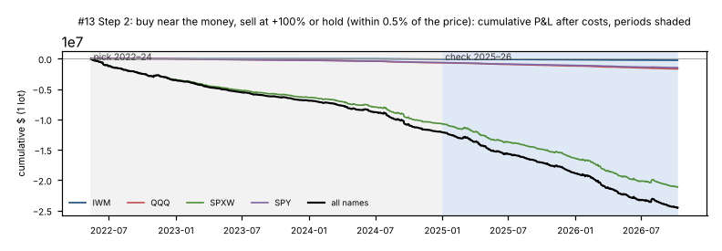

**Amendments, deviations and integrity checks.** Formulas: step2/summarize.py (tp100, fees), the committed loader step2.double.load.

**What it showed.** Near-the-money 0DTE buys lose 16–22% of premium a trade.

## #14 Step 3: 108 exits × 9 conditions

**Folder:** `step3/`. **Commits:** — / — / 09885b6. **Dates:** 2026-10-16.

**Hypothesis.** A target, stop or time exit, or a condition known at the buy, makes step 2's trades pay.

**Rule.** 108 exits × 9 entry conditions on step 2's trades.

**Fills and costs.** $0.65 a contract each way.

**Data.** As step 2.

**Periods and holdouts.** discovery 2022–24 / check 2025–26.

**Pass rule (as pre-registered).** None pre-registered.

**Verdict.** Nothing made money in a way that held up; a −50% stop shrank losses; targets raised the win rate and lowered the average.

**Metrics.** not available — committed as per-rule summaries (exits.csv, exits_best.csv); the per-trade paths are committed but the exit grid was not re-run here.

**Amendments, deviations and integrity checks.** —

**What it showed.** No exit rule rescues the buys.

## #15 Step 4: turn-up buy (1.5× the low) + 20% trailing stop, near the money

**Folder:** `step4/`. **Commits:** — / — / 6c0e60b. **Dates:** 2026-10-16.

**Hypothesis.** Buying the turn up off the low and selling near the high with a trailing stop finds an edge.

**Rule.** The first minute (9:36 → 15 minutes before the close) a contract's ask reaches 1.5× its low so far → buy at the ask; sell at the bid once it falls 20% from the highest bid since buying, else hold to the close. Strikes within 0.5% of the price.

**Fills and costs.** $0.65 a contract each way (none when worthless).

**Data.** SPY, QQQ, IWM, SPX 0DTE 2022–2026 (this slice of 12,149,834 trades).

**Periods and holdouts.** pick 2022–24 / check 2025–26.

**Pass rule (as pre-registered).** None pre-registered; 126 rules positive in both periods, the 11 biggest failed the stress test.

**Verdict.** A trailing stop beats holding but still loses.

**Metrics** (return = % of premium; win = P&L > 0 after fees; breakeven is a loss; the interval is audit_lib's 20-session moving-block bootstrap over the period's calendar sessions):

| name | period | trades | sessions (traded / span) | win % | avg win %, $ | avg loss %, $ | median %, $ | mean %, $ | 20-session block 95% (%; $) |
|------------------|------------------------------|---------------|---------------------|------------|------------------------|------------------------|------------------------|------------------------|------------------------------------------------|
| IWM | pick 2022–24 | 807 | 177 / 182 | 23.3 | +37.0, +28.76 | −22.0, −18.21 | −20.1, −11.30 | **−8.30**, −7.27 | [−11.58, −5.37]; [−10.27, −4.59] |
| QQQ | pick 2022–24 | 4,603 | 536 / 553 | 27.4 | +39.4, +52.74 | −19.9, −26.58 | −16.5, −15.30 | **−3.66**, −4.89 | [−4.88, −1.77]; [−6.69, −1.93] |
| SPXW | pick 2022–24 | 12,787 | 662 / 683 | 26.8 | +36.8, +473.51 | −19.3, −243.46 | −16.6, −116.30 | **−4.29**, −51.53 | [−5.43, −2.91]; [−68.61, −30.35] |
| SPY | pick 2022–24 | 5,388 | 536 / 553 | 26.2 | +36.7, +47.64 | −20.6, −23.22 | −17.2, −11.30 | **−5.57**, −4.66 | [−6.91, −3.68]; [−6.25, −2.04] |
| all names | pick 2022–24 | 23,585 | 662 / 683 | 26.6 | +37.3, +280.19 | −19.8, −142.87 | −16.8, −26.30 | **−4.59**, −30.20 | [−5.59, −3.37]; [−41.20, −17.62] |
| IWM | check 2025–26 | 2,347 | 444 / 457 | 24.8 | +41.3, +38.47 | −21.4, −19.47 | −18.4, −11.30 | **−5.82**, −5.08 | [−8.42, −2.59]; [−7.81, −2.07] |
| QQQ | check 2025–26 | 5,595 | 444 / 457 | 28.3 | +41.5, +87.29 | −19.7, −39.29 | −15.7, −21.30 | **−2.38**, −3.41 | [−4.82, +0.08]; [−7.63, +1.56] |
| SPXW | check 2025–26 | 12,238 | 444 / 457 | 30.0 | +41.0, +722.70 | −18.9, −311.15 | −14.6, −121.30 | **−0.94**, −1.45 | [−2.55, +1.19]; [−42.34, +52.40] |
| SPY | check 2025–26 | 6,078 | 444 / 457 | 29.3 | +39.7, +72.29 | −19.8, −32.35 | −15.1, −12.30 | **−2.41**, −1.72 | [−4.16, −0.30]; [−5.36, +2.51] |
| all names | check 2025–26 | 26,258 | 444 / 457 | 29.0 | +40.8, +385.98 | −19.5, −160.81 | −15.3, −24.30 | **−2.02**, −2.26 | [−3.63, −0.05]; [−22.69, +24.38] |

| name | period | biggest win ($, %, date, contract) | biggest loss ($, %, date, contract) | profit factor | max DD $ | longest DD (sessions) | top-5 days' share of profit |
|------------------|------------------------------|------------------------------------------------------------------|------------------------------------------------------------------|------------|---------------|---------------|------------------------------------|
| IWM | pick 2022–24 | +195.70, +160.4%, 2024-07-11, IWM 207.0C m14 | −241.30, −74.2%, 2024-09-03, IWM 217.0C m30 | 0.48 | 5,982 | 179 | total ≤ 0 (best 5 days +1,030; without them −6,895) |
| QQQ | pick 2022–24 | +603.70, +359.3%, 2023-08-29, QQQ 367.0C m13 | −271.30, −52.8%, 2023-03-22, QQQ 313.0P m270 | 0.75 | 22,493 | 553 | total ≤ 0 (best 5 days +7,132; without them −29,625) |
| SPXW | pick 2022–24 | +7,302.70, +268.5%, 2024-05-31, SPXW 5180.0C m211 | −4,491.30, −81.8%, 2023-09-21, SPXW 4350.0C m6 | 0.71 | 661,588 | 673 | total ≤ 0 (best 5 days +145,957; without them −804,860) |
| SPY | pick 2022–24 | +795.70, +248.7%, 2024-08-01, SPY 555.0P m36 | −331.30, −68.3%, 2024-09-18, SPY 565.0P m270 | 0.73 | 25,111 | 553 | total ≤ 0 (best 5 days +6,716; without them −31,828) |
| all names | pick 2022–24 | +7,302.70, +268.5%, 2024-05-31, SPXW 5180.0C m211 | −4,491.30, −81.8%, 2023-09-21, SPXW 4350.0C m6 | 0.71 | 715,057 | 673 | total ≤ 0 (best 5 days +154,181; without them −866,554) |
| IWM | check 2025–26 | +639.70, +752.6%, 2025-02-21, IWM 225.0P m6 | −246.30, −66.4%, 2025-08-01, IWM 212.5C m30 | 0.65 | 12,213 | 456 | total ≤ 0 (best 5 days +3,614; without them −15,535) |
| QQQ | check 2025–26 | +1,032.70, +983.5%, 2026-09-21, QQQ 730.0C m8 | −275.30, −100.5%, 2025-07-30, QQQ 570.0P m104 | 0.88 | 30,063 | 323 | total ≤ 0 (best 5 days +21,424; without them −40,512) |
| SPXW | check 2025–26 | +21,608.70, +266.1%, 2025-04-07, SPXW 4875.0C m19 | −39,941.30, −80.0%, 2025-04-09, SPXW 5340.0P m238 | 0.99 | 458,549 | 390 | total ≤ 0 (best 5 days +421,847; without them −439,607) |
| SPY | check 2025–26 | +1,875.70, +246.8%, 2025-04-07, SPY 490.0C m23 | −2,363.30, −86.0%, 2025-04-09, SPY 521.0P m231 | 0.92 | 29,308 | 390 | total ≤ 0 (best 5 days +20,771; without them −31,245) |
| all names | check 2025–26 | +21,608.70, +266.1%, 2025-04-07, SPXW 4875.0C m19 | −39,941.30, −80.0%, 2025-04-09, SPXW 5340.0P m238 | 0.98 | 525,009 | 390 | total ≤ 0 (best 5 days +459,513; without them −518,756) |

**Random baseline:** not available — no random baseline was computed by this study

**Exit reasons (share of trades):**

- pick 2022–24: 20% trailing stop 99.5%; held to the close 0.5%
- check 2025–26: 20% trailing stop 99.4%; held to the close 0.6%

**By year** (all periods together, labelled by entry year):

| year | name | trades | win % | mean % | mean $ | total $ |
|---|---|---|---|---|---|---|
| 2024 | IWM | 807 | 23.3 | −8.30 | −7.27 | −5,865 |
| 2025 | IWM | 1,182 | 23.0 | −7.82 | −8.19 | −9,676 |
| 2026 | IWM | 1,165 | 26.7 | −3.80 | −1.93 | −2,245 |
| 2022 | QQQ | 202 | 19.3 | −7.67 | −11.90 | −2,405 |
| 2023 | QQQ | 1,842 | 27.7 | −3.64 | −4.45 | −8,203 |
| 2024 | QQQ | 2,559 | 27.7 | −3.36 | −4.64 | −11,886 |
| 2025 | QQQ | 2,874 | 27.1 | −3.68 | −4.29 | −12,343 |
| 2026 | QQQ | 2,721 | 29.6 | −1.00 | −2.48 | −6,745 |
| 2022 | SPXW | 2,622 | 25.2 | −5.30 | −90.87 | −238,256 |
| 2023 | SPXW | 4,479 | 25.9 | −4.97 | −51.37 | −230,081 |
| 2024 | SPXW | 5,686 | 28.2 | −3.28 | −33.52 | −190,567 |
| 2025 | SPXW | 6,428 | 29.9 | −0.93 | +4.92 | +31,604 |
| 2026 | SPXW | 5,810 | 30.0 | −0.95 | −8.50 | −49,364 |
| 2022 | SPY | 300 | 22.7 | −7.11 | −10.67 | −3,200 |
| 2023 | SPY | 2,240 | 25.1 | −6.60 | −5.39 | −12,063 |
| 2024 | SPY | 2,848 | 27.4 | −4.59 | −3.46 | −9,848 |
| 2025 | SPY | 3,194 | 29.5 | −2.72 | −1.71 | −5,458 |
| 2026 | SPY | 2,884 | 29.0 | −2.07 | −1.74 | −5,016 |
| 2022 | all names | 3,124 | 24.6 | −5.63 | −78.06 | −243,860 |
| 2023 | all names | 8,561 | 26.0 | −5.11 | −29.24 | −250,346 |
| 2024 | all names | 11,900 | 27.6 | −3.95 | −18.33 | −218,166 |
| 2025 | all names | 13,678 | 28.6 | −2.52 | +0.30 | +4,127 |
| 2026 | all names | 12,580 | 29.4 | −1.48 | −5.04 | −63,371 |

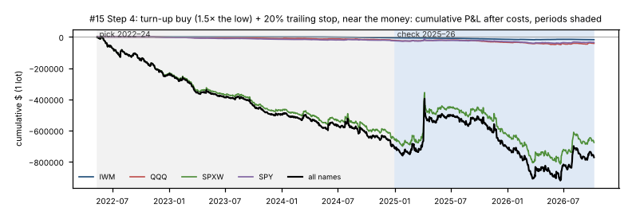

**Amendments, deviations and integrity checks.** Formulas copied from step4/summarize.py prep().

**What it showed.** The near-the-money turn-up buy with a 20% trail loses 1–8% of premium a trade.

## #16 Step 5: the runner model (model A/B) and its top 1% picks

**Folder:** `step5/`. **Commits:** — / — / ae3c63d, 1227394, f9f2746, 491a0c7. **Dates:** 2026-10-16 → 17.

**Hypothesis.** What was visible at the turn tells runners from duds well enough to trade.

**Rule.** Gradient-boosted model A (P(bid ≥ 3× paid)) and B; trade the top 1% / 0.5% / 0.1%, three exits.

**Fills and costs.** $0.65 a contract each way.

**Data.** 1,602,401 turn-up and range-break buys; trained 2022–24, scored once on 2025–26.

**Periods and holdouts.** train 2022–24 / scored 2025–26.

**Pass rule (as pre-registered).** None pre-registered.

**Verdict.** Runners partly separable (top 1% reach 3× 26% vs 6%) but do not pay; every pick total made money almost all on 2025-11-20, and without its best 5 days it lost $620,114.

**Metrics.** not available — the picks are committed as daily sums (top1_daily.csv), not trades.

**Amendments, deviations and integrity checks.** Scored once.

**What it showed.** The model ranks runners but its picks do not pay without a handful of days.

## #17 Step 6: the six pre-registered runner rules × three exits

**Folder:** `step6/`. **Commits:** 30babaa / — / 44b5547. **Dates:** 2026-10-23.

**Hypothesis.** A condition visible at the buy raises the odds of a +40% (family A) or +500% (family B) run enough to trade.

**Rule.** The top 3 rules of each family by Pick lift (one or two Part 2 buckets, ≥ 300 Pick trades on ≥ 60 dates), each buying every near-the-money population trade that meets it; exits (a) +40% / −30% / 60 minutes or 3:30, (b) 50% trail armed at +40%, out 3:30, (c) half at +40%, trail the rest 50%, out 3:30.

**Fills and costs.** $0.65 a contract each way (SPY/QQQ/IWM), SPXW per schedule; no sale fee at a $0 bid.

**Data.** 240,493 near-the-money 0DTE buys 2022-05 → 2026-10-09 (the 28 held-out months never read).

**Periods and holdouts.** pick 2022-05→2024 / check 2025→2026-10-09; the 28 holdout-B months UNOPENED.

**Pass rule (as pre-registered).** Check: average r > 0, its 20-session block lower end > 0, and above the 97.5th percentile of 500 cell-matched random draws.

**Verdict.** FAIL: 0 of 18 pass; all lose on Check (−3.3% to −21.9% a trade); 14 of 18 below the 20th random percentile.

**Metrics** (return = % of premium; win = P&L > 0 after fees; breakeven is a loss; the interval is audit_lib's 20-session moving-block bootstrap over the period's calendar sessions):

| name | period | trades | sessions (traded / span) | win % | avg win %, $ | avg loss %, $ | median %, $ | mean %, $ | 20-session block 95% (%; $) |
|------------------|------------------------------|---------------|---------------------|------------|------------------------|------------------------|------------------------|------------------------|------------------------------------------------|
| A1a | pick 2022-05→2024 | 665 | 80 / 681 | 49.8 | +35.7, +234.96 | −33.3, −297.25 | −0.5, −1.30 | **+1.07**, −32.35 | [−6.21, +10.10]; [−85.26, +64.39] |
| A1b | pick 2022-05→2024 | 665 | 80 / 681 | 31.9 | +79.6, +611.09 | −50.5, −418.65 | −23.4, −41.30 | **−9.02**, −90.37 | [−25.54, +15.35]; [−198.72, +179.43] |
| A1c | pick 2022-05→2024 | 665 | 80 / 681 | 66.2 | +65.4, +507.99 | −153.8, −1,321.76 | +14.1, +34.20 | **−8.77**, −111.10 | [−34.77, +29.18]; [−283.79, +319.36] |
| A2a | pick 2022-05→2024 | 1,081 | 186 / 678 | 43.1 | +37.8, +323.47 | −34.4, −270.96 | −30.9, −20.30 | **−3.29**, −14.71 | [−10.74, +1.18]; [−93.67, +31.73] |
| A2b | pick 2022-05→2024 | 1,081 | 186 / 678 | 32.7 | +141.1, +953.79 | −50.4, −417.45 | −22.7, −46.30 | **+12.30**, +31.60 | [−8.79, +40.13]; [−124.49, +238.45] |
| A2c | pick 2022-05→2024 | 1,081 | 186 / 678 | 64.0 | +99.9, +712.93 | −146.4, −1,191.32 | +13.5, +38.89 | **+11.28**, +27.68 | [−15.39, +42.35]; [−188.37, +293.41] |
| A3a | pick 2022-05→2024 | 1,239 | 127 / 683 | 47.4 | +37.6, +323.20 | −33.7, −288.28 | −14.7, −15.30 | **+0.07**, +1.42 | [−7.06, +6.68]; [−81.46, +73.56] |
| A3b | pick 2022-05→2024 | 1,239 | 127 / 683 | 28.6 | +95.9, +898.21 | −45.5, −356.22 | −20.9, −51.30 | **−5.11**, +2.19 | [−26.65, +2.15]; [−270.58, +75.75] |
| A3c | pick 2022-05→2024 | 1,239 | 127 / 683 | 66.0 | +68.8, +651.47 | −145.3, −1,125.75 | +15.1, +36.00 | **−3.97**, +47.59 | [−36.20, +11.73]; [−385.28, +200.43] |
| B1a | pick 2022-05→2024 | 2,426 | 121 / 443 | 42.3 | +31.5, +630.72 | −29.8, −598.56 | −18.6, −382.55 | **−3.88**, −78.17 | [−5.32, −2.90]; [−104.92, −55.79] |
| B1b | pick 2022-05→2024 | 2,426 | 121 / 443 | 34.5 | +106.5, +2,149.50 | −52.9, −1,062.58 | −21.6, −412.55 | **+2.01**, +44.30 | [−10.52, +14.04]; [−210.66, +297.90] |
| B1c | pick 2022-05→2024 | 2,426 | 121 / 443 | 58.4 | +93.3, +1,885.77 | −142.3, −2,856.32 | +13.8, +252.89 | **−4.69**, −86.51 | [−16.90, +8.33]; [−328.31, +192.24] |
| B2a | pick 2022-05→2024 | 2,483 | 137 / 621 | 38.6 | +30.0, +579.34 | −27.6, −533.86 | −15.5, −312.55 | **−5.35**, −103.91 | [−6.45, −4.60]; [−126.98, −88.86] |
| B2b | pick 2022-05→2024 | 2,483 | 137 / 621 | 34.8 | +95.2, +1,817.29 | −55.5, −1,074.00 | −23.8, −432.55 | **−2.99**, −66.76 | [−11.44, +6.44]; [−247.19, +130.14] |
| B2c | pick 2022-05→2024 | 2,483 | 137 / 621 | 55.8 | +90.1, +1,733.08 | −142.6, −2,744.70 | +10.8, +206.89 | **−12.68**, −245.22 | [−21.40, −3.60]; [−429.82, −54.34] |
| B3a | pick 2022-05→2024 | 752 | 60 / 85 | 43.8 | +35.9, +320.37 | −32.9, −203.52 | −30.6, −23.30 | **−2.80**, +25.68 | [−10.87, −2.38]; [−75.73, +33.84] |
| B3b | pick 2022-05→2024 | 752 | 60 / 85 | 32.3 | +104.5, +934.95 | −50.7, −338.31 | −22.0, −49.80 | **−0.53**, +73.13 | [−27.90, +5.39]; [−230.53, +152.66] |
| B3c | pick 2022-05→2024 | 752 | 60 / 85 | 55.9 | +91.0, +801.74 | −134.0, −857.15 | +11.7, +24.10 | **−8.30**, +69.36 | [−49.01, −1.58]; [−402.35, +169.93] |
| A1a | check 2025→2026-10-09 | 1,035 | 101 / 451 | 36.6 | +37.2, +430.01 | −33.4, −287.39 | −31.4, −33.30 | **−7.54**, −24.69 | [−15.50, −0.10]; [−159.16, +104.87] |
| A1b | check 2025→2026-10-09 | 1,035 | 101 / 451 | 27.1 | +83.4, +332.19 | −60.6, −660.70 | −30.0, −73.30 | **−21.53**, −391.13 | [−42.34, +0.40]; [−621.95, −125.68] |
| A1c | check 2025→2026-10-09 | 1,035 | 101 / 451 | 53.4 | +70.0, +418.67 | −162.5, −1,617.02 | +7.1, +6.40 | **−38.24**, −529.36 | [−80.04, −0.96]; [−823.99, −209.03] |
| A2a | check 2025→2026-10-09 | 1,502 | 155 / 456 | 32.2 | +36.2, +378.08 | −33.7, −318.23 | −31.7, −40.80 | **−11.17**, −93.85 | [−15.01, −7.26]; [−188.26, +1.70] |
| A2b | check 2025→2026-10-09 | 1,502 | 155 / 456 | 35.8 | +81.2, +882.58 | −63.9, −596.57 | −25.0, −46.30 | **−11.89**, −66.75 | [−30.37, +10.29]; [−318.50, +161.97] |
| A2c | check 2025→2026-10-09 | 1,502 | 155 / 456 | 55.3 | +83.7, +935.37 | −164.8, −1,565.82 | +11.2, +19.30 | **−27.31**, −182.01 | [−59.32, +9.59]; [−620.91, +239.32] |
| A3a | check 2025→2026-10-09 | 2,435 | 146 / 451 | 37.1 | +37.1, +364.92 | −34.0, −305.79 | −31.6, −35.30 | **−7.62**, −57.06 | [−11.88, −3.35]; [−116.97, +0.68] |
| A3b | check 2025→2026-10-09 | 2,435 | 146 / 451 | 28.7 | +75.1, +514.83 | −61.0, −622.63 | −28.1, −60.30 | **−21.90**, −296.11 | [−32.27, −7.52]; [−508.70, −5.52] |
| A3c | check 2025→2026-10-09 | 2,435 | 146 / 451 | 54.0 | +69.6, +546.69 | −166.1, −1,674.08 | +8.8, +11.00 | **−38.83**, −474.77 | [−56.61, −15.99]; [−825.13, −6.23] |
| B1a | check 2025→2026-10-09 | 6,350 | 197 / 457 | 41.6 | +31.8, +685.75 | −29.5, −642.56 | −17.7, −432.55 | **−3.97**, −89.48 | [−4.79, −3.41]; [−107.57, −76.20] |
| B1b | check 2025→2026-10-09 | 6,350 | 197 / 457 | 35.0 | +93.5, +2,028.38 | −55.6, −1,238.88 | −22.1, −442.55 | **−3.34**, −94.06 | [−8.46, +2.81]; [−198.26, +34.54] |
| B1c | check 2025→2026-10-09 | 6,350 | 197 / 457 | 59.0 | +85.8, +1,874.18 | −150.5, −3,356.98 | +13.9, +292.89 | **−11.03**, −269.36 | [−16.70, −5.06]; [−398.31, −127.42] |
| B2a | check 2025→2026-10-09 | 5,406 | 136 / 446 | 39.7 | +31.7, +703.69 | −29.3, −655.79 | −19.9, −452.55 | **−5.07**, −116.37 | [−6.44, −4.02]; [−152.63, −88.38] |
| B2b | check 2025→2026-10-09 | 5,406 | 136 / 446 | 35.4 | +93.0, +2,087.62 | −57.7, −1,324.39 | −22.1, −462.55 | **−4.29**, −115.10 | [−9.49, +3.40]; [−237.67, +59.66] |
| B2c | check 2025→2026-10-09 | 5,406 | 136 / 446 | 57.3 | +88.7, +2,007.17 | −152.2, −3,498.43 | +13.2, +276.89 | **−14.07**, −341.32 | [−21.04, −5.71]; [−528.55, −137.30] |
| B3a | check 2025→2026-10-09 | 5,454 | 321 / 457 | 37.4 | +36.3, +376.73 | −31.8, −325.65 | −30.9, −41.30 | **−6.35**, −63.19 | [−7.74, −5.02]; [−120.75, −21.88] |
| B3b | check 2025→2026-10-09 | 5,454 | 321 / 457 | 31.5 | +95.1, +1,032.89 | −54.9, −556.86 | −25.8, −65.30 | **−7.66**, −56.38 | [−12.26, −3.30]; [−130.94, +13.26] |
| B3c | check 2025→2026-10-09 | 5,454 | 321 / 457 | 53.6 | +86.3, +955.64 | −142.4, −1,426.40 | +8.7, +17.10 | **−19.87**, −150.21 | [−27.20, −13.13]; [−287.45, −42.98] |

| name | period | biggest win ($, %, date, contract) | biggest loss ($, %, date, contract) | profit factor | max DD $ | longest DD (sessions) | top-5 days' share of profit |
|------------------|------------------------------|------------------------------------------------------------------|------------------------------------------------------------------|------------|---------------|---------------|------------------------------------|
| A1a | pick 2022-05→2024 | +1,237.45, +39.9%, 2022-09-01, SPX 3955.0P m60 | −1,412.55, −31.6%, 2022-05-19, SPX 3935.0P m90 | 0.78 | 36,426 | 681 | total ≤ 0 (best 5 days +31,037; without them −52,548) |
| A1b | pick 2022-05→2024 | +6,137.45, +204.6%, 2022-10-20, SPX 3755.0P m90 | −3,402.55, −94.3%, 2022-05-17, SPX 4075.0P m90 | 0.68 | 82,630 | 681 | total ≤ 0 (best 5 days +91,995; without them −152,094) |
| A1c | pick 2022-05→2024 | +7,518.89, +200.0%, 2022-07-05, SPX 3725.0C m60 | −6,805.11, −188.5%, 2022-05-17, SPX 4075.0P m90 | 0.75 | 115,765 | 681 | total ≤ 0 (best 5 days +125,542; without them −199,422) |
| A2a | pick 2022-05→2024 | +1,689.45, +39.9%, 2022-06-13, SPX 3750.0C m150 | −1,322.55, −36.8%, 2022-05-19, SPX 3935.0P m210 | 0.90 | 65,459 | 660 | total ≤ 0 (best 5 days +53,846; without them −69,751) |
| A2b | pick 2022-05→2024 | +7,777.45, +436.9%, 2024-09-11, SPX 5445.0C m150 | −3,622.55, −86.0%, 2022-05-24, SPX 3930.0P m60 | 1.11 | 86,722 | 596 | 477% |
| A2c | pick 2022-05→2024 | +8,486.89, +476.8%, 2024-09-11, SPX 5445.0C m150 | −7,245.11, −172.1%, 2022-05-24, SPX 3930.0P m60 | 1.06 | 113,190 | 543 | 651% |
| A3a | pick 2022-05→2024 | +1,813.45, +39.9%, 2022-05-18, SPX 4050.0P m60 | −1,562.55, −40.7%, 2022-10-21, SPX 3710.0P m90 | 1.01 | 59,987 | 587 | 2981% |
| A3b | pick 2022-05→2024 | +8,687.45, +191.4%, 2022-05-18, SPX 4050.0P m60 | −3,837.46, −99.9%, 2022-10-21, SPX 3710.0P m90 | 1.01 | 171,405 | 679 | 8340% |
| A3c | pick 2022-05→2024 | +10,500.89, +231.3%, 2022-05-18, SPX 4050.0P m60 | −7,674.93, −199.9%, 2022-10-21, SPX 3710.0P m90 | 1.12 | 187,483 | 633 | 497% |
| B1a | pick 2022-05→2024 | +1,625.45, +39.9%, 2024-12-31, SPX 5955.0P m60 | −2,557.46, −99.5%, 2023-09-21, SPX 4355.0C m1 | 0.77 | 189,790 | 442 | total ≤ 0 (best 5 days +11,210; without them −200,843) |
| B1b | pick 2022-05→2024 | +12,317.45, +443.1%, 2024-12-18, SPX 6090.0P m90 | −3,431.28, −100.0%, 2024-04-15, SPX 5135.0C m1 | 1.06 | 233,599 | 324 | 525% |
| B1c | pick 2022-05→2024 | +13,426.89, +483.0%, 2024-12-18, SPX 6090.0P m90 | −6,862.55, −200.1%, 2024-04-15, SPX 5135.0C m1 | 0.93 | 392,636 | 443 | total ≤ 0 (best 5 days +559,720; without them −769,604) |
| B2a | pick 2022-05→2024 | +1,533.45, +39.9%, 2024-10-04, SPX 5775.0P m1 | −1,382.55, −37.8%, 2022-08-10, SPX 4165.0C m1 | 0.68 | 259,938 | 618 | total ≤ 0 (best 5 days +8,995; without them −267,011) |
| B2b | pick 2022-05→2024 | +12,317.45, +443.1%, 2024-12-18, SPX 6090.0P m90 | −3,322.55, −94.1%, 2024-10-31, SPX 5740.0C m1 | 0.90 | 457,000 | 621 | total ≤ 0 (best 5 days +395,720; without them −561,491) |
| B2c | pick 2022-05→2024 | +13,426.89, +483.0%, 2024-12-18, SPX 6090.0P m90 | −6,645.11, −188.2%, 2024-10-31, SPX 5740.0C m1 | 0.80 | 890,657 | 621 | total ≤ 0 (best 5 days +390,586; without them −999,469) |
| B3a | pick 2022-05→2024 | +1,281.45, +39.9%, 2024-09-06, SPX 5410.0C m90 | −1,112.55, −35.2%, 2024-09-06, SPX 5435.0C m60 | 1.22 | 19,070 | 62 | 202% |
| B3b | pick 2022-05→2024 | +11,797.45, +655.4%, 2024-12-18, SPX 6075.0P m150 | −2,932.55, −92.8%, 2024-09-06, SPX 5435.0C m60 | 1.32 | 83,967 | 79 | 268% |
| B3c | pick 2022-05→2024 | +12,514.89, +695.3%, 2024-12-18, SPX 6075.0P m150 | −5,865.11, −185.6%, 2024-09-06, SPX 5435.0C m60 | 1.18 | 138,490 | 79 | 344% |
| A1a | check 2025→2026-10-09 | +4,161.45, +40.0%, 2025-04-09, SPX 5085.0P m60 | −3,532.55, −37.5%, 2025-04-04, SPX 5255.0P m90 | 0.86 | 75,185 | 368 | total ≤ 0 (best 5 days +140,471; without them −166,024) |
| A1b | check 2025→2026-10-09 | +3,477.45, +37.0%, 2025-04-04, SPX 5255.0P m90 | −13,347.46, −100.0%, 2025-04-09, SPX 5125.0P m60 | 0.19 | 405,214 | 446 | total ≤ 0 (best 5 days +40,691; without them −445,512) |
| A1c | check 2025→2026-10-09 | +7,238.89, +76.9%, 2025-04-04, SPX 5255.0P m90 | −26,694.93, −200.0%, 2025-04-09, SPX 5125.0P m60 | 0.30 | 591,518 | 384 | total ≤ 0 (best 5 days +136,266; without them −684,148) |
| A2a | check 2025→2026-10-09 | +2,647.45, +23.2%, 2025-04-11, SPX 5155.0C m90 | −4,132.55, −31.1%, 2025-04-07, SPX 4900.0C m150 | 0.56 | 156,280 | 408 | total ≤ 0 (best 5 days +96,136; without them −237,101) |
| A2b | check 2025→2026-10-09 | +9,607.45, +84.2%, 2025-04-11, SPX 5155.0C m90 | −6,502.55, −88.7%, 2025-04-08, SPX 5025.0C m270 | 0.83 | 388,541 | 409 | total ≤ 0 (best 5 days +308,240; without them −408,502) |
| A2c | check 2025→2026-10-09 | +14,168.89, +124.2%, 2025-04-11, SPX 5155.0C m90 | −13,005.11, −177.4%, 2025-04-08, SPX 5025.0C m270 | 0.74 | 696,010 | 408 | total ≤ 0 (best 5 days +430,849; without them −704,227) |
| A3a | check 2025→2026-10-09 | +4,161.45, +40.0%, 2025-04-09, SPX 5085.0P m60 | −3,532.55, −37.5%, 2025-04-04, SPX 5255.0P m90 | 0.70 | 218,542 | 383 | total ≤ 0 (best 5 days +177,365; without them −316,304) |
| A3b | check 2025→2026-10-09 | +5,297.45, +118.5%, 2025-10-10, SPX 6680.0P m150 | −13,347.46, −100.0%, 2025-04-09, SPX 5125.0P m60 | 0.33 | 756,263 | 451 | total ≤ 0 (best 5 days +152,628; without them −873,645) |
| A3c | check 2025→2026-10-09 | +7,238.89, +76.9%, 2025-04-04, SPX 5255.0P m90 | −26,694.93, −200.0%, 2025-04-09, SPX 5125.0P m60 | 0.38 | 1,202,103 | 451 | total ≤ 0 (best 5 days +252,050; without them −1,408,120) |
| B1a | check 2025→2026-10-09 | +1,957.45, +39.9%, 2026-06-17, SPX 7570.0P m60 | −2,891.28, −100.0%, 2025-07-30, SPX 6360.0C m60 | 0.76 | 571,028 | 449 | total ≤ 0 (best 5 days +22,656; without them −590,866) |
| B1b | check 2025→2026-10-09 | +16,707.45, +843.8%, 2025-10-10, SPX 6770.0P m30 | −5,517.55, −98.2%, 2026-09-16, SPX 7560.0C m1 | 0.88 | 699,558 | 401 | total ≤ 0 (best 5 days +624,048; without them −1,221,308) |
| B1c | check 2025→2026-10-09 | +17,496.89, +883.7%, 2025-10-10, SPX 6770.0P m30 | −11,035.11, −196.4%, 2026-09-16, SPX 7560.0C m1 | 0.80 | 1,792,998 | 434 | total ≤ 0 (best 5 days +576,078; without them −2,286,495) |
| B2a | check 2025→2026-10-09 | +2,301.45, +40.0%, 2026-02-20, SPX 6790.0C m1 | −2,891.28, −100.0%, 2025-07-30, SPX 6360.0C m60 | 0.71 | 629,505 | 446 | total ≤ 0 (best 5 days +22,604; without them −651,714) |
| B2b | check 2025→2026-10-09 | +16,707.45, +843.8%, 2025-10-10, SPX 6770.0P m30 | −5,762.55, −97.0%, 2026-02-20, SPX 6890.0P m1 | 0.87 | 916,065 | 251 | total ≤ 0 (best 5 days +550,802; without them −1,173,037) |
| B2c | check 2025→2026-10-09 | +17,496.89, +883.7%, 2025-10-10, SPX 6770.0P m30 | −11,525.11, −194.0%, 2026-02-20, SPX 6890.0P m1 | 0.77 | 1,934,517 | 251 | total ≤ 0 (best 5 days +521,335; without them −2,366,486) |
| B3a | check 2025→2026-10-09 | +2,985.45, +40.0%, 2025-04-07, SPX 4925.0C m210 | −4,022.55, −33.5%, 2025-04-07, SPX 4820.0C m1 | 0.69 | 348,301 | 456 | total ≤ 0 (best 5 days +72,070; without them −416,712) |
| B3b | check 2025→2026-10-09 | +23,857.45, +381.1%, 2025-04-08, SPX 5295.0P m60 | −7,837.46, −99.2%, 2025-04-04, SPX 5215.0C m1 | 0.85 | 486,300 | 390 | total ≤ 0 (best 5 days +678,695; without them −986,191) |
| B3c | check 2025→2026-10-09 | +26,358.89, +421.1%, 2025-04-08, SPX 5295.0P m60 | −15,674.93, −198.4%, 2025-04-04, SPX 5215.0C m1 | 0.77 | 976,739 | 412 | total ≤ 0 (best 5 days +852,538; without them −1,671,786) |

**Random baseline:** 500 cell-matched random draws per rule and exit (step6/out/results.csv): the rule's percentile is printed there; on Check 14 of 18 rule × exit cells sit below the 20th.

**Exit reasons (share of trades):**

- pick 2022-05→2024: half at +40%, trail the rest 50%, out at 3:30 33.3%; time 20.4%; stop 15.9%; trail 11.9%; target 10.9%; time_armed 7.6%
- check 2025→2026-10-09: half at +40%, trail the rest 50%, out at 3:30 33.3%; time 21.0%; stop 17.5%; trail 10.7%; target 10.0%; time_armed 7.6%

**By year** (all periods together, labelled by entry year):

| year | name | trades | win % | mean % | mean $ | total $ |
|---|---|---|---|---|---|---|
| 2022 | A1a | 218 | 40.4 | −1.16 | −90.83 | −19,801 |
| 2023 | A1a | 249 | 59.0 | +6.29 | +4.53 | +1,127 |
| 2024 | A1a | 198 | 48.5 | −3.03 | −14.33 | −2,837 |
| 2025 | A1a | 615 | 44.1 | −1.95 | +31.76 | +19,534 |
| 2026 | A1a | 420 | 25.7 | −15.71 | −107.35 | −45,087 |
| 2022 | A1b | 218 | 22.5 | −9.14 | −138.04 | −30,094 |
| 2023 | A1b | 249 | 43.4 | +5.73 | −9.68 | −2,411 |
| 2024 | A1b | 198 | 27.8 | −27.44 | −139.36 | −27,594 |
| 2025 | A1b | 615 | 33.5 | −3.87 | −354.25 | −217,863 |
| 2026 | A1b | 420 | 17.9 | −47.38 | −445.14 | −186,959 |
| 2022 | A1c | 218 | 61.9 | −10.50 | −184.12 | −40,138 |
| 2023 | A1c | 249 | 75.5 | +15.00 | −6.09 | −1,516 |
| 2024 | A1c | 198 | 59.1 | −36.77 | −162.76 | −32,226 |
| 2025 | A1c | 615 | 63.9 | −5.04 | −364.75 | −224,319 |
| 2026 | A1c | 420 | 38.1 | −86.85 | −770.39 | −323,564 |
| 2022 | A2a | 341 | 37.5 | −7.00 | −59.61 | −20,326 |
| 2023 | A2a | 403 | 46.9 | −1.58 | −10.09 | −4,065 |
| 2024 | A2a | 337 | 44.2 | −1.59 | +25.18 | +8,486 |
| 2025 | A2a | 1,058 | 30.9 | −11.78 | −123.28 | −130,435 |
| 2026 | A2a | 444 | 35.4 | −9.74 | −23.72 | −10,530 |
| 2022 | A2b | 341 | 27.3 | −5.93 | −72.18 | −24,614 |
| 2023 | A2b | 403 | 32.5 | +17.65 | +48.07 | +19,372 |
| 2024 | A2b | 337 | 38.6 | +24.37 | +116.92 | +39,401 |
| 2025 | A2b | 1,058 | 35.4 | −8.72 | −69.17 | −73,183 |
| 2026 | A2b | 444 | 36.7 | −19.45 | −60.99 | −27,079 |
| 2022 | A2c | 341 | 62.8 | −6.22 | −36.77 | −12,540 |
| 2023 | A2c | 403 | 68.5 | +22.03 | +56.14 | +22,626 |
| 2024 | A2c | 337 | 59.9 | +16.14 | +58.87 | +19,838 |
| 2025 | A2c | 1,058 | 56.6 | −23.22 | −214.00 | −226,408 |
| 2026 | A2c | 444 | 52.3 | −37.05 | −105.79 | −46,971 |
| 2022 | A3a | 493 | 48.5 | +2.63 | +48.55 | +23,934 |
| 2023 | A3a | 440 | 48.2 | −0.24 | −24.33 | −10,704 |
| 2024 | A3a | 306 | 44.4 | −3.58 | −37.49 | −11,472 |
| 2025 | A3a | 1,516 | 36.7 | −8.11 | −74.40 | −112,784 |
| 2026 | A3a | 919 | 37.8 | −6.81 | −28.46 | −26,155 |
| 2022 | A3b | 493 | 27.2 | −1.82 | +56.60 | +27,903 |
| 2023 | A3b | 440 | 29.8 | −3.20 | −4.90 | −2,158 |
| 2024 | A3b | 306 | 29.1 | −13.15 | −75.28 | −23,034 |
| 2025 | A3b | 1,516 | 27.6 | −23.35 | −402.33 | −609,934 |
| 2026 | A3b | 919 | 30.6 | −19.51 | −120.87 | −111,082 |
| 2022 | A3c | 493 | 65.9 | −0.26 | +88.84 | +43,798 |
| 2023 | A3c | 440 | 74.3 | +6.27 | +113.37 | +49,885 |
| 2024 | A3c | 306 | 54.2 | −24.69 | −113.46 | −34,719 |
| 2025 | A3c | 1,516 | 52.0 | −42.32 | −642.72 | −974,369 |
| 2026 | A3c | 919 | 57.3 | −33.09 | −197.72 | −181,701 |
| 2023 | B1a | 911 | 43.4 | −3.71 | −72.13 | −65,710 |
| 2024 | B1a | 1,515 | 41.7 | −3.98 | −81.80 | −123,923 |
| 2025 | B1a | 3,411 | 42.0 | −3.89 | −85.43 | −291,407 |
| 2026 | B1a | 2,939 | 41.3 | −4.07 | −94.18 | −276,803 |
| 2023 | B1b | 911 | 36.2 | −3.36 | −78.60 | −71,608 |
| 2024 | B1b | 1,515 | 33.4 | +5.24 | +118.21 | +179,086 |
| 2025 | B1b | 3,411 | 36.1 | −1.46 | −51.14 | −174,438 |
| 2026 | B1b | 2,939 | 33.9 | −5.53 | −143.87 | −422,822 |
| 2023 | B1c | 911 | 59.9 | −8.62 | −171.80 | −156,506 |
| 2024 | B1c | 1,515 | 57.5 | −2.32 | −35.23 | −53,378 |
| 2025 | B1c | 3,411 | 60.1 | −7.60 | −176.36 | −601,549 |
| 2026 | B1c | 2,939 | 57.8 | −15.01 | −377.29 | −1,108,868 |
| 2022 | B2a | 247 | 39.7 | −5.52 | −117.60 | −29,047 |
| 2023 | B2a | 775 | 37.5 | −5.44 | −104.70 | −81,144 |
| 2024 | B2a | 1,461 | 39.0 | −5.27 | −101.18 | −147,825 |
| 2025 | B2a | 2,755 | 40.3 | −4.73 | −103.16 | −284,195 |
| 2026 | B2a | 2,651 | 39.0 | −5.42 | −130.11 | −344,915 |
| 2022 | B2b | 247 | 33.2 | −17.67 | −395.70 | −97,738 |
| 2023 | B2b | 775 | 34.1 | −10.28 | −223.84 | −173,474 |
| 2024 | B2b | 1,461 | 35.5 | +3.36 | +72.17 | +105,442 |
| 2025 | B2b | 2,755 | 36.9 | +1.04 | +21.88 | +60,290 |
| 2026 | B2b | 2,651 | 33.9 | −9.84 | −257.46 | −682,525 |
| 2022 | B2c | 247 | 50.2 | −33.36 | −708.84 | −175,082 |
| 2023 | B2c | 775 | 54.7 | −20.25 | −396.67 | −307,420 |
| 2024 | B2c | 1,461 | 57.4 | −5.17 | −86.50 | −126,381 |
| 2025 | B2c | 2,755 | 58.3 | −7.52 | −151.92 | −418,538 |
| 2026 | B2c | 2,651 | 56.4 | −20.87 | −538.14 | −1,426,613 |
| 2024 | B3a | 752 | 43.8 | −2.80 | +25.68 | +19,313 |
| 2025 | B3a | 3,157 | 36.6 | −6.90 | −87.21 | −275,316 |
| 2026 | B3a | 2,297 | 38.4 | −5.60 | −30.18 | −69,326 |
| 2024 | B3b | 752 | 32.3 | −0.53 | +73.13 | +54,994 |
| 2025 | B3b | 3,157 | 31.3 | −7.37 | −61.48 | −194,107 |
| 2026 | B3b | 2,297 | 31.7 | −8.05 | −49.36 | −113,389 |
| 2024 | B3c | 752 | 55.9 | −8.30 | +69.36 | +52,157 |
| 2025 | B3c | 3,157 | 52.5 | −20.30 | −181.75 | −573,791 |
| 2026 | B3c | 2,297 | 55.0 | −19.28 | −106.86 | −245,456 |
| 2022 | all names | 3,897 | 43.9 | −6.35 | −90.77 | −353,745 |
| 2023 | all names | 8,334 | 47.5 | −2.26 | −94.04 | −783,707 |
| 2024 | all names | 13,707 | 44.3 | −2.45 | −7.64 | −104,672 |
| 2025 | all names | 37,536 | 43.1 | −9.30 | −141.27 | −5,302,813 |
| 2026 | all names | 29,010 | 42.2 | −13.47 | −194.76 | −5,649,845 |

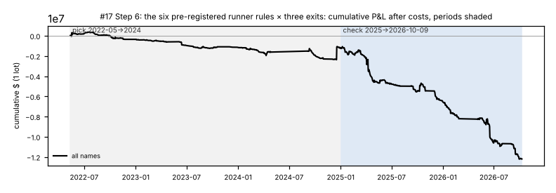

**Amendments, deviations and integrity checks.** The rules are chosen by the committed step6/trade.py choose() on the scratchpad population (39 MB, not committed); verify.py 0 differences in 480 figures; lookahead.py 0 differences in 104,748 values.

**What it showed.** No rule chosen on Pick made money on Check.

## #18 Compass engine audit (six module groups)

**Folder:** `research_notes/Compass engine audit/, reports/Compass engine audit.md`. **Commits:** — / — / 9cf8110, 59e1a1a, d724ae4, 18cf86a, b84fa3c, 09799af; report 138ff0e. **Dates:** 2026-10-21.

**Hypothesis.** The owner's 16-module Compass specification picks direction and opens trades that pay after costs.

**Rule.** Each module tested under its own definition (exits and sizing, expected move/ATR/flow, clock and power hour, greeks and books, horizons, sweep and grade).

**Fills and costs.** Ask in, bid out, $0.65 each way.

**Data.** 0DTE SPY/QQQ/IWM/SPXW 980/980/621/1,106 sessions; daily bars for horizons.

**Periods and holdouts.** fit 2022–24 / check 2025–26.

**Pass rule (as pre-registered).** Picked on 2022–24, read on 2025–26, friction-adjusted.

**Verdict.** No directional rule survives after fees. What holds: the 15:58 flat, the −32% backstop, a breakeven lock at +0% with a target on, a trailed remainder, the r,q pricer from parity, Method A flips with three books, net/gross confidence, the MOC magnitude as a volatility gauge, an ATR > 1.5 block on counter-trend fades.

**Metrics.** not available — the audit committed row-level paths and events (paths_\*.parquet, events_\*.parquet) and per-cell tables; its exit stacks were scored by cell, and no single trade list per rule exists to recompute (spec stack A −4.3% / B −4.5% of debit a trade, exits_sizing.md line 14).

**Amendments, deviations and integrity checks.** Six blockers stated (no OPRA tape, no strike-level OI history before 2026-10, …).

**What it showed.** Frictions, not edges.

## #19 Phase 2 hyp A: the low-moc_mag closing pin (SPXW short call spread, 15:30, held)

**Folder:** `research_notes/Compass phase 2/hyp_a_closing_pin`. **Commits:** prereg in-doc before the OOS read / — / 5deb793. **Dates:** 2026-10-21.

**Hypothesis.** On quiet closes (low moc_mag) the 15:30 short credit spread pins and pays.

**Rule.** SPXW short call spread, short strike at 1.00 × the move rule, 25 wide, 15:30 at the NBBO, held to settlement, on low-moc_mag sessions (the pre-registered cell).

**Fills and costs.** $0.65 a contract (leg) to open, nothing at expiry; bought at the ask, sold at the bid of the 1-minute NBBO (ThetaData)

**Data.** SPXW 2022-05-13 → 2026-10-09.

**Periods and holdouts.** fit 2022–24 / OOS 2025–26 (read once).

**Pass rule (as pre-registered).** The pick fixed on fit; read OOS for a positive mean with an interval clear of zero.

**Verdict.** NO EDGE: fit +$26 a spread, OOS −$33 [−84, +13].

**Metrics** (return = % of max risk; win = P&L > 0 after fees; breakeven is a loss; the interval is audit_lib's 20-session moving-block bootstrap over the period's calendar sessions):

| name | period | trades | sessions (traded / span) | win % | avg win %, $ | avg loss %, $ | median %, $ | mean %, $ | 20-session block 95% (%; $) |
|------------------|------------------------------|---------------|---------------------|------------|------------------------|------------------------|------------------------|------------------------|------------------------------------------------|
| SPXW | fit 2022–24 | 252 | 252 / 656 | 91.7 | +2.3, +55.87 | −12.2, −298.87 | +1.9, +46.20 | **+1.10**, +26.31 | [+0.45, +1.66]; [+10.45, +39.79] |
| SPXW | OOS 2025–26 | 177 | 177 / 456 | 87.6 | +2.6, +62.88 | −29.5, −708.75 | +2.0, +48.70 | **−1.39**, −33.03 | [−3.53, +0.30]; [−84.64, +7.73] |

| name | period | biggest win ($, %, date, contract) | biggest loss ($, %, date, contract) | profit factor | max DD $ | longest DD (sessions) | top-5 days' share of profit |
|------------------|------------------------------|------------------------------------------------------------------|------------------------------------------------------------------|------------|---------------|---------------|------------------------------------|
| SPXW | fit 2022–24 | +198.70, +8.6%, 2022-09-16, SPXW 15:30 3880.0/3905.0C | −687.30, −28.1%, 2023-03-08, SPXW 15:30 3985.0/4010.0C | 2.06 | 908 | 93 | 13% |
| SPXW | OOS 2025–26 | +173.70, +7.5%, 2025-04-14, SPXW 15:30 5450.0/5475.0C | −2,311.30, −100.1%, 2025-04-30, SPXW 15:30 5535.0/5560.0C | 0.63 | 8,053 | 426 | total ≤ 0 (best 5 days +794; without them −6,640) |

**Random baseline:** not available — no random baseline was computed by this study

**Exit reasons (share of trades):**

- fit 2022–24: held to settlement 100.0%
- OOS 2025–26: held to settlement 100.0%

**By year** (all periods together, labelled by entry year):

| year | name | trades | win % | mean % | mean $ | total $ |
|---|---|---|---|---|---|---|
| 2022 | SPXW | 55 | 92.7 | +2.23 | +53.19 | +2,925 |
| 2023 | SPXW | 95 | 90.5 | +0.47 | +11.34 | +1,078 |
| 2024 | SPXW | 102 | 92.2 | +1.08 | +25.76 | +2,627 |
| 2025 | SPXW | 94 | 88.3 | −1.59 | −37.12 | −3,489 |
| 2026 | SPXW | 83 | 86.7 | −1.17 | −28.40 | −2,357 |

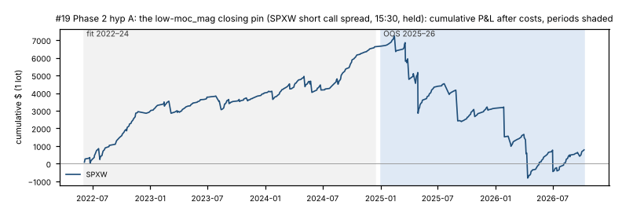

**Amendments, deviations and integrity checks.** Cells and the pick written before the OOS run (s3_report.py fit, then oos).

**What it showed.** The pin made money on fit and lost out of sample.

## #20a Phase 2 hyp B: boundary touch — SPY 2-wide 25-delta credit spread, held (the touch pick)

**Folder:** `research_notes/Compass phase 2/hyp_b_boundary_theta`. **Commits:** out/prereg.txt before the OOS read / — / 2c241f4. **Dates:** 2026-10-21.

**Hypothesis.** When price touches the straddle boundary, the far side's credit spread decays faster.

**Rule.** At a touch: sell the 2-wide spread on the touched side, short strike at 25 delta, held to settlement.

**Fills and costs.** $0.65 a contract (leg) to open, nothing at expiry; bought at the ask, sold at the bid of the 1-minute NBBO (ThetaData)

**Data.** SPY 2022-11 → 2026-10.

**Periods and holdouts.** fit 2022–24 / OOS 2025–26.

**Pass rule (as pre-registered).** The highest fit lower bound (N ≥ 300, ≥ 150 sessions, positive without the best 5); its lower bound was negative ("least bad").

**Verdict.** No edge: the touch adds nothing over the unconditional sell at the same minute (the increment flips sign between periods).

**Metrics** (return = % of max risk; win = P&L > 0 after fees; breakeven is a loss; the interval is audit_lib's 20-session moving-block bootstrap over the period's calendar sessions):

| name | period | trades | sessions (traded / span) | win % | avg win %, $ | avg loss %, $ | median %, $ | mean %, $ | 20-session block 95% (%; $) |
|------------------|------------------------------|---------------|---------------------|------------|------------------------|------------------------|------------------------|------------------------|------------------------------------------------|
| SPY | fit 2022–24 | 2,890 | 512 / 553 | 83.5 | +10.6, +18.66 | −47.4, −83.65 | +8.7, +15.70 | **+1.07**, +1.81 | [−0.80, +2.84]; [−1.55, +4.95] |
| SPY | OOS 2025–26 | 2,600 | 432 / 457 | 88.1 | +11.9, +20.68 | −55.2, −95.74 | +10.4, +18.70 | **+3.91**, +6.84 | [+1.56, +5.68]; [+2.71, +9.95] |

| name | period | biggest win ($, %, date, contract) | biggest loss ($, %, date, contract) | profit factor | max DD $ | longest DD (sessions) | top-5 days' share of profit |
|------------------|------------------------------|------------------------------------------------------------------|------------------------------------------------------------------|------------|---------------|---------------|------------------------------------|
| SPY | fit 2022–24 | +43.70, +28.2%, 2024-08-28, SPY 554.0/552.0 down | −195.30, −100.7%, 2024-05-31, SPY 525.0/527.0 up | 1.13 | 4,005 | 172 | 26% |
| SPY | OOS 2025–26 | +44.70, +29.0%, 2025-11-14, SPY 673.0/675.0 up | −191.30, −100.2%, 2026-04-13, SPY 684.0/686.0 up | 1.60 | 4,526 | 64 | 9% |

**Random baseline:** not available — no random baseline was computed by this study

**Exit reasons (share of trades):**

- fit 2022–24: held to settlement 100.0%
- OOS 2025–26: held to settlement 100.0%

**By year** (all periods together, labelled by entry year):

| year | name | trades | win % | mean % | mean $ | total $ |
|---|---|---|---|---|---|---|
| 2022 | SPY | 188 | 80.9 | +0.75 | +1.06 | +200 |
| 2023 | SPY | 1,366 | 82.7 | +0.71 | +1.15 | +1,567 |
| 2024 | SPY | 1,336 | 84.7 | +1.48 | +2.59 | +3,465 |
| 2025 | SPY | 1,457 | 87.6 | +3.68 | +6.40 | +9,319 |
| 2026 | SPY | 1,143 | 88.7 | +4.21 | +7.41 | +8,465 |

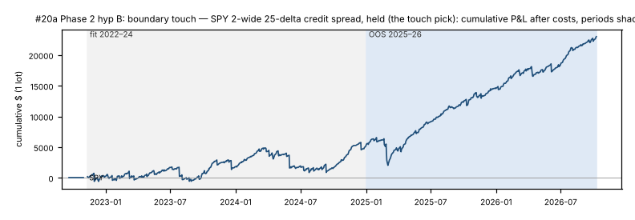

**Amendments, deviations and integrity checks.** Deduplicated as analyze.py (one touch a session, side, e, mult, rule, width).

**What it showed.** Positive in both periods but no better than selling unconditionally.

## #20b Phase 2 hyp B: the midday SPY iron condor (em1, mid-VIX), the midday pick

**Folder:** `research_notes/Compass phase 2/hyp_b_boundary_theta`. **Commits:** out/prereg.txt / — / 2c241f4. **Dates:** 2026-10-21.

**Hypothesis.** Midday iron condors on SPY are unconditional short premium that pays.

**Rule.** 11:30–13:30 every half hour: SPY 2-wide iron condor, shorts at the first listed strikes outside spot ± the ATM straddle, held to settlement, VIX in the fit's middle tercile.

**Fills and costs.** $0.65 a contract (leg) to open, nothing at expiry; bought at the ask, sold at the bid of the 1-minute NBBO (ThetaData)

**Data.** SPY 2022-11 → 2026-10.

**Periods and holdouts.** fit 2022–24 / OOS 2025–26.

**Pass rule (as pre-registered).** As 20a.

**Verdict.** "Needs X" (a forward paper run): +4.6% of risk fit, +3.3% OOS (CI $0.03–$10.69). Became the tracker's condor_em1 (all-VIX parent, #26).

**Metrics** (return = % of max risk; win = P&L > 0 after fees; breakeven is a loss; the interval is audit_lib's 20-session moving-block bootstrap over the period's calendar sessions):

| name | period | trades | sessions (traded / span) | win % | avg win %, $ | avg loss %, $ | median %, $ | mean %, $ | 20-session block 95% (%; $) |
|------------------|------------------------------|---------------|---------------------|------------|------------------------|------------------------|------------------------|------------------------|------------------------------------------------|
| SPY | fit 2022–24 | 748 | 178 / 510 | 80.5 | +15.6, +26.03 | −40.9, −69.48 | +12.8, +21.90 | **+4.61**, +7.39 | [+1.27, +7.77]; [+1.83, +12.66] |
| SPY | OOS 2025–26 | 1,202 | 280 / 456 | 81.6 | +15.5, +25.89 | −50.9, −84.73 | +12.8, +22.40 | **+3.25**, +5.55 | [+0.21, +6.04]; [+0.58, +10.01] |

| name | period | biggest win ($, %, date, contract) | biggest loss ($, %, date, contract) | profit factor | max DD $ | longest DD (sessions) | top-5 days' share of profit |
|------------------|------------------------------|------------------------------------------------------------------|------------------------------------------------------------------|------------|---------------|---------------|------------------------------------|
| SPY | fit 2022–24 | +62.40, +46.2%, 2024-09-18, None | −175.60, −101.5%, 2024-09-11, None | 1.54 | 1,438 | 145 | 23% |
| SPY | OOS 2025–26 | +56.40, +40.0%, 2026-04-29, None | −178.60, −101.5%, 2026-07-24, None | 1.36 | 1,825 | 104 | 18% |

**Random baseline:** not available — no random baseline was computed by this study

**Exit reasons (share of trades):**

- fit 2022–24: held to settlement 100.0%
- OOS 2025–26: held to settlement 100.0%

**By year** (all periods together, labelled by entry year):

| year | name | trades | win % | mean % | mean $ | total $ |
|---|---|---|---|---|---|---|
| 2023 | SPY | 388 | 74.2 | +1.05 | +1.60 | +619 |
| 2024 | SPY | 360 | 87.2 | +8.44 | +13.63 | +4,905 |
| 2025 | SPY | 631 | 83.2 | +4.65 | +7.66 | +4,836 |
| 2026 | SPY | 571 | 79.9 | +1.72 | +3.22 | +1,840 |

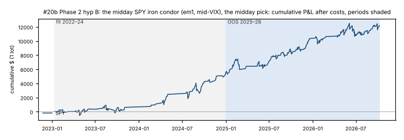

**Amendments, deviations and integrity checks.** The VIX terciles recomputed from the fit d15 condors exactly as analyze.py.

**What it showed.** Small positive in both periods; $5 a condor on a four-leg structure.

## #21a Phase 2 hyp C: 15:00 SPY/QQQ P1 iron ±2 butterfly, held to settlement

**Folder:** `research_notes/Compass phase 2/hyp_c_debit_flies`. **Commits:** preregistration.md before the OOS run / — / faea67c. **Dates:** 2026-10-21.

**Hypothesis.** Late-day ATM butterflies on quiet closes pin.

**Rule.** 15:00, SPY and QQQ, P1 iron ±2 at the 4-leg NBBO, held to settlement, unconditional.

**Fills and costs.** $0.65 a contract (leg) to open, nothing at expiry (four legs); bought at the ask, sold at the bid of the 1-minute NBBO (ThetaData)

**Data.** SPY and QQQ 2022-11 → 2026-10.

**Periods and holdouts.** fit 2022–24 / OOS 2025–26.

**Pass rule (as pre-registered).** Edge only if the OOS mean is positive with its interval clear of zero AND positive without the best five sessions AND both OOS years positive.

**Verdict.** Not confirmed: the picks fell to +2 to +4.5% of risk OOS with intervals through zero and die under $0.01 a leg; the un-picked iron ±5 read +5.0/+6.0% (→ the tracker's fly5).

**Metrics** (return = % of max risk; win = P&L > 0 after fees; breakeven is a loss; the interval is audit_lib's 20-session moving-block bootstrap over the period's calendar sessions):

| name | period | trades | sessions (traded / span) | win % | avg win %, $ | avg loss %, $ | median %, $ | mean %, $ | 20-session block 95% (%; $) |
|------------------|------------------------------|---------------|---------------------|------------|------------------------|------------------------|------------------------|------------------------|------------------------------------------------|
| QQQ | fit 2022–24 | 521 | 521 / 553 | 63.1 | +53.1, +49.60 | −52.4, −50.42 | +21.3, +23.40 | **+14.26**, +12.74 | [+9.21, +20.69]; [+8.42, +18.01] |
| SPY | fit 2022–24 | 525 | 525 / 553 | 62.1 | +49.6, +47.81 | −52.3, −51.56 | +16.3, +19.40 | **+10.95**, +10.14 | [+6.16, +15.93]; [+5.96, +14.38] |
| all names | fit 2022–24 | 1,046 | 529 / 553 | 62.6 | +51.4, +48.71 | −52.4, −51.00 | +19.3, +21.40 | **+12.60**, +11.44 | [+8.22, +17.89]; [+7.66, +15.67] |
| QQQ | OOS 2025–26 | 440 | 440 / 457 | 50.0 | +75.0, +56.25 | −70.7, −53.49 | +0.1, +0.15 | **+2.16**, +1.38 | [−5.77, +10.53]; [−4.72, +7.83] |
| SPY | OOS 2025–26 | 438 | 438 / 457 | 54.6 | +63.7, +52.13 | −61.4, −50.60 | +8.3, +8.65 | **+6.84**, +5.45 | [−0.71, +15.31]; [−0.57, +12.65] |
| all names | OOS 2025–26 | 878 | 440 / 457 | 52.3 | +69.1, +54.10 | −66.3, −52.12 | +4.5, +4.40 | **+4.49**, +3.41 | [−2.96, +12.33]; [−1.96, +9.60] |

| name | period | biggest win ($, %, date, contract) | biggest loss ($, %, date, contract) | profit factor | max DD $ | longest DD (sessions) | top-5 days' share of profit |
|------------------|------------------------------|------------------------------------------------------------------|------------------------------------------------------------------|------------|---------------|---------------|------------------------------------|
| QQQ | fit 2022–24 | +136.40, +257.4%, 2024-02-01, QQQ 1500 iron K0 422.0 ±2.0 | −144.60, −101.8%, 2023-07-07, QQQ 1500 iron K0 369.0 ±2.0 | 1.69 | 683 | 92 | 10% |
| SPY | fit 2022–24 | +130.40, +197.6%, 2024-12-31, SPY 1500 iron K0 586.0 ±2.0 | −146.60, −101.8%, 2024-03-26, SPY 1500 iron K0 521.0 ±2.0 | 1.52 | 462 | 62 | 12% |
| all names | fit 2022–24 | +136.40, +257.4%, 2024-02-01, QQQ 1500 iron K0 422.0 ±2.0 | −146.60, −101.8%, 2024-03-26, SPY 1500 iron K0 521.0 ±2.0 | 1.60 | 870 | 37 | 10% |
| QQQ | OOS 2025–26 | +153.40, +374.1%, 2026-01-28, QQQ 1500 iron K0 633.0 ±2.0 | −120.60, −102.2%, 2026-09-14, QQQ 1500 iron K0 712.0 ±2.0 | 1.05 | 1,143 | 197 | 114% |
| SPY | OOS 2025–26 | +146.90, +358.3%, 2026-09-16, SPY 1500 iron K0 754.0 ±2.0 | −132.60, −102.0%, 2026-01-07, SPY 1500 iron K0 692.0 ±2.0 | 1.24 | 889 | 166 | 29% |
| all names | OOS 2025–26 | +153.40, +374.1%, 2026-01-28, QQQ 1500 iron K0 633.0 ±2.0 | −132.60, −102.0%, 2026-01-07, SPY 1500 iron K0 692.0 ±2.0 | 1.14 | 1,817 | 142 | 43% |

**Random baseline:** not available — no random baseline was computed by this study

**Exit reasons (share of trades):**

- fit 2022–24: held to settlement 100.0%
- OOS 2025–26: held to settlement 100.0%

**By year** (all periods together, labelled by entry year):

| year | name | trades | win % | mean % | mean $ | total $ |
|---|---|---|---|---|---|---|
| 2022 | QQQ | 33 | 75.8 | +18.94 | +13.72 | +453 |
| 2023 | QQQ | 247 | 63.6 | +13.88 | +13.15 | +3,249 |
| 2024 | QQQ | 241 | 61.0 | +14.00 | +12.19 | +2,937 |
| 2025 | QQQ | 246 | 52.0 | +1.03 | +3.07 | +755 |
| 2026 | QQQ | 194 | 47.4 | +3.58 | −0.76 | −148 |
| 2022 | SPY | 32 | 65.6 | +30.49 | +22.49 | +720 |
| 2023 | SPY | 246 | 63.8 | +10.46 | +10.96 | +2,696 |
| 2024 | SPY | 247 | 59.9 | +8.92 | +7.73 | +1,909 |
| 2025 | SPY | 244 | 52.9 | +1.88 | +2.47 | +604 |
| 2026 | SPY | 194 | 56.7 | +13.06 | +9.20 | +1,785 |
| 2022 | all names | 65 | 70.8 | +24.62 | +18.04 | +1,172 |
| 2023 | all names | 493 | 63.7 | +12.17 | +12.06 | +5,946 |
| 2024 | all names | 488 | 60.5 | +11.43 | +9.93 | +4,846 |
| 2025 | all names | 490 | 52.4 | +1.46 | +2.77 | +1,359 |
| 2026 | all names | 388 | 52.1 | +8.32 | +4.22 | +1,637 |

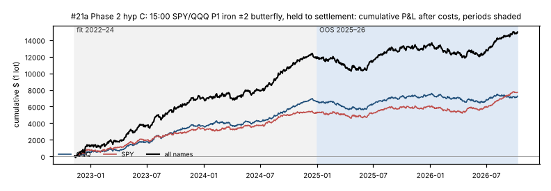

**Amendments, deviations and integrity checks.** Fill stress ($0.01 a leg) read on both periods as a robustness check.

**What it showed.** Positive on fit, shrunk to noise out of sample.

## #21b Phase 2 hyp C: 15:00 SPY/QQQ P2 call ±2 butterfly, held to settlement

**Folder:** `research_notes/Compass phase 2/hyp_c_debit_flies`. **Commits:** preregistration.md before the OOS run / — / faea67c. **Dates:** 2026-10-21.

**Hypothesis.** Late-day ATM butterflies on quiet closes pin.

**Rule.** 15:00, SPY and QQQ, P2 call ±2 at the 4-leg NBBO, held to settlement, unconditional.

**Fills and costs.** $0.65 a contract (leg) to open, nothing at expiry (four legs); bought at the ask, sold at the bid of the 1-minute NBBO (ThetaData)

**Data.** SPY and QQQ 2022-11 → 2026-10.

**Periods and holdouts.** fit 2022–24 / OOS 2025–26.

**Pass rule (as pre-registered).** Edge only if the OOS mean is positive with its interval clear of zero AND positive without the best five sessions AND both OOS years positive.

**Verdict.** Not confirmed: the picks fell to +2 to +4.5% of risk OOS with intervals through zero and die under $0.01 a leg; the un-picked iron ±5 read +5.0/+6.0% (→ the tracker's fly5).

**Metrics** (return = % of max risk; win = P&L > 0 after fees; breakeven is a loss; the interval is audit_lib's 20-session moving-block bootstrap over the period's calendar sessions):

| name | period | trades | sessions (traded / span) | win % | avg win %, $ | avg loss %, $ | median %, $ | mean %, $ | 20-session block 95% (%; $) |
|------------------|------------------------------|---------------|---------------------|------------|------------------------|------------------------|------------------------|------------------------|------------------------------------------------|
| QQQ | fit 2022–24 | 522 | 522 / 553 | 61.5 | +49.9, +47.80 | −51.6, −51.68 | +18.2, +20.40 | **+10.81**, +9.49 | [+5.90, +17.14]; [+5.11, +14.83] |
| SPY | fit 2022–24 | 525 | 525 / 553 | 59.6 | +47.6, +46.99 | −50.3, −51.23 | +14.3, +16.40 | **+8.07**, +7.33 | [+3.41, +13.02]; [+3.01, +11.65] |
| all names | fit 2022–24 | 1,047 | 530 / 553 | 60.6 | +48.8, +47.40 | −50.9, −51.45 | +16.3, +18.40 | **+9.44**, +8.41 | [+5.18, +14.71]; [+4.54, +12.71] |
| QQQ | OOS 2025–26 | 441 | 441 / 457 | 48.3 | +72.5, +55.44 | −69.5, −54.36 | −3.0, −2.60 | **−0.92**, −1.33 | [−8.71, +7.43]; [−7.44, +5.21] |
| SPY | OOS 2025–26 | 439 | 439 / 457 | 54.2 | +61.5, +51.12 | −61.7, −51.77 | +6.2, +6.40 | **+5.11**, +4.01 | [−2.63, +13.75]; [−2.10, +11.26] |
| all names | OOS 2025–26 | 880 | 441 / 457 | 51.2 | +66.7, +53.16 | −65.8, −53.14 | +2.1, +2.40 | **+2.09**, +1.34 | [−5.35, +10.06]; [−4.09, +7.53] |

| name | period | biggest win ($, %, date, contract) | biggest loss ($, %, date, contract) | profit factor | max DD $ | longest DD (sessions) | top-5 days' share of profit |
|------------------|------------------------------|------------------------------------------------------------------|------------------------------------------------------------------|------------|---------------|---------------|------------------------------------|
| QQQ | fit 2022–24 | +135.40, +250.7%, 2024-02-01, QQQ 1500 call K0 422.0 ±2.0 | −148.60, −101.8%, 2023-07-07, QQQ 1500 call K0 369.0 ±2.0 | 1.48 | 788 | 119 | 13% |
| SPY | fit 2022–24 | +129.40, +369.7%, 2024-08-28, SPY 1500 call K0 558.0 ±2.0 | −151.60, −101.7%, 2024-03-26, SPY 1500 call K0 521.0 ±2.0 | 1.35 | 577 | 152 | 16% |
| all names | fit 2022–24 | +135.40, +250.7%, 2024-02-01, QQQ 1500 call K0 422.0 ±2.0 | −151.60, −101.7%, 2024-03-26, SPY 1500 call K0 521.0 ±2.0 | 1.41 | 934 | 51 | 13% |
| QQQ | OOS 2025–26 | +151.40, +352.1%, 2026-01-28, QQQ 1500 call K0 633.0 ±2.0 | −132.60, −102.0%, 2025-11-05, QQQ 1500 call K0 626.0 ±2.0 | 0.95 | 1,413 | 197 | total ≤ 0 (best 5 days +684; without them −1,268) |
| SPY | OOS 2025–26 | +146.90, +358.3%, 2026-09-16, SPY 1500 call K0 754.0 ±2.0 | −133.60, −102.0%, 2026-01-07, SPY 1500 call K0 692.0 ±2.0 | 1.17 | 1,081 | 205 | 39% |
| all names | OOS 2025–26 | +151.40, +352.1%, 2026-01-28, QQQ 1500 call K0 633.0 ±2.0 | −133.60, −102.0%, 2026-01-07, SPY 1500 call K0 692.0 ±2.0 | 1.05 | 2,167 | 212 | 109% |

**Random baseline:** not available — no random baseline was computed by this study

**Exit reasons (share of trades):**

- fit 2022–24: held to settlement 100.0%
- OOS 2025–26: held to settlement 100.0%

**By year** (all periods together, labelled by entry year):

| year | name | trades | win % | mean % | mean $ | total $ |
|---|---|---|---|---|---|---|
| 2022 | QQQ | 33 | 69.7 | +14.87 | +9.29 | +307 |
| 2023 | QQQ | 247 | 61.9 | +10.42 | +9.74 | +2,406 |
| 2024 | QQQ | 242 | 59.9 | +10.66 | +9.27 | +2,243 |
| 2025 | QQQ | 247 | 50.2 | −2.12 | +0.31 | +77 |
| 2026 | QQQ | 194 | 45.9 | +0.60 | −3.41 | −662 |
| 2022 | SPY | 32 | 65.6 | +26.62 | +19.37 | +620 |
| 2023 | SPY | 246 | 61.8 | +8.01 | +8.44 | +2,076 |
| 2024 | SPY | 247 | 56.7 | +5.73 | +4.65 | +1,150 |
| 2025 | SPY | 245 | 51.8 | −0.32 | +0.66 | +161 |
| 2026 | SPY | 194 | 57.2 | +11.96 | +8.24 | +1,599 |
| 2022 | all names | 65 | 67.7 | +20.65 | +14.25 | +926 |
| 2023 | all names | 493 | 61.9 | +9.22 | +9.09 | +4,483 |
| 2024 | all names | 489 | 58.3 | +8.17 | +6.94 | +3,392 |
| 2025 | all names | 492 | 51.0 | −1.22 | +0.48 | +238 |
| 2026 | all names | 388 | 51.5 | +6.28 | +2.42 | +937 |

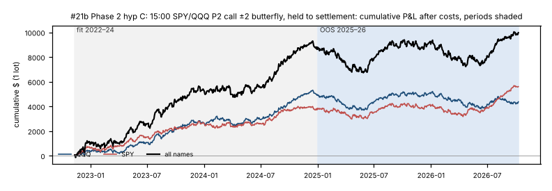

**Amendments, deviations and integrity checks.** Fill stress ($0.01 a leg) read on both periods as a robustness check.

**What it showed.** Positive on fit, shrunk to noise out of sample.

## #21c Phase 2 hyp C: 15:00 SPY/QQQ P3 call ±5 butterfly, held to settlement

**Folder:** `research_notes/Compass phase 2/hyp_c_debit_flies`. **Commits:** preregistration.md before the OOS run / — / faea67c. **Dates:** 2026-10-21.

**Hypothesis.** Late-day ATM butterflies on quiet closes pin.

**Rule.** 15:00, SPY and QQQ, P3 call ±5 at the 4-leg NBBO, held to settlement, unconditional.

**Fills and costs.** $0.65 a contract (leg) to open, nothing at expiry (four legs); bought at the ask, sold at the bid of the 1-minute NBBO (ThetaData)

**Data.** SPY and QQQ 2022-11 → 2026-10.

**Periods and holdouts.** fit 2022–24 / OOS 2025–26.

**Pass rule (as pre-registered).** Edge only if the OOS mean is positive with its interval clear of zero AND positive without the best five sessions AND both OOS years positive.

**Verdict.** Not confirmed: the picks fell to +2 to +4.5% of risk OOS with intervals through zero and die under $0.01 a leg; the un-picked iron ±5 read +5.0/+6.0% (→ the tracker's fly5).

**Metrics** (return = % of max risk; win = P&L > 0 after fees; breakeven is a loss; the interval is audit_lib's 20-session moving-block bootstrap over the period's calendar sessions):

| name | period | trades | sessions (traded / span) | win % | avg win %, $ | avg loss %, $ | median %, $ | mean %, $ | 20-session block 95% (%; $) |
|------------------|------------------------------|---------------|---------------------|------------|------------------------|------------------------|------------------------|------------------------|------------------------------------------------|
| QQQ | fit 2022–24 | 523 | 523 / 553 | 66.3 | +16.0, +57.61 | −19.9, −74.43 | +6.9, +28.40 | **+3.91**, +13.17 | [+2.23, +6.26]; [+7.84, +20.38] |
| SPY | fit 2022–24 | 524 | 524 / 553 | 64.9 | +14.7, +54.53 | −19.2, −74.21 | +5.4, +22.40 | **+2.81**, +9.32 | [+1.17, +4.83]; [+3.34, +16.31] |
| all names | fit 2022–24 | 1,047 | 530 / 553 | 65.6 | +15.4, +56.08 | −19.6, −74.32 | +6.4, +25.40 | **+3.36**, +11.25 | [+1.85, +5.44]; [+6.15, +17.83] |
| QQQ | OOS 2025–26 | 438 | 438 / 457 | 55.5 | +25.0, +76.31 | −29.1, −98.48 | +4.5, +17.40 | **+0.90**, −1.51 | [−2.31, +4.05]; [−12.39, +8.80] |
| SPY | OOS 2025–26 | 440 | 440 / 457 | 61.6 | +21.4, +69.68 | −25.5, −84.32 | +6.6, +23.40 | **+3.40**, +10.53 | [+0.80, +5.95]; [+2.30, +19.47] |
| all names | OOS 2025–26 | 878 | 441 / 457 | 58.5 | +23.1, +72.82 | −27.4, −91.91 | +5.0, +19.40 | **+2.15**, +4.52 | [−0.59, +4.78]; [−4.48, +13.82] |

| name | period | biggest win ($, %, date, contract) | biggest loss ($, %, date, contract) | profit factor | max DD $ | longest DD (sessions) | top-5 days' share of profit |
|------------------|------------------------------|------------------------------------------------------------------|------------------------------------------------------------------|------------|---------------|---------------|------------------------------------|
| QQQ | fit 2022–24 | +286.40, +206.0%, 2024-08-28, QQQ 1500 call K0 472.0 ±5.0 | −369.60, −100.7%, 2024-05-31, QQQ 1500 call K0 446.0 ±5.0 | 1.53 | 820 | 66 | 16% |
| SPY | fit 2022–24 | +268.40, +136.9%, 2024-08-28, SPY 1500 call K0 558.0 ±5.0 | −407.60, −100.6%, 2024-05-31, SPY 1500 call K0 521.0 ±5.0 | 1.36 | 945 | 169 | 21% |
| all names | fit 2022–24 | +286.40, +206.0%, 2024-08-28, QQQ 1500 call K0 472.0 ±5.0 | −407.60, −100.6%, 2024-05-31, SPY 1500 call K0 521.0 ±5.0 | 1.44 | 1,339 | 62 | 17% |
| QQQ | OOS 2025–26 | +274.40, +169.4%, 2026-04-29, QQQ 1500 call K0 661.0 ±5.0 | −470.60, −100.6%, 2026-05-12, QQQ 1500 call K0 702.0 ±5.0 | 0.97 | 2,306 | 457 | total ≤ 0 (best 5 days +1,256; without them −1,916) |
| SPY | OOS 2025–26 | +264.90, +118.8%, 2026-09-16, SPY 1500 call K0 754.0 ±5.0 | −344.60, −100.8%, 2026-03-09, SPY 1500 call K0 670.0 ±5.0 | 1.33 | 1,260 | 118 | 25% |
| all names | OOS 2025–26 | +274.40, +169.4%, 2026-04-29, QQQ 1500 call K0 661.0 ±5.0 | −470.60, −100.6%, 2026-05-12, QQQ 1500 call K0 702.0 ±5.0 | 1.12 | 3,295 | 176 | 58% |

**Random baseline:** not available — no random baseline was computed by this study

**Exit reasons (share of trades):**

- fit 2022–24: held to settlement 100.0%
- OOS 2025–26: held to settlement 100.0%

**By year** (all periods together, labelled by entry year):

| year | name | trades | win % | mean % | mean $ | total $ |
|---|---|---|---|---|---|---|
| 2022 | QQQ | 32 | 71.9 | +4.79 | +10.67 | +341 |
| 2023 | QQQ | 247 | 65.2 | +3.82 | +14.77 | +3,648 |
| 2024 | QQQ | 244 | 66.8 | +3.88 | +11.89 | +2,901 |
| 2025 | QQQ | 246 | 56.5 | +0.26 | −2.56 | −629 |
| 2026 | QQQ | 192 | 54.2 | +1.71 | −0.16 | −31 |
| 2022 | SPY | 33 | 72.7 | +7.11 | +19.84 | +655 |
| 2023 | SPY | 247 | 66.0 | +2.94 | +11.47 | +2,832 |
| 2024 | SPY | 244 | 62.7 | +2.11 | +5.74 | +1,399 |
| 2025 | SPY | 247 | 59.5 | +2.09 | +6.62 | +1,635 |
| 2026 | SPY | 193 | 64.2 | +5.07 | +15.53 | +2,998 |
| 2022 | all names | 65 | 72.3 | +5.97 | +15.32 | +996 |
| 2023 | all names | 494 | 65.6 | +3.38 | +13.12 | +6,480 |
| 2024 | all names | 488 | 64.8 | +2.99 | +8.81 | +4,300 |
| 2025 | all names | 493 | 58.0 | +1.18 | +2.04 | +1,005 |
| 2026 | all names | 385 | 59.2 | +3.40 | +7.71 | +2,967 |

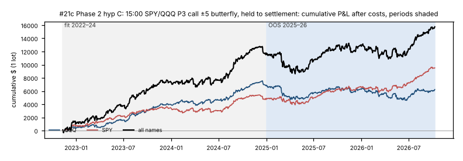

**Amendments, deviations and integrity checks.** Fill stress ($0.01 a leg) read on both periods as a robustness check.

**What it showed.** Positive on fit, shrunk to noise out of sample.

## #21d Phase 2 hyp C: debit vertical 0.70/0.30, universe B, held (the vertical pick)

**Folder:** `research_notes/Compass phase 2/hyp_c_debit_flies`. **Commits:** preregistration.md / — / faea67c. **Dates:** 2026-10-21.

**Hypothesis.** A debit vertical keeps the directional premium at lower cost.

**Rule.** The audit's universe B entries, 0.70Δ/0.30Δ debit vertical, held to settlement.

**Fills and costs.** $0.65 a contract (leg) to open, nothing at expiry; bought at the ask, sold at the bid of the 1-minute NBBO (ThetaData)

**Data.** SPY, QQQ, IWM, SPXW 2022–2026.

**Periods and holdouts.** fit / OOS.

**Pass rule (as pre-registered).** Pre-registered expectation: negative OOS.

**Verdict.** Loses less than the naked contract but still loses (−6.7% of debit fit).

**Metrics** (return = % of premium; win = P&L > 0 after fees; breakeven is a loss; the interval is audit_lib's 20-session moving-block bootstrap over the period's calendar sessions):

| name | period | trades | sessions (traded / span) | win % | avg win %, $ | avg loss %, $ | median %, $ | mean %, $ | 20-session block 95% (%; $) |
|------------------|------------------------------|---------------|---------------------|------------|------------------------|------------------------|------------------------|------------------------|------------------------------------------------|
| IWM | fit 2022–24 | 173 | 173 / 182 | 54.9 | +58.9, +43.45 | −71.9, −51.06 | +8.8, +9.70 | **−0.05**, +0.84 | [−12.07, +7.72]; [−8.88, +7.66] |
| QQQ | fit 2022–24 | 530 | 530 / 553 | 50.2 | +69.1, +92.73 | −71.0, −90.58 | +0.4, +0.70 | **−0.66**, +1.42 | [−7.85, +7.82]; [−9.48, +14.58] |
| SPXW | fit 2022–24 | 656 | 656 / 683 | 45.4 | +74.8, +884.62 | −77.6, −952.87 | −14.4, −155.80 | **−8.38**, −118.16 | [−13.19, −1.84]; [−182.50, −31.49] |
| SPY | fit 2022–24 | 530 | 530 / 553 | 44.0 | +68.5, +80.70 | −76.8, −91.93 | −22.4, −25.30 | **−12.94**, −16.04 | [−19.06, −5.52]; [−24.17, −5.21] |
| all names | fit 2022–24 | 1,889 | 656 / 683 | 47.2 | +69.8, +348.89 | −75.2, −397.52 | −9.3, −15.30 | **−6.73**, −45.06 | [−9.96, −3.11]; [−66.53, −16.04] |
| IWM | OOS 2025–26 | 439 | 439 / 457 | 49.7 | +66.6, +60.84 | −73.5, −61.89 | −0.3, −0.30 | **−3.93**, −0.94 | [−10.90, +2.84]; [−8.20, +6.38] |
| QQQ | OOS 2025–26 | 441 | 441 / 457 | 51.5 | +71.4, +135.51 | −71.1, −133.23 | +8.8, +13.70 | **+2.26**, +5.10 | [−5.49, +9.09]; [−10.73, +20.79] |
| SPXW | OOS 2025–26 | 441 | 441 / 457 | 51.7 | +71.8, +1,075.79 | −78.0, −1,139.59 | +5.5, +70.70 | **−0.55**, +5.78 | [−8.93, +7.80]; [−102.60, +118.36] |
| SPY | OOS 2025–26 | 440 | 440 / 457 | 53.6 | +72.9, +114.50 | −68.8, −111.22 | +11.9, +17.70 | **+7.22**, +9.85 | [−0.41, +14.64]; [−3.89, +23.09] |
| all names | OOS 2025–26 | 1,761 | 441 / 457 | 51.6 | +70.7, +347.99 | −72.9, −361.04 | +5.7, +9.70 | **+1.25**, +4.95 | [−2.84, +4.65]; [−22.31, +32.57] |

| name | period | biggest win ($, %, date, contract) | biggest loss ($, %, date, contract) | profit factor | max DD $ | longest DD (sessions) | top-5 days' share of profit |
|------------------|------------------------------|------------------------------------------------------------------|------------------------------------------------------------------|------------|---------------|---------------|------------------------------------|
| IWM | fit 2022–24 | +136.70, +92.4%, 2024-08-08, IWM CALL 0.70/0.30 m56 | −213.30, −100.6%, 2024-06-12, IWM CALL 0.70/0.30 m146 | 1.04 | 717 | 78 | 405% |
| QQQ | fit 2022–24 | +369.70, +95.5%, 2022-12-14, QQQ PUT 0.70/0.30 m54 | −322.30, −100.4%, 2024-11-20, QQQ PUT 0.70/0.30 m66 | 1.03 | 3,066 | 231 | 202% |
| SPXW | fit 2022–24 | +4,408.70, +107.8%, 2022-09-21, SPXW PUT 0.70/0.30 m59 | −4,491.30, −100.0%, 2022-12-14, SPXW CALL 0.70/0.30 m90 | 0.77 | 79,805 | 574 | total ≤ 0 (best 5 days +14,719; without them −92,231) |
| SPY | fit 2022–24 | +337.70, +93.5%, 2023-03-22, SPY PUT 0.70/0.30 m96 | −455.30, −100.3%, 2022-12-14, SPY CALL 0.70/0.30 m160 | 0.69 | 8,874 | 553 | total ≤ 0 (best 5 days +1,312; without them −9,812) |
| all names | fit 2022–24 | +4,408.70, +107.8%, 2022-09-21, SPXW PUT 0.70/0.30 m59 | −4,491.30, −100.0%, 2022-12-14, SPXW CALL 0.70/0.30 m90 | 0.79 | 87,407 | 574 | total ≤ 0 (best 5 days +13,894; without them −99,008) |
| IWM | OOS 2025–26 | +217.70, +120.3%, 2026-09-16, IWM PUT 0.70/0.30 m108 | −395.30, −94.6%, 2025-06-23, IWM PUT 0.70/0.30 m30 | 0.97 | 2,283 | 351 | total ≤ 0 (best 5 days +1,048; without them −1,461) |
| QQQ | OOS 2025–26 | +593.70, +117.6%, 2026-06-10, QQQ PUT 0.70/0.30 m62 | −620.30, −67.1%, 2025-04-07, QQQ PUT 0.70/0.30 m66 | 1.08 | 2,773 | 186 | 113% |
| SPXW | OOS 2025–26 | +6,048.70, +87.0%, 2025-04-11, SPXW CALL 0.70/0.30 m99 | −7,091.30, −100.0%, 2025-04-10, SPXW PUT 0.70/0.30 m176 | 1.01 | 34,557 | 286 | 958% |
| SPY | OOS 2025–26 | +689.70, +85.3%, 2025-04-11, SPY CALL 0.70/0.30 m52 | −559.30, −100.2%, 2025-04-08, SPY CALL 0.70/0.30 m197 | 1.19 | 2,288 | 229 | 57% |
| all names | OOS 2025–26 | +6,048.70, +87.0%, 2025-04-11, SPXW CALL 0.70/0.30 m99 | −7,091.30, −100.0%, 2025-04-10, SPXW PUT 0.70/0.30 m176 | 1.03 | 32,600 | 264 | 304% |

**Random baseline:** not available — no random baseline was computed by this study

**Exit reasons (share of trades):**

- fit 2022–24: settle 100.0%
- OOS 2025–26: settle 100.0%

**By year** (all periods together, labelled by entry year):

| year | name | trades | win % | mean % | mean $ | total $ |
|---|---|---|---|---|---|---|
| 2024 | IWM | 173 | 54.9 | −0.05 | +0.84 | +145 |
| 2025 | IWM | 245 | 47.8 | −8.11 | −1.75 | −428 |
| 2026 | IWM | 194 | 52.1 | +1.35 | +0.08 | +15 |
| 2022 | QQQ | 33 | 42.4 | −2.60 | −4.38 | −144 |
| 2023 | QQQ | 248 | 51.6 | +0.41 | +4.88 | +1,209 |
| 2024 | QQQ | 249 | 49.8 | −1.46 | −1.25 | −311 |
| 2025 | QQQ | 247 | 50.6 | −0.78 | +0.91 | +224 |
| 2026 | QQQ | 194 | 52.6 | +6.14 | +10.44 | +2,025 |
| 2022 | SPXW | 159 | 47.2 | −6.17 | −110.29 | −17,536 |
| 2023 | SPXW | 248 | 46.0 | −8.83 | −118.30 | −29,338 |
| 2024 | SPXW | 249 | 43.8 | −9.34 | −123.04 | −30,638 |
| 2025 | SPXW | 247 | 49.8 | −2.42 | −38.62 | −9,539 |
| 2026 | SPXW | 194 | 54.1 | +1.84 | +62.30 | +12,087 |
| 2022 | SPY | 33 | 30.3 | −31.13 | −65.75 | −2,170 |
| 2023 | SPY | 248 | 42.7 | −14.59 | −14.39 | −3,569 |
| 2024 | SPY | 249 | 47.0 | −8.88 | −11.09 | −2,761 |
| 2025 | SPY | 246 | 51.6 | +2.65 | +4.53 | +1,115 |
| 2026 | SPY | 194 | 56.2 | +13.01 | +16.59 | +3,219 |
| 2022 | all names | 225 | 44.0 | −9.31 | −88.22 | −19,850 |
| 2023 | all names | 744 | 46.8 | −7.67 | −42.61 | −31,699 |
| 2024 | all names | 920 | 48.4 | −5.34 | −36.48 | −33,565 |
| 2025 | all names | 985 | 49.9 | −2.16 | −8.76 | −8,629 |
| 2026 | all names | 776 | 53.7 | +5.59 | +22.35 | +17,346 |

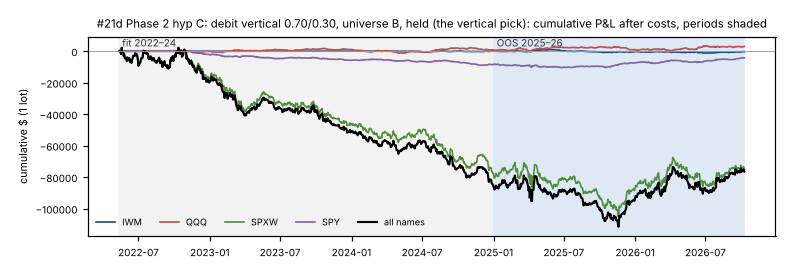

**Amendments, deviations and integrity checks.** —

**What it showed.** Verticals lose less than calls and puts, and still lose.

## #22 Phase 2 hyp D: volatility breakout (straddles on the model's top decile)

**Folder:** `research_notes/Compass phase 2/hyp_d_vol_breakout`. **Commits:** out/preregistered.md / — / da02507. **Dates:** 2026-10-21.

**Hypothesis.** The volatility model's top decile marks straddles worth buying.

**Rule.** Buy straddles/strangles on the top-decile scan minutes.

**Fills and costs.** $0.65 a contract (leg) to open, nothing at expiry

**Data.** SPY/QQQ/IWM/SPXW 2022–2026.

**Periods and holdouts.** fit / cut / OOS (read once).

**Pass rule (as pre-registered).** Best-on-fit cell positive OOS.

**Verdict.** No edge: the best-on-fit cell flipped from +4.6% to −7.0%; the model forecasts volatility (AUC 0.71–0.73) but the straddle is already priced richer.

**Metrics.** not available — committed as cells by scan minute and decile (cells_\*.csv, minutes_\*.parquet); no trade list of the pre-registered cell.

**Amendments, deviations and integrity checks.** —

**What it showed.** Forecasting volatility is not trading it.

## #24 Phase 3 hyp E: short-premium lift of the vol model's quiet deciles

**Folder:** `research_notes/Compass phase 3/hyp_e_short_premium_lift`. **Commits:** out/preregistered.md / — / 02d0dcd. **Dates:** 2026-10-21.

**Hypothesis.** Quiet deciles lift the SPY short-premium spread over selling unconditionally.

**Rule.** Sell the SPY spread on the bottom deciles vs unconditionally, same minute.

**Fills and costs.** $0.65 a contract (leg) to open, nothing at expiry

**Data.** SPY 2022-11 → 2026-10.

**Periods and holdouts.** fit / OOS.

**Pass rule (as pre-registered).** A pre-registrable lift on fit.

**Verdict.** No edge established — not pre-registrable (no fit cell clear of zero); the D1 condor read later became condor_d20 (#26).

**Metrics.** not available — committed as by-scan cells and pooled tables; the candidate was set after the OOS read (see #26 condor_d20 for its trades).

**Amendments, deviations and integrity checks.** —

**What it showed.** No lift on fit.

## #25 Phase 3 hyp F: the 15:30 SPY/QQQ long call ±5 butterfly (cash account)

**Folder:** `research_notes/Compass phase 3/hyp_f_cash_butterfly`. **Commits:** out/preregistered.md (20:44:54 UTC) / — / f2883c0; report b7ffa46. **Dates:** 2026-10-21.

**Hypothesis.** The cash-account call fly at 15:30 keeps hyp C's OOS edge under realistic complex-order fills.

**Rule.** 15:30, SPY and QQQ, long call butterfly ±5 around the ATM strike at the 4-leg NBBO package, held to settlement.

**Fills and costs.** $0.65 a leg, four legs to open, none at expiry; package at the NBBO (k = 0).

**Data.** SPY, QQQ 2022-11-11 → 2026-10-09.

**Periods and holdouts.** fit 2022-11 → 2024 / OOS 2025 → 2026-10-09 (the same OOS C read).

**Pass rule (as pre-registered).** Four parts: OOS mean > 0 with its interval clear of zero at k = 0; also under $0.01 a leg worse; positive without the best five sessions; both names positive.

**Verdict.** Passes all four, but the cell was named after C's OOS was printed: a conditionally justified rule, to be confirmed forward (≈ 450 sessions); dies at $0.02 a leg.

**Metrics** (return = % of max risk; win = P&L > 0 after fees; breakeven is a loss; the interval is audit_lib's 20-session moving-block bootstrap over the period's calendar sessions):

| name | period | trades | sessions (traded / span) | win % | avg win %, $ | avg loss %, $ | median %, $ | mean %, $ | 20-session block 95% (%; $) |
|------------------|------------------------------|---------------|---------------------|------------|------------------------|------------------------|------------------------|------------------------|------------------------------------------------|
| QQQ | fit 2022-11→2024 | 526 | 526 / 553 | 65.2 | +13.3, +48.94 | −16.6, −67.69 | +5.1, +22.40 | **+2.93**, +8.36 | [+1.37, +5.42]; [+3.16, +16.58] |
| SPY | fit 2022-11→2024 | 522 | 522 / 553 | 63.8 | +11.5, +44.54 | −15.9, −64.33 | +4.3, +18.40 | **+1.56**, +5.12 | [+0.11, +3.53]; [−0.53, +12.46] |
| all names | fit 2022-11→2024 | 1,048 | 529 / 553 | 64.5 | +12.4, +46.77 | −16.2, −65.98 | +4.6, +19.40 | **+2.25**, +6.75 | [+0.83, +4.35]; [+1.80, +13.97] |
| QQQ | OOS 2025–26 | 439 | 439 / 457 | 60.1 | +21.1, +66.53 | −23.0, −83.58 | +4.7, +18.40 | **+3.48**, +6.69 | [+0.65, +6.32]; [−2.40, +15.17] |
| SPY | OOS 2025–26 | 440 | 440 / 457 | 64.3 | +17.1, +58.78 | −18.9, −69.29 | +5.9, +24.40 | **+4.22**, +13.08 | [+2.11, +6.41]; [+6.21, +19.91] |
| all names | OOS 2025–26 | 879 | 441 / 457 | 62.2 | +19.0, +62.52 | −21.1, −76.83 | +5.2, +21.90 | **+3.85**, +9.89 | [+1.49, +6.20]; [+2.36, +16.75] |

| name | period | biggest win ($, %, date, contract) | biggest loss ($, %, date, contract) | profit factor | max DD $ | longest DD (sessions) | top-5 days' share of profit |
|------------------|------------------------------|------------------------------------------------------------------|------------------------------------------------------------------|------------|---------------|---------------|------------------------------------|
| QQQ | fit 2022-11→2024 | +287.40, +208.3%, 2024-08-28, QQQ 1530 call fly K0 472.0 ±5 | −407.60, −100.6%, 2024-12-18, QQQ 1530 call fly K0 522.0 ±5 | 1.35 | 1,323 | 48 | 24% |
| SPY | fit 2022-11→2024 | +226.40, +111.0%, 2024-08-28, SPY 1530 call fly K0 559.0 ±5 | −422.60, −100.6%, 2024-05-31, SPY 1530 call fly K0 522.0 ±5 | 1.22 | 1,569 | 214 | 33% |
| all names | fit 2022-11→2024 | +287.40, +208.3%, 2024-08-28, QQQ 1530 call fly K0 472.0 ±5 | −422.60, −100.6%, 2024-05-31, SPY 1530 call fly K0 522.0 ±5 | 1.29 | 2,196 | 97 | 26% |
| QQQ | OOS 2025–26 | +259.40, +146.6%, 2026-04-29, QQQ 1530 call fly K0 661.0 ±5 | −334.60, −100.8%, 2025-03-04, QQQ 1530 call fly K0 502.0 ±5 | 1.20 | 1,654 | 161 | 41% |
| SPY | OOS 2025–26 | +235.40, +103.7%, 2025-11-19, SPY 1530 call fly K0 663.0 ±5 | −292.60, −74.5%, 2025-05-22, SPY 1530 call fly K0 587.0 ±5 | 1.53 | 1,121 | 82 | 19% |
| all names | OOS 2025–26 | +259.40, +146.6%, 2026-04-29, QQQ 1530 call fly K0 661.0 ±5 | −334.60, −100.8%, 2025-03-04, QQQ 1530 call fly K0 502.0 ±5 | 1.34 | 2,519 | 90 | 25% |

**Random baseline:** not available — no random baseline was computed by this study

**Exit reasons (share of trades):**

- fit 2022-11→2024: held to settlement 100.0%
- OOS 2025–26: held to settlement 100.0%

**By year** (all periods together, labelled by entry year):

| year | name | trades | win % | mean % | mean $ | total $ |
|---|---|---|---|---|---|---|
| 2022 | QQQ | 33 | 60.6 | −0.39 | −3.25 | −107 |
| 2023 | QQQ | 248 | 66.1 | +3.12 | +11.20 | +2,778 |
| 2024 | QQQ | 245 | 64.9 | +3.18 | +7.05 | +1,727 |
| 2025 | QQQ | 247 | 58.7 | +2.84 | +3.99 | +986 |
| 2026 | QQQ | 192 | 62.0 | +4.30 | +10.15 | +1,950 |
| 2022 | SPY | 32 | 71.9 | +4.66 | +16.35 | +523 |
| 2023 | SPY | 248 | 66.1 | +2.33 | +8.65 | +2,144 |
| 2024 | SPY | 242 | 60.3 | +0.37 | +0.02 | +6 |
| 2025 | SPY | 246 | 63.0 | +2.96 | +8.36 | +2,056 |
| 2026 | SPY | 194 | 66.0 | +5.83 | +19.07 | +3,700 |
| 2022 | all names | 65 | 66.2 | +2.10 | +6.40 | +416 |
| 2023 | all names | 496 | 66.1 | +2.72 | +9.92 | +4,922 |
| 2024 | all names | 487 | 62.6 | +1.78 | +3.56 | +1,733 |
| 2025 | all names | 493 | 60.9 | +2.90 | +6.17 | +3,043 |
| 2026 | all names | 386 | 64.0 | +5.07 | +14.64 | +5,649 |

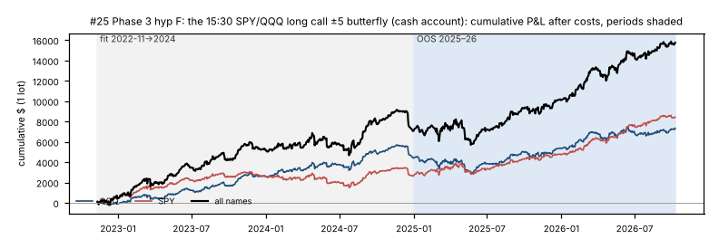

**Amendments, deviations and integrity checks.** The selection is not independent of the OOS it was read on (stated in the report).

**What it showed.** +3.85% of risk a fly OOS, carried by the same data that chose it.

## #26a Paper tracker: condor_em1 (SPY 2-wide iron condor at ± the ATM straddle, 11:30–13:30)

**Folder:** `scripts/paper_tracker.py; research_notes/Compass phase 3/backtest_replay, backtest_audit, forward_*`. **Commits:** defaults ba117a7, 6826b98 / official-close settlement a4ebe90, 99a3d4e, 16eb3c0 / replay 94af538, 30bb73e; audit 1ca1f0e; forward d7115b6, 2a7bd3b. **Dates:** 2026-10-21 → 22.

**Hypothesis.** The midday SPY condor of hyp B (#20b), all-VIX form, pays forward.

**Rule.** 11:30, 12:00, 12:30, 13:00, 13:30: SPY 2-wide iron condor, shorts the first listed strikes outside spot ± the ATM straddle, held to the official close.

**Fills and costs.** Shorts at the bid, longs at the ask; $0.65 a contract (leg) to open, nothing at expiry.

**Data.** The replay of every stored session through the live tracker's code, settled on the official close (data_recorder/paper_backtest_official, git-ignored, every trade).

**Periods and holdouts.** i development 2022-11-11 → 2024-12-31 / ii selection 2025-01-02 → 2026-10-09 (read) / iii forward 2026-10-12 → (untouched). No historical period is untouched for any candidate (AUDIT.md §5).

**Pass rule (as pre-registered).** Confirmation: 60 → 120 forward sessions (the candidate's threshold).

**Verdict.** Historical periods through zero (i +3.47 [−0.04, +6.68], ii +4.10 [−0.51, +8.15]); the 15:58 close-out turns it negative; forward pending.

**Metrics** (return = % of max risk; win = P&L > 0 after fees; breakeven is a loss; the interval is audit_lib's 20-session moving-block bootstrap over the period's calendar sessions):

| name | period | trades | sessions (traded / span) | win % | avg win %, $ | avg loss %, $ | median %, $ | mean %, $ | 20-session block 95% (%; $) |
|------------------|------------------------------|---------------|---------------------|------------|------------------------|------------------------|------------------------|------------------------|------------------------------------------------|
| SPY | i | 2,358 | 525 / 553 | 80.2 | +14.2, +23.96 | −46.7, −79.50 | +10.9, +19.40 | **+2.16**, +3.47 | [+0.08, +4.18]; [−0.04, +6.89] |
| SPY | ii | 2,068 | 439 / 457 | 80.4 | +17.5, +28.47 | −59.1, −95.95 | +13.4, +23.40 | **+2.46**, +4.10 | [−0.54, +5.02]; [−0.68, +8.15] |
| SPY | iii | 44 | 9 / 9 | 86.4 | +15.5, +25.93 | −55.1, −90.93 | +13.1, +22.90 | **+5.84**, +9.99 | n/a (< 60 sessions); n/a (< 60 sessions) |

| name | period | biggest win ($, %, date, contract) | biggest loss ($, %, date, contract) | profit factor | max DD $ | longest DD (sessions) | top-5 days' share of profit |
|------------------|------------------------------|------------------------------------------------------------------|------------------------------------------------------------------|------------|---------------|---------------|------------------------------------|
| SPY | i | +66.40, +50.7%, 2022-12-14, SPY 12:30 −C411/−C413/−P396/−P394 | −191.60, −101.4%, 2023-07-07, SPY 13:30 −C444/−C446/−P441/−P439 | 1.22 | 2,849 | 165 | 17% |
| SPY | ii | +63.40, +47.3%, 2026-07-29, SPY 13:00 −C741/−C743/−P729/−P727 | −187.60, −101.4%, 2025-04-09, SPY 13:30 −C536/−C538/−P512/−P510 | 1.22 | 2,910 | 81 | 17% |
| SPY | iii | +44.40, +29.0%, 2026-10-22, SPY 11:30 −C767/−C769/−P760/−P758 | −170.60, −101.5%, 2026-10-16, SPY 11:30 −C772/−C774/−P766/−P764 | 1.81 | 455 | 4 | 170% |

**Random baseline:** not available — no random baseline was computed by this study

**Exit reasons (share of trades):**

- i: held to settlement (official close) 100.0%
- ii: held to settlement (official close) 100.0%
- iii: held to settlement (official close) 100.0%

**By year** (all periods together, labelled by entry year):

| year | name | trades | win % | mean % | mean $ | total $ |
|---|---|---|---|---|---|---|
| 2022 | SPY | 159 | 81.8 | +5.54 | +9.38 | +1,492 |
| 2023 | SPY | 1,080 | 77.9 | +0.20 | +0.16 | +170 |
| 2024 | SPY | 1,119 | 82.2 | +3.57 | +5.84 | +6,532 |
| 2025 | SPY | 1,129 | 81.4 | +3.53 | +5.65 | +6,378 |
| 2026 | SPY | 983 | 79.6 | +1.39 | +2.59 | +2,549 |

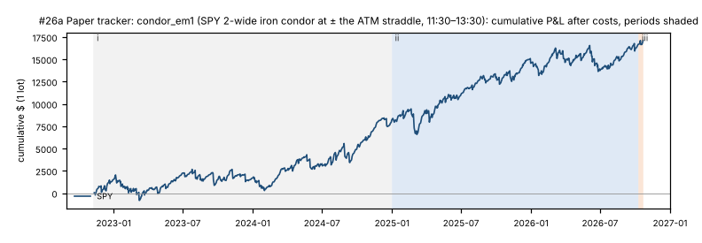

**Amendments, deviations and integrity checks.** Deterministic (a cold replay equals the committed CSV byte for byte); 100 trades re-derived, 0 differences; re-settled on the official close (12,338 of 20,469 trades changed).

**What it showed.** A few dollars a condor in both historical periods, inside the noise.

## #26b Paper tracker: fly5 (SPY/QQQ ±5 butterflies at 15:00 and 15:30: iron, call, put)

**Folder:** `scripts/paper_tracker.py; research_notes/Compass phase 3/backtest_replay, backtest_audit, forward_*`. **Commits:** defaults ba117a7, 6826b98 / official-close settlement a4ebe90, 99a3d4e, 16eb3c0 / replay 94af538, 30bb73e; audit 1ca1f0e; forward d7115b6, 2a7bd3b. **Dates:** 2026-10-21 → 22.

**Hypothesis.** The late-day ±5 fly of hyp C/F pays forward.

**Rule.** 15:00 and 15:30: SPY and QQQ ±5 iron, call and put butterflies (one trade seen three ways), held to the official close.

**Fills and costs.** Shorts at the bid, longs at the ask; $0.65 a contract (leg) to open, nothing at expiry.

**Data.** The replay of every stored session through the live tracker's code, settled on the official close (data_recorder/paper_backtest_official, git-ignored, every trade).

**Periods and holdouts.** i development 2022-11-11 → 2024-12-31 / ii selection 2025-01-02 → 2026-10-09 (read) / iii forward 2026-10-12 → (untouched). No historical period is untouched for any candidate (AUDIT.md §5).

**Pass rule (as pre-registered).** Confirmation: 250 forward sessions a name.

**Verdict.** Iron clear of zero in i and ii (+16.59, +16.20 a trade) but chosen on ii; hold-to-expiry leaves 100 shares a fly; the after-hours rule (#27) DROPS the iron as a SPY/QQQ hold-to-expiry strategy.

**Metrics** (return = % of max risk; win = P&L > 0 after fees; breakeven is a loss; the interval is audit_lib's 20-session moving-block bootstrap over the period's calendar sessions):

| name | period | trades | sessions (traded / span) | win % | avg win %, $ | avg loss %, $ | median %, $ | mean %, $ | 20-session block 95% (%; $) |
|------------------|------------------------------|---------------|---------------------|------------|------------------------|------------------------|------------------------|------------------------|------------------------------------------------|
| QQQ call | i | 1,049 | 528 / 553 | 66.7 | +14.6, +52.97 | −18.2, −70.84 | +6.0, +25.40 | **+3.69**, +11.78 | [+2.25, +6.00]; [+6.99, +19.03] |
| QQQ iron | i | 1,049 | 528 / 553 | 69.5 | +15.8, +56.79 | −18.3, −69.14 | +7.6, +31.40 | **+5.39**, +18.38 | [+3.81, +7.82]; [+13.64, +25.55] |
| QQQ put | i | 1,051 | 529 / 553 | 65.8 | +14.5, +52.59 | −17.8, −69.16 | +6.0, +24.40 | **+3.45**, +11.00 | [+2.03, +5.76]; [+6.42, +18.23] |
| SPY call | i | 1,046 | 525 / 553 | 64.1 | +13.2, +50.06 | −17.4, −68.57 | +4.9, +20.40 | **+2.24**, +7.42 | [+0.85, +4.08]; [+2.07, +13.97] |
| SPY iron | i | 1,046 | 525 / 553 | 69.0 | +14.1, +52.81 | −18.3, −69.92 | +6.9, +28.40 | **+4.08**, +14.80 | [+2.77, +5.88]; [+10.06, +20.73] |
| SPY put | i | 1,046 | 525 / 553 | 60.7 | +13.1, +49.26 | −16.6, −66.31 | +3.8, +15.40 | **+1.41**, +3.85 | [−0.16, +3.37]; [−2.21, +11.04] |
| all names | i | 6,287 | 530 / 553 | 66.0 | +14.2, +52.51 | −17.7, −68.89 | +5.8, +24.40 | **+3.38**, +11.21 | [+2.05, +5.40]; [+6.67, +17.68] |
| QQQ call | ii | 877 | 439 / 457 | 57.5 | +23.1, +71.82 | −26.1, −90.64 | +4.3, +18.40 | **+2.20**, +2.72 | [−0.17, +4.54]; [−5.48, +10.66] |
| QQQ iron | ii | 877 | 439 / 457 | 62.7 | +25.0, +76.77 | −26.7, −87.04 | +7.8, +31.40 | **+5.71**, +15.69 | [+3.47, +7.94]; [+7.95, +22.93] |
| QQQ put | ii | 877 | 439 / 457 | 56.4 | +22.9, +71.07 | −25.9, −90.24 | +3.6, +15.40 | **+1.68**, +0.81 | [−0.72, +3.99]; [−7.46, +8.43] |
| SPY call | ii | 880 | 441 / 457 | 61.6 | +19.6, +65.60 | −22.0, −75.18 | +5.9, +24.40 | **+3.65**, +11.52 | [+1.91, +5.44]; [+5.61, +17.89] |
| SPY iron | ii | 880 | 441 / 457 | 64.2 | +20.4, +67.58 | −22.3, −74.53 | +7.2, +28.40 | **+5.12**, +16.71 | [+3.41, +6.91]; [+10.63, +23.00] |
| SPY put | ii | 880 | 441 / 457 | 60.8 | +19.6, +65.46 | −21.8, −75.16 | +5.6, +22.40 | **+3.37**, +10.33 | [+1.63, +5.21]; [+4.17, +16.78] |
| all names | ii | 5,271 | 441 / 457 | 60.5 | +21.8, +69.68 | −24.2, −82.48 | +5.7, +22.40 | **+3.62**, +9.64 | [+1.77, +5.47]; [+3.12, +15.94] |
| QQQ call | iii | 18 | 9 / 9 | 77.8 | +36.0, +108.26 | −20.5, −77.10 | +27.0, +79.90 | **+23.42**, +67.07 | n/a (< 60 sessions); n/a (< 60 sessions) |
| QQQ iron | iii | 18 | 9 / 9 | 77.8 | +38.0, +112.76 | −19.0, −69.60 | +29.0, +86.90 | **+25.29**, +72.23 | n/a (< 60 sessions); n/a (< 60 sessions) |
| QQQ put | iii | 18 | 9 / 9 | 77.8 | +36.2, +108.40 | −19.7, −73.10 | +27.5, +78.40 | **+23.75**, +68.07 | n/a (< 60 sessions); n/a (< 60 sessions) |
| SPY call | iii | 18 | 9 / 9 | 61.1 | +22.0, +79.49 | −9.8, −39.89 | +13.8, +46.90 | **+9.63**, +33.07 | n/a (< 60 sessions); n/a (< 60 sessions) |
| SPY iron | iii | 18 | 9 / 9 | 61.1 | +22.2, +80.04 | −9.6, −39.31 | +13.9, +51.90 | **+9.83**, +33.62 | n/a (< 60 sessions); n/a (< 60 sessions) |
| SPY put | iii | 18 | 9 / 9 | 61.1 | +22.1, +79.67 | −9.7, −39.60 | +13.8, +51.40 | **+9.72**, +33.29 | n/a (< 60 sessions); n/a (< 60 sessions) |
| all names | iii | 108 | 9 / 9 | 69.4 | +30.3, +96.57 | −13.4, −51.84 | +17.5, +64.90 | **+16.94**, +51.22 | n/a (< 60 sessions); n/a (< 60 sessions) |

| name | period | biggest win ($, %, date, contract) | biggest loss ($, %, date, contract) | profit factor | max DD $ | longest DD (sessions) | top-5 days' share of profit |
|------------------|------------------------------|------------------------------------------------------------------|------------------------------------------------------------------|------------|---------------|---------------|------------------------------------|
| QQQ call | i | +294.40, +213.3%, 2024-08-28, QQQ 15:30 −C467/−C472/−C477 | −407.60, −100.6%, 2024-12-18, QQQ 15:30 −C517/−C522/−C527 | 1.50 | 1,866 | 38 | 16% |
| QQQ iron | i | +296.40, +217.9%, 2024-08-28, QQQ 15:00 −C472/−P472/−P467/−C477 | −351.60, −100.7%, 2024-07-25, QQQ 15:30 −C464/−P464/−P459/−C469 | 1.87 | 1,406 | 36 | 11% |
| QQQ put | i | +293.40, +211.1%, 2024-08-28, QQQ 15:00 −P467/−P472/−P477 | −374.60, −100.7%, 2024-07-25, QQQ 15:30 −P459/−P464/−P469 | 1.47 | 1,702 | 38 | 18% |
| SPY call | i | +271.40, +138.5%, 2024-08-28, SPY 15:00 −C553/−C558/−C563 | −422.60, −100.6%, 2024-05-31, SPY 15:30 −C517/−C522/−C527 | 1.30 | 2,046 | 195 | 23% |
| SPY iron | i | +273.40, +140.9%, 2024-08-28, SPY 15:00 −C558/−P558/−P553/−C563 | −401.60, −100.7%, 2024-05-31, SPY 15:30 −C522/−P522/−P517/−C527 | 1.68 | 1,070 | 39 | 12% |
| SPY put | i | +271.40, +138.5%, 2024-08-28, SPY 15:00 −P553/−P558/−P563 | −407.60, −100.6%, 2024-05-31, SPY 15:00 −P516/−P521/−P526 | 1.15 | 4,148 | 284 | 44% |
| all names | i | +296.40, +217.9%, 2024-08-28, QQQ 15:00 −C472/−P472/−P467/−C477 | −422.60, −100.6%, 2024-05-31, SPY 15:30 −C517/−C522/−C527 | 1.48 | 8,394 | 53 | 16% |
| QQQ call | ii | +278.40, +171.9%, 2026-04-29, QQQ 15:00 −C656/−C661/−C666 | −470.60, −100.6%, 2026-05-12, QQQ 15:00 −C697/−C702/−C707 | 1.07 | 3,590 | 184 | 95% |
| QQQ iron | ii | +280.40, +175.2%, 2026-04-29, QQQ 15:00 −C661/−P661/−P656/−C666 | −349.60, −100.7%, 2026-03-09, QQQ 15:00 −C600/−P600/−P595/−C605 | 1.48 | 1,767 | 81 | 17% |
| QQQ put | ii | +278.40, +171.9%, 2026-04-29, QQQ 15:00 −P656/−P661/−P666 | −365.60, −100.7%, 2026-03-09, QQQ 15:00 −P595/−P600/−P605 | 1.02 | 3,670 | 296 | 323% |
| SPY call | ii | +269.40, +120.8%, 2026-09-16, SPY 15:00 −C749/−C754/−C759 | −344.60, −100.8%, 2026-03-09, SPY 15:00 −C665/−C670/−C675 | 1.40 | 1,765 | 99 | 18% |
| SPY iron | ii | +269.40, +120.8%, 2026-09-16, SPY 15:00 −C754/−P754/−P749/−C759 | −343.60, −100.8%, 2026-03-09, SPY 15:00 −C670/−P670/−P665/−C675 | 1.63 | 1,299 | 35 | 13% |
| SPY put | ii | +268.40, +119.8%, 2026-09-16, SPY 15:00 −P749/−P754/−P759 | −348.60, −100.8%, 2026-03-09, SPY 15:00 −P665/−P670/−P675 | 1.35 | 1,961 | 135 | 21% |
| all names | ii | +280.40, +175.2%, 2026-04-29, QQQ 15:00 −C661/−P661/−P656/−C666 | −470.60, −100.6%, 2026-05-12, QQQ 15:00 −C697/−C702/−C707 | 1.30 | 12,048 | 107 | 24% |
| QQQ call | iii | +175.40, +72.5%, 2026-10-21, QQQ 15:30 −C721/−C726/−C731 | −153.60, −43.8%, 2026-10-15, QQQ 15:00 −C720/−C725/−C730 | 4.91 | 43 | 1 | 100% |
| QQQ iron | iii | +179.40, +75.4%, 2026-10-21, QQQ 15:30 −C726/−P726/−P721/−C731 | −143.60, −42.1%, 2026-10-15, QQQ 15:00 −C725/−P725/−P720/−C730 | 5.67 | 32 | 1 | 97% |
| QQQ put | iii | +176.40, +73.2%, 2026-10-21, QQQ 15:30 −P721/−P726/−P731 | −147.60, −42.8%, 2026-10-15, QQQ 15:00 −P720/−P725/−P730 | 5.19 | 42 | 1 | 99% |
| SPY call | iii | +156.40, +47.1%, 2026-10-21, SPY 15:30 −C768/−C773/−C778 | −71.60, −17.2%, 2026-10-19, SPY 15:30 −C763/−C768/−C773 | 3.13 | 121 | 2 | 125% |
| SPY iron | iii | +156.40, +47.1%, 2026-10-21, SPY 15:30 −C773/−P773/−P768/−C778 | −73.60, −17.6%, 2026-10-19, SPY 15:30 −C768/−P768/−P763/−C773 | 3.20 | 124 | 2 | 125% |
| SPY put | iii | +154.40, +46.2%, 2026-10-21, SPY 15:30 −P768/−P773/−P778 | −74.60, −17.8%, 2026-10-19, SPY 15:30 −P763/−P768/−P773 | 3.16 | 125 | 2 | 126% |
| all names | iii | +179.40, +75.4%, 2026-10-21, QQQ 15:30 −C726/−P726/−P721/−C731 | −153.60, −43.8%, 2026-10-15, QQQ 15:00 −C720/−C725/−C730 | 4.23 | 324 | 1 | 98% |

**Random baseline:** not available — no random baseline was computed by this study

**Exit reasons (share of trades):**

- i: held to settlement (official close) 100.0%
- ii: held to settlement (official close) 100.0%
- iii: held to settlement (official close) 100.0%

**By year** (all periods together, labelled by entry year):

| year | name | trades | win % | mean % | mean $ | total $ |
|---|---|---|---|---|---|---|
| 2022 | QQQ call | 65 | 66.2 | +2.16 | +3.75 | +244 |
| 2023 | QQQ call | 495 | 67.7 | +3.74 | +14.07 | +6,965 |
| 2024 | QQQ call | 489 | 65.8 | +3.83 | +10.53 | +5,150 |
| 2025 | QQQ call | 493 | 57.2 | +1.57 | +0.95 | +470 |
| 2026 | QQQ call | 402 | 58.7 | +3.93 | +7.78 | +3,126 |
| 2022 | QQQ iron | 65 | 72.3 | +3.99 | +11.29 | +734 |
| 2023 | QQQ iron | 495 | 69.5 | +4.98 | +18.83 | +9,320 |
| 2024 | QQQ iron | 489 | 69.1 | +6.00 | +18.86 | +9,224 |
| 2025 | QQQ iron | 493 | 63.7 | +5.45 | +15.54 | +7,659 |
| 2026 | QQQ iron | 402 | 62.2 | +6.91 | +18.40 | +7,399 |
| 2022 | QQQ put | 65 | 67.7 | +2.01 | +3.08 | +200 |
| 2023 | QQQ put | 495 | 67.3 | +3.51 | +13.12 | +6,492 |
| 2024 | QQQ put | 491 | 64.2 | +3.58 | +9.92 | +4,872 |
| 2025 | QQQ put | 493 | 54.4 | +0.76 | −2.05 | −1,013 |
| 2026 | QQQ put | 402 | 60.0 | +3.80 | +7.33 | +2,948 |
| 2022 | SPY call | 65 | 69.2 | +5.70 | +17.31 | +1,125 |
| 2023 | SPY call | 495 | 65.9 | +2.68 | +10.23 | +5,065 |
| 2024 | SPY call | 486 | 61.5 | +1.33 | +3.23 | +1,567 |
| 2025 | SPY call | 493 | 59.8 | +2.22 | +7.00 | +3,453 |
| 2026 | SPY call | 405 | 63.7 | +5.65 | +17.99 | +7,284 |
| 2022 | SPY iron | 65 | 72.3 | +7.07 | +21.86 | +1,421 |
| 2023 | SPY iron | 495 | 70.5 | +4.06 | +15.77 | +7,806 |
| 2024 | SPY iron | 486 | 67.1 | +3.69 | +12.86 | +6,250 |
| 2025 | SPY iron | 493 | 62.1 | +3.65 | +11.92 | +5,877 |
| 2026 | SPY iron | 405 | 66.7 | +7.12 | +23.29 | +9,433 |
| 2022 | SPY put | 65 | 69.2 | +5.59 | +16.82 | +1,093 |
| 2023 | SPY put | 495 | 64.0 | +2.14 | +7.92 | +3,918 |
| 2024 | SPY put | 486 | 56.2 | +0.10 | −2.03 | −985 |
| 2025 | SPY put | 493 | 58.4 | +1.82 | +5.30 | +2,612 |
| 2026 | SPY put | 405 | 63.7 | +5.54 | +17.47 | +7,077 |
| 2022 | all names | 390 | 69.5 | +4.42 | +12.35 | +4,817 |
| 2023 | all names | 2,970 | 67.5 | +3.52 | +13.32 | +39,566 |
| 2024 | all names | 2,927 | 64.0 | +3.09 | +8.91 | +26,079 |
| 2025 | all names | 2,958 | 59.3 | +2.58 | +6.44 | +19,059 |
| 2026 | all names | 2,421 | 62.5 | +5.49 | +15.39 | +37,266 |

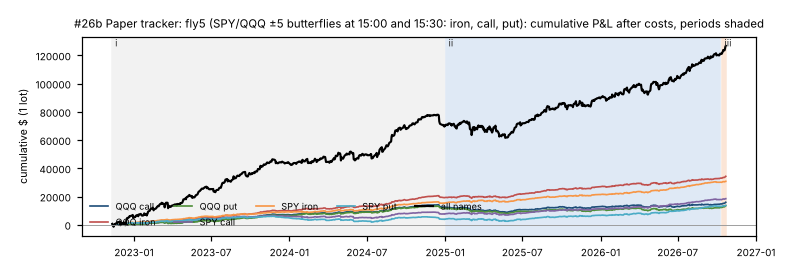

**Amendments, deviations and integrity checks.** As 26a.

**What it showed.** Positive historically, but on the period that chose it, and not operationally clean.

## #26c Paper tracker: condor_d20 (SPY 2-wide 20-delta iron condor, 13:00–15:00)

**Folder:** `scripts/paper_tracker.py; research_notes/Compass phase 3/backtest_replay, backtest_audit, forward_*`. **Commits:** defaults ba117a7, 6826b98 / official-close settlement a4ebe90, 99a3d4e, 16eb3c0 / replay 94af538, 30bb73e; audit 1ca1f0e; forward d7115b6, 2a7bd3b; candidate 3 99a3d4e. **Dates:** 2026-10-21 → 22.

**Hypothesis.** The 20-delta SPY condor (from hyp E's D1 read) pays forward.

**Rule.** 13:00, 13:30, 14:00, 14:30, 15:00: SPY 2-wide iron condor at 20 delta, held to the official close.

**Fills and costs.** Shorts at the bid, longs at the ask; $0.65 a contract (leg) to open, nothing at expiry.

**Data.** The replay of every stored session through the live tracker's code, settled on the official close (data_recorder/paper_backtest_official, git-ignored, every trade).

**Periods and holdouts.** i-a model training 2022-11 → 2024-06 (in-sample) / i-b decile cuts 2024-07 → 12 / ii selection 2025 → 2026-10-09 / iii forward.

**Pass rule (as pre-registered).** Confirmation: 150 forward sessions for the D1 re-test.

**Verdict.** Positive in ii (+7.67 [+3.87, +10.89]) but set after ii was read; the after-hours rule DROPS it as a hold-to-expiry strategy.

**Metrics** (return = % of max risk; win = P&L > 0 after fees; breakeven is a loss; the interval is audit_lib's 20-session moving-block bootstrap over the period's calendar sessions):

| name | period | trades | sessions (traded / span) | win % | avg win %, $ | avg loss %, $ | median %, $ | mean %, $ | 20-session block 95% (%; $) |
|------------------|------------------------------|---------------|---------------------|------------|------------------------|------------------------|------------------------|------------------------|------------------------------------------------|
| SPY | i-a | 1,823 | 403 / 422 | 76.9 | +14.9, +24.87 | −42.8, −72.11 | +11.5, +20.40 | **+1.53**, +2.42 | [−0.37, +3.11]; [−0.79, +5.00] |
| SPY | i-b | 572 | 125 / 131 | 83.9 | +16.5, +27.06 | −53.3, −87.05 | +13.1, +22.40 | **+5.25**, +8.71 | [+2.06, +9.54]; [+3.44, +15.69] |
| SPY | ii | 2,090 | 440 / 457 | 82.1 | +17.0, +27.70 | −51.5, −83.92 | +13.4, +23.40 | **+4.68**, +7.67 | [+2.43, +6.59]; [+3.97, +10.78] |
| SPY | iii | 41 | 9 / 9 | 95.1 | +16.2, +26.94 | −27.7, −46.10 | +16.1, +27.40 | **+14.02**, +23.38 | n/a (< 60 sessions); n/a (< 60 sessions) |

| name | period | biggest win ($, %, date, contract) | biggest loss ($, %, date, contract) | profit factor | max DD $ | longest DD (sessions) | top-5 days' share of profit |
|------------------|------------------------------|------------------------------------------------------------------|------------------------------------------------------------------|------------|---------------|---------------|------------------------------------|
| SPY | i-a | +69.40, +54.2%, 2022-12-14, SPY 13:30 −C411/−C413/−P397/−P395 | −191.60, −101.4%, 2023-07-07, SPY 13:30 −C444/−C446/−P441/−P439 | 1.14 | 1,769 | 75 | 28% |
| SPY | i-b | +63.40, +47.3%, 2024-09-18, SPY 13:00 −C569/−C571/−P557/−P555 | −185.60, −101.4%, 2024-07-12, SPY 15:00 −C564/−C566/−P562/−P560 | 1.62 | 1,618 | 29 | 26% |
| SPY | ii | +60.40, +44.1%, 2025-04-10, SPY 13:30 −C530/−C532/−P509/−P507 | −189.60, −101.4%, 2026-04-13, SPY 14:00 −C684/−C686/−P680/−P678 | 1.51 | 2,292 | 39 | 8% |
| SPY | iii | +41.40, +26.5%, 2026-10-22, SPY 13:00 −C767/−C769/−P761/−P759 | −47.60, −28.7%, 2026-10-15, SPY 14:30 −C771/−C773/−P768/−P766 | 11.39 | 0 | 0 | 73% |

**Random baseline:** not available — no random baseline was computed by this study

**Exit reasons (share of trades):**

- i-a: held to settlement (official close) 100.0%
- i-b: held to settlement (official close) 100.0%
- ii: held to settlement (official close) 100.0%
- iii: held to settlement (official close) 100.0%

**By year** (all periods together, labelled by entry year):

| year | name | trades | win % | mean % | mean $ | total $ |
|---|---|---|---|---|---|---|
| 2022 | SPY | 163 | 77.9 | −1.08 | −2.26 | −369 |
| 2023 | SPY | 1,102 | 76.0 | +1.43 | +2.33 | +2,569 |
| 2024 | SPY | 1,130 | 81.2 | +3.89 | +6.36 | +7,190 |
| 2025 | SPY | 1,156 | 82.1 | +5.26 | +8.46 | +9,784 |
| 2026 | SPY | 975 | 82.6 | +4.38 | +7.39 | +7,208 |

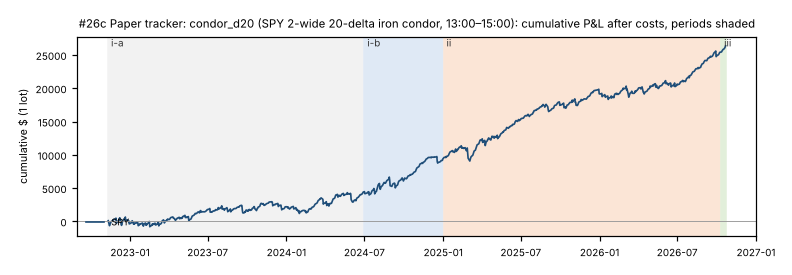

**Amendments, deviations and integrity checks.** As 26a.

**What it showed.** Positive on the period it was chosen on.

## #26d Paper tracker: fly_spxw (SPX ±5 / ±25 flies)

**Folder:** `scripts/paper_tracker.py; research_notes/Compass phase 3/backtest_replay, backtest_audit, forward_*`. **Commits:** scripts/paper_backtest.py (off unless listed). **Dates:** 2026-10-21.

**Hypothesis.** The SPXW analogue of fly5.

**Rule.** 15:00 and 15:30 SPXW ±5 and ±25 flies.

**Fills and costs.** SPXW $1.18748 a contract each way under $1 of premium, $1.27748 at $1 and up (commission, Cboe fee, SPXW surcharge, ORF, OCC)

**Data.** One week, 2026-10-05 → 09.

**Periods and holdouts.** —

**Pass rule (as pre-registered).** —

**Verdict.** Run only as a one-week sanity run outside the repository; replaced by the pre-registered SPXW test (#28).

**Metrics.** not available — a one-week sanity run outside the repository; no rows were kept.

**Amendments, deviations and integrity checks.** —

**What it showed.** No result.

## #27a After-hours exercise study: fly5 iron ±5, case (b) the post-market decision

**Folder:** `research_notes/Compass phase 3/backtest_audit/AFTERHOURS.md`. **Commits:** owner's rule fixed before the read / — / 633fbff. **Dates:** 2026-10-22.

**Hypothesis.** The SPY/QQQ hold-to-expiry candidates survive after-hours exercise.

**Rule.** fly5 iron held to expiry; case (b): the counterparty exercises on the 17:30 post-market price, the position re-marked at the next 09:30 open.

**Fills and costs.** As #26 plus the exercise/assignment fee.

**Data.** SPY/QQQ, period ii (2025-10-13 → 2026-10-09 overlap) and iii (2026-10-12 → 21).

**Periods and holdouts.** ii / iii (7 sessions with a next open).

**Pass rule (as pre-registered).** "If a candidate's mean under (b) is ≤ 0 or its block-20 interval includes zero, drop it as a SPY/QQQ hold-to-expiry strategy."

**Verdict.** DROP: (b) +22.52 a trade [−20.07, +52.89] in ii.

**Metrics** (return = % of max risk; win = P&L > 0 after fees; breakeven is a loss; the interval is audit_lib's 20-session moving-block bootstrap over the period's calendar sessions):

| name | period | trades | sessions (traded / span) | win % | avg win %, $ | avg loss %, $ | median %, $ | mean %, $ | 20-session block 95% (%; $) |
|------------------|------------------------------|---------------|---------------------|------------|------------------------|------------------------|------------------------|------------------------|------------------------------------------------|
| QQQ | ii | 492 | 246 / 258 | 55.5 | +119.5, +393.38 | −131.7, −428.79 | +15.8, +58.90 | **+7.69**, +27.42 | [−7.67, +18.13]; [−22.91, +61.48] |
| SPY | ii | 495 | 248 / 258 | 56.0 | +72.0, +257.24 | −80.6, −286.78 | +8.9, +36.40 | **+4.82**, +17.65 | [−6.54, +13.87]; [−20.04, +48.90] |
| all names | ii | 987 | 248 / 258 | 55.7 | +95.6, +324.81 | −106.2, −357.95 | +10.5, +41.40 | **+6.25**, +22.52 | [−5.84, +15.27]; [−18.92, +51.90] |
| QQQ | iii | 14 | 7 / 7 | 42.9 | +142.0, +504.15 | −157.0, −513.29 | −52.0, −170.60 | **−28.86**, −77.24 | n/a (< 60 sessions); n/a (< 60 sessions) |
| SPY | iii | 14 | 7 / 7 | 42.9 | +55.9, +224.73 | −49.7, −179.73 | −28.1, −109.10 | **−4.44**, −6.39 | n/a (< 60 sessions); n/a (< 60 sessions) |
| all names | iii | 28 | 7 / 7 | 42.9 | +99.0, +364.44 | −103.4, −346.51 | −28.1, −109.10 | **−16.65**, −41.81 | n/a (< 60 sessions); n/a (< 60 sessions) |

| name | period | biggest win ($, %, date, contract) | biggest loss ($, %, date, contract) | profit factor | max DD $ | longest DD (sessions) | top-5 days' share of profit |
|------------------|------------------------------|------------------------------------------------------------------|------------------------------------------------------------------|------------|---------------|---------------|------------------------------------|
| QQQ | ii | +2,196.40, +671.7%, 2026-06-22, QQQ 15:00 [["C", 736.0, "short", 1], ["P", 736.0, "short", 1], ["P", 731.0, "long", 1], ["C", 741.0, "long", 1]] | −2,195.60, −681.9%, 2026-04-07, QQQ 15:30 [["C", 585.0, "short", 1], ["P", 585.0, "short", 1], ["P", 580.0, "long", 1], ["C", 590.0, "long", 1]] | 1.14 | 10,408 | 69 | 93% |
| SPY | ii | +1,153.40, +317.7%, 2026-06-22, SPY 15:00 [["C", 744.0, "short", 1], ["P", 744.0, "short", 1], ["P", 739.0, "long", 1], ["C", 749.0, "long", 1]] | −1,761.60, −550.5%, 2026-04-07, SPY 15:30 [["C", 657.0, "short", 1], ["P", 657.0, "short", 1], ["P", 652.0, "long", 1], ["C", 662.0, "long", 1]] | 1.14 | 7,209 | 88 | 91% |
| all names | ii | +2,196.40, +671.7%, 2026-06-22, QQQ 15:00 [["C", 736.0, "short", 1], ["P", 736.0, "short", 1], ["P", 731.0, "long", 1], ["C", 741.0, "long", 1]] | −2,195.60, −681.9%, 2026-04-07, QQQ 15:30 [["C", 585.0, "short", 1], ["P", 585.0, "short", 1], ["P", 580.0, "long", 1], ["C", 590.0, "long", 1]] | 1.14 | 15,715 | 84 | 89% |
| QQQ | iii | +1,066.40, +365.2%, 2026-10-16, QQQ 15:30 [["C", 711.0, "short", 1], ["P", 711.0, "short", 1], ["P", 706.0, "long", 1], ["C", 716.0, "long", 1]] | −875.60, −267.0%, 2026-10-14, QQQ 15:30 [["C", 729.0, "short", 1], ["P", 729.0, "short", 1], ["P", 724.0, "long", 1], ["C", 734.0, "long", 1]] | 0.74 | 2,219 | 5 | total ≤ 0 (best 5 days +1,152; without them −2,233) |
| SPY | iii | +373.40, +86.4%, 2026-10-13, SPY 15:00 [["C", 778.0, "short", 1], ["P", 778.0, "short", 1], ["P", 773.0, "long", 1], ["C", 783.0, "long", 1]] | −342.60, −108.1%, 2026-10-16, SPY 15:00 [["C", 762.0, "short", 1], ["P", 762.0, "short", 1], ["P", 757.0, "long", 1], ["C", 767.0, "long", 1]] | 0.94 | 1,183 | 3 | total ≤ 0 (best 5 days +845; without them −934) |
| all names | iii | +1,066.40, +365.2%, 2026-10-16, QQQ 15:30 [["C", 711.0, "short", 1], ["P", 711.0, "short", 1], ["P", 706.0, "long", 1], ["C", 716.0, "long", 1]] | −875.60, −267.0%, 2026-10-14, QQQ 15:30 [["C", 729.0, "short", 1], ["P", 729.0, "short", 1], ["P", 724.0, "long", 1], ["C", 734.0, "long", 1]] | 0.79 | 3,097 | 5 | total ≤ 0 (best 5 days +1,222; without them −2,393) |

**Random baseline:** not available — no random baseline was computed by this study

**Exit reasons (share of trades):**

- ii: held; after-hours decision (b) on the 17:30 price 100.0%
- iii: held; after-hours decision (b) on the 17:30 price 100.0%

**By year** (all periods together, labelled by entry year):

| year | name | trades | win % | mean % | mean $ | total $ |
|---|---|---|---|---|---|---|
| 2025 | QQQ | 108 | 56.5 | +10.86 | +55.66 | +6,011 |
| 2026 | QQQ | 398 | 54.8 | +5.54 | +16.07 | +6,396 |
| 2025 | SPY | 108 | 59.3 | +5.25 | +31.63 | +3,416 |
| 2026 | SPY | 401 | 54.6 | +4.38 | +13.05 | +5,232 |
| 2025 | all names | 216 | 57.9 | +8.05 | +43.65 | +9,427 |
| 2026 | all names | 799 | 54.7 | +4.96 | +14.55 | +11,627 |

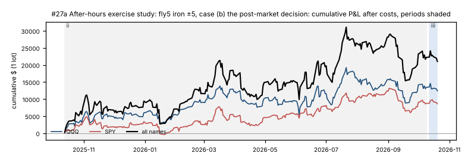

**Amendments, deviations and integrity checks.** 16 name-sessions of UW 1-minute post-market bars fetched once with the owner's leave; SPY 2025-04-09 official close flagged.

**What it showed.** Counting after-hours exercise, the iron fly's mean is inside the noise.

## #27b After-hours exercise study: condor_d20, case (b)

**Folder:** `research_notes/Compass phase 3/backtest_audit/AFTERHOURS.md`. **Commits:** — / — / 633fbff. **Dates:** 2026-10-22.

**Hypothesis.** As 27a.

**Rule.** condor_d20 held to expiry, case (b).

**Fills and costs.** As 27a.

**Data.** As 27a.

**Periods and holdouts.** ii / iii.

**Pass rule (as pre-registered).** As 27a.

**Verdict.** DROP: (b) +3.84 [−19.94, +22.74] in ii; iii undecided (7 sessions).

**Metrics** (return = % of max risk; win = P&L > 0 after fees; breakeven is a loss; the interval is audit_lib's 20-session moving-block bootstrap over the period's calendar sessions):

| name | period | trades | sessions (traded / span) | win % | avg win %, $ | avg loss %, $ | median %, $ | mean %, $ | 20-session block 95% (%; $) |
|------------------|------------------------------|---------------|---------------------|------------|------------------------|------------------------|------------------------|------------------------|------------------------------------------------|
| SPY | ii | 1,176 | 247 / 258 | 83.3 | +37.0, +60.03 | −170.6, −277.09 | +14.8, +25.40 | **+2.37**, +3.84 | [−12.63, +14.57]; [−20.21, +22.96] |
| SPY | iii | 36 | 8 / 8 | 94.4 | +30.2, +51.93 | −85.4, −146.10 | +16.1, +27.40 | **+23.77**, +40.93 | n/a (< 60 sessions); n/a (< 60 sessions) |

| name | period | biggest win ($, %, date, contract) | biggest loss ($, %, date, contract) | profit factor | max DD $ | longest DD (sessions) | top-5 days' share of profit |
|------------------|------------------------------|------------------------------------------------------------------|------------------------------------------------------------------|------------|---------------|---------------|------------------------------------|
| SPY | ii | +867.40, +598.2%, 2026-09-16, SPY 14:00 [["C", 765.0, "short", 1], ["C", 767.0, "long", 1], ["P", 755.0, "short", 1], ["P", 753.0, "long", 1]] | −1,798.60, −1,145.6%, 2026-04-07, SPY 14:30 [["C", 658.0, "short", 1], ["C", 660.0, "long", 1], ["P", 654.0, "short", 1], ["P", 652.0, "long", 1]] | 1.08 | 11,988 | 132 | 246% |
| SPY | iii | +353.40, +211.6%, 2026-10-16, SPY 13:00 [["C", 769.0, "short", 1], ["C", 771.0, "long", 1], ["P", 764.0, "short", 1], ["P", 762.0, "long", 1]] | −192.60, −116.0%, 2026-10-15, SPY 14:30 [["C", 771.0, "short", 1], ["C", 773.0, "long", 1], ["P", 768.0, "short", 1], ["P", 766.0, "long", 1]] | 6.04 | 71 | 1 | 108% |

**Random baseline:** not available — no random baseline was computed by this study

**Exit reasons (share of trades):**

- ii: held; after-hours decision (b) on the 17:30 price 100.0%
- iii: held; after-hours decision (b) on the 17:30 price 100.0%

**By year** (all periods together, labelled by entry year):

| year | name | trades | win % | mean % | mean $ | total $ |
|---|---|---|---|---|---|---|
| 2025 | SPY | 242 | 84.3 | +1.60 | +3.72 | +900 |
| 2026 | SPY | 970 | 83.5 | +3.36 | +5.25 | +5,095 |

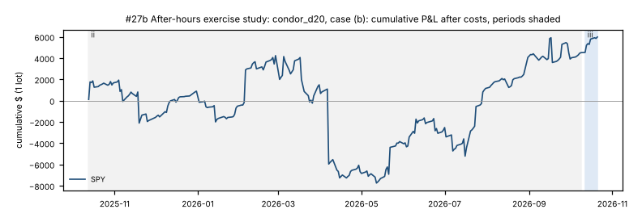

**Amendments, deviations and integrity checks.** As 27a.

**What it showed.** Inside the noise once exercise is counted.

## #28a SPXW analogue A: iron fly ±5×ratio at 15:00 and 15:30 (fly5 iron)

**Folder:** `research_notes/Compass phase 3/spxw_prereg`. **Commits:** 2820bb4 / — / 6bb230e. **Dates:** 2026-10-22.

**Hypothesis.** The ETF fly5 iron result transfers to cash-settled SPXW.

**Rule.** SPXW iron fly, wings ±5 × the SPX/SPY ratio, 15:00 and 15:30, package fill at the NBBO rounded against us to $0.05, held to cash settlement on the official SPX close.

**Fills and costs.** SPXW $1.18748 a contract each way under $1 of premium, $1.27748 at $1 and up (commission, Cboe fee, SPXW surcharge, ORF, OCC); about $4.93 to open a four-leg structure.

**Data.** SPXW 1,105 full sessions 2022-05-13 → 2026-10-21.

**Periods and holdouts.** development 2022-05 → 2024 / selection 2025 → 2026-10-09 / forward 8 sessions.

**Pass rule (as pre-registered).** (1) selection mean > 0 and block-20 lower bound > 0; (2) selection mean > 0 at +$0.05 package stress; (3) development mean > 0.

**Verdict.** FAIL: selection −$39.64 a session [−173.06, +87.48].

**Metrics** (return = % of max risk; win = P&L > 0 after fees; breakeven is a loss; the interval is audit_lib's 20-session moving-block bootstrap over the period's calendar sessions):

| name | period | trades | sessions (traded / span) | win % | avg win %, $ | avg loss %, $ | median %, $ | mean %, $ | 20-session block 95% (%; $) |
|------------------|------------------------------|---------------|---------------------|------------|------------------------|------------------------|------------------------|------------------------|------------------------------------------------|
| SPXW | development | 1,312 | 656 / 683 | 62.6 | +12.7, +487.74 | −18.3, −708.95 | +4.6, +194.57 | **+1.07**, +39.89 | [−0.13, +2.35]; [−4.35, +88.04] |
| SPXW | selection | 882 | 441 / 457 | 58.8 | +15.0, +534.43 | −22.5, −812.26 | +3.5, +149.57 | **−0.41**, −19.82 | [−2.28, +1.41]; [−87.30, +45.60] |
| SPXW | forward | 16 | 8 / 8 | 62.5 | +10.9, +432.97 | −7.7, −325.26 | +1.4, +54.07 | **+3.91**, +148.63 | n/a (< 60 sessions); n/a (< 60 sessions) |

| name | period | biggest win ($, %, date, contract) | biggest loss ($, %, date, contract) | profit factor | max DD $ | longest DD (sessions) | top-5 days' share of profit |
|------------------|------------------------------|------------------------------------------------------------------|------------------------------------------------------------------|------------|---------------|---------------|------------------------------------|
| SPXW | development | +2,462.89, +123.1%, 2022-12-14, None | −4,034.93, −100.1%, 2024-05-31, None | 1.15 | 30,003 | 272 | 29% |
| SPXW | selection | +2,568.89, +114.4%, 2026-09-16, None | −3,549.93, −100.1%, 2026-03-09, None | 0.94 | 39,380 | 422 | total ≤ 0 (best 5 days +15,018; without them −32,499) |
| SPXW | forward | +921.07, +25.4%, 2026-10-16, None | −746.93, −17.3%, 2026-10-19, None | 2.22 | 814 | 2 | 141% |

**Random baseline:** not available — no random baseline was computed by this study

**Exit reasons (share of trades):**

- development: held to cash settlement (official SPX close) 100.0%
- selection: held to cash settlement (official SPX close) 100.0%
- forward: held to cash settlement (official SPX close) 100.0%

**By year** (all periods together, labelled by entry year):

| year | name | trades | win % | mean % | mean $ | total $ |
|---|---|---|---|---|---|---|
| 2022 | SPXW | 318 | 63.5 | +3.77 | +133.26 | +42,378 |
| 2023 | SPXW | 496 | 64.5 | +1.27 | +53.62 | +26,596 |
| 2024 | SPXW | 498 | 60.0 | −0.86 | −33.41 | −16,637 |
| 2025 | SPXW | 494 | 58.9 | −0.89 | −38.92 | −19,225 |
| 2026 | SPXW | 404 | 58.9 | +0.34 | +10.20 | +4,122 |

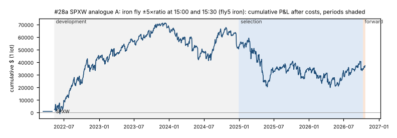

**Amendments, deviations and integrity checks.** The package rule cost nothing: the summed leg NBBO is always a multiple of $0.05.

**What it showed.** SPXW did not reproduce the ETF fly.

## #28b SPXW analogue B: 20-delta iron condor, wings 2×ratio, 13:00–15:00 (condor_d20)

**Folder:** `research_notes/Compass phase 3/spxw_prereg`. **Commits:** 2820bb4 / — / 6bb230e. **Dates:** 2026-10-22.

**Hypothesis.** As 28a for condor_d20.

**Rule.** SPXW 20-delta iron condor, wings 2 × ratio, five entries 13:00–15:00, package fill, held to cash settlement.

**Fills and costs.** SPXW $1.18748 a contract each way under $1 of premium, $1.27748 at $1 and up (commission, Cboe fee, SPXW surcharge, ORF, OCC)

**Data.** As 28a.

**Periods and holdouts.** As 28a.

**Pass rule (as pre-registered).** As 28a.

**Verdict.** FAIL: selection +$120.76 a session [−95.03, +286.78] — positive but the interval crosses zero.

**Metrics** (return = % of max risk; win = P&L > 0 after fees; breakeven is a loss; the interval is audit_lib's 20-session moving-block bootstrap over the period's calendar sessions):

| name | period | trades | sessions (traded / span) | win % | avg win %, $ | avg loss %, $ | median %, $ | mean %, $ | 20-session block 95% (%; $) |
|------------------|------------------------------|---------------|---------------------|------------|------------------------|------------------------|------------------------|------------------------|------------------------------------------------|
| SPXW | development | 3,193 | 656 / 683 | 74.4 | +16.9, +280.66 | −47.0, −785.28 | +13.0, +230.07 | **+0.49**, +7.25 | [−1.33, +2.18]; [−22.51, +35.23] |
| SPXW | selection | 2,157 | 441 / 457 | 76.8 | +17.5, +289.08 | −51.4, −849.22 | +13.4, +235.07 | **+1.49**, +24.69 | [−1.12, +3.46]; [−18.86, +57.64] |
| SPXW | forward | 38 | 8 / 8 | 89.5 | +15.4, +261.83 | −15.0, −260.91 | +14.3, +250.07 | **+12.19**, +206.80 | n/a (< 60 sessions); n/a (< 60 sessions) |

| name | period | biggest win ($, %, date, contract) | biggest loss ($, %, date, contract) | profit factor | max DD $ | longest DD (sessions) | top-5 days' share of profit |
|------------------|------------------------------|------------------------------------------------------------------|------------------------------------------------------------------|------------|---------------|---------------|------------------------------------|
| SPXW | development | +704.89, +54.6%, 2022-12-14, SPXW 13:00 3945.0/3965.0P 4105.0/4125.0C | −1,879.75, −100.3%, 2023-12-20, SPXW 13:30 4745.0/4765.0P 4785.0/4805.0C | 1.04 | 56,703 | 560 | 55% |
| SPXW | selection | +604.89, +43.5%, 2026-07-29, SPXW 13:00 7290.0/7310.0P 7430.0/7450.0C | −1,849.93, −100.3%, 2026-04-13, SPXW 14:30 6815.0/6835.0P 6860.0/6880.0C | 1.13 | 35,113 | 171 | 24% |
| SPXW | forward | +434.89, +27.9%, 2026-10-16, SPXW 13:30 7620.0/7640.0P 7695.0/7715.0C | −645.93, −37.2%, 2026-10-15, SPXW 14:30 7685.0/7705.0P 7735.0/7755.0C | 8.53 | 0 | 0 | 81% |

**Random baseline:** not available — no random baseline was computed by this study

**Exit reasons (share of trades):**

- development: held to cash settlement (official SPX close) 100.0%
- selection: held to cash settlement (official SPX close) 100.0%
- forward: held to cash settlement (official SPX close) 100.0%

**By year** (all periods together, labelled by entry year):

| year | name | trades | win % | mean % | mean $ | total $ |
|---|---|---|---|---|---|---|
| 2022 | SPXW | 794 | 73.8 | +1.30 | +19.65 | +15,600 |
| 2023 | SPXW | 1,190 | 73.4 | −0.27 | −3.94 | −4,694 |
| 2024 | SPXW | 1,209 | 75.6 | +0.69 | +10.13 | +12,244 |
| 2025 | SPXW | 1,203 | 77.1 | +1.80 | +28.21 | +33,937 |
| 2026 | SPXW | 992 | 76.9 | +1.54 | +27.40 | +27,177 |

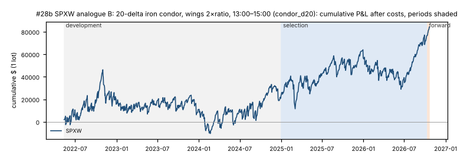

**Amendments, deviations and integrity checks.** As 28a; the ETF−SPXW late-day extrinsic gap measured beside it.

**What it showed.** Positive in both periods, inside the noise.

## #29a Picker (GeorgeFi rule), PRIMARY: opening-range fade, stop 0.68, target 1.25, 5-minute stop, flat 15:58

**Folder:** `research_notes/Compass phase 3/picker_prereg`. **Commits:** c502122 / — / 1e10053. **Dates:** 2026-10-22.

**Hypothesis.** The opening-range sweep fade the GeorgeFi cards describe makes money as written.

**Rule.** Opening range = the 09:30–09:59 bars; 10:00–11:59: the first bar with high ≥ ORH × (1 + 2 bp) and close < ORH → PUT (the low side → CALL); buy the nearest OTM 0DTE contract at the ask one bar later; exits: stop at 0.68 × ask, target 1.25 × ask (resting), out at 5 minutes unless +6% reached, flat 15:58.

**Fills and costs.** $0.68748 a contract each way (SPY, QQQ, IWM: $0.65 commission + $0.03748 pass-throughs), nothing at expiry; SPXW $1.18748 a contract each way under $1 of premium, $1.27748 at $1 and up (commission, Cboe fee, SPXW surcharge, ORF, OCC); bought at the ask, sold at the bid of the 1-minute NBBO (ThetaData); a target at its resting limit

**Data.** SPY, QQQ (846 sessions), IWM (484), SPXW (972), 2022 → 2026-10-21, the 134 GeorgeFi card dates excluded.

**Periods and holdouts.** The whole tested span (verdict) and the never-read line 2026-10-14 → 21 (no verdict). The 2022–2026 NBBO had been read by the engine audit for the same universe (disclosed).

**Pass rule (as pre-registered).** "Pass: mean > 0 with the interval clear of zero on each name, judged only on the span with the excluded dates removed" (PRIMARY only; mean % of premium, 20-session block interval; every name must pass).

**Verdict.** FAIL on every name: SPY −6.28% [−8.18, −4.41], QQQ −5.21%, IWM −9.47%, SPXW −4.96%.

**Metrics** (return = % of premium; win = P&L > 0 after fees; breakeven is a loss; the interval is audit_lib's 20-session moving-block bootstrap over the period's calendar sessions):

| name | period | trades | sessions (traded / span) | win % | avg win %, $ | avg loss %, $ | median %, $ | mean %, $ | 20-session block 95% (%; $) |
|------------------|------------------------------|---------------|---------------------|------------|------------------------|------------------------|------------------------|------------------------|------------------------------------------------|
| IWM | whole span (card dates out) | 438 | 394 / 634 | 34.9 | +21.8, +13.07 | −26.3, −14.21 | −14.1, −6.38 | **−9.47**, −4.68 | [−12.02, −7.26]; [−6.52, −3.22] |
| QQQ | whole span (card dates out) | 814 | 698 / 1,005 | 36.4 | +22.2, +28.41 | −21.1, −26.89 | −8.4, −8.88 | **−5.34**, −6.78 | [−7.05, −3.69]; [−9.68, −3.98] |
| SPXW | whole span (card dates out) | 902 | 765 / 1,135 | 36.9 | +21.8, +269.22 | −20.8, −253.15 | −7.9, −82.56 | **−5.03**, −60.30 | [−6.69, −3.51]; [−84.97, −37.22] |
| SPY | whole span (card dates out) | 771 | 660 / 1,005 | 34.4 | +21.7, +24.93 | −21.1, −23.41 | −9.3, −7.38 | **−6.37**, −6.79 | [−8.12, −4.67]; [−9.77, −4.19] |
| all names | whole span (card dates out) | 2,925 | 898 / 1,135 | 35.8 | +21.9, +101.88 | −21.8, −92.58 | −9.1, −10.38 | **−6.14**, −22.97 | [−7.36, −4.81]; [−31.17, −15.21] |
| QQQ | never-read 2026-10-14→21 | 6 | 5 / 6 | 66.7 | +24.5, +49.12 | −10.6, −20.38 | +24.4, +44.62 | **+12.77**, +25.96 | n/a (< 60 sessions); n/a (< 60 sessions) |
| SPXW | never-read 2026-10-14→21 | 6 | 5 / 6 | 50.0 | +24.9, +290.78 | −12.5, −145.89 | +10.0, +87.44 | **+6.21**, +72.44 | n/a (< 60 sessions); n/a (< 60 sessions) |
| SPY | never-read 2026-10-14→21 | 6 | 5 / 6 | 50.0 | +24.2, +25.29 | −12.5, −14.38 | +9.1, +4.62 | **+5.82**, +5.46 | n/a (< 60 sessions); n/a (< 60 sessions) |
| all names | never-read 2026-10-14→21 | 18 | 5 / 6 | 55.6 | +24.5, +114.47 | −12.0, −65.19 | +24.0, +23.12 | **+8.27**, +34.62 | n/a (< 60 sessions); n/a (< 60 sessions) |
| IWM | whole span (verdict) | 438 | 394 / 634 | 34.9 | +21.8, +13.07 | −26.3, −14.21 | −14.1, −6.38 | **−9.47**, −4.68 | [−12.02, −7.26]; [−6.52, −3.22] |
| QQQ | whole span (verdict) | 820 | 703 / 1,018 | 36.6 | +22.2, +28.68 | −21.0, −26.86 | −8.4, −8.38 | **−5.21**, −6.54 | [−7.13, −3.67]; [−9.75, −4.19] |
| SPXW | whole span (verdict) | 908 | 770 / 1,148 | 37.0 | +21.9, +269.41 | −20.7, −252.59 | −7.8, −77.56 | **−4.96**, −59.43 | [−6.73, −3.49]; [−85.73, −36.98] |
| SPY | whole span (verdict) | 777 | 665 / 1,018 | 34.5 | +21.8, +24.93 | −21.0, −23.35 | −9.1, −7.38 | **−6.28**, −6.70 | [−8.12, −4.61]; [−9.79, −4.25] |
| all names | whole span (verdict) | 2,943 | 903 / 1,148 | 35.9 | +21.9, +101.99 | −21.7, −92.46 | −9.1, −10.38 | **−6.05**, −22.62 | [−7.41, −4.82]; [−31.23, −14.52] |

| name | period | biggest win ($, %, date, contract) | biggest loss ($, %, date, contract) | profit factor | max DD $ | longest DD (sessions) | top-5 days' share of profit |
|------------------|------------------------------|------------------------------------------------------------------|------------------------------------------------------------------|------------|---------------|---------------|------------------------------------|
| IWM | whole span (card dates out) | +59.62, +24.5%, 2025-04-09, IWM 2025-04-09 176.0P | −120.38, −58.4%, 2025-04-07, IWM 2025-04-07 176.0P | 0.49 | 2,077 | 632 | total ≤ 0 (best 5 days +281; without them −2,331) |
| QQQ | whole span (card dates out) | +140.62, +24.9%, 2025-04-09, QQQ 2025-04-09 423.0P | −300.38, −51.3%, 2025-04-07, QQQ 2025-04-07 416.0P | 0.60 | 5,572 | 990 | total ≤ 0 (best 5 days +680; without them −6,198) |
| SPXW | whole span (card dates out) | +1,387.44, +25.1%, 2025-04-09, SPXW 2025-04-09 4960.0C | −2,952.55, −45.6%, 2025-04-07, SPXW 2025-04-07 4970.0P | 0.62 | 54,720 | 1,135 | total ≤ 0 (best 5 days +6,117; without them −60,512) |
| SPY | whole span (card dates out) | +127.62, +24.8%, 2025-04-09, SPY 2025-04-09 495.0C | −295.38, −45.4%, 2025-04-07, SPY 2025-04-07 495.0P | 0.56 | 5,270 | 1,005 | total ≤ 0 (best 5 days +561; without them −5,799) |
| all names | whole span (card dates out) | +1,387.44, +25.1%, 2025-04-09, SPXW 2025-04-09 4960.0C | −2,952.55, −45.6%, 2025-04-07, SPXW 2025-04-07 4970.0P | 0.61 | 67,530 | 1,135 | total ≤ 0 (best 5 days +7,296; without them −74,497) |
| QQQ | never-read 2026-10-14→21 | +53.62, +24.5%, 2026-10-15, QQQ 2026-10-15 720.0P | −35.38, −18.5%, 2026-10-19, QQQ 2026-10-19 720.0P | 4.82 | 41 | 2 | 100% |
| SPXW | never-read 2026-10-14→21 | +347.44, +25.0%, 2026-10-19, SPXW 2026-10-19 7690.0C | −222.56, −17.8%, 2026-10-14, SPXW 2026-10-14 7760.0C | 1.99 | 295 | 3 | 100% |
| SPY | never-read 2026-10-14→21 | +29.62, +23.9%, 2026-10-21, SPY 2026-10-21 770.0C | −18.38, −19.1%, 2026-10-14, SPY 2026-10-14 774.0C | 1.76 | 28 | 3 | 100% |
| all names | never-read 2026-10-14→21 | +347.44, +25.0%, 2026-10-19, SPXW 2026-10-19 7690.0C | −222.56, −17.8%, 2026-10-14, SPXW 2026-10-14 7760.0C | 2.19 | 224 | 2 | 100% |
| IWM | whole span (verdict) | +59.62, +24.5%, 2025-04-09, IWM 2025-04-09 176.0P | −120.38, −58.4%, 2025-04-07, IWM 2025-04-07 176.0P | 0.49 | 2,077 | 632 | total ≤ 0 (best 5 days +281; without them −2,331) |
| QQQ | whole span (verdict) | +140.62, +24.9%, 2025-04-09, QQQ 2025-04-09 423.0P | −300.38, −51.3%, 2025-04-07, QQQ 2025-04-07 416.0P | 0.62 | 5,572 | 1,003 | total ≤ 0 (best 5 days +680; without them −6,042) |
| SPXW | whole span (verdict) | +1,387.44, +25.1%, 2025-04-09, SPXW 2025-04-09 4960.0C | −2,952.55, −45.6%, 2025-04-07, SPXW 2025-04-07 4970.0P | 0.63 | 54,720 | 1,148 | total ≤ 0 (best 5 days +6,117; without them −60,077) |
| SPY | whole span (verdict) | +127.62, +24.8%, 2025-04-09, SPY 2025-04-09 495.0C | −295.38, −45.4%, 2025-04-07, SPY 2025-04-07 495.0P | 0.56 | 5,270 | 1,018 | total ≤ 0 (best 5 days +561; without them −5,766) |
| all names | whole span (verdict) | +1,387.44, +25.1%, 2025-04-09, SPXW 2025-04-09 4960.0C | −2,952.55, −45.6%, 2025-04-07, SPXW 2025-04-07 4970.0P | 0.62 | 67,530 | 1,148 | total ≤ 0 (best 5 days +7,296; without them −73,874) |

**Random baseline:** not available — no random baseline was computed by this study

**Exit reasons (share of trades):**

- whole span (card dates out): time5 47.2%; target 32.1%; stop 20.7%
- never-read 2026-10-14→21: target 55.6%; time5 44.4%

**By year** (all periods together, labelled by entry year):

| year | name | trades | win % | mean % | mean $ | total $ |
|---|---|---|---|---|---|---|
| 2024 | IWM | 152 | 28.9 | −12.08 | −6.01 | −913 |
| 2025 | IWM | 232 | 37.9 | −7.97 | −3.56 | −827 |
| 2026 | IWM | 54 | 38.9 | −8.57 | −5.75 | −310 |
| 2022 | QQQ | 30 | 36.7 | −4.19 | −3.21 | −96 |
| 2023 | QQQ | 248 | 38.7 | −3.64 | −2.77 | −687 |
| 2024 | QQQ | 244 | 33.2 | −6.55 | −8.47 | −2,066 |
| 2025 | QQQ | 233 | 38.2 | −4.78 | −7.64 | −1,780 |
| 2026 | QQQ | 65 | 35.4 | −8.19 | −11.27 | −732 |
| 2022 | SPXW | 164 | 40.9 | −3.28 | −41.70 | −6,839 |
| 2023 | SPXW | 240 | 41.7 | −3.18 | −25.76 | −6,183 |
| 2024 | SPXW | 228 | 28.5 | −7.33 | −75.63 | −17,243 |
| 2025 | SPXW | 213 | 36.2 | −5.64 | −88.47 | −18,844 |
| 2026 | SPXW | 63 | 42.9 | −5.25 | −77.00 | −4,851 |
| 2022 | SPY | 33 | 30.3 | −11.01 | −11.59 | −382 |
| 2023 | SPY | 240 | 39.2 | −3.96 | −2.35 | −565 |
| 2024 | SPY | 228 | 26.8 | −8.69 | −8.13 | −1,854 |
| 2025 | SPY | 213 | 35.7 | −5.99 | −9.06 | −1,929 |
| 2026 | SPY | 63 | 42.9 | −4.85 | −7.53 | −475 |
| 2022 | all names | 227 | 38.8 | −4.52 | −32.24 | −7,318 |
| 2023 | all names | 728 | 39.8 | −3.59 | −10.21 | −7,435 |
| 2024 | all names | 852 | 29.5 | −8.32 | −25.91 | −22,077 |
| 2025 | all names | 891 | 37.0 | −6.10 | −26.24 | −23,380 |
| 2026 | all names | 245 | 40.0 | −6.66 | −25.99 | −6,368 |

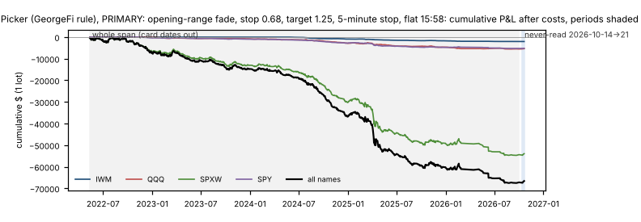

**Amendments, deviations and integrity checks.** verify_picker.py re-derives trades from the raw files; the flow gate had one session of data (0 trades gated).

**What it showed.** The fade loses 5–9% of premium a trade on every name.

## #29b Picker, SECONDARY: the narrative's +6% breakeven lock and VIX trail

**Folder:** `research_notes/Compass phase 3/picker_prereg`. **Commits:** c502122 / — / 1e10053. **Dates:** 2026-10-22.

**Hypothesis.** The vendor's narrative exits rescue the rule.

**Rule.** Opening range = the 09:30–09:59 bars; 10:00–11:59: the first bar with high ≥ ORH × (1 + 2 bp) and close < ORH → PUT (the low side → CALL); buy the nearest OTM 0DTE contract at the ask one bar later; exits: stop, target, breakeven lock at +6%, VIX-scaled trail, flat 15:58.

**Fills and costs.** $0.68748 a contract each way (SPY, QQQ, IWM: $0.65 commission + $0.03748 pass-throughs), nothing at expiry; SPXW $1.18748 a contract each way under $1 of premium, $1.27748 at $1 and up (commission, Cboe fee, SPXW surcharge, ORF, OCC); bought at the ask, sold at the bid of the 1-minute NBBO (ThetaData); a target at its resting limit

**Data.** SPY, QQQ (846 sessions), IWM (484), SPXW (972), 2022 → 2026-10-21, the 134 GeorgeFi card dates excluded.

**Periods and holdouts.** The whole tested span (verdict) and the never-read line 2026-10-14 → 21 (no verdict). The 2022–2026 NBBO had been read by the engine audit for the same universe (disclosed).

**Pass rule (as pre-registered).** No verdict of its own (labelled).

**Verdict.** Labelled: SPY −6.29%, QQQ −5.44%, IWM −9.91%, SPXW −5.01%.

**Metrics** (return = % of premium; win = P&L > 0 after fees; breakeven is a loss; the interval is audit_lib's 20-session moving-block bootstrap over the period's calendar sessions):

| name | period | trades | sessions (traded / span) | win % | avg win %, $ | avg loss %, $ | median %, $ | mean %, $ | 20-session block 95% (%; $) |
|------------------|------------------------------|---------------|---------------------|------------|------------------------|------------------------|------------------------|------------------------|------------------------------------------------|
| IWM | whole span (card dates out) | 438 | 394 / 634 | 33.8 | +17.8, +10.60 | −24.1, −12.28 | −6.5, −3.38 | **−9.91**, −4.55 | [−12.27, −7.73]; [−5.94, −3.29] |
| QQQ | whole span (card dates out) | 814 | 698 / 1,005 | 42.3 | +16.8, +21.58 | −22.0, −26.71 | −2.0, −2.38 | **−5.59**, −6.30 | [−6.92, −4.02]; [−8.45, −3.87] |
| SPXW | whole span (card dates out) | 902 | 765 / 1,135 | 41.4 | +16.5, +210.61 | −20.1, −243.10 | −1.6, −12.55 | **−4.98**, −55.48 | [−6.45, −3.38]; [−72.59, −35.73] |
| SPY | whole span (card dates out) | 771 | 660 / 1,005 | 38.4 | +16.6, +19.60 | −20.5, −22.36 | −3.0, −2.38 | **−6.25**, −6.25 | [−8.05, −4.65]; [−8.21, −4.43] |
| all names | whole span (card dates out) | 2,925 | 898 / 1,135 | 39.7 | +16.8, +80.41 | −21.4, −88.06 | −2.7, −3.38 | **−6.22**, −21.19 | [−7.32, −4.97]; [−26.53, −14.47] |
| QQQ | never-read 2026-10-14→21 | 6 | 5 / 6 | 83.3 | +24.5, +49.02 | −33.2, −63.38 | +24.5, +47.12 | **+14.87**, +30.29 | n/a (< 60 sessions); n/a (< 60 sessions) |
| SPXW | never-read 2026-10-14→21 | 6 | 5 / 6 | 33.3 | +25.0, +312.44 | −26.9, −335.05 | −17.7, −187.56 | **−9.60**, −119.22 | n/a (< 60 sessions); n/a (< 60 sessions) |
| SPY | never-read 2026-10-14→21 | 6 | 5 / 6 | 33.3 | +24.2, +28.62 | −28.5, −35.62 | −19.7, −18.38 | **−10.95**, −14.21 | n/a (< 60 sessions); n/a (< 60 sessions) |
| all names | never-read 2026-10-14→21 | 18 | 5 / 6 | 50.0 | +24.5, +103.03 | −28.3, −171.79 | +10.3, +11.62 | **−1.89**, −34.38 | n/a (< 60 sessions); n/a (< 60 sessions) |
| IWM | whole span (verdict) | 438 | 394 / 634 | 33.8 | +17.8, +10.60 | −24.1, −12.28 | −6.5, −3.38 | **−9.91**, −4.55 | [−12.27, −7.73]; [−5.94, −3.29] |
| QQQ | whole span (verdict) | 820 | 703 / 1,018 | 42.6 | +16.9, +21.97 | −22.0, −26.79 | −2.0, −2.38 | **−5.44**, −6.03 | [−7.06, −4.10]; [−8.63, −4.07] |
| SPXW | whole span (verdict) | 908 | 770 / 1,148 | 41.3 | +16.6, +211.15 | −20.2, −243.79 | −1.7, −17.55 | **−5.01**, −55.90 | [−6.58, −3.47]; [−73.81, −37.26] |
| SPY | whole span (verdict) | 777 | 665 / 1,018 | 38.4 | +16.6, +19.66 | −20.6, −22.47 | −3.0, −2.38 | **−6.29**, −6.31 | [−8.04, −4.75]; [−8.37, −4.54] |
| all names | whole span (verdict) | 2,943 | 903 / 1,148 | 39.8 | +16.8, +80.58 | −21.4, −88.48 | −2.7, −3.38 | **−6.20**, −21.27 | [−7.38, −5.02]; [−26.92, −14.94] |

| name | period | biggest win ($, %, date, contract) | biggest loss ($, %, date, contract) | profit factor | max DD $ | longest DD (sessions) | top-5 days' share of profit |
|------------------|------------------------------|------------------------------------------------------------------|------------------------------------------------------------------|------------|---------------|---------------|------------------------------------|
| IWM | whole span (card dates out) | +59.62, +24.5%, 2025-04-09, IWM 2025-04-09 176.0P | −60.38, −40.0%, 2024-08-05, IWM 2024-08-05 199.0P | 0.44 | 2,010 | 632 | total ≤ 0 (best 5 days +214; without them −2,205) |
| QQQ | whole span (card dates out) | +140.62, +24.9%, 2025-04-09, QQQ 2025-04-09 423.0P | −140.38, −34.9%, 2025-04-08, QQQ 2025-04-08 440.0P | 0.59 | 5,174 | 1,001 | total ≤ 0 (best 5 days +606; without them −5,736) |
| SPXW | whole span (card dates out) | +1,387.44, +25.1%, 2025-04-09, SPXW 2025-04-09 4960.0C | −1,182.56, −34.4%, 2025-04-23, SPXW 2025-04-23 5445.0P | 0.61 | 50,045 | 1,135 | total ≤ 0 (best 5 days +5,590; without them −55,634) |
| SPY | whole span (card dates out) | +127.62, +24.8%, 2025-04-09, SPY 2025-04-09 495.0C | −110.38, −35.2%, 2025-04-23, SPY 2025-04-23 542.0P | 0.55 | 4,923 | 913 | total ≤ 0 (best 5 days +522; without them −5,340) |
| all names | whole span (card dates out) | +1,387.44, +25.1%, 2025-04-09, SPXW 2025-04-09 4960.0C | −1,182.56, −34.4%, 2025-04-23, SPXW 2025-04-23 5445.0P | 0.60 | 61,983 | 1,135 | total ≤ 0 (best 5 days +6,242; without them −68,225) |
| QQQ | never-read 2026-10-14→21 | +53.62, +24.5%, 2026-10-15, QQQ 2026-10-15 720.0P | −63.38, −33.2%, 2026-10-19, QQQ 2026-10-19 720.0P | 3.87 | 15 | 2 | 100% |
| SPXW | never-read 2026-10-14→21 | +347.44, +25.0%, 2026-10-19, SPXW 2026-10-19 7690.0C | −562.55, −36.1%, 2026-10-15, SPXW 2026-10-15 7695.0P | 0.47 | 998 | 6 | total ≤ 0 (best 5 days −715; without them +0) |
| SPY | never-read 2026-10-14→21 | +29.62, +23.9%, 2026-10-21, SPY 2026-10-21 770.0C | −58.38, −35.2%, 2026-10-15, SPY 2026-10-15 767.0P | 0.40 | 95 | 6 | total ≤ 0 (best 5 days −85; without them +0) |
| all names | never-read 2026-10-14→21 | +347.44, +25.0%, 2026-10-19, SPXW 2026-10-19 7690.0C | −562.55, −36.1%, 2026-10-15, SPXW 2026-10-15 7695.0P | 0.60 | 957 | 6 | total ≤ 0 (best 5 days −619; without them −0) |
| IWM | whole span (verdict) | +59.62, +24.5%, 2025-04-09, IWM 2025-04-09 176.0P | −60.38, −40.0%, 2024-08-05, IWM 2024-08-05 199.0P | 0.44 | 2,010 | 632 | total ≤ 0 (best 5 days +214; without them −2,205) |
| QQQ | whole span (verdict) | +140.62, +24.9%, 2025-04-09, QQQ 2025-04-09 423.0P | −140.38, −34.9%, 2025-04-08, QQQ 2025-04-08 440.0P | 0.61 | 5,174 | 1,014 | total ≤ 0 (best 5 days +606; without them −5,554) |
| SPXW | whole span (verdict) | +1,387.44, +25.1%, 2025-04-09, SPXW 2025-04-09 4960.0C | −1,182.56, −34.4%, 2025-04-23, SPXW 2025-04-23 5445.0P | 0.61 | 51,042 | 1,148 | total ≤ 0 (best 5 days +5,590; without them −56,350) |
| SPY | whole span (verdict) | +127.62, +24.8%, 2025-04-09, SPY 2025-04-09 495.0C | −110.38, −35.2%, 2025-04-23, SPY 2025-04-23 542.0P | 0.54 | 5,018 | 926 | total ≤ 0 (best 5 days +522; without them −5,425) |
| all names | whole span (verdict) | +1,387.44, +25.1%, 2025-04-09, SPXW 2025-04-09 4960.0C | −1,182.56, −34.4%, 2025-04-23, SPXW 2025-04-23 5445.0P | 0.60 | 62,940 | 1,148 | total ≤ 0 (best 5 days +6,242; without them −68,844) |

**Random baseline:** not available — no random baseline was computed by this study

**Exit reasons (share of trades):**

- whole span (card dates out): stop 30.8%; lock 27.4%; target 25.0%; trail 16.9%
- never-read 2026-10-14→21: target 50.0%; stop 38.9%; lock 11.1%

**By year** (all periods together, labelled by entry year):

| year | name | trades | win % | mean % | mean $ | total $ |
|---|---|---|---|---|---|---|
| 2024 | IWM | 152 | 32.2 | −11.22 | −5.28 | −803 |
| 2025 | IWM | 232 | 33.2 | −9.70 | −4.18 | −970 |
| 2026 | IWM | 54 | 40.7 | −7.14 | −4.04 | −218 |
| 2022 | QQQ | 30 | 40.0 | −4.56 | −2.71 | −81 |
| 2023 | QQQ | 248 | 46.8 | −4.85 | −3.95 | −980 |
| 2024 | QQQ | 244 | 38.1 | −7.23 | −8.31 | −2,026 |
| 2025 | QQQ | 233 | 44.6 | −3.87 | −4.93 | −1,148 |
| 2026 | QQQ | 65 | 36.9 | −6.99 | −10.96 | −712 |
| 2022 | SPXW | 164 | 36.6 | −3.38 | −44.99 | −7,379 |
| 2023 | SPXW | 240 | 46.2 | −3.54 | −27.31 | −6,553 |
| 2024 | SPXW | 228 | 41.2 | −6.30 | −76.68 | −17,483 |
| 2025 | SPXW | 213 | 41.3 | −5.52 | −64.62 | −13,764 |
| 2026 | SPXW | 63 | 34.9 | −8.42 | −88.59 | −5,581 |
| 2022 | SPY | 33 | 36.4 | −2.74 | −2.41 | −79 |
| 2023 | SPY | 240 | 39.6 | −4.94 | −3.16 | −758 |
| 2024 | SPY | 228 | 37.3 | −7.34 | −7.90 | −1,800 |
| 2025 | SPY | 213 | 40.4 | −6.34 | −7.71 | −1,643 |
| 2026 | SPY | 63 | 31.7 | −9.30 | −9.87 | −622 |
| 2022 | all names | 227 | 37.0 | −3.44 | −33.21 | −7,540 |
| 2023 | all names | 728 | 44.2 | −4.45 | −11.39 | −8,291 |
| 2024 | all names | 852 | 37.7 | −7.72 | −25.95 | −22,113 |
| 2025 | all names | 891 | 39.8 | −6.37 | −19.67 | −17,525 |
| 2026 | all names | 245 | 35.9 | −7.98 | −29.12 | −7,133 |

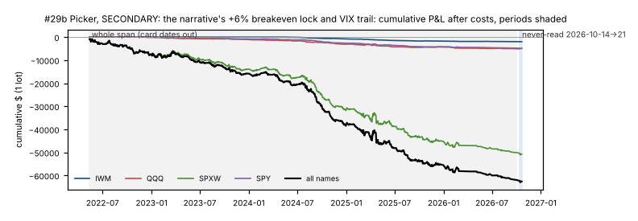

**Amendments, deviations and integrity checks.** As 29a.

**What it showed.** The narrative exits change nothing.

## #29c Picker, S2: "5 minutes" as a hard exit

**Folder:** `research_notes/Compass phase 3/picker_prereg`. **Commits:** c502122 / — / 1e10053. **Dates:** 2026-10-22.

**Hypothesis.** Reading the 5-minute rule as a hard exit helps.

**Rule.** Opening range = the 09:30–09:59 bars; 10:00–11:59: the first bar with high ≥ ORH × (1 + 2 bp) and close < ORH → PUT (the low side → CALL); buy the nearest OTM 0DTE contract at the ask one bar later; exit at 5 minutes, or the stop/target first.

**Fills and costs.** $0.68748 a contract each way (SPY, QQQ, IWM: $0.65 commission + $0.03748 pass-throughs), nothing at expiry; SPXW $1.18748 a contract each way under $1 of premium, $1.27748 at $1 and up (commission, Cboe fee, SPXW surcharge, ORF, OCC); bought at the ask, sold at the bid of the 1-minute NBBO (ThetaData); a target at its resting limit

**Data.** SPY, QQQ (846 sessions), IWM (484), SPXW (972), 2022 → 2026-10-21, the 134 GeorgeFi card dates excluded.

**Periods and holdouts.** The whole tested span (verdict) and the never-read line 2026-10-14 → 21 (no verdict). The 2022–2026 NBBO had been read by the engine audit for the same universe (disclosed).

**Pass rule (as pre-registered).** Sensitivity, no verdict.

**Verdict.** Labelled: SPY −4.20%, QQQ −3.64%, IWM −7.42%, SPXW −3.10%.

**Metrics** (return = % of premium; win = P&L > 0 after fees; breakeven is a loss; the interval is audit_lib's 20-session moving-block bootstrap over the period's calendar sessions):

| name | period | trades | sessions (traded / span) | win % | avg win %, $ | avg loss %, $ | median %, $ | mean %, $ | 20-session block 95% (%; $) |
|------------------|------------------------------|---------------|---------------------|------------|------------------------|------------------------|------------------------|------------------------|------------------------------------------------|
| IWM | whole span (card dates out) | 438 | 394 / 634 | 35.8 | +15.0, +8.80 | −19.9, −10.28 | −8.6, −3.38 | **−7.42**, −3.44 | [−9.45, −5.42]; [−4.94, −2.11] |
| QQQ | whole span (card dates out) | 814 | 698 / 1,005 | 38.9 | +14.5, +18.77 | −15.4, −19.27 | −4.8, −5.38 | **−3.76**, −4.46 | [−4.96, −2.44]; [−6.28, −2.37] |
| SPXW | whole span (card dates out) | 902 | 765 / 1,135 | 40.4 | +13.6, +172.58 | −14.4, −172.74 | −4.0, −42.55 | **−3.11**, −33.39 | [−4.33, −1.87]; [−47.88, −17.58] |
| SPY | whole span (card dates out) | 771 | 660 / 1,005 | 36.4 | +13.7, +16.05 | −14.5, −15.63 | −5.2, −4.38 | **−4.21**, −4.08 | [−5.64, −2.91]; [−5.65, −2.45] |
| all names | whole span (card dates out) | 2,925 | 898 / 1,135 | 38.3 | +14.1, +66.72 | −15.6, −62.60 | −4.8, −5.38 | **−4.23**, −13.13 | [−5.22, −3.18]; [−17.87, −7.66] |
| QQQ | never-read 2026-10-14→21 | 6 | 5 / 6 | 66.7 | +24.5, +49.12 | −10.6, −20.38 | +24.4, +44.62 | **+12.77**, +25.96 | n/a (< 60 sessions); n/a (< 60 sessions) |
| SPXW | never-read 2026-10-14→21 | 6 | 5 / 6 | 33.3 | +15.0, +177.44 | −10.2, −117.56 | −4.0, −52.56 | **−1.78**, −19.22 | n/a (< 60 sessions); n/a (< 60 sessions) |
| SPY | never-read 2026-10-14→21 | 6 | 5 / 6 | 33.3 | +13.7, +16.62 | −10.8, −11.88 | −5.7, −6.88 | **−2.63**, −2.38 | n/a (< 60 sessions); n/a (< 60 sessions) |
| all names | never-read 2026-10-14→21 | 18 | 5 / 6 | 44.4 | +19.4, +73.08 | −10.5, −55.85 | −3.0, −4.88 | **+2.79**, +1.45 | n/a (< 60 sessions); n/a (< 60 sessions) |
| IWM | whole span (verdict) | 438 | 394 / 634 | 35.8 | +15.0, +8.80 | −19.9, −10.28 | −8.6, −3.38 | **−7.42**, −3.44 | [−9.45, −5.42]; [−4.94, −2.11] |
| QQQ | whole span (verdict) | 820 | 703 / 1,018 | 39.1 | +14.7, +19.15 | −15.4, −19.27 | −4.7, −5.38 | **−3.64**, −4.23 | [−4.99, −2.47]; [−6.40, −2.42] |
| SPXW | whole span (verdict) | 908 | 770 / 1,148 | 40.3 | +13.6, +172.61 | −14.4, −172.33 | −4.0, −42.55 | **−3.10**, −33.29 | [−4.46, −1.80]; [−48.84, −17.23] |
| SPY | whole span (verdict) | 777 | 665 / 1,018 | 36.4 | +13.7, +16.05 | −14.5, −15.60 | −5.2, −4.38 | **−4.20**, −4.07 | [−5.61, −2.85]; [−5.69, −2.44] |
| all names | whole span (verdict) | 2,943 | 903 / 1,148 | 38.3 | +14.1, +66.77 | −15.6, −62.56 | −4.8, −5.38 | **−4.18**, −13.04 | [−5.32, −3.14]; [−18.40, −7.47] |

| name | period | biggest win ($, %, date, contract) | biggest loss ($, %, date, contract) | profit factor | max DD $ | longest DD (sessions) | top-5 days' share of profit |
|------------------|------------------------------|------------------------------------------------------------------|------------------------------------------------------------------|------------|---------------|---------------|------------------------------------|
| IWM | whole span (card dates out) | +32.62, +13.4%, 2025-04-09, IWM 2025-04-09 176.0P | −48.38, −40.7%, 2026-02-13, IWM 2026-02-13 261.0P | 0.48 | 1,520 | 632 | total ≤ 0 (best 5 days +175; without them −1,683) |
| QQQ | whole span (card dates out) | +82.62, +24.8%, 2025-03-11, QQQ 2025-03-11 472.0C | −101.38, −39.9%, 2026-02-20, QQQ 2026-02-20 604.0P | 0.62 | 3,627 | 1,005 | total ≤ 0 (best 5 days +512; without them −4,139) |
| SPXW | whole span (card dates out) | +907.45, +16.4%, 2025-04-09, SPXW 2025-04-09 4960.0C | −992.55, −34.1%, 2026-02-05, SPXW 2026-02-05 6810.0C | 0.68 | 30,589 | 1,038 | total ≤ 0 (best 5 days +4,437; without them −34,552) |
| SPY | whole span (card dates out) | +87.62, +17.0%, 2025-04-09, SPY 2025-04-09 495.0C | −98.38, −32.9%, 2026-02-05, SPY 2026-02-05 679.0C | 0.59 | 3,274 | 914 | total ≤ 0 (best 5 days +401; without them −3,549) |
| all names | whole span (card dates out) | +907.45, +16.4%, 2025-04-09, SPXW 2025-04-09 4960.0C | −992.55, −34.1%, 2026-02-05, SPXW 2026-02-05 6810.0C | 0.66 | 38,812 | 1,038 | total ≤ 0 (best 5 days +4,920; without them −43,319) |
| QQQ | never-read 2026-10-14→21 | +53.62, +24.5%, 2026-10-15, QQQ 2026-10-15 720.0P | −35.38, −18.5%, 2026-10-19, QQQ 2026-10-19 720.0P | 4.82 | 41 | 2 | 100% |
| SPXW | never-read 2026-10-14→21 | +247.44, +22.3%, 2026-10-21, SPXW 2026-10-21 7725.0C | −222.56, −17.8%, 2026-10-14, SPXW 2026-10-14 7760.0C | 0.75 | 328 | 6 | total ≤ 0 (best 5 days −115; without them +0) |
| SPY | never-read 2026-10-14→21 | +24.62, +19.9%, 2026-10-21, SPY 2026-10-21 770.0C | −18.38, −19.1%, 2026-10-14, SPY 2026-10-14 774.0C | 0.70 | 32 | 6 | total ≤ 0 (best 5 days −14; without them +0) |
| all names | never-read 2026-10-14→21 | +247.44, +22.3%, 2026-10-21, SPXW 2026-10-21 7725.0C | −222.56, −17.8%, 2026-10-14, SPXW 2026-10-14 7760.0C | 1.05 | 224 | 5 | 100% |
| IWM | whole span (verdict) | +32.62, +13.4%, 2025-04-09, IWM 2025-04-09 176.0P | −48.38, −40.7%, 2026-02-13, IWM 2026-02-13 261.0P | 0.48 | 1,520 | 632 | total ≤ 0 (best 5 days +175; without them −1,683) |
| QQQ | whole span (verdict) | +82.62, +24.8%, 2025-03-11, QQQ 2025-03-11 472.0C | −101.38, −39.9%, 2026-02-20, QQQ 2026-02-20 604.0P | 0.64 | 3,627 | 1,018 | total ≤ 0 (best 5 days +512; without them −3,983) |
| SPXW | whole span (verdict) | +907.45, +16.4%, 2025-04-09, SPXW 2025-04-09 4960.0C | −992.55, −34.1%, 2026-02-05, SPXW 2026-02-05 6810.0C | 0.68 | 30,812 | 1,051 | total ≤ 0 (best 5 days +4,437; without them −34,667) |
| SPY | whole span (verdict) | +87.62, +17.0%, 2025-04-09, SPY 2025-04-09 495.0C | −98.38, −32.9%, 2026-02-05, SPY 2026-02-05 679.0C | 0.59 | 3,298 | 927 | total ≤ 0 (best 5 days +401; without them −3,563) |
| all names | whole span (verdict) | +907.45, +16.4%, 2025-04-09, SPXW 2025-04-09 4960.0C | −992.55, −34.1%, 2026-02-05, SPXW 2026-02-05 6810.0C | 0.66 | 38,991 | 1,051 | total ≤ 0 (best 5 days +4,920; without them −43,292) |

**Random baseline:** not available — no random baseline was computed by this study

**Exit reasons (share of trades):**

- whole span (card dates out): time5 80.8%; target 13.2%; stop 6.0%
- never-read 2026-10-14→21: time5 77.8%; target 22.2%

**By year** (all periods together, labelled by entry year):

| year | name | trades | win % | mean % | mean $ | total $ |
|---|---|---|---|---|---|---|
| 2024 | IWM | 152 | 29.6 | −10.15 | −5.22 | −794 |
| 2025 | IWM | 232 | 40.1 | −5.41 | −1.88 | −436 |
| 2026 | IWM | 54 | 35.2 | −8.37 | −5.15 | −278 |
| 2022 | QQQ | 30 | 36.7 | −2.27 | −1.41 | −42 |
| 2023 | QQQ | 248 | 41.9 | −2.69 | −2.10 | −521 |
| 2024 | QQQ | 244 | 36.1 | −4.88 | −5.92 | −1,446 |
| 2025 | QQQ | 233 | 42.1 | −2.49 | −2.73 | −636 |
| 2026 | QQQ | 65 | 30.8 | −7.32 | −12.71 | −826 |
| 2022 | SPXW | 164 | 45.7 | −1.49 | −20.18 | −3,309 |
| 2023 | SPXW | 240 | 42.9 | −2.73 | −15.81 | −3,793 |
| 2024 | SPXW | 228 | 34.2 | −3.91 | −46.37 | −10,573 |
| 2025 | SPXW | 213 | 39.0 | −3.45 | −41.29 | −8,794 |
| 2026 | SPXW | 63 | 42.9 | −4.62 | −59.70 | −3,761 |
| 2022 | SPY | 33 | 39.4 | −5.32 | −5.77 | −190 |
| 2023 | SPY | 240 | 38.8 | −3.46 | −1.79 | −430 |
| 2024 | SPY | 228 | 31.6 | −4.76 | −4.87 | −1,110 |
| 2025 | SPY | 213 | 37.6 | −3.95 | −4.82 | −1,027 |
| 2026 | SPY | 63 | 39.7 | −5.24 | −6.42 | −405 |
| 2022 | all names | 227 | 43.6 | −2.15 | −15.60 | −3,542 |
| 2023 | all names | 728 | 41.2 | −2.96 | −6.52 | −4,744 |
| 2024 | all names | 852 | 33.2 | −5.53 | −16.34 | −13,923 |
| 2025 | all names | 891 | 39.7 | −3.83 | −12.23 | −10,893 |
| 2026 | all names | 245 | 37.1 | −6.32 | −21.51 | −5,270 |

**Amendments, deviations and integrity checks.** As 29a.

**What it showed.** Shorter holds lose less, still lose.

## #29d Picker, S3: SPXW rides to the official close when in the money at 15:58

**Folder:** `research_notes/Compass phase 3/picker_prereg`. **Commits:** c502122 / — / 1e10053. **Dates:** 2026-10-22.

**Hypothesis.** SPXW's cash settlement adds value.

**Rule.** Opening range = the 09:30–09:59 bars; 10:00–11:59: the first bar with high ≥ ORH × (1 + 2 bp) and close < ORH → PUT (the low side → CALL); buy the nearest OTM 0DTE contract at the ask one bar later; SPXW only; ITM at 15:58 → settle.

**Fills and costs.** $0.68748 a contract each way (SPY, QQQ, IWM: $0.65 commission + $0.03748 pass-throughs), nothing at expiry; SPXW $1.18748 a contract each way under $1 of premium, $1.27748 at $1 and up (commission, Cboe fee, SPXW surcharge, ORF, OCC); bought at the ask, sold at the bid of the 1-minute NBBO (ThetaData); a target at its resting limit

**Data.** SPY, QQQ (846 sessions), IWM (484), SPXW (972), 2022 → 2026-10-21, the 134 GeorgeFi card dates excluded.

**Periods and holdouts.** The whole tested span (verdict) and the never-read line 2026-10-14 → 21 (no verdict). The 2022–2026 NBBO had been read by the engine audit for the same universe (disclosed).

**Pass rule (as pre-registered).** Sensitivity, no verdict.

**Verdict.** Labelled: identical to PRIMARY (no trade was open at 15:58).

**Metrics** (return = % of premium; win = P&L > 0 after fees; breakeven is a loss; the interval is audit_lib's 20-session moving-block bootstrap over the period's calendar sessions):

| name | period | trades | sessions (traded / span) | win % | avg win %, $ | avg loss %, $ | median %, $ | mean %, $ | 20-session block 95% (%; $) |
|------------------|------------------------------|---------------|---------------------|------------|------------------------|------------------------|------------------------|------------------------|------------------------------------------------|
| SPXW | whole span (card dates out) | 902 | 765 / 1,135 | 36.9 | +21.8, +269.22 | −20.8, −253.15 | −7.9, −82.56 | **−5.03**, −60.30 | [−6.69, −3.51]; [−84.97, −37.22] |
| SPXW | never-read 2026-10-14→21 | 6 | 5 / 6 | 50.0 | +24.9, +290.78 | −12.5, −145.89 | +10.0, +87.44 | **+6.21**, +72.44 | n/a (< 60 sessions); n/a (< 60 sessions) |
| SPXW | whole span (verdict) | 908 | 770 / 1,148 | 37.0 | +21.9, +269.41 | −20.7, −252.59 | −7.8, −77.56 | **−4.96**, −59.43 | [−6.73, −3.49]; [−85.73, −36.98] |

| name | period | biggest win ($, %, date, contract) | biggest loss ($, %, date, contract) | profit factor | max DD $ | longest DD (sessions) | top-5 days' share of profit |
|------------------|------------------------------|------------------------------------------------------------------|------------------------------------------------------------------|------------|---------------|---------------|------------------------------------|
| SPXW | whole span (card dates out) | +1,387.44, +25.1%, 2025-04-09, SPXW 2025-04-09 4960.0C | −2,952.55, −45.6%, 2025-04-07, SPXW 2025-04-07 4970.0P | 0.62 | 54,720 | 1,135 | total ≤ 0 (best 5 days +6,117; without them −60,512) |
| SPXW | never-read 2026-10-14→21 | +347.44, +25.0%, 2026-10-19, SPXW 2026-10-19 7690.0C | −222.56, −17.8%, 2026-10-14, SPXW 2026-10-14 7760.0C | 1.99 | 295 | 3 | 100% |
| SPXW | whole span (verdict) | +1,387.44, +25.1%, 2025-04-09, SPXW 2025-04-09 4960.0C | −2,952.55, −45.6%, 2025-04-07, SPXW 2025-04-07 4970.0P | 0.63 | 54,720 | 1,148 | total ≤ 0 (best 5 days +6,117; without them −60,077) |

**Random baseline:** not available — no random baseline was computed by this study

**Exit reasons (share of trades):**

- whole span (card dates out): time5 48.9%; target 31.5%; stop 19.6%
- never-read 2026-10-14→21: time5 50.0%; target 50.0%

**By year** (all periods together, labelled by entry year):

| year | name | trades | win % | mean % | mean $ | total $ |
|---|---|---|---|---|---|---|
| 2022 | SPXW | 164 | 40.9 | −3.28 | −41.70 | −6,839 |
| 2023 | SPXW | 240 | 41.7 | −3.18 | −25.76 | −6,183 |
| 2024 | SPXW | 228 | 28.5 | −7.33 | −75.63 | −17,243 |
| 2025 | SPXW | 213 | 36.2 | −5.64 | −88.47 | −18,844 |
| 2026 | SPXW | 63 | 42.9 | −5.25 | −77.00 | −4,851 |

**Amendments, deviations and integrity checks.** As 29a.

**What it showed.** No trade reached 15:58.

## #29e Picker, IMPROVED (picked on the cards): PDH sweep → put, 10:00–12:00, +25% or 5 minutes

**Folder:** `research_notes/Compass phase 3/picker_prereg`. **Commits:** c502122 / — / 1e10053. **Dates:** 2026-10-22.

**Hypothesis.** The owner's "improved" parameters, traced to the cards, work.

**Rule.** SPXW/SPY/IWM: prior-day-high sweep → put, 10:00–12:00, sell at +25% or at 5 minutes.

**Fills and costs.** $0.68748 a contract each way (SPY, QQQ, IWM: $0.65 commission + $0.03748 pass-throughs), nothing at expiry; SPXW $1.18748 a contract each way under $1 of premium, $1.27748 at $1 and up (commission, Cboe fee, SPXW surcharge, ORF, OCC); bought at the ask, sold at the bid of the 1-minute NBBO (ThetaData); a target at its resting limit

**Data.** SPY, QQQ (846 sessions), IWM (484), SPXW (972), 2022 → 2026-10-21, the 134 GeorgeFi card dates excluded.

**Periods and holdouts.** The whole tested span (verdict) and the never-read line 2026-10-14 → 21 (no verdict). The 2022–2026 NBBO had been read by the engine audit for the same universe (disclosed).

**Pass rule (as pre-registered).** Labelled, never pooled; the owner's rule shown for reading only.

**Verdict.** FAIL on every name (read only): SPXW −3.81% [−6.76, −0.95], SPY −4.77%, IWM −10.38%.

**Metrics** (return = % of premium; win = P&L > 0 after fees; breakeven is a loss; the interval is audit_lib's 20-session moving-block bootstrap over the period's calendar sessions):

| name | period | trades | sessions (traded / span) | win % | avg win %, $ | avg loss %, $ | median %, $ | mean %, $ | 20-session block 95% (%; $) |
|------------------|------------------------------|---------------|---------------------|------------|------------------------|------------------------|------------------------|------------------------|------------------------------------------------|
| IWM | whole span (card dates out) | 106 | 106 / 615 | 34.9 | +13.8, +7.95 | −23.4, −12.32 | −11.2, −5.38 | **−10.38**, −5.24 | [−14.45, −6.32]; [−8.72, −2.14] |
| SPXW | whole span (card dates out) | 217 | 217 / 1,105 | 40.1 | +16.9, +196.64 | −17.9, −198.02 | −6.3, −62.55 | **−3.95**, −39.79 | [−6.85, −1.03]; [−77.49, −3.10] |
| SPY | whole span (card dates out) | 191 | 191 / 977 | 38.7 | +16.7, +17.98 | −18.6, −18.62 | −8.2, −6.38 | **−4.92**, −4.44 | [−7.55, −1.17]; [−7.75, −0.03] |
| all names | whole span (card dates out) | 514 | 275 / 1,125 | 38.5 | +16.2, +94.61 | −19.3, −91.05 | −8.1, −8.38 | **−5.64**, −19.53 | [−8.26, −3.06]; [−37.02, −2.94] |
| SPXW | never-read 2026-10-14→21 | 1 | 1 / 1 | 100.0 | +25.2, +337.44 | —, — | +25.2, +337.44 | **+25.18**, +337.44 | n/a (< 60 sessions); n/a (< 60 sessions) |
| SPY | never-read 2026-10-14→21 | 1 | 1 / 1 | 100.0 | +24.0, +34.62 | —, — | +24.0, +34.62 | **+24.05**, +34.62 | n/a (< 60 sessions); n/a (< 60 sessions) |
| all names | never-read 2026-10-14→21 | 2 | 1 / 1 | 100.0 | +24.6, +186.03 | —, — | +24.6, +186.03 | **+24.61**, +186.03 | n/a (< 60 sessions); n/a (< 60 sessions) |
| IWM | whole span (verdict) | 106 | 106 / 615 | 34.9 | +13.8, +7.95 | −23.4, −12.32 | −11.2, −5.38 | **−10.38**, −5.24 | [−14.45, −6.32]; [−8.72, −2.14] |
| SPXW | whole span (verdict) | 218 | 218 / 1,145 | 40.4 | +17.0, +198.24 | −17.9, −198.02 | −6.2, −62.55 | **−3.81**, −38.06 | [−6.93, −1.10]; [−80.79, −3.24] |
| SPY | whole span (verdict) | 192 | 192 / 1,017 | 39.1 | +16.8, +18.20 | −18.6, −18.62 | −8.0, −6.38 | **−4.77**, −4.24 | [−7.69, −1.37]; [−7.82, −0.14] |
| all names | whole span (verdict) | 516 | 276 / 1,145 | 38.8 | +16.3, +95.52 | −19.3, −91.05 | −8.0, −8.38 | **−5.52**, −18.73 | [−8.38, −2.95]; [−38.68, −2.53] |

| name | period | biggest win ($, %, date, contract) | biggest loss ($, %, date, contract) | profit factor | max DD $ | longest DD (sessions) | top-5 days' share of profit |
|------------------|------------------------------|------------------------------------------------------------------|------------------------------------------------------------------|------------|---------------|---------------|------------------------------------|
| IWM | whole span (card dates out) | +27.62, +23.8%, 2024-07-17, IWM 2024-07-17 224.0P | −130.38, −60.9%, 2025-04-07, IWM 2025-04-07 182.0P | 0.35 | 625 | 512 | total ≤ 0 (best 5 days +111; without them −667) |
| SPXW | whole span (card dates out) | +477.44, +25.0%, 2024-08-07, SPXW 2024-08-07 5310.0P | −1,172.56, −49.7%, 2026-02-20, SPXW 2026-02-20 6870.0P | 0.66 | 9,157 | 1,084 | total ≤ 0 (best 5 days +2,257; without them −10,892) |
| SPY | whole span (card dates out) | +49.62, +22.0%, 2025-11-20, SPY 2025-11-20 667.0P | −109.38, −49.5%, 2026-02-20, SPY 2026-02-20 685.0P | 0.61 | 880 | 977 | total ≤ 0 (best 5 days +218; without them −1,067) |
| all names | whole span (card dates out) | +477.44, +25.0%, 2024-08-07, SPXW 2024-08-07 5310.0P | −1,172.56, −49.7%, 2026-02-20, SPXW 2026-02-20 6870.0P | 0.65 | 10,551 | 1,104 | total ≤ 0 (best 5 days +2,479; without them −12,518) |
| SPXW | never-read 2026-10-14→21 | +337.44, +25.2%, 2026-10-20, SPXW 2026-10-20 7715.0P | +337.44, +25.2%, 2026-10-20, SPXW 2026-10-20 7715.0P | ∞ | 0 | 0 | 100% |
| SPY | never-read 2026-10-14→21 | +34.62, +24.0%, 2026-10-20, SPY 2026-10-20 769.0P | +34.62, +24.0%, 2026-10-20, SPY 2026-10-20 769.0P | ∞ | 0 | 0 | 100% |
| all names | never-read 2026-10-14→21 | +337.44, +25.2%, 2026-10-20, SPXW 2026-10-20 7715.0P | +34.62, +24.0%, 2026-10-20, SPY 2026-10-20 769.0P | ∞ | 0 | 0 | 100% |
| IWM | whole span (verdict) | +27.62, +23.8%, 2024-07-17, IWM 2024-07-17 224.0P | −130.38, −60.9%, 2025-04-07, IWM 2025-04-07 182.0P | 0.35 | 625 | 512 | total ≤ 0 (best 5 days +111; without them −667) |
| SPXW | whole span (verdict) | +477.44, +25.0%, 2024-08-07, SPXW 2024-08-07 5310.0P | −1,172.56, −49.7%, 2026-02-20, SPXW 2026-02-20 6870.0P | 0.68 | 9,157 | 1,124 | total ≤ 0 (best 5 days +2,257; without them −10,554) |
| SPY | whole span (verdict) | +49.62, +22.0%, 2025-11-20, SPY 2025-11-20 667.0P | −109.38, −49.5%, 2026-02-20, SPY 2026-02-20 685.0P | 0.63 | 880 | 1,017 | total ≤ 0 (best 5 days +218; without them −1,032) |
| all names | whole span (verdict) | +477.44, +25.0%, 2024-08-07, SPXW 2024-08-07 5310.0P | −1,172.56, −49.7%, 2026-02-20, SPXW 2026-02-20 6870.0P | 0.66 | 10,551 | 1,124 | total ≤ 0 (best 5 days +2,479; without them −12,146) |

**Random baseline:** not available — no random baseline was computed by this study

**Exit reasons (share of trades):**

- whole span (card dates out): time5 81.9%; target 18.1%
- never-read 2026-10-14→21: target 100.0%

**By year** (all periods together, labelled by entry year):

| year | name | trades | win % | mean % | mean $ | total $ |
|---|---|---|---|---|---|---|
| 2024 | IWM | 37 | 45.9 | −6.18 | −1.51 | −56 |
| 2025 | IWM | 52 | 32.7 | −12.05 | −7.16 | −372 |
| 2026 | IWM | 17 | 17.6 | −14.41 | −7.49 | −127 |
| 2022 | SPXW | 33 | 42.4 | −5.31 | −75.28 | −2,484 |
| 2023 | SPXW | 61 | 37.7 | −5.07 | −43.87 | −2,676 |
| 2024 | SPXW | 50 | 38.0 | −1.12 | +9.04 | +452 |
| 2025 | SPXW | 57 | 47.4 | −2.05 | −11.33 | −646 |
| 2026 | SPXW | 17 | 29.4 | −10.24 | −173.14 | −2,943 |
| 2022 | SPY | 7 | 28.6 | −15.74 | −16.66 | −117 |
| 2023 | SPY | 61 | 36.1 | −6.37 | −4.74 | −289 |
| 2024 | SPY | 50 | 38.0 | −1.93 | −0.14 | −7 |
| 2025 | SPY | 57 | 47.4 | −2.37 | −1.88 | −107 |
| 2026 | SPY | 17 | 29.4 | −10.94 | −17.32 | −294 |
| 2022 | all names | 40 | 40.0 | −7.13 | −65.02 | −2,601 |
| 2023 | all names | 122 | 36.9 | −5.72 | −24.30 | −2,965 |
| 2024 | all names | 137 | 40.1 | −2.78 | +2.84 | +390 |
| 2025 | all names | 166 | 42.8 | −5.29 | −6.78 | −1,126 |
| 2026 | all names | 51 | 25.5 | −11.87 | −65.98 | −3,365 |

**Amendments, deviations and integrity checks.** Parameters picked from the cards, whose dates are excluded.

**What it showed.** Negative on every name.

## #29f Picker: flow gate and grade check

**Folder:** `research_notes/Compass phase 3/picker_prereg`. **Commits:** c502122 / — / 1e10053. **Dates:** 2026-10-22.

**Hypothesis.** UW sweep flow on the trade's side, and the vendor's grades, separate winners.

**Rule.** Gate: trade-side UW sweep ask-premium over the 5 minutes before entry > the other side. Grade: A+/A/B+ on the vendor cards.

**Fills and costs.** —

**Data.** Flow: one session (2026-10-21). Grades: the D1 ledger (489 cards).

**Periods and holdouts.** —

**Pass rule (as pre-registered).** Descriptive only.

**Verdict.** Flow gate: 0 of 5 trades gated (one session). Grades (vendor-recorded, not re-marked): A+ +8.09% [+1.81, +19.44], A +3.12%, B+ −3.23%; A+ − A +4.97 [−3.79, +15.09].

**Metrics.** not available — one session of flow (5 trades) and the vendor's own recorded returns (see #1, vendor-recorded).

**Amendments, deviations and integrity checks.** —

**What it showed.** No usable gate; the grades rank the vendor's own record.

## #30a Compass features: the base trades (every feature is judged against them)

**Folder:** `research_notes/Compass features/`. **Commits:** inventory 04ce685; prereg a2e14e4 / Phase B prereg b6737c7; forward rule b101ae1 / Phase A 2a49049; Phase B e5dd8c6; forward wired 850268e. **Dates:** 2026-10-22.

**Hypothesis.** (The reference set.)

**Rule.** Every base trade, fixed exit: 0DTE sold at the 15:58 bid (SPXW held to settlement), multi-day at a fixed horizon.

**Fills and costs.** $0.68748 a contract each way (SPY, QQQ, IWM: $0.65 commission + $0.03748 pass-throughs), nothing at expiry; SPXW $1.18748 a contract each way under $1 of premium, $1.27748 at $1 and up (commission, Cboe fee, SPXW surcharge, ORF, OCC); bought at the ask, sold at the bid of the 1-minute NBBO (ThetaData) (0DTE at 13 fixed minutes; 1–60 DTE at the EOD closing ask)

**Data.** The base trades: 0DTE at 13 fixed minutes (SPY/QQQ/SPXW and the singles' expiry days) and 1–7, 8–30, 31–60 DTE at the EOD close, 15 names, five strike buckets, 2012-06 → 2026-10 (by span).

**Periods and holdouts.** exploration / holdout — the holdout (43 months + AVGO, MU, QQQ) was OPENED: read twice in Phase A (the first on a table with duplicated rows) and once in Phase B; forward from 2026-10-22 (0 sessions).

**Pass rule (as pre-registered).** —

**Verdict.** Descriptive: −13.35% a trade (exploration), −11.03% (holdout).

**Metrics** (return = % of premium; win = P&L > 0 after fees; breakeven is a loss; the interval is audit_lib's 20-session moving-block bootstrap over the period's calendar sessions):

| name | period | trades | sessions (traded / span) | win % | avg win %, $ | avg loss %, $ | median %, $ | mean %, $ | 20-session block 95% (%; $) |
|------------------|------------------------------|---------------|---------------------|------------|------------------------|------------------------|------------------------|------------------------|------------------------------------------------|
| 0DTE→60 DTE, 15 names | exploration | 651,232 | 2,596 / 3,671 | 26.9 | +168.2, +744.76 | −80.0, −330.73 | −75.1, −57.37 | **−13.35**, −41.86 | [−16.39, −10.41]; [−58.11, −25.11] |
| 0DTE→60 DTE, 15 names | holdout (opened) | 580,234 | 3,577 / 3,686 | 28.2 | +158.6, +672.15 | −77.5, −306.91 | −67.3, −48.37 | **−11.03**, −31.26 | [−13.95, −7.83]; [−44.18, −10.15] |

| name | period | biggest win ($, %, date, contract) | biggest loss ($, %, date, contract) | profit factor | max DD $ | longest DD (sessions) | top-5 days' share of profit |
|------------------|------------------------------|------------------------------------------------------------------|------------------------------------------------------------------|------------|---------------|---------------|------------------------------------|
| 0DTE→60 DTE, 15 names | exploration | +73,267.45, +453.4%, 2025-03-25, SPXW 31-60 5900.0P | −27,252.55, −77.6%, 2025-04-08, SPXW 31-60 5175.0P | 0.83 | 27,484,233 | 3,671 | total ≤ 0 (best 5 days +4,027,391; without them −31,288,704) |
| 0DTE→60 DTE, 15 names | holdout (opened) | +45,477.45, +143.5%, 2026-03-30, SPXW 31-60 6220.0C | −32,491.28, −100.0%, 2026-10-19, SPXW 1-7 7740.0P | 0.86 | 18,135,830 | 3,686 | total ≤ 0 (best 5 days +2,431,046; without them −20,566,876) |

**Random baseline:** not available — no random baseline was computed by this study

**Exit reasons (share of trades):**

- exploration: fixed exit 100.0%
- holdout (opened): fixed exit 100.0%

**By year** (all periods together, labelled by entry year):

| year | name | trades | win % | mean % | mean $ | total $ |
|---|---|---|---|---|---|---|
| 2012 | 0DTE→60 DTE, 15 names | 7,483 | 33.0 | −16.21 | −20.40 | −152,617 |
| 2013 | 0DTE→60 DTE, 15 names | 13,829 | 33.4 | −10.08 | −13.43 | −185,703 |
| 2014 | 0DTE→60 DTE, 15 names | 14,053 | 34.9 | −8.57 | −12.10 | −170,008 |
| 2015 | 0DTE→60 DTE, 15 names | 14,318 | 31.9 | −10.04 | −17.20 | −246,310 |
| 2016 | 0DTE→60 DTE, 15 names | 14,750 | 32.1 | −10.00 | −19.08 | −281,487 |
| 2017 | 0DTE→60 DTE, 15 names | 26,450 | 26.0 | −15.28 | −17.11 | −452,492 |
| 2018 | 0DTE→60 DTE, 15 names | 45,006 | 26.7 | −18.90 | −18.17 | −817,830 |
| 2019 | 0DTE→60 DTE, 15 names | 41,854 | 25.4 | −26.84 | −29.98 | −1,254,812 |
| 2020 | 0DTE→60 DTE, 15 names | 52,798 | 26.2 | −16.34 | −41.08 | −2,169,063 |
| 2021 | 0DTE→60 DTE, 15 names | 50,593 | 24.4 | −26.27 | −60.05 | −3,038,340 |
| 2022 | 0DTE→60 DTE, 15 names | 90,557 | 27.0 | −14.06 | −54.23 | −4,910,848 |
| 2023 | 0DTE→60 DTE, 15 names | 194,773 | 28.2 | −9.72 | −32.29 | −6,288,933 |
| 2024 | 0DTE→60 DTE, 15 names | 210,416 | 27.7 | −8.39 | −16.66 | −3,504,658 |
| 2025 | 0DTE→60 DTE, 15 names | 223,997 | 27.6 | −10.48 | −37.20 | −8,331,655 |
| 2026 | 0DTE→60 DTE, 15 names | 230,589 | 26.8 | −11.16 | −58.95 | −13,592,388 |

**Amendments, deviations and integrity checks.** The holdout join duplicated rows on the first read (777,571 rows for 580,274 trades); fixed with no feature, threshold or rule changed.

**What it showed.** The base trades lose 11–13% of the debit a trade.

## #30b Compass features V1: veto a spread over 10% of mid (PASSED)

**Folder:** `research_notes/Compass features/`. **Commits:** inventory 04ce685; prereg a2e14e4 / Phase B prereg b6737c7; forward rule b101ae1 / Phase A 2a49049; Phase B e5dd8c6; forward wired 850268e. **Dates:** 2026-10-22.

**Hypothesis.** Skipping wide spreads makes a losing set lose less.

**Rule.** The base trades with (ask − bid) ÷ mid ≤ 10% at the entry quote.

**Fills and costs.** $0.68748 a contract each way (SPY, QQQ, IWM: $0.65 commission + $0.03748 pass-throughs), nothing at expiry; SPXW $1.18748 a contract each way under $1 of premium, $1.27748 at $1 and up (commission, Cboe fee, SPXW surcharge, ORF, OCC); bought at the ask, sold at the bid of the 1-minute NBBO (ThetaData) (0DTE at 13 fixed minutes; 1–60 DTE at the EOD closing ask)

**Data.** The base trades: 0DTE at 13 fixed minutes (SPY/QQQ/SPXW and the singles' expiry days) and 1–7, 8–30, 31–60 DTE at the EOD close, 15 names, five strike buckets, 2012-06 → 2026-10 (by span).

**Periods and holdouts.** exploration / holdout — the holdout (43 months + AVGO, MU, QQQ) was OPENED: read twice in Phase A (the first on a table with duplicated rows) and once in Phase B; forward from 2026-10-22 (0 sessions).

**Pass rule (as pre-registered).** Holdout Δ (with − without, % of debit) > 0 with its 20-session block 95% interval clear of zero.

**Verdict.** PASS: holdout Δ +2.61 [+1.76, +3.46] (−8.43 with vs −11.03 without).

**Metrics** (return = % of premium; win = P&L > 0 after fees; breakeven is a loss; the interval is audit_lib's 20-session moving-block bootstrap over the period's calendar sessions):

| name | period | trades | sessions (traded / span) | win % | avg win %, $ | avg loss %, $ | median %, $ | mean %, $ | 20-session block 95% (%; $) |
|------------------|------------------------------|---------------|---------------------|------------|------------------------|------------------------|------------------------|------------------------|------------------------------------------------|
| 0DTE→60 DTE, 15 names | exploration | 538,468 | 2,594 / 3,671 | 28.0 | +163.3, +776.73 | −78.6, −355.88 | −70.2, −61.69 | **−10.89**, −38.87 | [−14.09, −7.65]; [−57.55, −19.77] |
| 0DTE→60 DTE, 15 names | holdout (opened) | 474,526 | 3,572 / 3,686 | 29.5 | +153.1, +676.26 | −76.1, −321.72 | −62.5, −49.69 | **−8.43**, −27.16 | [−11.25, −5.25]; [−40.74, −5.56] |

| name | period | biggest win ($, %, date, contract) | biggest loss ($, %, date, contract) | profit factor | max DD $ | longest DD (sessions) | top-5 days' share of profit |
|------------------|------------------------------|------------------------------------------------------------------|------------------------------------------------------------------|------------|---------------|---------------|------------------------------------|
| 0DTE→60 DTE, 15 names | exploration | +73,267.45, +453.4%, 2025-03-25, SPXW 31-60 5900.0P | −27,252.55, −77.6%, 2025-04-08, SPXW 31-60 5175.0P | 0.85 | 21,147,853 | 3,671 | total ≤ 0 (best 5 days +4,129,699; without them −25,057,444) |
| 0DTE→60 DTE, 15 names | holdout (opened) | +45,477.45, +143.5%, 2026-03-30, SPXW 31-60 6220.0C | −29,000.69, −100.0%, 2026-10-19, MU 1-7 1000.0C | 0.88 | 12,888,643 | 3,686 | total ≤ 0 (best 5 days +2,364,189; without them −15,252,832) |

**Random baseline:** not available — no random baseline was computed by this study

**Exit reasons (share of trades):**

- exploration: fixed exit 100.0%
- holdout (opened): fixed exit 100.0%

**By year** (all periods together, labelled by entry year):

| year | name | trades | win % | mean % | mean $ | total $ |
|---|---|---|---|---|---|---|
| 2012 | 0DTE→60 DTE, 15 names | 6,826 | 33.0 | −16.46 | −21.97 | −149,981 |
| 2013 | 0DTE→60 DTE, 15 names | 12,329 | 33.5 | −10.84 | −14.71 | −181,409 |
| 2014 | 0DTE→60 DTE, 15 names | 12,822 | 35.8 | −7.77 | −12.46 | −159,705 |
| 2015 | 0DTE→60 DTE, 15 names | 13,158 | 32.9 | −7.88 | −17.12 | −225,237 |
| 2016 | 0DTE→60 DTE, 15 names | 14,153 | 32.2 | −10.33 | −19.94 | −282,182 |
| 2017 | 0DTE→60 DTE, 15 names | 15,517 | 30.0 | −12.71 | −20.74 | −321,751 |
| 2018 | 0DTE→60 DTE, 15 names | 23,379 | 32.4 | −8.45 | −9.78 | −228,634 |
| 2019 | 0DTE→60 DTE, 15 names | 25,570 | 31.1 | −15.74 | −26.36 | −673,917 |
| 2020 | 0DTE→60 DTE, 15 names | 32,249 | 29.7 | −8.71 | −32.88 | −1,060,327 |
| 2021 | 0DTE→60 DTE, 15 names | 35,164 | 26.9 | −22.75 | −61.28 | −2,154,972 |
| 2022 | 0DTE→60 DTE, 15 names | 76,404 | 28.0 | −12.52 | −52.47 | −4,009,075 |
| 2023 | 0DTE→60 DTE, 15 names | 169,119 | 29.1 | −8.26 | −29.21 | −4,940,725 |
| 2024 | 0DTE→60 DTE, 15 names | 179,301 | 28.5 | −6.45 | −10.20 | −1,829,470 |
| 2025 | 0DTE→60 DTE, 15 names | 201,814 | 28.0 | −9.12 | −32.15 | −6,488,858 |
| 2026 | 0DTE→60 DTE, 15 names | 195,189 | 27.4 | −10.44 | −56.92 | −11,110,146 |

**Amendments, deviations and integrity checks.** As 30a.

**What it showed.** A cost filter: the with-set still loses 8.4% a trade.

## #30c Compass features X3: sell a same-day long option at the 14:00 bid (PASSED)

**Folder:** `research_notes/Compass features/`. **Commits:** inventory 04ce685; prereg a2e14e4 / Phase B prereg b6737c7; forward rule b101ae1 / Phase A 2a49049; Phase B e5dd8c6; forward wired 850268e. **Dates:** 2026-10-22.

**Hypothesis.** Selling 0DTE longs at 14:00 beats holding to 15:58/settlement.

**Rule.** 0DTE base trades entered before 14:00, sold at the 14:00 bid.

**Fills and costs.** $0.68748 a contract each way (SPY, QQQ, IWM: $0.65 commission + $0.03748 pass-throughs), nothing at expiry; SPXW $1.18748 a contract each way under $1 of premium, $1.27748 at $1 and up (commission, Cboe fee, SPXW surcharge, ORF, OCC); bought at the ask, sold at the bid of the 1-minute NBBO (ThetaData) (0DTE at 13 fixed minutes; 1–60 DTE at the EOD closing ask)

**Data.** The base trades: 0DTE at 13 fixed minutes (SPY/QQQ/SPXW and the singles' expiry days) and 1–7, 8–30, 31–60 DTE at the EOD close, 15 names, five strike buckets, 2012-06 → 2026-10 (by span).

**Periods and holdouts.** exploration / holdout — the holdout (43 months + AVGO, MU, QQQ) was OPENED: read twice in Phase A (the first on a table with duplicated rows) and once in Phase B; forward from 2026-10-22 (0 sessions).

**Pass rule (as pre-registered).** As 30b.

**Verdict.** PASS: holdout Δ +7.78 [+4.14, +10.95] (−9.51 with vs −17.29 without).

**Metrics** (return = % of premium; win = P&L > 0 after fees; breakeven is a loss; the interval is audit_lib's 20-session moving-block bootstrap over the period's calendar sessions):

| name | period | trades | sessions (traded / span) | win % | avg win %, $ | avg loss %, $ | median %, $ | mean %, $ | 20-session block 95% (%; $) |
|------------------|------------------------------|---------------|---------------------|------------|------------------------|------------------------|------------------------|------------------------|------------------------------------------------|
| 0DTE→60 DTE, 15 names | exploration | 291,090 | 964 / 2,388 | 28.3 | +109.4, +381.24 | −62.6, −184.44 | −45.1, −26.37 | **−13.88**, −24.21 | [−16.20, −11.58]; [−33.58, −12.55] |
| 0DTE→60 DTE, 15 names | holdout (opened) | 233,454 | 1,290 / 2,428 | 29.0 | +122.0, +271.22 | −63.3, −127.51 | −44.8, −22.37 | **−9.51**, −11.72 | [−13.87, −7.42]; [−19.67, −5.30] |

| name | period | biggest win ($, %, date, contract) | biggest loss ($, %, date, contract) | profit factor | max DD $ | longest DD (sessions) | top-5 days' share of profit |
|------------------|------------------------------|------------------------------------------------------------------|------------------------------------------------------------------|------------|---------------|---------------|------------------------------------|
| 0DTE→60 DTE, 15 names | exploration | +36,117.45, +538.3%, 2025-04-09, SPXW 0DTE 4940.0C | −9,452.55, −96.9%, 2025-04-09, SPXW 0DTE 5040.0P | 0.82 | 7,048,089 | 2,388 | total ≤ 0 (best 5 days +1,948,354; without them −8,996,442) |
| 0DTE→60 DTE, 15 names | holdout (opened) | +19,167.45, +891.5%, 2025-11-20, SPXW 0DTE 6780.0P | −4,252.55, −93.3%, 2025-11-21, SPXW 0DTE 6580.0P | 0.87 | 3,066,916 | 2,418 | total ≤ 0 (best 5 days +1,176,529; without them −3,911,950) |

**Random baseline:** not available — no random baseline was computed by this study

**Exit reasons (share of trades):**

- exploration: sold at the 14:00 bid 100.0%
- holdout (opened): sold at the 14:00 bid 100.0%

**By year** (all periods together, labelled by entry year):

| year | name | trades | win % | mean % | mean $ | total $ |
|---|---|---|---|---|---|---|
| 2017 | 0DTE→60 DTE, 15 names | 9,741 | 20.5 | −13.11 | −10.64 | −103,674 |
| 2018 | 0DTE→60 DTE, 15 names | 23,860 | 24.5 | −23.82 | −29.00 | −691,889 |
| 2019 | 0DTE→60 DTE, 15 names | 21,472 | 23.1 | −24.02 | −26.75 | −574,307 |
| 2020 | 0DTE→60 DTE, 15 names | 29,501 | 26.7 | −15.98 | −39.20 | −1,156,410 |
| 2021 | 0DTE→60 DTE, 15 names | 27,934 | 25.9 | −18.56 | −44.60 | −1,245,834 |
| 2022 | 0DTE→60 DTE, 15 names | 47,279 | 29.8 | −11.71 | −33.06 | −1,562,925 |
| 2023 | 0DTE→60 DTE, 15 names | 72,946 | 30.8 | −8.99 | −15.24 | −1,111,973 |
| 2024 | 0DTE→60 DTE, 15 names | 84,765 | 29.3 | −11.39 | −13.45 | −1,139,864 |
| 2025 | 0DTE→60 DTE, 15 names | 93,284 | 30.7 | −6.49 | +4.56 | +425,798 |
| 2026 | 0DTE→60 DTE, 15 names | 113,762 | 28.4 | −11.23 | −23.05 | −2,622,433 |

**Amendments, deviations and integrity checks.** As 30a.

**What it showed.** Selling at 14:00 halves the loss; the with-set still loses 9.5% a trade.

## #30d Compass features BV1b: the V1 veto at 3% (PASSED, Phase B)

**Folder:** `research_notes/Compass features/`. **Commits:** inventory 04ce685; prereg a2e14e4 / Phase B prereg b6737c7; forward rule b101ae1 / Phase A 2a49049; Phase B e5dd8c6; forward wired 850268e. **Dates:** 2026-10-22.

**Hypothesis.** A stricter spread veto.

**Rule.** The base trades with spread ≤ 3% of mid.

**Fills and costs.** $0.68748 a contract each way (SPY, QQQ, IWM: $0.65 commission + $0.03748 pass-throughs), nothing at expiry; SPXW $1.18748 a contract each way under $1 of premium, $1.27748 at $1 and up (commission, Cboe fee, SPXW surcharge, ORF, OCC); bought at the ask, sold at the bid of the 1-minute NBBO (ThetaData) (0DTE at 13 fixed minutes; 1–60 DTE at the EOD closing ask)

**Data.** The base trades: 0DTE at 13 fixed minutes (SPY/QQQ/SPXW and the singles' expiry days) and 1–7, 8–30, 31–60 DTE at the EOD close, 15 names, five strike buckets, 2012-06 → 2026-10 (by span).

**Periods and holdouts.** exploration / holdout — the holdout (43 months + AVGO, MU, QQQ) was OPENED: read twice in Phase A (the first on a table with duplicated rows) and once in Phase B; forward from 2026-10-22 (0 sessions).

**Pass rule (as pre-registered).** As 30b (Phase B, read once).

**Verdict.** PASS: holdout Δ +4.30 [+2.66, +5.85] (−6.73 with vs −11.03) — the holdout was not virgin for it.

**Metrics** (return = % of premium; win = P&L > 0 after fees; breakeven is a loss; the interval is audit_lib's 20-session moving-block bootstrap over the period's calendar sessions):

| name | period | trades | sessions (traded / span) | win % | avg win %, $ | avg loss %, $ | median %, $ | mean %, $ | 20-session block 95% (%; $) |
|------------------|------------------------------|---------------|---------------------|------------|------------------------|------------------------|------------------------|------------------------|------------------------------------------------|
| 0DTE→60 DTE, 15 names | exploration | 265,416 | 2,576 / 3,671 | 30.8 | +140.1, +924.53 | −74.0, −478.80 | −55.6, −82.37 | **−7.95**, −46.00 | [−11.44, −4.19]; [−75.14, −14.27] |
| 0DTE→60 DTE, 15 names | holdout (opened) | 251,808 | 3,437 / 3,686 | 31.9 | +134.9, +692.20 | −73.0, −363.11 | −53.1, −65.37 | **−6.73**, −26.77 | [−9.38, −3.86]; [−40.12, −9.68] |

| name | period | biggest win ($, %, date, contract) | biggest loss ($, %, date, contract) | profit factor | max DD $ | longest DD (sessions) | top-5 days' share of profit |
|------------------|------------------------------|------------------------------------------------------------------|------------------------------------------------------------------|------------|---------------|---------------|------------------------------------|
| 0DTE→60 DTE, 15 names | exploration | +73,267.45, +453.4%, 2025-03-25, SPXW 31-60 5900.0P | −27,252.55, −77.6%, 2025-04-08, SPXW 31-60 5175.0P | 0.86 | 12,394,931 | 3,671 | total ≤ 0 (best 5 days +3,637,140; without them −15,846,316) |
| 0DTE→60 DTE, 15 names | holdout (opened) | +45,477.45, +143.5%, 2026-03-30, SPXW 31-60 6220.0C | −26,112.55, −90.4%, 2026-03-30, SPXW 31-60 6510.0P | 0.89 | 6,740,309 | 3,686 | total ≤ 0 (best 5 days +1,733,658; without them −8,473,967) |

**Random baseline:** not available — no random baseline was computed by this study

**Exit reasons (share of trades):**

- exploration: fixed exit 100.0%
- holdout (opened): fixed exit 100.0%

**By year** (all periods together, labelled by entry year):

| year | name | trades | win % | mean % | mean $ | total $ |
|---|---|---|---|---|---|---|
| 2012 | 0DTE→60 DTE, 15 names | 3,539 | 34.4 | −15.15 | −28.74 | −101,727 |
| 2013 | 0DTE→60 DTE, 15 names | 5,476 | 35.3 | −10.01 | −16.44 | −90,048 |
| 2014 | 0DTE→60 DTE, 15 names | 5,572 | 37.0 | −5.91 | −11.37 | −63,337 |
| 2015 | 0DTE→60 DTE, 15 names | 4,958 | 35.1 | −4.82 | −16.56 | −82,108 |
| 2016 | 0DTE→60 DTE, 15 names | 8,797 | 33.2 | −10.98 | −22.50 | −197,896 |
| 2017 | 0DTE→60 DTE, 15 names | 5,822 | 31.2 | −13.88 | −27.01 | −157,225 |
| 2018 | 0DTE→60 DTE, 15 names | 8,205 | 38.0 | +3.72 | +8.55 | +70,128 |
| 2019 | 0DTE→60 DTE, 15 names | 11,814 | 36.1 | −9.84 | −26.10 | −308,398 |
| 2020 | 0DTE→60 DTE, 15 names | 12,459 | 35.2 | +1.78 | −9.92 | −123,574 |
| 2021 | 0DTE→60 DTE, 15 names | 14,837 | 31.7 | −15.12 | −65.73 | −975,297 |
| 2022 | 0DTE→60 DTE, 15 names | 36,317 | 32.2 | −7.40 | −54.28 | −1,971,370 |
| 2023 | 0DTE→60 DTE, 15 names | 85,208 | 32.3 | −6.90 | −34.23 | −2,916,704 |
| 2024 | 0DTE→60 DTE, 15 names | 93,592 | 31.3 | −4.85 | −8.80 | −823,985 |
| 2025 | 0DTE→60 DTE, 15 names | 120,615 | 30.1 | −7.12 | −34.04 | −4,105,168 |
| 2026 | 0DTE→60 DTE, 15 names | 100,013 | 29.2 | −10.06 | −71.02 | −7,102,777 |

**Amendments, deviations and integrity checks.** 33 variants tried for 3 candidates.

**What it showed.** Still −6.7% a trade.

## #30e Compass features BX3e: the 14:00 exit on the physically settled names only (PASSED, Phase B)

**Folder:** `research_notes/Compass features/`. **Commits:** inventory 04ce685; prereg a2e14e4 / Phase B prereg b6737c7; forward rule b101ae1 / Phase A 2a49049; Phase B e5dd8c6; forward wired 850268e. **Dates:** 2026-10-22.

**Hypothesis.** X3 without SPXW.

**Rule.** X3 on SPY/QQQ/singles (physical settlement).

**Fills and costs.** $0.68748 a contract each way (SPY, QQQ, IWM: $0.65 commission + $0.03748 pass-throughs), nothing at expiry; SPXW $1.18748 a contract each way under $1 of premium, $1.27748 at $1 and up (commission, Cboe fee, SPXW surcharge, ORF, OCC); bought at the ask, sold at the bid of the 1-minute NBBO (ThetaData) (0DTE at 13 fixed minutes; 1–60 DTE at the EOD closing ask)

**Data.** The base trades: 0DTE at 13 fixed minutes (SPY/QQQ/SPXW and the singles' expiry days) and 1–7, 8–30, 31–60 DTE at the EOD close, 15 names, five strike buckets, 2012-06 → 2026-10 (by span).

**Periods and holdouts.** exploration / holdout — the holdout (43 months + AVGO, MU, QQQ) was OPENED: read twice in Phase A (the first on a table with duplicated rows) and once in Phase B; forward from 2026-10-22 (0 sessions).

**Pass rule (as pre-registered).** As 30d.

**Verdict.** PASS: holdout Δ +7.67 [+4.23, +10.69] (−11.03 with vs −18.71).

**Metrics** (return = % of premium; win = P&L > 0 after fees; breakeven is a loss; the interval is audit_lib's 20-session moving-block bootstrap over the period's calendar sessions):

| name | period | trades | sessions (traded / span) | win % | avg win %, $ | avg loss %, $ | median %, $ | mean %, $ | 20-session block 95% (%; $) |
|------------------|------------------------------|---------------|---------------------|------------|------------------------|------------------------|------------------------|------------------------|------------------------------------------------|
| 0DTE→60 DTE, 15 names | exploration | 225,023 | 897 / 2,388 | 27.3 | +110.7, +206.30 | −63.5, −107.62 | −47.5, −20.37 | **−15.96**, −21.91 | [−18.40, −13.67]; [−28.33, −16.59] |
| 0DTE→60 DTE, 15 names | holdout (opened) | 203,289 | 1,257 / 2,428 | 28.4 | +122.1, +152.15 | −63.8, −80.05 | −46.4, −20.37 | **−11.03**, −14.09 | [−15.23, −9.12]; [−19.41, −10.34] |

| name | period | biggest win ($, %, date, contract) | biggest loss ($, %, date, contract) | profit factor | max DD $ | longest DD (sessions) | top-5 days' share of profit |
|------------------|------------------------------|------------------------------------------------------------------|------------------------------------------------------------------|------------|---------------|---------------|------------------------------------|
| 0DTE→60 DTE, 15 names | exploration | +10,633.63, +181.8%, 2022-02-04, AMZN 0DTE 3045.0C | −6,109.37, −97.1%, 2020-09-04, AMZN 0DTE 3150.0P | 0.72 | 4,930,273 | 2,388 | total ≤ 0 (best 5 days +867,361; without them −5,797,634) |
| 0DTE→60 DTE, 15 names | holdout (opened) | +7,778.63, +421.6%, 2026-07-02, MU 0DTE 1055.0P | −3,458.37, −99.4%, 2021-12-17, AMZN 0DTE 3330.0P | 0.75 | 3,023,529 | 2,418 | total ≤ 0 (best 5 days +482,248; without them −3,346,742) |

**Random baseline:** not available — no random baseline was computed by this study

**Exit reasons (share of trades):**

- exploration: sold at the 14:00 bid 100.0%
- holdout (opened): sold at the 14:00 bid 100.0%

**By year** (all periods together, labelled by entry year):

| year | name | trades | win % | mean % | mean $ | total $ |
|---|---|---|---|---|---|---|
| 2017 | 0DTE→60 DTE, 15 names | 9,741 | 20.5 | −13.11 | −10.64 | −103,674 |
| 2018 | 0DTE→60 DTE, 15 names | 23,860 | 24.5 | −23.82 | −29.00 | −691,889 |
| 2019 | 0DTE→60 DTE, 15 names | 21,472 | 23.1 | −24.02 | −26.75 | −574,307 |
| 2020 | 0DTE→60 DTE, 15 names | 29,501 | 26.7 | −15.98 | −39.20 | −1,156,410 |
| 2021 | 0DTE→60 DTE, 15 names | 27,934 | 25.9 | −18.56 | −44.60 | −1,245,834 |
| 2022 | 0DTE→60 DTE, 15 names | 33,013 | 28.0 | −15.44 | −32.63 | −1,077,365 |
| 2023 | 0DTE→60 DTE, 15 names | 51,821 | 29.9 | −10.03 | −5.80 | −300,459 |
| 2024 | 0DTE→60 DTE, 15 names | 63,319 | 28.4 | −13.63 | −9.52 | −602,667 |
| 2025 | 0DTE→60 DTE, 15 names | 71,666 | 30.1 | −7.83 | −3.51 | −251,270 |
| 2026 | 0DTE→60 DTE, 15 names | 95,985 | 28.1 | −12.29 | −18.66 | −1,790,893 |

**Amendments, deviations and integrity checks.** As 30d.

**What it showed.** Still −11% a trade.

## #30f Compass features VN1 (venue SPY vs SPXW) and BC3 (V1 + X3 + D6)

**Folder:** `research_notes/Compass features/`. **Commits:** inventory 04ce685; prereg a2e14e4 / Phase B prereg b6737c7; forward rule b101ae1 / Phase A 2a49049; Phase B e5dd8c6; forward wired 850268e. **Dates:** 2026-10-22.

**Hypothesis.** The cheaper venue, and the stacked model, lose less.

**Rule.** VN1: keep the SPXW/SPY venue with the lower ((ask − mid) + fee ÷ 100) ÷ mid. BC3: V1 veto + X3 exit + D6 direction.

**Fills and costs.** $0.68748 a contract each way (SPY, QQQ, IWM: $0.65 commission + $0.03748 pass-throughs), nothing at expiry; SPXW $1.18748 a contract each way under $1 of premium, $1.27748 at $1 and up (commission, Cboe fee, SPXW surcharge, ORF, OCC); bought at the ask, sold at the bid of the 1-minute NBBO (ThetaData) (0DTE at 13 fixed minutes; 1–60 DTE at the EOD closing ask)

**Data.** The base trades: 0DTE at 13 fixed minutes (SPY/QQQ/SPXW and the singles' expiry days) and 1–7, 8–30, 31–60 DTE at the EOD close, 15 names, five strike buckets, 2012-06 → 2026-10 (by span).

**Periods and holdouts.** exploration / holdout — the holdout (43 months + AVGO, MU, QQQ) was OPENED: read twice in Phase A (the first on a table with duplicated rows) and once in Phase B; forward from 2026-10-22 (0 sessions).

**Pass rule (as pre-registered).** As 30b.

**Verdict.** PASS: VN1 holdout Δ +1.18 [+0.50, +2.20] (failed on the duplicated table); BC3 +6.77 [+4.82, +8.19] (−4.26 with vs −11.03).

**Metrics.** not available — VN1 pairs venues and BC3 needs the D6 direction feature; both are computed inside the study's screen code, and their per-trade arms are not on disk.

**Amendments, deviations and integrity checks.** VN1 failed on the first (duplicated) holdout read and passes on the corrected one.

**What it showed.** Cost and timing filters; no direction feature passed.

## #31 Compass direction: post-earnings drift in 31–60 DTE options (rerun)

**Folder:** `research_notes/Compass direction/`. **Commits:** 38b11bf / ledger code 043d723 / 94fb69d. **Dates:** 2026-10-22.

**Hypothesis.** After a report, options on the side of the earnings-day move drift in its direction (PEAD).

**Rule.** At the close after the report: the 31–60 DTE expiry nearest 45 days; buy five strike buckets on the picked side (the sign of the report-day return) at the closing ask; sell at the closing bid 10 full sessions later ($0 if no bid).

**Fills and costs.** $0.68748 a contract each way (SPY, QQQ, IWM: $0.65 commission + $0.03748 pass-throughs), nothing at expiry; the closing NBBO (EOD).

**Data.** Exploration set X: 1,601 names, 3,129 events (12,114 picked-side trades) 2019-04 → 2026-09.

**Periods and holdouts.** Exploration screen only; the 1,600 holdout names (2019-01 → 2022-12) UNOPENED.

**Pass rule (as pre-registered).** Screen: Δ (picked − both sides) > 0 with its block-20 interval clear of zero; then the holdout once.

**Verdict.** FAIL: Δ −0.90 pp [−3.53, +1.71]; the holdout is not fetched and not read.

**Metrics** (return = % of premium; win = P&L > 0 after fees; breakeven is a loss; the interval is audit_lib's 20-session moving-block bootstrap over the period's calendar sessions):

| name | period | trades | sessions (traded / span) | win % | avg win %, $ | avg loss %, $ | median %, $ | mean %, $ | 20-session block 95% (%; $) |
|------------------|------------------------------|---------------|---------------------|------------|------------------------|------------------------|------------------------|------------------------|------------------------------------------------|
| single names | exploration (holdout unopened) | 12,114 | 893 / 1,920 | 26.1 | +79.5, +471.43 | −60.9, −313.71 | −47.1, −86.37 | **−24.29**, −108.97 | [−28.19, −19.82]; [−136.77, −79.20] |

| name | period | biggest win ($, %, date, contract) | biggest loss ($, %, date, contract) | profit factor | max DD $ | longest DD (sessions) | top-5 days' share of profit |
|------------------|------------------------------|------------------------------------------------------------------|------------------------------------------------------------------|------------|---------------|---------------|------------------------------------|
| single names | exploration (holdout unopened) | +18,028.63, +195.5%, 2023-10-30, CMG 2023-12-15 1880.0C | −13,866.37, −72.0%, 2026-06-26, MU 2026-08-07 1040.0C | 0.53 | 1,326,491 | 1,840 | total ≤ 0 (best 5 days +160,543; without them −1,480,599) |

**Random baseline:** not available — no random baseline was computed by this study

**Exit reasons (share of trades):**

- exploration (holdout unopened): closing bid 10 sessions later 94.5%; no bid at exit ($0) 5.5%

**By year** (all periods together, labelled by entry year):

| year | name | trades | win % | mean % | mean $ | total $ |
|---|---|---|---|---|---|---|
| 2019 | single names | 702 | 29.8 | −10.35 | −41.98 | −29,472 |
| 2020 | single names | 1,187 | 19.4 | −27.94 | −169.27 | −200,926 |
| 2021 | single names | 1,485 | 28.6 | −20.78 | −62.05 | −92,150 |
| 2022 | single names | 1,549 | 28.3 | −19.35 | −126.64 | −196,162 |
| 2023 | single names | 1,520 | 25.1 | −25.15 | −56.19 | −85,408 |
| 2024 | single names | 1,604 | 28.3 | −24.67 | −107.80 | −172,908 |
| 2025 | single names | 2,170 | 27.1 | −24.51 | −113.65 | −246,622 |
| 2026 | single names | 1,897 | 22.9 | −32.71 | −156.25 | −296,410 |

**Amendments, deviations and integrity checks.** Rerun for this report at 94fb69d from the stored files: screen.json equal to the committed one to the last float digit (summation order); the trade table expl_trades.parquet rewritten in the scratchpad.

**What it showed.** The picked side loses 24% of the debit a trade, no better than the other side.

## #32 Compass H1 / edge H1: overnight reversal of the late-day move (SPY, QQQ stock)

**Folder:** `research_notes/Compass H1/`. **Commits:** 38aca66 / — / 4a02144. **Dates:** 2026-10-23.

**Hypothesis.** The 15:00 → close move reverses overnight.

**Rule.** Short 100 shares at the official close if the close > the 15:00 price, long if below; exit at the next 09:30 open.

**Fills and costs.** $0.01 a share each way ($2.00 a trade at 1×); 2× shown in the study.

**Data.** SPY 2017-01-03 → 2025-10-10, QQQ 2012-06-01 → 2025-10-10.

**Periods and holdouts.** Single test; no holdout.

**Pass rule (as pre-registered).** In each name: mean $ a trade after costs > 0 and the 20-session block interval clear of zero (both names).

**Verdict.** FAIL: SPY +$11.09 [−4.42, +28.72], QQQ +$9.42 [−0.06, +18.61].

**Metrics** (return = % of notional ($ = per 100 sh); win = P&L > 0 after fees; breakeven is a loss; the interval is audit_lib's 20-session moving-block bootstrap over the period's calendar sessions):

| name | period | trades | sessions (traded / span) | win % | avg win %, $ | avg loss %, $ | median %, $ | mean %, $ | 20-session block 95% (%; $) |
|------------------|------------------------------|---------------|---------------------|------------|------------------------|------------------------|------------------------|------------------------|------------------------------------------------|
| QQQ | single test | 3,299 | 3,299 / 3,420 | 50.5 | +0.535, +133.53 | −0.491, −117.20 | +0.007, +0.92 | **+0.027**, +9.42 | [−0.006, +0.064]; [−0.19, +18.84] |
| SPY | single test | 2,177 | 2,177 / 2,266 | 50.8 | +0.479, +181.49 | −0.431, −164.89 | +0.010, +4.00 | **+0.032**, +11.09 | [−0.013, +0.084]; [−4.56, +27.78] |

| name | period | biggest win ($, %, date, contract) | biggest loss ($, %, date, contract) | profit factor | max DD $ | longest DD (sessions) | top-5 days' share of profit |
|------------------|------------------------------|------------------------------------------------------------------|------------------------------------------------------------------|------------|---------------|---------------|------------------------------------|
| QQQ | single test | +2,400.88, +5.4%, 2024-08-02, 100 QQQ short | −1,449.35, −3.4%, 2025-04-07, 100 QQQ short | 1.16 | 8,311 | 1,157 | 32% |
| SPY | single test | +3,026.86, +11.1%, 2020-03-13, 100 SPY short | −1,750.42, −3.5%, 2025-04-07, 100 SPY short | 1.14 | 10,434 | 565 | 46% |

**Random baseline:** not available — no random baseline was computed by this study

**Exit reasons (share of trades):**

- single test: next 09:30 open 100.0%

**By year** (all periods together, labelled by entry year):

| year | name | trades | win % | mean % | mean $ | total $ |
|---|---|---|---|---|---|---|
| 2012 | QQQ | 142 | 48.6 | −0.03 | −1.78 | −252 |
| 2013 | QQQ | 247 | 52.6 | +0.04 | +3.03 | +747 |
| 2014 | QQQ | 244 | 48.4 | −0.03 | −3.18 | −776 |
| 2015 | QQQ | 246 | 49.6 | −0.02 | −1.75 | −430 |
| 2016 | QQQ | 248 | 46.8 | +0.02 | +1.43 | +355 |
| 2017 | QQQ | 248 | 52.4 | +0.01 | +0.93 | +231 |
| 2018 | QQQ | 247 | 45.7 | −0.05 | −8.40 | −2,074 |
| 2019 | QQQ | 248 | 43.5 | −0.08 | −14.19 | −3,520 |
| 2020 | QQQ | 247 | 54.7 | +0.19 | +38.01 | +9,388 |
| 2021 | QQQ | 247 | 55.9 | +0.06 | +17.11 | +4,227 |
| 2022 | QQQ | 249 | 52.6 | +0.12 | +36.64 | +9,122 |
| 2023 | QQQ | 246 | 52.0 | +0.03 | +11.10 | +2,731 |
| 2024 | QQQ | 248 | 54.0 | +0.09 | +41.73 | +10,349 |
| 2025 | QQQ | 192 | 49.0 | −0.00 | +5.13 | +984 |
| 2017 | SPY | 245 | 52.2 | +0.03 | +6.27 | +1,537 |
| 2018 | SPY | 246 | 47.2 | −0.03 | −8.82 | −2,171 |
| 2019 | SPY | 248 | 42.3 | −0.05 | −15.09 | −3,743 |
| 2020 | SPY | 251 | 57.4 | +0.21 | +60.54 | +15,197 |
| 2021 | SPY | 251 | 53.8 | +0.02 | +8.11 | +2,036 |
| 2022 | SPY | 247 | 53.8 | +0.08 | +31.70 | +7,830 |
| 2023 | SPY | 247 | 49.0 | +0.01 | +6.02 | +1,486 |
| 2024 | SPY | 249 | 52.6 | +0.04 | +22.58 | +5,622 |
| 2025 | SPY | 193 | 48.2 | −0.04 | −18.96 | −3,659 |
| 2012 | all names | 142 | 48.6 | −0.03 | −1.78 | −252 |
| 2013 | all names | 247 | 52.6 | +0.04 | +3.03 | +747 |
| 2014 | all names | 244 | 48.4 | −0.03 | −3.18 | −776 |
| 2015 | all names | 246 | 49.6 | −0.02 | −1.75 | −430 |
| 2016 | all names | 248 | 46.8 | +0.02 | +1.43 | +355 |
| 2017 | all names | 493 | 52.3 | +0.02 | +3.59 | +1,769 |
| 2018 | all names | 493 | 46.5 | −0.04 | −8.61 | −4,245 |
| 2019 | all names | 496 | 42.9 | −0.06 | −14.64 | −7,263 |
| 2020 | all names | 498 | 56.0 | +0.20 | +49.37 | +24,585 |
| 2021 | all names | 498 | 54.8 | +0.04 | +12.58 | +6,263 |
| 2022 | all names | 496 | 53.2 | +0.10 | +34.18 | +16,952 |
| 2023 | all names | 493 | 50.5 | +0.02 | +8.55 | +4,216 |
| 2024 | all names | 497 | 53.3 | +0.07 | +32.14 | +15,971 |
| 2025 | all names | 385 | 48.6 | −0.02 | −6.95 | −2,675 |

**Amendments, deviations and integrity checks.** verify_h1.py: 50 random trades re-derived, 0 differences.

**What it showed.** The longs carry the overnight drift; the shorts lose.

## #34 Edge H3: earnings IV-crush short iron condor (single names)

**Folder:** `research_notes/Edge search/H3`. **Commits:** 001a136 / — / 34c8fd8. **Dates:** 2026-10-23.

**Hypothesis.** Implied volatility collapses across the report enough to pay a short condor.

**Rule.** Shorts at K0 ± 0.5 implied move, longs ± 1.5, first expiry after R within 14 days, sold at the closing quote before the report, bought back at the reaction session's close.

**Fills and costs.** Bid/ask both ways, $0.68748 a contract each way.

**Data.** Exploration: 1,601 X names, 2,209 condors 2019-04 → 2022-12.

**Periods and holdouts.** Exploration screen; holdout (1,600 H names) not fetched, UNOPENED.

**Pass rule (as pre-registered).** Screen: mean > 0 with the block interval clear of zero.

**Verdict.** FAIL: −$161.54 a condor [−180.68, −142.46] (−30.2% of max risk); at the mid −$20.

**Metrics** (return = % of max risk; win = P&L > 0 after fees; breakeven is a loss; the interval is audit_lib's 20-session moving-block bootstrap over the period's calendar sessions):

| name | period | trades | sessions (traded / span) | win % | avg win %, $ | avg loss %, $ | median %, $ | mean %, $ | 20-session block 95% (%; $) |
|------------------|------------------------------|---------------|---------------------|------------|------------------------|------------------------|------------------------|------------------------|------------------------------------------------|
| single names | exploration (holdout unopened) | 2,209 | 554 / 957 | 30.3 | +21.0, +118.26 | −52.5, −283.09 | −22.6, −44.81 | **−30.24**, −161.54 | [−32.38, −27.80]; [−180.79, −142.84] |

| name | period | biggest win ($, %, date, contract) | biggest loss ($, %, date, contract) | profit factor | max DD $ | longest DD (sessions) | top-5 days' share of profit |
|------------------|------------------------------|------------------------------------------------------------------|------------------------------------------------------------------|------------|---------------|---------------|------------------------------------|
| single names | exploration (holdout unopened) | +1,560.19, +19.3%, 2022-04-26, CMG 2022-04-29 1270.0/1385.0P 1495.0/1605.0C | −6,539.81, −111.2%, 2022-07-26, CMG 2022-07-29 1180.0/1270.0P 1365.0/1455.0C | 0.18 | 356,842 | 957 | total ≤ 0 (best 5 days +4,919; without them −361,761) |

**Random baseline:** not available — no random baseline was computed by this study

**Exit reasons (share of trades):**

- exploration (holdout unopened): quotes 100.0%; split-sized move: booked at max loss 0.0%

**By year** (all periods together, labelled by entry year):

| year | name | trades | win % | mean % | mean $ | total $ |
|---|---|---|---|---|---|---|
| 2019 | single names | 403 | 35.0 | −28.00 | −99.06 | −39,920 |
| 2020 | single names | 504 | 26.0 | −32.37 | −166.49 | −83,909 |
| 2021 | single names | 649 | 30.0 | −32.72 | −192.07 | −124,656 |
| 2022 | single names | 653 | 30.9 | −27.50 | −165.94 | −108,357 |

**Amendments, deviations and integrity checks.** —

**What it showed.** The spread and fees take the crush.

## #35 Edge H4: market intraday momentum (SPY, QQQ stock)

**Folder:** `research_notes/Edge search/H4`. **Commits:** b14b640 / — / dfa575d. **Dates:** 2026-10-23.

**Hypothesis.** The first half hour's return predicts the last half hour (Gao, Han, Li & Zhou 2018).

**Rule.** r1 = the 09:59 bar close ÷ the previous official close − 1; long 100 at the 15:30 bar open if r1 > 0, short if < 0; exit at the official close.

**Fills and costs.** $0.005 a share entry + $0.01 auction ($1.50 a trade).

**Data.** Test 2025-10-13 → 2026-10-22 (257 sessions a name); exploration (context) SPY 2017 → 2025-10-10, QQQ 2012 → .

**Periods and holdouts.** test (the verdict) / exploration (context only, spent by S12 and others).

**Pass rule (as pre-registered).** Each name: mean > 0 with the block-20 interval clear of zero.

**Verdict.** FAIL: SPY −$2.95 [−19.01, +15.37], QQQ +$10.32 [−8.56, +35.77].

**Metrics** (return = % of notional ($ = per 100 sh); win = P&L > 0 after fees; breakeven is a loss; the interval is audit_lib's 20-session moving-block bootstrap over the period's calendar sessions):

| name | period | trades | sessions (traded / span) | win % | avg win %, $ | avg loss %, $ | median %, $ | mean %, $ | 20-session block 95% (%; $) |
|------------------|------------------------------|---------------|---------------------|------------|------------------------|------------------------|------------------------|------------------------|------------------------------------------------|
| QQQ | exploration (context) | 3,319 | 3,319 / 3,419 | 48.1 | +0.194, +45.75 | −0.193, −47.21 | −0.008, −1.50 | **−0.007**, −2.53 | [−0.017, +0.005]; [−5.13, +0.56] |
| SPY | exploration (context) | 2,184 | 2,184 / 2,265 | 48.9 | +0.192, +72.19 | −0.190, −72.03 | −0.003, −1.25 | **−0.003**, −1.51 | [−0.018, +0.013]; [−6.94, +4.41] |
| QQQ | test 2025-10-13→2026-10-22 | 257 | 257 / 267 | 49.8 | +0.180, +120.02 | −0.152, −98.53 | −0.001, −0.50 | **+0.014**, +10.32 | [−0.016, +0.048]; [−9.41, +35.26] |
| SPY | test 2025-10-13→2026-10-22 | 257 | 257 / 267 | 45.5 | +0.126, +89.37 | −0.114, −80.10 | −0.012, −8.50 | **−0.004**, −2.95 | [−0.028, +0.020]; [−19.50, +14.78] |

| name | period | biggest win ($, %, date, contract) | biggest loss ($, %, date, contract) | profit factor | max DD $ | longest DD (sessions) | top-5 days' share of profit |
|------------------|------------------------------|------------------------------------------------------------------|------------------------------------------------------------------|------------|---------------|---------------|------------------------------------|
| QQQ | exploration (context) | +779.50, +4.2%, 2020-03-13, 100 QQQ long | −752.50, −4.5%, 2020-03-18, 100 QQQ short | 0.90 | 12,532 | 1,938 | total ≤ 0 (best 5 days +3,462; without them −11,870) |
| SPY | exploration (context) | +1,249.04, +4.8%, 2020-03-13, 100 SPY long | −744.51, −2.6%, 2020-02-28, 100 SPY short | 0.96 | 9,267 | 1,417 | total ≤ 0 (best 5 days +4,113; without them −7,402) |
| QQQ | test 2025-10-13→2026-10-22 | +902.49, +1.3%, 2026-07-29, 100 QQQ short | −377.50, −0.6%, 2025-11-20, 100 QQQ long | 1.21 | 2,278 | 142 | 92% |
| SPY | test 2025-10-13→2026-10-22 | +573.49, +0.8%, 2026-07-29, 100 SPY short | −372.50, −0.5%, 2026-09-30, 100 SPY long | 0.93 | 3,144 | 240 | total ≤ 0 (best 5 days +1,737; without them −2,495) |

**Random baseline:** not available — no random baseline was computed by this study

**Exit reasons (share of trades):**

- exploration (context): official close 100.0%
- test 2025-10-13→2026-10-22: official close 100.0%

**By year** (all periods together, labelled by entry year):

| year | name | trades | win % | mean % | mean $ | total $ |
|---|---|---|---|---|---|---|
| 2012 | QQQ | 142 | 48.6 | −0.01 | −0.84 | −120 |
| 2013 | QQQ | 245 | 46.1 | −0.01 | −0.40 | −99 |
| 2014 | QQQ | 245 | 46.1 | −0.00 | −0.32 | −79 |
| 2015 | QQQ | 250 | 45.6 | −0.01 | −0.86 | −216 |
| 2016 | QQQ | 251 | 48.6 | −0.02 | −1.89 | −475 |
| 2017 | QQQ | 249 | 45.0 | −0.01 | −1.55 | −385 |
| 2018 | QQQ | 248 | 55.2 | +0.03 | +3.97 | +985 |
| 2019 | QQQ | 249 | 48.6 | −0.01 | −2.06 | −513 |
| 2020 | QQQ | 251 | 52.2 | +0.05 | +8.79 | +2,206 |
| 2021 | QQQ | 250 | 44.4 | −0.04 | −13.21 | −3,302 |
| 2022 | QQQ | 250 | 47.6 | −0.04 | −12.83 | −3,209 |
| 2023 | QQQ | 248 | 48.0 | −0.02 | −6.82 | −1,691 |
| 2024 | QQQ | 248 | 48.0 | −0.01 | −2.62 | −649 |
| 2025 | QQQ | 247 | 47.8 | −0.01 | −5.26 | −1,299 |
| 2026 | QQQ | 203 | 51.7 | +0.02 | +15.21 | +3,088 |
| 2017 | SPY | 246 | 44.7 | −0.01 | −2.71 | −666 |
| 2018 | SPY | 248 | 50.8 | −0.01 | −2.21 | −548 |
| 2019 | SPY | 248 | 50.8 | −0.01 | −2.07 | −513 |
| 2020 | SPY | 251 | 46.6 | +0.03 | +5.04 | +1,265 |
| 2021 | SPY | 251 | 43.0 | −0.03 | −14.11 | −3,543 |
| 2022 | SPY | 250 | 50.0 | −0.02 | −7.61 | −1,903 |
| 2023 | SPY | 248 | 51.2 | +0.02 | +6.98 | +1,731 |
| 2024 | SPY | 249 | 49.4 | −0.00 | −2.61 | −649 |
| 2025 | SPY | 247 | 52.2 | +0.00 | +2.81 | +695 |
| 2026 | SPY | 203 | 46.3 | +0.00 | +0.42 | +84 |
| 2012 | all names | 142 | 48.6 | −0.01 | −0.84 | −120 |
| 2013 | all names | 245 | 46.1 | −0.01 | −0.40 | −99 |
| 2014 | all names | 245 | 46.1 | −0.00 | −0.32 | −79 |
| 2015 | all names | 250 | 45.6 | −0.01 | −0.86 | −216 |
| 2016 | all names | 251 | 48.6 | −0.02 | −1.89 | −475 |
| 2017 | all names | 495 | 44.8 | −0.01 | −2.12 | −1,051 |
| 2018 | all names | 496 | 53.0 | +0.01 | +0.88 | +437 |
| 2019 | all names | 497 | 49.7 | −0.01 | −2.07 | −1,026 |
| 2020 | all names | 502 | 49.4 | +0.04 | +6.91 | +3,471 |
| 2021 | all names | 501 | 43.7 | −0.03 | −13.66 | −6,845 |
| 2022 | all names | 500 | 48.8 | −0.03 | −10.22 | −5,112 |
| 2023 | all names | 496 | 49.6 | −0.00 | +0.08 | +40 |
| 2024 | all names | 497 | 48.7 | −0.01 | −2.61 | −1,298 |
| 2025 | all names | 494 | 50.0 | −0.00 | −1.22 | −603 |
| 2026 | all names | 406 | 49.0 | +0.01 | +7.81 | +3,172 |

**Amendments, deviations and integrity checks.** A-priori MDE $28–37 a trade: weak evidence either way.

**What it showed.** No momentum after costs.

## #37a Edge H7: the pre-FOMC drift (SPY, QQQ stock) — PASSED

**Folder:** `research_notes/Edge search/H7_H8_H9`. **Commits:** edca472 / forward rule fcc1f4d / 6c94bb8; wired 712b0ad; baseline 827bd5e. **Dates:** 2026-10-23.

**Hypothesis.** Stocks drift up in the 24 hours before a scheduled FOMC statement (Lucca & Moench 2015).

**Rule.** Buy 100 at the official close of the session before each scheduled 2:00 pm statement (2013-03-20 on); sell at the 13:58 bar's close on the statement day.

**Fills and costs.** $0.01 a share auction entry + $0.005 exit ($1.50 a trade).

**Data.** SPY 77 statements 2017-02 → 2026-09; QQQ 108 2013-03 → 2026-09.

**Periods and holdouts.** Single test (no study had read the signed pre-FOMC return); forward from 2026-10-28 (N 366 SPY / 483 QQQ).

**Pass rule (as pre-registered).** Each name: mean > 0 with the block-20 interval (calendar sessions, 2,000 draws, seed 20261023) clear of zero at 1× and 2×; Bonferroni m = 13 for an EDGE.

**Verdict.** PASS both names: SPY +$70.43 [+14.64, +129.31], QQQ +$69.59 [+23.10, +122.14]; QQQ clears Bonferroni (EDGE under rule 5); not "works" before its forward N.

**Metrics** (return = % of notional ($ = per 100 sh); win = P&L > 0 after fees; breakeven is a loss; the interval is audit_lib's 20-session moving-block bootstrap over the period's calendar sessions):

| name | period | trades | sessions (traded / span) | win % | avg win %, $ | avg loss %, $ | median %, $ | mean %, $ | 20-session block 95% (%; $) |
|------------------|------------------------------|---------------|---------------------|------------|------------------------|------------------------|------------------------|------------------------|------------------------------------------------|
| QQQ | single test | 108 | 108 / 3,462 | 61.1 | +0.645, +195.18 | −0.473, −127.77 | +0.110, +17.50 | **+0.210**, +69.59 | [+0.049, +0.355]; [+17.74, +114.93] |
| SPY | single test | 77 | 77 / 2,487 | 55.8 | +0.562, +224.67 | −0.281, −124.63 | +0.060, +15.50 | **+0.190**, +70.43 | [+0.059, +0.355]; [+11.12, +131.07] |

| name | period | biggest win ($, %, date, contract) | biggest loss ($, %, date, contract) | profit factor | max DD $ | longest DD (sessions) | top-5 days' share of profit |
|------------------|------------------------------|------------------------------------------------------------------|------------------------------------------------------------------|------------|---------------|---------------|------------------------------------|
| QQQ | single test | +1,161.50, +2.5%, 2024-07-30, 100 QQQ long, FOMC 2024-07-31 | −542.50, −0.8%, 2026-07-28, 100 QQQ long, FOMC 2026-07-29 | 2.40 | 1,003 | 1,370 | 56% |
| SPY | single test | +823.10, +1.5%, 2024-07-30, 100 SPY long, FOMC 2024-07-31 | −620.50, −1.6%, 2021-01-26, 100 SPY long, FOMC 2021-01-27 | 2.28 | 1,065 | 295 | 66% |

**Random baseline:** descriptive baseline against every non-FOMC session over the same clock window (H7_BASELINE.md, 827bd5e), no new verdict.

**Exit reasons (share of trades):**

- single test: 13:58 bar close on the statement day 100.0%

**By year** (all periods together, labelled by entry year):

| year | name | trades | win % | mean % | mean $ | total $ |
|---|---|---|---|---|---|---|
| 2013 | QQQ | 7 | 42.9 | −0.12 | −9.93 | −70 |
| 2014 | QQQ | 8 | 50.0 | −0.05 | −3.44 | −28 |
| 2015 | QQQ | 8 | 62.5 | +0.12 | +12.57 | +101 |
| 2016 | QQQ | 8 | 62.5 | −0.20 | −20.75 | −166 |
| 2017 | QQQ | 8 | 62.5 | −0.02 | −4.56 | −37 |
| 2018 | QQQ | 8 | 75.0 | +0.23 | +38.19 | +305 |
| 2019 | QQQ | 8 | 50.0 | +0.19 | +30.71 | +246 |
| 2020 | QQQ | 7 | 85.7 | +1.12 | +273.00 | +1,911 |
| 2021 | QQQ | 8 | 37.5 | −0.34 | −109.81 | −879 |
| 2022 | QQQ | 8 | 87.5 | +1.28 | +399.29 | +3,194 |
| 2023 | QQQ | 8 | 62.5 | +0.16 | +51.19 | +410 |
| 2024 | QQQ | 8 | 62.5 | +0.46 | +229.09 | +1,833 |
| 2025 | QQQ | 8 | 50.0 | +0.04 | +20.79 | +166 |
| 2026 | QQQ | 6 | 66.7 | +0.11 | +88.00 | +528 |
| 2017 | SPY | 8 | 37.5 | +0.00 | +0.50 | +4 |
| 2018 | SPY | 8 | 62.5 | +0.17 | +43.94 | +352 |
| 2019 | SPY | 8 | 50.0 | −0.01 | −4.65 | −37 |
| 2020 | SPY | 7 | 85.7 | +0.90 | +285.20 | +1,996 |
| 2021 | SPY | 8 | 12.5 | −0.26 | −100.59 | −805 |
| 2022 | SPY | 8 | 87.5 | +0.82 | +332.50 | +2,660 |
| 2023 | SPY | 8 | 62.5 | +0.07 | +30.82 | +247 |
| 2024 | SPY | 8 | 62.5 | +0.30 | +175.51 | +1,404 |
| 2025 | SPY | 8 | 62.5 | +0.08 | +45.25 | +362 |
| 2026 | SPY | 6 | 33.3 | −0.18 | −126.53 | −759 |
| 2013 | all names | 7 | 42.9 | −0.12 | −9.93 | −70 |
| 2014 | all names | 8 | 50.0 | −0.05 | −3.44 | −28 |
| 2015 | all names | 8 | 62.5 | +0.12 | +12.57 | +101 |
| 2016 | all names | 8 | 62.5 | −0.20 | −20.75 | −166 |
| 2017 | all names | 16 | 50.0 | −0.01 | −2.03 | −33 |
| 2018 | all names | 16 | 68.8 | +0.20 | +41.06 | +657 |
| 2019 | all names | 16 | 50.0 | +0.09 | +13.03 | +208 |
| 2020 | all names | 14 | 85.7 | +1.01 | +279.10 | +3,907 |
| 2021 | all names | 16 | 25.0 | −0.30 | −105.20 | −1,683 |
| 2022 | all names | 16 | 87.5 | +1.05 | +365.90 | +5,854 |
| 2023 | all names | 16 | 62.5 | +0.11 | +41.00 | +656 |
| 2024 | all names | 16 | 62.5 | +0.38 | +202.30 | +3,237 |
| 2025 | all names | 16 | 56.2 | +0.06 | +33.02 | +528 |
| 2026 | all names | 12 | 50.0 | −0.03 | −19.27 | −231 |

**Amendments, deviations and integrity checks.** The gross is the night (close → 09:30 ≈ +$73–74); QQQ before March 2016 −$3.00.

**What it showed.** About +$70 a trade (0.2% of notional) in both names, carried overnight.

## #37b Edge H8: turn of the month (SPY, QQQ stock)

**Folder:** `research_notes/Edge search/H7_H8_H9`. **Commits:** edca472 / — / 6c94bb8. **Dates:** 2026-10-23.

**Hypothesis.** Returns concentrate from the last trading day to the third of the new month.

**Rule.** Buy 100 at the official close of the second-to-last session of each month, sell at the official close of the third session of the next.

**Fills and costs.** $0.01 a share each way ($2.00 a trade).

**Data.** SPY 117 turns 2017-01 → 2026-09; QQQ 172 2012-06 → 2026-09.

**Periods and holdouts.** Single test.

**Pass rule (as pre-registered).** As H7.

**Verdict.** SPY FAIL; QQQ PASS at 1× only (+$110.22 [+0.84, +218.26]) — not an EDGE.

**Metrics** (return = % of notional ($ = per 100 sh); win = P&L > 0 after fees; breakeven is a loss; the interval is audit_lib's 20-session moving-block bootstrap over the period's calendar sessions):

| name | period | trades | sessions (traded / span) | win % | avg win %, $ | avg loss %, $ | median %, $ | mean %, $ | 20-session block 95% (%; $) |
|------------------|------------------------------|---------------|---------------------|------------|------------------------|------------------------|------------------------|------------------------|------------------------------------------------|
| QQQ | single test | 172 | 172 / 3,651 | 59.3 | +1.844, +503.91 | −1.737, −463.44 | +0.398, +80.50 | **+0.387**, +110.22 | [+0.006, +0.694]; [−10.71, +211.82] |
| SPY | single test | 117 | 117 / 2,498 | 60.7 | +1.479, +607.54 | −1.491, −596.91 | +0.414, +154.00 | **+0.311**, +134.00 | [−0.052, +0.642]; [−20.87, +264.39] |

| name | period | biggest win ($, %, date, contract) | biggest loss ($, %, date, contract) | profit factor | max DD $ | longest DD (sessions) | top-5 days' share of profit |
|------------------|------------------------------|------------------------------------------------------------------|------------------------------------------------------------------|------------|---------------|---------------|------------------------------------|
| QQQ | single test | +3,373.00, +4.9%, 2026-07-30, 100 QQQ long, turn 2026-07 | −2,370.00, −3.8%, 2026-01-29, 100 QQQ long, turn 2026-01 | 1.58 | 4,243 | 1,015 | 64% |
| SPY | single test | +2,808.00, +3.8%, 2026-07-30, 100 SPY long, turn 2026-07 | −2,464.00, −4.5%, 2024-07-30, 100 SPY long, turn 2024-07 | 1.57 | 4,630 | 498 | 66% |

**Random baseline:** not available — no random baseline was computed by this study

**Exit reasons (share of trades):**

- single test: official close, 3rd session 100.0%

**By year** (all periods together, labelled by entry year):

| year | name | trades | win % | mean % | mean $ | total $ |
|---|---|---|---|---|---|---|
| 2012 | QQQ | 7 | 71.4 | +1.62 | +103.62 | +725 |
| 2013 | QQQ | 12 | 66.7 | +0.42 | +27.51 | +330 |
| 2014 | QQQ | 12 | 50.0 | −0.19 | −22.33 | −268 |
| 2015 | QQQ | 12 | 41.7 | −0.19 | −27.50 | −330 |
| 2016 | QQQ | 12 | 50.0 | +0.03 | +1.67 | +20 |
| 2017 | QQQ | 12 | 66.7 | +0.49 | +71.83 | +862 |
| 2018 | QQQ | 12 | 58.3 | +0.18 | +23.67 | +284 |
| 2019 | QQQ | 12 | 66.7 | +0.45 | +73.50 | +882 |
| 2020 | QQQ | 12 | 66.7 | +1.68 | +413.08 | +4,957 |
| 2021 | QQQ | 12 | 50.0 | −0.24 | −121.75 | −1,461 |
| 2022 | QQQ | 12 | 50.0 | −0.19 | −63.33 | −760 |
| 2023 | QQQ | 12 | 58.3 | +0.61 | +150.50 | +1,806 |
| 2024 | QQQ | 12 | 58.3 | +0.17 | +90.67 | +1,088 |
| 2025 | QQQ | 12 | 66.7 | +0.27 | +164.25 | +1,971 |
| 2026 | QQQ | 9 | 77.8 | +1.50 | +983.56 | +8,852 |
| 2017 | SPY | 12 | 75.0 | +0.42 | +104.92 | +1,259 |
| 2018 | SPY | 12 | 58.3 | −0.18 | −59.58 | −715 |
| 2019 | SPY | 12 | 66.7 | +0.24 | +58.62 | +703 |
| 2020 | SPY | 12 | 75.0 | +1.24 | +417.33 | +5,008 |
| 2021 | SPY | 12 | 41.7 | +0.05 | +1.08 | +13 |
| 2022 | SPY | 12 | 50.0 | −0.14 | −69.50 | −834 |
| 2023 | SPY | 12 | 58.3 | +0.48 | +174.25 | +2,091 |
| 2024 | SPY | 12 | 58.3 | −0.12 | −61.58 | −739 |
| 2025 | SPY | 12 | 58.3 | +0.10 | +79.08 | +949 |
| 2026 | SPY | 9 | 66.7 | +1.25 | +882.44 | +7,942 |
| 2012 | all names | 7 | 71.4 | +1.62 | +103.62 | +725 |
| 2013 | all names | 12 | 66.7 | +0.42 | +27.51 | +330 |
| 2014 | all names | 12 | 50.0 | −0.19 | −22.33 | −268 |
| 2015 | all names | 12 | 41.7 | −0.19 | −27.50 | −330 |
| 2016 | all names | 12 | 50.0 | +0.03 | +1.67 | +20 |
| 2017 | all names | 24 | 70.8 | +0.45 | +88.37 | +2,121 |
| 2018 | all names | 24 | 58.3 | −0.00 | −17.96 | −431 |
| 2019 | all names | 24 | 66.7 | +0.34 | +66.06 | +1,585 |
| 2020 | all names | 24 | 70.8 | +1.46 | +415.21 | +9,965 |
| 2021 | all names | 24 | 45.8 | −0.09 | −60.33 | −1,448 |
| 2022 | all names | 24 | 50.0 | −0.17 | −66.42 | −1,594 |
| 2023 | all names | 24 | 58.3 | +0.54 | +162.37 | +3,897 |
| 2024 | all names | 24 | 58.3 | +0.03 | +14.54 | +349 |
| 2025 | all names | 24 | 62.5 | +0.19 | +121.67 | +2,920 |
| 2026 | all names | 18 | 72.2 | +1.37 | +933.00 | +16,794 |

**Amendments, deviations and integrity checks.** The nine 2026 turns are about half of each total.

**What it showed.** Positive means, intervals at or through zero.

## #36 Edge H5 (SPY − SPXW late straddle) and H6 (monthly put spreads), forward only

**Folder:** `research_notes/Edge search/`. **Commits:** e114e30 / — / wired 23c0cc3. **Dates:** 2026-10-23.

**Hypothesis.** (See the prereg.)

**Rule.** (See the prereg.)

**Fills and costs.** —

**Data.** Forward only.

**Periods and holdouts.** Forward; no historical read.

**Pass rule (as pre-registered).** At N forward trades only.

**Verdict.** No verdict.

**Metrics.** not available — forward-only: no trade exists. Every metric (trades, win rate, mean, interval, drawdown, by year) is "not available" because no forward session has been counted. H5: no forward session read yet (N = 1,326 sessions); H6: entries from 2026-11-02 (N = 449 months). Their historical reads are spent (the SPXW report, S17).

**Amendments, deviations and integrity checks.** —

**What it showed.** Nothing to report yet.

## #38 Edge H9: overnight drift (forward only, withdrawn)

**Folder:** `research_notes/Edge search/`. **Commits:** edca472 / — / wired 712b0ad, removed c68f389. **Dates:** 2026-10-23.

**Hypothesis.** (See the prereg.)

**Rule.** (See the prereg.)

**Fills and costs.** —

**Data.** Forward only.

**Periods and holdouts.** Forward; no historical read.

**Pass rule (as pre-registered).** At N forward trades only.

**Verdict.** No verdict.

**Metrics.** not available — forward-only: no trade exists. Every metric (trades, win rate, mean, interval, drawdown, by year) is "not available" because no forward session has been counted. Withdrawn by the owner 2026-10-23 (c68f389) before any forward row was written; the registered rule edca472 is unchanged.

**Amendments, deviations and integrity checks.** —

**What it showed.** Nothing to report yet.

## #39 Compass scanner (score ≥ 80, SPY/QQQ/IWM 0DTE)

**Folder:** `research_notes/Compass scanner/`. **Commits:** 142fcf4 / — / 9e3888e. **Dates:** 2026-10-23.

**Hypothesis.** The owner's scanner score (RSI/VWAP/RVOL/structure) gives a forward move worth an option trade.

**Rule.** Signal check first: the underlying's forward return after a signal vs non-signal minutes; only then the option P&L.

**Fills and costs.** —

**Data.** SPY/QQQ/IWM bars, Pick 2017-07-05 → 2022-11-18 and the option layer's Pick.

**Periods and holdouts.** Pick / Check; the 28 holdout months and AMD/AVGO UNOPENED.

**Pass rule (as pre-registered).** At 15 or 30 minutes: excess > 0 with its block-20 interval clear of zero and a positive signal mean.

**Verdict.** FAIL at the gate: 15 min −0.30 bp [−0.56, −0.07] (wrong side); 30 min −0.19 bp [−0.57, +0.21]. The study stopped.

**Metrics.** not available — signal-only: the gate failed before any option was priced, so trades, win rate, average win/loss, biggest win/loss, profit factor, drawdown, top-5 share and by-year are not available; no exit or option P&L was ever read.

**Amendments, deviations and integrity checks.** No held-out month read for an outcome.

**What it showed.** The scanner's signals do not move the underlying their way.

## #40a Compass EMA ladder: PREVIEW 2025-03, 13 versions (rerun)

**Folder:** `research_notes/Compass EMA ladder/`. **Commits:** 0dd8c5d / — / cb79c23. **Dates:** 2026-10-23.

**Hypothesis.** The owner's EMA ladder entries on 0DTE options make money.

**Rule.** EMA 9 / ladder L1 (V1, the preview's base) and V2–V13 (one change each); the best-R/R execution contract; exits per PREREG_EMA_LADDER §3.

**Fills and costs.** $0.68748 a contract each way; ask in, bid out; bid 0 → $0, no exit fee.

**Data.** SPY, QQQ, IWM 0DTE, 21 sessions 2025-03-03 → 31 (inside Pick, not held out).

**Periods and holdouts.** PREVIEW, no verdict; the full study was never run; the 28-month holdout UNOPENED for this rule.

**Pass rule (as pre-registered).** None for a preview (the study's rule waits for the full run).

**Verdict.** PREVIEW: every version loses.

**Metrics** (return = % of premium; win = P&L > 0 after fees; breakeven is a loss; the interval is audit_lib's 20-session moving-block bootstrap over the period's calendar sessions):

| name | period | trades | sessions (traded / span) | win % | avg win %, $ | avg loss %, $ | median %, $ | mean %, $ | 20-session block 95% (%; $) |
|------------------|------------------------------|---------------|---------------------|------------|------------------------|------------------------|------------------------|------------------------|------------------------------------------------|
| V1 | preview 2025-03 | 2,781 | 21 / 21 | 15.5 | +37.5, +13.57 | −17.7, −5.74 | −14.7, −4.37 | **−9.20**, −2.76 | n/a (< 60 sessions); n/a (< 60 sessions) |
| V10 | preview 2025-03 | 1,996 | 21 / 21 | 17.0 | +32.1, +12.46 | −15.8, −5.82 | −13.3, −4.37 | **−7.62**, −2.71 | n/a (< 60 sessions); n/a (< 60 sessions) |
| V11 | preview 2025-03 | 2,765 | 21 / 21 | 15.6 | +37.6, +13.58 | −17.5, −5.78 | −14.6, −4.37 | **−8.88**, −2.76 | n/a (< 60 sessions); n/a (< 60 sessions) |
| V12 | preview 2025-03 | 2,350 | 21 / 21 | 18.5 | +32.2, +15.79 | −14.5, −7.10 | −11.8, −5.37 | **−5.91**, −2.87 | n/a (< 60 sessions); n/a (< 60 sessions) |
| V13 | preview 2025-03 | 2,794 | 21 / 21 | 22.3 | +23.3, +32.57 | −11.3, −13.12 | −7.8, −8.37 | **−3.61**, −2.91 | n/a (< 60 sessions); n/a (< 60 sessions) |
| V2 | preview 2025-03 | 768 | 21 / 21 | 13.2 | +84.7, +31.46 | −32.1, −11.21 | −27.6, −8.37 | **−16.78**, −5.60 | n/a (< 60 sessions); n/a (< 60 sessions) |
| V3 | preview 2025-03 | 253 | 21 / 21 | 10.7 | +163.8, +60.14 | −46.8, −18.55 | −45.3, −14.37 | **−24.32**, −10.15 | n/a (< 60 sessions); n/a (< 60 sessions) |
| V4 | preview 2025-03 | 2,214 | 21 / 21 | 12.5 | +65.4, +23.59 | −19.1, −6.24 | −16.3, −5.37 | **−8.50**, −2.51 | n/a (< 60 sessions); n/a (< 60 sessions) |
| V5 | preview 2025-03 | 511 | 21 / 21 | 11.2 | +131.3, +43.08 | −34.7, −12.58 | −31.4, −10.37 | **−16.15**, −6.37 | n/a (< 60 sessions); n/a (< 60 sessions) |
| V6 | preview 2025-03 | 192 | 21 / 21 | 8.3 | +233.2, +95.00 | −50.3, −20.88 | −48.0, −17.37 | **−26.68**, −11.22 | n/a (< 60 sessions); n/a (< 60 sessions) |
| V7 | preview 2025-03 | 2,749 | 21 / 21 | 15.5 | +37.3, +13.58 | −17.7, −5.76 | −14.7, −4.37 | **−9.15**, −2.75 | n/a (< 60 sessions); n/a (< 60 sessions) |
| V8 | preview 2025-03 | 2,101 | 21 / 21 | 14.8 | +46.0, +17.13 | −17.9, −5.76 | −15.0, −4.37 | **−8.50**, −2.38 | n/a (< 60 sessions); n/a (< 60 sessions) |
| V9 | preview 2025-03 | 2,076 | 21 / 21 | 14.8 | +46.0, +17.19 | −17.9, −5.77 | −14.9, −4.37 | **−8.40**, −2.37 | n/a (< 60 sessions); n/a (< 60 sessions) |

| name | period | biggest win ($, %, date, contract) | biggest loss ($, %, date, contract) | profit factor | max DD $ | longest DD (sessions) | top-5 days' share of profit |
|------------------|------------------------------|------------------------------------------------------------------|------------------------------------------------------------------|------------|---------------|---------------|------------------------------------|
| V1 | preview 2025-03 | +147.63, +328.1%, 2025-03-28, QQQ 473P m34 | −31.37, −40.2%, 2025-03-05, QQQ 486P m24 | 0.43 | 7,668 | 21 | total ≤ 0 (best 5 days −931; without them −6,737) |
| V10 | preview 2025-03 | +147.63, +328.1%, 2025-03-28, QQQ 473P m34 | −31.37, −40.2%, 2025-03-05, QQQ 486P m24 | 0.44 | 5,407 | 21 | total ≤ 0 (best 5 days −321; without them −5,087) |
| V11 | preview 2025-03 | +147.63, +328.1%, 2025-03-28, QQQ 473P m34 | −31.37, −40.2%, 2025-03-05, QQQ 486P m24 | 0.44 | 7,618 | 21 | total ≤ 0 (best 5 days −922; without them −6,696) |
| V12 | preview 2025-03 | +147.63, +328.1%, 2025-03-28, QQQ 473P m34 | −41.37, −57.5%, 2025-03-07, QQQ 489P m346 | 0.50 | 6,741 | 21 | total ≤ 0 (best 5 days −611; without them −6,131) |
| V13 | preview 2025-03 | +357.63, +211.6%, 2025-03-03, QQQ 509P m195 | −98.37, −29.6%, 2025-03-05, QQQ 495P m24 | 0.71 | 8,143 | 21 | total ≤ 0 (best 5 days +687; without them −8,830) |
| V2 | preview 2025-03 | +247.63, +604.0%, 2025-03-17, QQQ 482C m229 | −47.37, −61.5%, 2025-03-11, QQQ 483C m18 | 0.42 | 4,301 | 21 | total ≤ 0 (best 5 days +118; without them −4,419) |
| V3 | preview 2025-03 | +305.63, +679.2%, 2025-03-28, QQQ 473P m30 | −146.37, −61.5%, 2025-03-03, QQQ 506P m30 | 0.39 | 3,072 | 21 | total ≤ 0 (best 5 days +861; without them −3,429) |
| V4 | preview 2025-03 | +494.63, +1,545.7%, 2025-03-03, QQQ 501P m317 | −35.37, −53.6%, 2025-03-07, QQQ 479P m209 | 0.54 | 6,344 | 19 | total ≤ 0 (best 5 days +423; without them −5,980) |
| V5 | preview 2025-03 | +287.63, +653.7%, 2025-03-28, QQQ 473P m35 | −46.37, −66.2%, 2025-03-11, QQQ 463P m90 | 0.43 | 3,791 | 19 | total ≤ 0 (best 5 days +842; without them −4,095) |
| V6 | preview 2025-03 | +306.63, +696.9%, 2025-03-28, QQQ 473P m35 | −146.37, −61.5%, 2025-03-03, QQQ 506P m30 | 0.41 | 3,106 | 21 | total ≤ 0 (best 5 days +1,008; without them −3,162) |
| V7 | preview 2025-03 | +147.63, +328.1%, 2025-03-28, QQQ 473P m34 | −31.37, −40.2%, 2025-03-05, QQQ 486P m24 | 0.43 | 7,571 | 21 | total ≤ 0 (best 5 days −931; without them −6,640) |
| V8 | preview 2025-03 | +376.63, +941.6%, 2025-03-03, QQQ 502P m316 | −28.37, −53.5%, 2025-03-19, QQQ 471P m269 | 0.52 | 5,580 | 20 | total ≤ 0 (best 5 days +266; without them −5,265) |
| V9 | preview 2025-03 | +376.63, +941.6%, 2025-03-03, QQQ 502P m316 | −28.37, −53.5%, 2025-03-19, QQQ 471P m269 | 0.52 | 5,494 | 20 | total ≤ 0 (best 5 days +266; without them −5,180) |

**Random baseline:** not available — no random baseline was computed by this study

**Exit reasons (share of trades):**

- preview 2025-03: signal 99.6%; 15:58 0.2%; 14:00 0.2%

**By year** (all periods together, labelled by entry year):

| year | name | trades | win % | mean % | mean $ | total $ |
|---|---|---|---|---|---|---|
| 2025 | V1 | 2,781 | 15.5 | −9.20 | −2.76 | −7,668 |
| 2025 | V10 | 1,996 | 17.0 | −7.62 | −2.71 | −5,407 |
| 2025 | V11 | 2,765 | 15.6 | −8.88 | −2.76 | −7,618 |
| 2025 | V12 | 2,350 | 18.5 | −5.91 | −2.87 | −6,741 |
| 2025 | V13 | 2,794 | 22.3 | −3.61 | −2.91 | −8,143 |
| 2025 | V2 | 768 | 13.2 | −16.78 | −5.60 | −4,301 |
| 2025 | V3 | 253 | 10.7 | −24.32 | −10.15 | −2,568 |
| 2025 | V4 | 2,214 | 12.5 | −8.50 | −2.51 | −5,557 |
| 2025 | V5 | 511 | 11.2 | −16.15 | −6.37 | −3,254 |
| 2025 | V6 | 192 | 8.3 | −26.68 | −11.22 | −2,154 |
| 2025 | V7 | 2,749 | 15.5 | −9.15 | −2.75 | −7,571 |
| 2025 | V8 | 2,101 | 14.8 | −8.50 | −2.38 | −5,000 |
| 2025 | V9 | 2,076 | 14.8 | −8.40 | −2.37 | −4,914 |
| 2025 | all names | 23,550 | 16.1 | −8.54 | −3.01 | −70,896 |

**Amendments, deviations and integrity checks.** Rerun for this report at cb79c23/e9d13c0 from the stored files: preview_2025-03.json byte-identical to the original run (sha256 81edab0c934effe5…).

**What it showed.** All 13 versions lose 3.6–26.7% of premium a trade in the month.

## #40b Compass EMA ladder: "take profits are the nearest EMAs" PREVIEW (E1 ATM, E2 best-R/R)

**Folder:** `research_notes/Compass EMA ladder/`. **Commits:** rule aad56cf / — / e9d13c0. **Dates:** 2026-10-23.

**Hypothesis.** Targets at the nearest EMAs rescue the entries.

**Rule.** E1: the ATM contract (3% spread veto); E2: the best-R/R contract (3% cap); targets at the nearest EMAs, exits on the ATM chart.

**Fills and costs.** As 40a.

**Data.** 2025-02 (19 sessions, fresh) and 2025-03 (21, seen before).

**Periods and holdouts.** PREVIEW, no verdict.

**Pass rule (as pre-registered).** None.

**Verdict.** PREVIEW: both versions lose in both months.

**Metrics** (return = % of premium; win = P&L > 0 after fees; breakeven is a loss; the interval is audit_lib's 20-session moving-block bootstrap over the period's calendar sessions):

| name | period | trades | sessions (traded / span) | win % | avg win %, $ | avg loss %, $ | median %, $ | mean %, $ | 20-session block 95% (%; $) |
|------------------|------------------------------|---------------|---------------------|------------|------------------------|------------------------|------------------------|------------------------|------------------------------------------------|
| E1 | preview 2025-02 (fresh) | 1,761 | 19 / 20 | 30.8 | +15.1, +16.25 | −10.7, −10.83 | −6.9, −5.37 | **−2.75**, −2.49 | n/a (< 60 sessions); n/a (< 60 sessions) |
| E2 | preview 2025-02 (fresh) | 1,544 | 19 / 20 | 27.1 | +18.5, +8.60 | −14.0, −6.42 | −10.3, −4.37 | **−5.21**, −2.34 | n/a (< 60 sessions); n/a (< 60 sessions) |
| E1 | preview 2025-03 (seen before) | 2,179 | 21 / 21 | 32.5 | +15.5, +22.22 | −10.8, −14.19 | −6.6, −7.37 | **−2.28**, −2.36 | n/a (< 60 sessions); n/a (< 60 sessions) |
| E2 | preview 2025-03 (seen before) | 2,044 | 21 / 21 | 29.4 | +18.5, +9.16 | −14.5, −7.05 | −10.4, −5.37 | **−4.76**, −2.29 | n/a (< 60 sessions); n/a (< 60 sessions) |

| name | period | biggest win ($, %, date, contract) | biggest loss ($, %, date, contract) | profit factor | max DD $ | longest DD (sessions) | top-5 days' share of profit |
|------------------|------------------------------|------------------------------------------------------------------|------------------------------------------------------------------|------------|---------------|---------------|------------------------------------|
| E1 | preview 2025-02 (fresh) | +175.63, +82.5%, 2025-02-03, SPY 592C m52 | −86.37, −61.3%, 2025-02-07, QQQ 527.5C m77 | 0.67 | 4,393 | 20 | total ≤ 0 (best 5 days +1; without them −4,395) |
| E2 | preview 2025-02 (fresh) | +79.63, +118.8%, 2025-02-25, SPY 596P m359 | −31.37, −64.0%, 2025-02-07, QQQ 530C m77 | 0.50 | 3,617 | 20 | total ≤ 0 (best 5 days −393; without them −3,224) |
| E1 | preview 2025-03 (seen before) | +139.63, +133.0%, 2025-03-19, QQQ 484P m348 | −64.37, −21.9%, 2025-03-11, QQQ 473P m120 | 0.75 | 5,134 | 21 | total ≤ 0 (best 5 days +357; without them −5,491) |
| E2 | preview 2025-03 (seen before) | +108.63, +142.9%, 2025-03-05, QQQ 502P m346 | −24.37, −32.1%, 2025-03-13, QQQ 466P m42 | 0.54 | 4,672 | 21 | total ≤ 0 (best 5 days −557; without them −4,116) |

**Random baseline:** not available — no random baseline was computed by this study

**Exit reasons (share of trades):**

- preview 2025-02 (fresh): stop 72.4%; target 27.6%
- preview 2025-03 (seen before): stop 70.3%; target 29.7%

**By year** (all periods together, labelled by entry year):

| year | name | trades | win % | mean % | mean $ | total $ |
|---|---|---|---|---|---|---|
| 2025 | E1 | 3,940 | 31.7 | −2.49 | −2.42 | −9,527 |
| 2025 | E2 | 3,588 | 28.4 | −4.95 | −2.31 | −8,289 |
| 2025 | all names | 7,528 | 30.2 | −3.66 | −2.37 | −17,817 |

**Amendments, deviations and integrity checks.** Rerun byte-identical (targets_2025-02.json 6de804ea3ddfa9d5…, targets_2025-03.json 2b005e352e86e126…).

**What it showed.** E1 −2.3 to −2.8% and E2 −4.8 to −5.2% of premium a trade.

## #41a EMA system v0: PREVIEW on 2026-10-12 → 16 (5 sessions)

**Folder:** `research_notes/EMA system/`. **Commits:** af32405 / — / 8765f71. **Dates:** 2026-10-23.

**Hypothesis.** The owner's EMA options system as specified (v0 defaults pinned).

**Rule.** RULEBOOK_v0.md: Config A/B entries, exits X1 (+1R), X2 (+2R), X3 (runner), X4; SPXW (SPX prints), SPY, QQQ, IWM.

**Fills and costs.** $0.68748 SPY/QQQ/IWM; SPXW $1.18748/$1.27748; ask in, bid out.

**Data.** 5 full sessions 2026-10-12 → 16 (a falling week: SPY −1.96%).

**Periods and holdouts.** PREVIEW, no verdict.

**Pass rule (as pre-registered).** None.

**Verdict.** PREVIEW: every row net positive in a falling week, 86% of trades puts.

**Metrics** (return = % of premium; win = P&L > 0 after fees; breakeven is a loss; the interval is audit_lib's 20-session moving-block bootstrap over the period's calendar sessions):

| name | period | trades | sessions (traded / span) | win % | avg win %, $ | avg loss %, $ | median %, $ | mean %, $ | 20-session block 95% (%; $) |
|------------------|------------------------------|---------------|---------------------|------------|------------------------|------------------------|------------------------|------------------------|------------------------------------------------|
| Config A X1 | preview 2026-10-12→16 | 57 | 5 / 5 | 61.4 | +41.4, +134.99 | −38.2, −103.27 | +25.1, +32.63 | **+10.67**, +43.03 | n/a (< 60 sessions); n/a (< 60 sessions) |
| Config A X2 | preview 2026-10-12→16 | 53 | 5 / 5 | 49.1 | +75.4, +232.16 | −42.0, −103.07 | −13.9, −11.37 | **+15.56**, +61.38 | n/a (< 60 sessions); n/a (< 60 sessions) |
| Config A X3 | preview 2026-10-12→16 | 48 | 5 / 5 | 29.2 | +135.6, +560.15 | −34.9, −101.33 | −22.8, −28.87 | **+14.82**, +91.60 | n/a (< 60 sessions); n/a (< 60 sessions) |
| Config A X4 | preview 2026-10-12→16 | 48 | 5 / 5 | 33.3 | +89.2, +3,182.94 | −33.0, −920.11 | −21.3, −233.75 | **+7.71**, +447.58 | n/a (< 60 sessions); n/a (< 60 sessions) |
| Config B X1 | preview 2026-10-12→16 | 55 | 5 / 5 | 63.6 | +38.8, +125.30 | −39.2, −106.01 | +26.0, +32.63 | **+10.41**, +41.19 | n/a (< 60 sessions); n/a (< 60 sessions) |
| Config B X2 | preview 2026-10-12→16 | 49 | 5 / 5 | 46.9 | +70.7, +208.98 | −42.6, −102.36 | −16.9, −12.37 | **+10.54**, +43.78 | n/a (< 60 sessions); n/a (< 60 sessions) |
| Config B X3 | preview 2026-10-12→16 | 46 | 5 / 5 | 28.3 | +124.5, +596.57 | −35.4, −100.87 | −23.8, −30.37 | **+9.80**, +96.23 | n/a (< 60 sessions); n/a (< 60 sessions) |
| Config B X4 | preview 2026-10-12→16 | 46 | 5 / 5 | 32.6 | +81.5, +3,352.92 | −33.9, −915.35 | −22.1, −248.75 | **+3.72**, +476.48 | n/a (< 60 sessions); n/a (< 60 sessions) |

| name | period | biggest win ($, %, date, contract) | biggest loss ($, %, date, contract) | profit factor | max DD $ | longest DD (sessions) | top-5 days' share of profit |
|------------------|------------------------------|------------------------------------------------------------------|------------------------------------------------------------------|------------|---------------|---------------|------------------------------------|
| Config A X1 | preview 2026-10-12→16 | +717.45, +69.7%, 2026-10-14, SPXW 7770.0P 09:53 | −772.55, −51.2%, 2026-10-15, SPXW 7665.0P 09:55 | 2.08 | 624 | 2 | 100% |
| Config A X2 | preview 2026-10-12→16 | +1,427.45, +138.6%, 2026-10-14, SPXW 7770.0P 09:53 | −527.55, −65.1%, 2026-10-16, SPXW 7640.0P 14:37 | 2.17 | 728 | 2 | 100% |
| Config A X3 | preview 2026-10-12→16 | +3,277.45, +337.9%, 2026-10-16, SPXW 7715.0P 11:42 | −527.55, −65.1%, 2026-10-16, SPXW 7640.0P 14:37 | 2.28 | 609 | 2 | 100% |
| Config A X4 | preview 2026-10-12→16 | +21,704.45, +210.7%, 2026-10-14, SPXW 7770.0P 09:53 | −3,605.55, −44.5%, 2026-10-16, SPXW 7640.0P 14:37 | 1.73 | 5,507 | 2 | 100% |
| Config B X1 | preview 2026-10-12→16 | +717.45, +69.7%, 2026-10-14, SPXW 7770.0P 09:53 | −772.55, −51.2%, 2026-10-15, SPXW 7665.0P 09:55 | 2.07 | 624 | 2 | 100% |
| Config B X2 | preview 2026-10-12→16 | +1,427.45, +138.6%, 2026-10-14, SPXW 7770.0P 09:53 | −527.55, −65.1%, 2026-10-16, SPXW 7640.0P 14:37 | 1.81 | 606 | 2 | 100% |
| Config B X3 | preview 2026-10-12→16 | +3,277.45, +337.9%, 2026-10-16, SPXW 7715.0P 11:42 | −527.55, −65.1%, 2026-10-16, SPXW 7640.0P 14:37 | 2.33 | 578 | 2 | 100% |
| Config B X4 | preview 2026-10-12→16 | +21,704.45, +210.7%, 2026-10-14, SPXW 7770.0P 09:53 | −3,605.55, −44.5%, 2026-10-16, SPXW 7640.0P 14:37 | 1.77 | 5,507 | 2 | 100% |

**Random baseline:** not available — no random baseline was computed by this study

**Exit reasons (share of trades):**

- preview 2026-10-12→16: stop 45.0%; runner 24.9%; +1R 17.4%; +2R 12.2%; flat 0.5%

**By year** (all periods together, labelled by entry year):

| year | name | trades | win % | mean % | mean $ | total $ |
|---|---|---|---|---|---|---|
| 2026 | Config A X1 | 57 | 61.4 | +10.67 | +43.03 | +2,452 |
| 2026 | Config A X2 | 53 | 49.1 | +15.56 | +61.38 | +3,253 |
| 2026 | Config A X3 | 48 | 29.2 | +14.82 | +91.60 | +4,397 |
| 2026 | Config A X4 | 48 | 33.3 | +7.71 | +447.58 | +21,484 |
| 2026 | Config B X1 | 55 | 63.6 | +10.41 | +41.19 | +2,265 |
| 2026 | Config B X2 | 49 | 46.9 | +10.54 | +43.78 | +2,145 |
| 2026 | Config B X3 | 46 | 28.3 | +9.80 | +96.23 | +4,427 |
| 2026 | Config B X4 | 46 | 32.6 | +3.72 | +476.48 | +21,918 |
| 2026 | all names | 402 | 44.0 | +10.51 | +155.08 | +62,341 |

**Amendments, deviations and integrity checks.** —

**What it showed.** One falling week, mostly puts.

## #41b EMA system v1: PREVIEW on three drawn weeks (up, flat, down)

**Folder:** `research_notes/EMA system/`. **Commits:** f171654 / — / f512d21. **Dates:** 2026-10-23.

**Hypothesis.** v0 with four changes (the three passed rules V1, X3, VN1 and a fix).

**Rule.** RULEBOOK_v1.md.

**Fills and costs.** As 41a.

**Data.** Weeks drawn by seed 2026102310: up 2025-07-21, flat 2026-02-02, down 2026-07-13.

**Periods and holdouts.** PREVIEW, no verdict; no day in a held-out month.

**Pass rule (as pre-registered).** None.

**Verdict.** PREVIEW: about zero pooled; the sign follows the week.

**Metrics** (return = % of premium; win = P&L > 0 after fees; breakeven is a loss; the interval is audit_lib's 20-session moving-block bootstrap over the period's calendar sessions):

| name | period | trades | sessions (traded / span) | win % | avg win %, $ | avg loss %, $ | median %, $ | mean %, $ | 20-session block 95% (%; $) |
|------------------|------------------------------|---------------|---------------------|------------|------------------------|------------------------|------------------------|------------------------|------------------------------------------------|
| Config A X1 | preview week: up | 20 | 5 / 5 | 45.0 | +17.1, +27.12 | −43.8, −70.77 | −27.4, −18.37 | **−16.37**, −26.72 | n/a (< 60 sessions); n/a (< 60 sessions) |
| Config A X2 | preview week: up | 20 | 5 / 5 | 20.0 | +50.7, +158.04 | −47.4, −74.72 | −35.8, −23.37 | **−27.76**, −28.17 | n/a (< 60 sessions); n/a (< 60 sessions) |
| Config A X3 | preview week: up | 21 | 5 / 5 | 9.5 | +22.9, +9.63 | −30.2, −58.90 | −30.2, −21.37 | **−25.11**, −52.37 | n/a (< 60 sessions); n/a (< 60 sessions) |
| Config A X4 | preview week: up | 21 | 5 / 5 | 9.5 | +28.5, +121.25 | −28.1, −564.96 | −29.4, −213.75 | **−22.71**, −499.61 | n/a (< 60 sessions); n/a (< 60 sessions) |
| Config B X1 | preview week: up | 18 | 5 / 5 | 50.0 | +17.1, +27.12 | −43.8, −79.64 | −9.9, −6.37 | **−13.33**, −26.26 | n/a (< 60 sessions); n/a (< 60 sessions) |
| Config B X2 | preview week: up | 18 | 5 / 5 | 22.2 | +50.7, +158.04 | −47.9, −80.98 | −35.8, −23.37 | **−25.99**, −27.87 | n/a (< 60 sessions); n/a (< 60 sessions) |
| Config B X3 | preview week: up | 19 | 5 / 5 | 10.5 | +22.9, +9.63 | −29.6, −62.90 | −30.2, −18.37 | **−24.09**, −55.26 | n/a (< 60 sessions); n/a (< 60 sessions) |
| Config B X4 | preview week: up | 19 | 5 / 5 | 10.5 | +28.5, +121.25 | −27.3, −602.16 | −28.0, −183.75 | **−21.43**, −526.01 | n/a (< 60 sessions); n/a (< 60 sessions) |
| Config A X1 | preview week: flat | 32 | 5 / 5 | 68.8 | +43.9, +217.85 | −40.6, −208.01 | +28.7, +33.63 | **+17.52**, +84.77 | n/a (< 60 sessions); n/a (< 60 sessions) |
| Config A X2 | preview week: flat | 27 | 5 / 5 | 55.6 | +73.6, +367.64 | −36.5, −245.84 | +50.8, +46.63 | **+24.68**, +94.99 | n/a (< 60 sessions); n/a (< 60 sessions) |
| Config A X3 | preview week: flat | 24 | 5 / 5 | 45.8 | +87.5, +486.11 | −31.2, −163.95 | −15.7, −11.87 | **+23.21**, +133.99 | n/a (< 60 sessions); n/a (< 60 sessions) |
| Config A X4 | preview week: flat | 24 | 5 / 5 | 45.8 | +70.7, +3,677.41 | −27.4, −1,418.16 | −3.4, −59.75 | **+17.55**, +917.31 | n/a (< 60 sessions); n/a (< 60 sessions) |
| Config B X1 | preview week: flat | 32 | 5 / 5 | 68.8 | +43.9, +217.85 | −40.6, −208.01 | +28.7, +33.63 | **+17.52**, +84.77 | n/a (< 60 sessions); n/a (< 60 sessions) |
| Config B X2 | preview week: flat | 27 | 5 / 5 | 55.6 | +73.6, +367.64 | −36.5, −245.84 | +50.8, +46.63 | **+24.68**, +94.99 | n/a (< 60 sessions); n/a (< 60 sessions) |
| Config B X3 | preview week: flat | 24 | 5 / 5 | 45.8 | +87.5, +486.11 | −31.2, −163.95 | −15.7, −11.87 | **+23.21**, +133.99 | n/a (< 60 sessions); n/a (< 60 sessions) |
| Config B X4 | preview week: flat | 24 | 5 / 5 | 45.8 | +70.7, +3,677.41 | −27.4, −1,418.16 | −3.4, −59.75 | **+17.55**, +917.31 | n/a (< 60 sessions); n/a (< 60 sessions) |
| Config A X1 | preview week: down | 12 | 5 / 5 | 33.3 | +63.1, +201.08 | −42.9, −349.01 | −30.3, −94.46 | **−7.58**, −165.65 | n/a (< 60 sessions); n/a (< 60 sessions) |
| Config A X2 | preview week: down | 12 | 5 / 5 | 16.7 | +79.9, +530.54 | −48.9, −295.58 | −47.3, −138.96 | **−27.42**, −157.90 | n/a (< 60 sessions); n/a (< 60 sessions) |
| Config A X3 | preview week: down | 13 | 5 / 5 | 23.1 | +18.5, +60.57 | −33.0, −245.88 | −28.5, −83.37 | **−21.10**, −175.16 | n/a (< 60 sessions); n/a (< 60 sessions) |
| Config A X4 | preview week: down | 13 | 5 / 5 | 30.8 | +34.5, +1,459.30 | −36.5, −2,730.51 | −28.5, −833.75 | **−14.66**, −1,441.33 | n/a (< 60 sessions); n/a (< 60 sessions) |
| Config B X1 | preview week: down | 12 | 5 / 5 | 33.3 | +63.1, +201.08 | −42.9, −349.01 | −30.3, −94.46 | **−7.58**, −165.65 | n/a (< 60 sessions); n/a (< 60 sessions) |
| Config B X2 | preview week: down | 12 | 5 / 5 | 16.7 | +79.9, +530.54 | −48.9, −295.58 | −47.3, −138.96 | **−27.42**, −157.90 | n/a (< 60 sessions); n/a (< 60 sessions) |
| Config B X3 | preview week: down | 13 | 5 / 5 | 23.1 | +18.5, +60.57 | −33.0, −245.88 | −28.5, −83.37 | **−21.10**, −175.16 | n/a (< 60 sessions); n/a (< 60 sessions) |
| Config B X4 | preview week: down | 13 | 5 / 5 | 30.8 | +34.5, +1,459.30 | −36.5, −2,730.51 | −28.5, −833.75 | **−14.66**, −1,441.33 | n/a (< 60 sessions); n/a (< 60 sessions) |
| Config A X1 | three weeks pooled | 64 | 15 / 257 | 54.7 | +39.2, +166.89 | −42.4, −194.85 | +9.2, +9.63 | **+2.23**, +2.98 | [−14.91, +28.63]; [−71.71, +164.43] |
| Config A X2 | three weeks pooled | 59 | 15 / 257 | 35.6 | +69.8, +343.23 | −44.3, −186.88 | −29.4, −23.37 | **−3.69**, +1.80 | [−21.32, +33.47]; [−60.09, +239.59] |
| Config A X3 | three weeks pooled | 58 | 15 / 257 | 27.6 | +66.5, +346.76 | −31.2, −135.93 | −26.8, −18.37 | **−4.22**, −2.78 | [−23.21, +41.16]; [−96.79, +243.90] |
| Config A X4 | three weeks pooled | 58 | 15 / 257 | 29.3 | +57.2, +2,737.13 | −29.7, −1,310.85 | −23.8, −173.75 | **−4.24**, −124.37 | [−20.19, +29.83]; [−552.41, +1,586.55] |
| Config B X1 | three weeks pooled | 62 | 15 / 257 | 56.5 | +39.2, +166.89 | −42.3, −207.00 | +11.4, +11.13 | **+3.71**, +4.07 | [−13.33, +28.63]; [−71.71, +164.43] |
| Config B X2 | three weeks pooled | 57 | 15 / 257 | 36.8 | +69.8, +343.23 | −44.4, −195.55 | −28.0, −23.37 | **−2.29**, +2.95 | [−21.32, +33.47]; [−60.09, +239.59] |
| Config B X3 | three weeks pooled | 56 | 15 / 257 | 28.6 | +66.5, +346.76 | −31.0, −141.49 | −25.5, −17.37 | **−3.12**, −1.99 | [−22.39, +41.16]; [−96.79, +243.90] |
| Config B X4 | three weeks pooled | 56 | 15 / 257 | 30.4 | +57.2, +2,737.13 | −29.5, −1,365.32 | −22.3, −158.75 | **−3.15**, −119.93 | [−19.76, +29.83]; [−572.95, +1,586.55] |

| name | period | biggest win ($, %, date, contract) | biggest loss ($, %, date, contract) | profit factor | max DD $ | longest DD (sessions) | top-5 days' share of profit |
|------------------|------------------------------|------------------------------------------------------------------|------------------------------------------------------------------|------------|---------------|---------------|------------------------------------|
| Config A X1 | preview week: up | +97.45, +19.1%, 2025-07-23, SPXW 6340.0C 12:43 | −322.55, −35.4%, 2025-07-22, SPXW 6285.0P 10:13 | 0.31 | 552 | 4 | total ≤ 0 (best 5 days −534; without them −0) |
| Config A X2 | preview week: up | +387.45, +76.0%, 2025-07-23, SPXW 6340.0C 12:43 | −322.55, −35.4%, 2025-07-22, SPXW 6285.0P 10:13 | 0.53 | 815 | 5 | total ≤ 0 (best 5 days −563; without them −0) |
| Config A X3 | preview week: up | +17.63, +43.0%, 2025-07-25, QQQ 567.0C 12:09 | −322.55, −35.4%, 2025-07-22, SPXW 6285.0P 10:13 | 0.02 | 1,100 | 5 | total ≤ 0 (best 5 days −1,100; without them −0) |
| Config A X4 | preview week: up | +208.25, +50.8%, 2025-07-25, QQQ 567.0C 12:09 | −3,225.55, −35.4%, 2025-07-22, SPXW 6285.0P 10:13 | 0.02 | 10,492 | 5 | total ≤ 0 (best 5 days −10,492; without them +0) |
| Config B X1 | preview week: up | +97.45, +19.1%, 2025-07-23, SPXW 6340.0C 12:43 | −322.55, −35.4%, 2025-07-22, SPXW 6285.0P 10:13 | 0.34 | 529 | 4 | total ≤ 0 (best 5 days −473; without them −0) |
| Config B X2 | preview week: up | +387.45, +76.0%, 2025-07-23, SPXW 6340.0C 12:43 | −322.55, −35.4%, 2025-07-22, SPXW 6285.0P 10:13 | 0.56 | 776 | 5 | total ≤ 0 (best 5 days −502; without them +0) |
| Config B X3 | preview week: up | +17.63, +43.0%, 2025-07-25, QQQ 567.0C 12:09 | −322.55, −35.4%, 2025-07-22, SPXW 6285.0P 10:13 | 0.02 | 1,050 | 5 | total ≤ 0 (best 5 days −1,050; without them −0) |
| Config B X4 | preview week: up | +208.25, +50.8%, 2025-07-25, QQQ 567.0C 12:09 | −3,225.55, −35.4%, 2025-07-22, SPXW 6285.0P 10:13 | 0.02 | 9,994 | 5 | total ≤ 0 (best 5 days −9,994; without them +0) |
| Config A X1 | preview week: flat | +1,357.45, +119.1%, 2026-02-03, SPXW 6925.0P 11:51 | −872.55, −66.1%, 2026-02-03, SPXW 6925.0P 10:25 | 2.30 | 567 | 2 | 100% |
| Config A X2 | preview week: flat | +1,357.45, +119.1%, 2026-02-03, SPXW 6925.0P 11:51 | −1,052.55, −47.6%, 2026-02-05, SPXW 6785.0P 10:46 | 1.87 | 1,208 | 3 | 100% |
| Config A X3 | preview week: flat | +4,287.45, +376.1%, 2026-02-03, SPXW 6925.0P 11:51 | −782.55, −59.3%, 2026-02-03, SPXW 6925.0P 10:25 | 2.51 | 920 | 3 | 100% |
| Config A X4 | preview week: flat | +28,224.45, +247.6%, 2026-02-03, SPXW 6925.0P 11:51 | −7,825.55, −59.3%, 2026-02-03, SPXW 6925.0P 10:25 | 2.19 | 4,734 | 3 | 100% |
| Config B X1 | preview week: flat | +1,357.45, +119.1%, 2026-02-03, SPXW 6925.0P 11:51 | −872.55, −66.1%, 2026-02-03, SPXW 6925.0P 10:25 | 2.30 | 567 | 2 | 100% |
| Config B X2 | preview week: flat | +1,357.45, +119.1%, 2026-02-03, SPXW 6925.0P 11:51 | −1,052.55, −47.6%, 2026-02-05, SPXW 6785.0P 10:46 | 1.87 | 1,208 | 3 | 100% |
| Config B X3 | preview week: flat | +4,287.45, +376.1%, 2026-02-03, SPXW 6925.0P 11:51 | −782.55, −59.3%, 2026-02-03, SPXW 6925.0P 10:25 | 2.51 | 920 | 3 | 100% |
| Config B X4 | preview week: flat | +28,224.45, +247.6%, 2026-02-03, SPXW 6925.0P 11:51 | −7,825.55, −59.3%, 2026-02-03, SPXW 6925.0P 10:25 | 2.19 | 4,734 | 3 | 100% |
| Config A X1 | preview week: down | +627.45, +90.9%, 2026-07-13, SPXW 7530.0P 12:17 | −632.55, −35.9%, 2026-07-17, SPXW 7430.0P 09:45 | 0.29 | 2,615 | 4 | total ≤ 0 (best 5 days −1,988; without them +0) |
| Config A X2 | preview week: down | +1,047.45, +151.8%, 2026-07-13, SPXW 7530.0P 12:17 | −632.55, −35.9%, 2026-07-17, SPXW 7430.0P 09:45 | 0.36 | 2,942 | 4 | total ≤ 0 (best 5 days −1,895; without them +0) |
| Config A X3 | preview week: down | +137.45, +19.9%, 2026-07-13, SPXW 7530.0P 12:17 | −632.55, −35.9%, 2026-07-17, SPXW 7430.0P 09:45 | 0.07 | 2,415 | 4 | total ≤ 0 (best 5 days −2,277; without them +0) |
| Config A X4 | preview week: down | +5,084.45, +73.7%, 2026-07-13, SPXW 7530.0P 12:17 | −6,325.55, −35.9%, 2026-07-17, SPXW 7430.0P 09:45 | 0.24 | 23,822 | 4 | total ≤ 0 (best 5 days −18,737; without them −0) |
| Config B X1 | preview week: down | +627.45, +90.9%, 2026-07-13, SPXW 7530.0P 12:17 | −632.55, −35.9%, 2026-07-17, SPXW 7430.0P 09:45 | 0.29 | 2,615 | 4 | total ≤ 0 (best 5 days −1,988; without them +0) |
| Config B X2 | preview week: down | +1,047.45, +151.8%, 2026-07-13, SPXW 7530.0P 12:17 | −632.55, −35.9%, 2026-07-17, SPXW 7430.0P 09:45 | 0.36 | 2,942 | 4 | total ≤ 0 (best 5 days −1,895; without them +0) |
| Config B X3 | preview week: down | +137.45, +19.9%, 2026-07-13, SPXW 7530.0P 12:17 | −632.55, −35.9%, 2026-07-17, SPXW 7430.0P 09:45 | 0.07 | 2,415 | 4 | total ≤ 0 (best 5 days −2,277; without them +0) |
| Config B X4 | preview week: down | +5,084.45, +73.7%, 2026-07-13, SPXW 7530.0P 12:17 | −6,325.55, −35.9%, 2026-07-17, SPXW 7430.0P 09:45 | 0.24 | 23,822 | 4 | total ≤ 0 (best 5 days −18,737; without them −0) |
| Config A X1 | three weeks pooled | +1,357.45, +119.1%, 2026-02-03, SPXW 6925.0P 11:51 | −872.55, −66.1%, 2026-02-03, SPXW 6925.0P 10:25 | 1.03 | 2,615 | 136 | 2095% |
| Config A X2 | three weeks pooled | +1,357.45, +119.1%, 2026-02-03, SPXW 6925.0P 11:51 | −1,052.55, −47.6%, 2026-02-05, SPXW 6785.0P 10:46 | 1.01 | 2,942 | 137 | 4791% |
| Config A X3 | three weeks pooled | +4,287.45, +376.1%, 2026-02-03, SPXW 6925.0P 11:51 | −782.55, −59.3%, 2026-02-03, SPXW 6925.0P 10:25 | 0.97 | 3,197 | 138 | total ≤ 0 (best 5 days +4,184; without them −4,346) |
| Config A X4 | three weeks pooled | +28,224.45, +247.6%, 2026-02-03, SPXW 6925.0P 11:51 | −7,825.55, −59.3%, 2026-02-03, SPXW 6925.0P 10:25 | 0.87 | 23,822 | 138 | total ≤ 0 (best 5 days +31,822; without them −39,035) |
| Config B X1 | three weeks pooled | +1,357.45, +119.1%, 2026-02-03, SPXW 6925.0P 11:51 | −872.55, −66.1%, 2026-02-03, SPXW 6925.0P 10:25 | 1.05 | 2,615 | 136 | 1591% |
| Config B X2 | three weeks pooled | +1,357.45, +119.1%, 2026-02-03, SPXW 6925.0P 11:51 | −1,052.55, −47.6%, 2026-02-05, SPXW 6785.0P 10:46 | 1.02 | 2,942 | 137 | 3045% |
| Config B X3 | three weeks pooled | +4,287.45, +376.1%, 2026-02-03, SPXW 6925.0P 11:51 | −782.55, −59.3%, 2026-02-03, SPXW 6925.0P 10:25 | 0.98 | 3,197 | 138 | total ≤ 0 (best 5 days +4,197; without them −4,308) |
| Config B X4 | three weeks pooled | +28,224.45, +247.6%, 2026-02-03, SPXW 6925.0P 11:51 | −7,825.55, −59.3%, 2026-02-03, SPXW 6925.0P 10:25 | 0.87 | 23,822 | 138 | total ≤ 0 (best 5 days +32,095; without them −38,812) |

**Random baseline:** not available — no random baseline was computed by this study

**Exit reasons (share of trades):**

- preview week: up: stop 46.2%; runner 34.6%; +1R 11.5%; +2R 5.1%; 14:00 2.6%
- preview week: flat: runner 31.8%; stop 25.2%; +1R 19.6%; +2R 12.1%; 14:00 11.2%
- preview week: down: stop 56.0%; runner 32.0%; +1R 6.0%; 14:00 4.0%; +2R 2.0%

**By year** (all periods together, labelled by entry year):

| year | name | trades | win % | mean % | mean $ | total $ |
|---|---|---|---|---|---|---|
| 2025 | Config A X1 | 20 | 45.0 | −16.37 | −26.72 | −534 |
| 2026 | Config A X1 | 44 | 59.1 | +10.68 | +16.47 | +725 |
| 2025 | Config A X2 | 20 | 20.0 | −27.76 | −28.17 | −563 |
| 2026 | Config A X2 | 39 | 43.6 | +8.65 | +17.18 | +670 |
| 2025 | Config A X3 | 21 | 9.5 | −25.11 | −52.37 | −1,100 |
| 2026 | Config A X3 | 37 | 37.8 | +7.64 | +25.37 | +939 |
| 2025 | Config A X4 | 21 | 9.5 | −22.71 | −499.61 | −10,492 |
| 2026 | Config A X4 | 37 | 40.5 | +6.24 | +88.60 | +3,278 |
| 2025 | Config B X1 | 18 | 50.0 | −13.33 | −26.26 | −473 |
| 2026 | Config B X1 | 44 | 59.1 | +10.68 | +16.47 | +725 |
| 2025 | Config B X2 | 18 | 22.2 | −25.99 | −27.87 | −502 |
| 2026 | Config B X2 | 39 | 43.6 | +8.65 | +17.18 | +670 |
| 2025 | Config B X3 | 19 | 10.5 | −24.09 | −55.26 | −1,050 |
| 2026 | Config B X3 | 37 | 37.8 | +7.64 | +25.37 | +939 |
| 2025 | Config B X4 | 19 | 10.5 | −21.43 | −526.01 | −9,994 |
| 2026 | Config B X4 | 37 | 40.5 | +6.24 | +88.60 | +3,278 |
| 2025 | all names | 156 | 21.8 | −22.17 | −158.38 | −24,708 |
| 2026 | all names | 314 | 45.9 | +8.41 | +35.74 | +11,223 |

**Amendments, deviations and integrity checks.** —

**What it showed.** The sign follows the week.

## #42 George A+ entry + EMA targets

**Folder:** `(research_notes/George A+ EMA targets/ was planned)`. **Commits:** none. **Dates:** 2026-10-23.

**Hypothesis.** The GeorgeFi "A+" entry with EMA price-target exits.

**Rule.** —

**Fills and costs.** —

**Data.** —

**Periods and holdouts.** —

**Pass rule (as pre-registered).** —

**Verdict.** Never run.

**Metrics.** not available — the run was stopped before its prereg was committed; no file exists on disk or in history, so every metric is not available.

**Amendments, deviations and integrity checks.** —

**What it showed.** No result.

## #43 Compass ICT: sweep → displacement/MSS → FVG on SPXW 0DTE

**Folder:** `research_notes/Compass ICT/`. **Commits:** 9d6c37e / Amendment 1 9dbc0bf / preview 315fe8e; exploration 0943030. **Dates:** 2026-10-23.

**Hypothesis.** The owner's ICT rule (v0) and its variants trade SPXW 0DTE at a profit.

**Rule.** HTF bias, a sweep of a level in a killzone, displacement/MSS, entry in the FVG; 2 contracts; TP1 half, TP2, stop; V1 OTE, V2 out 14:00, V3 range gate, V4 5-min; four ablations.

**Fills and costs.** SPXW $1.18748 a contract each way under $1 of premium, $1.27748 at $1 and up (commission, Cboe fee, SPXW surcharge, ORF, OCC); ask in, bid out.

**Data.** SPXW 0DTE, 818 full sessions 2022-05-16 → 2026-10-09 (the 28 held-out months out); preview 2026-10-09 → 22.

**Periods and holdouts.** exploration / preview (10 sessions). Holdout A and holdout B UNOPENED; finalists named, never read.

**Pass rule (as pre-registered).** Finalists: v0 plus at most 2 candidates with exploration mean % > 0 and underlying return > 0; holdout B pass: options mean % > 0, interval clear of zero, ≥ 80 trades.

**Verdict.** Exploration only: v0 −0.8% [−7.7, +7.2], +$48 a trade; no holdout read.

**Metrics** (return = % of premium; win = P&L > 0 after fees; breakeven is a loss; the interval is audit_lib's 20-session moving-block bootstrap over the period's calendar sessions):

| name | period | trades | sessions (traded / span) | win % | avg win %, $ | avg loss %, $ | median %, $ | mean %, $ | 20-session block 95% (%; $) |
|------------------|------------------------------|---------------|---------------------|------------|------------------------|------------------------|------------------------|------------------------|------------------------------------------------|
| A no FVG | exploration 2022-05→2026-10-09 | 202 | 158 / 1,123 | 33.2 | +66.1, +1,839.67 | −29.7, −695.46 | −4.9, −110.11 | **+2.10**, +145.40 | [−6.84, +12.24]; [−150.93, +476.28] |
| A no HTF bias | exploration 2022-05→2026-10-09 | 357 | 281 / 1,135 | 37.3 | +37.0, +893.24 | −26.4, −628.49 | −4.7, −105.11 | **−2.77**, −61.57 | [−7.87, +2.08]; [−204.13, +87.84] |
| A no killzones | exploration 2022-05→2026-10-09 | 245 | 175 / 1,126 | 33.1 | +43.7, +1,039.77 | −22.7, −519.33 | −4.3, −95.11 | **−0.77**, −3.87 | [−6.30, +6.13]; [−148.35, +185.23] |
| A no sweep | exploration 2022-05→2026-10-09 | 1,266 | 698 / 1,128 | 41.3 | +30.8, +864.12 | −28.7, −754.22 | −2.7, −55.11 | **−4.14**, −85.66 | [−6.24, −1.67]; [−141.27, −24.78] |
| V1 OTE | exploration 2022-05→2026-10-09 | 94 | 79 / 1,117 | 33.0 | +36.6, +832.95 | −22.6, −526.30 | −12.1, −215.11 | **−3.07**, −78.04 | [−11.17, +6.37]; [−264.98, +154.33] |
| V2 out 14:00 | exploration 2022-05→2026-10-09 | 142 | 116 / 1,117 | 39.4 | +34.0, +895.96 | −21.2, −447.05 | −3.5, −65.11 | **+0.55**, +82.59 | [−6.41, +8.90]; [−102.52, +310.29] |
| V3 range gate | exploration 2022-05→2026-10-09 | 84 | 71 / 1,105 | 36.9 | +26.4, +713.28 | −24.9, −499.21 | −5.4, −85.11 | **−5.98**, −51.74 | [−14.28, +2.70]; [−259.58, +236.68] |
| V4 5-min | exploration 2022-05→2026-10-09 | 37 | 37 / 1,077 | 27.0 | +77.6, +1,528.39 | −41.1, −988.60 | −5.2, −85.11 | **−9.02**, −308.33 | [−24.97, +17.97]; [−673.90, +278.78] |
| v0 | exploration 2022-05→2026-10-09 | 142 | 116 / 1,117 | 37.3 | +35.5, +954.70 | −22.4, −491.54 | −3.9, −75.11 | **−0.76**, +48.26 | [−7.77, +7.54]; [−154.18, +292.19] |
| A no FVG | preview 2026-10-09→22 | 2 | 2 / 6 | 50.0 | +15.1, +174.89 | −37.8, −1,005.11 | −11.4, −415.11 | **−11.35**, −415.11 | n/a (< 60 sessions); n/a (< 60 sessions) |
| A no HTF bias | preview 2026-10-09→22 | 4 | 3 / 3 | 25.0 | +98.7, +3,454.89 | −32.1, −925.11 | −25.5, −575.11 | **+0.57**, +169.89 | n/a (< 60 sessions); n/a (< 60 sessions) |
| A no killzones | preview 2026-10-09→22 | 4 | 3 / 6 | 0.0 | —, — | −50.0, −722.56 | −47.2, −825.11 | **−50.00**, −722.56 | n/a (< 60 sessions); n/a (< 60 sessions) |
| A no sweep | preview 2026-10-09→22 | 17 | 9 / 9 | 35.3 | +68.8, +1,563.22 | −42.0, −1,029.66 | −8.9, −205.11 | **−2.86**, −114.52 | n/a (< 60 sessions); n/a (< 60 sessions) |
| V1 OTE | preview 2026-10-09→22 | 1 | 1 / 1 | 0.0 | —, — | −10.0, −265.11 | −10.0, −265.11 | **−10.04**, −265.11 | n/a (< 60 sessions); n/a (< 60 sessions) |
| V2 out 14:00 | preview 2026-10-09→22 | 1 | 1 / 1 | 0.0 | —, — | −40.6, −885.11 | −40.6, −885.11 | **−40.60**, −885.11 | n/a (< 60 sessions); n/a (< 60 sessions) |
| V3 range gate | preview 2026-10-09→22 | 1 | 1 / 1 | 100.0 | +6.7, +174.89 | —, — | +6.7, +174.89 | **+6.68**, +174.89 | n/a (< 60 sessions); n/a (< 60 sessions) |
| V4 5-min | preview 2026-10-09→22 | 1 | 1 / 1 | 0.0 | —, — | −13.1, −105.11 | −13.1, −105.11 | **−13.14**, −105.11 | n/a (< 60 sessions); n/a (< 60 sessions) |
| v0 | preview 2026-10-09→22 | 1 | 1 / 1 | 0.0 | —, — | −40.6, −885.11 | −40.6, −885.11 | **−40.60**, −885.11 | n/a (< 60 sessions); n/a (< 60 sessions) |

| name | period | biggest win ($, %, date, contract) | biggest loss ($, %, date, contract) | profit factor | max DD $ | longest DD (sessions) | top-5 days' share of profit |
|------------------|------------------------------|------------------------------------------------------------------|------------------------------------------------------------------|------------|---------------|---------------|------------------------------------|
| A no FVG | exploration 2022-05→2026-10-09 | +21,544.89, +282.7%, 2025-04-08, SPXW 5220.0- ×2 m84 | −4,075.11, −91.8%, 2026-02-20, SPXW 6860.0- ×2 m47 | 1.31 | 22,178 | 337 | 194% |
| A no HTF bias | exploration 2022-05→2026-10-09 | +9,734.89, +333.4%, 2026-07-27, SPXW 7465.0- ×2 m16 | −10,805.11, −69.9%, 2025-04-07, SPXW 5075.01 ×2 m53 | 0.84 | 45,401 | 1,011 | total ≤ 0 (best 5 days +35,064; without them −57,045) |
| A no killzones | exploration 2022-05→2026-10-09 | +9,734.89, +333.4%, 2026-07-27, SPXW 7465.0- ×2 m16 | −3,284.93, −97.8%, 2025-05-05, SPXW 5655.01 ×2 m33 | 0.99 | 16,929 | 518 | total ≤ 0 (best 5 days +30,154; without them −31,103) |
| A no sweep | exploration 2022-05→2026-10-09 | +24,994.89, +262.6%, 2025-04-04, SPXW 5245.0- ×2 m6 | −13,625.11, −92.2%, 2025-04-07, SPXW 4895.0- ×2 m3 | 0.81 | 121,646 | 1,083 | total ≤ 0 (best 5 days +58,764; without them −167,214) |
| V1 OTE | exploration 2022-05→2026-10-09 | +4,614.89, +219.8%, 2023-08-10, SPXW 4510.0- ×2 m86 | −2,125.11, −37.7%, 2026-06-12, SPXW 7405.0- ×2 m37 | 0.78 | 7,452 | 1,117 | total ≤ 0 (best 5 days +16,419; without them −23,755) |
| V2 out 14:00 | exploration 2022-05→2026-10-09 | +9,734.89, +333.4%, 2026-07-27, SPXW 7465.0- ×2 m16 | −3,045.11, −51.4%, 2026-06-12, SPXW 7395.0- ×2 m31 | 1.31 | 7,081 | 584 | 214% |
| V3 range gate | exploration 2022-05→2026-10-09 | +7,704.89, +157.9%, 2022-10-14, SPXW 3675.0- ×2 m30 | −3,045.11, −51.4%, 2026-06-12, SPXW 7395.0- ×2 m31 | 0.84 | 7,290 | 1,008 | total ≤ 0 (best 5 days +16,389; without them −20,736) |
| V4 5-min | exploration 2022-05→2026-10-09 | +4,024.89, +156.0%, 2026-06-04, SPXW 7550.01 ×2 m61 | −3,765.11, −64.3%, 2026-06-12, SPXW 7380.0- ×2 m27 | 0.57 | 13,996 | 1,077 | total ≤ 0 (best 5 days +13,134; without them −24,543) |
| v0 | exploration 2022-05→2026-10-09 | +9,734.89, +333.4%, 2026-07-27, SPXW 7465.0- ×2 m16 | −3,284.93, −97.8%, 2025-05-05, SPXW 5655.01 ×2 m33 | 1.16 | 10,622 | 878 | 398% |
| A no FVG | preview 2026-10-09→22 | +174.89, +15.1%, 2026-10-21, SPXW 7745.0- ×2 m330 | −1,005.11, −37.8%, 2026-10-14, SPXW 7785.01 ×2 m18 | 0.17 | 1,005 | 6 | total ≤ 0 (best 5 days −830; without them +0) |
| A no HTF bias | preview 2026-10-09→22 | +3,454.89, +98.7%, 2026-10-15, SPXW 7695.01 ×2 m35 | −1,625.11, −45.4%, 2026-10-15, SPXW 7695.01 ×2 m13 | 1.24 | 885 | 1 | 100% |
| A no killzones | preview 2026-10-09→22 | −295.11, −11.0%, 2026-10-20, SPXW 7720.0- ×2 m106 | −944.93, −94.5%, 2026-10-21, SPXW 7745.0- ×2 m347 | 0.00 | 2,890 | 6 | total ≤ 0 (best 5 days −2,890; without them +0) |
| A no sweep | preview 2026-10-09→22 | +6,544.89, +320.8%, 2026-10-16, SPXW 7740.0- ×2 m86 | −2,225.11, −74.7%, 2026-10-21, SPXW 7720.0- ×2 m38 | 0.83 | 5,616 | 4 | total ≤ 0 (best 5 days +5,134; without them −7,081) |
| V1 OTE | preview 2026-10-09→22 | −265.11, −10.0%, 2026-10-14, SPXW 7775.01 ×2 m23 | −265.11, −10.0%, 2026-10-14, SPXW 7775.01 ×2 m23 | 0.00 | 265 | 1 | total ≤ 0 (best 5 days −265; without them +0) |
| V2 out 14:00 | preview 2026-10-09→22 | −885.11, −40.6%, 2026-10-14, SPXW 7790.01 ×2 m20 | −885.11, −40.6%, 2026-10-14, SPXW 7790.01 ×2 m20 | 0.00 | 885 | 1 | total ≤ 0 (best 5 days −885; without them +0) |
| V3 range gate | preview 2026-10-09→22 | +174.89, +6.7%, 2026-10-14, SPXW 7760.01 ×2 m30 | +174.89, +6.7%, 2026-10-14, SPXW 7760.01 ×2 m30 | ∞ | 0 | 0 | 100% |
| V4 5-min | preview 2026-10-09→22 | −105.11, −13.1%, 2026-10-13, SPXW 7805.01 ×2 m286 | −105.11, −13.1%, 2026-10-13, SPXW 7805.01 ×2 m286 | 0.00 | 105 | 1 | total ≤ 0 (best 5 days −105; without them +0) |
| v0 | preview 2026-10-09→22 | −885.11, −40.6%, 2026-10-14, SPXW 7790.01 ×2 m20 | −885.11, −40.6%, 2026-10-14, SPXW 7790.01 ×2 m20 | 0.00 | 885 | 1 | total ≤ 0 (best 5 days −885; without them +0) |

**Random baseline:** not available — no random baseline was computed by this study

**Exit reasons (share of trades):**

- exploration 2022-05→2026-10-09: TP1+stop@entry 45.9%; stop 29.9%; TP1+TP2 7.3%; TP1 6.5%; TP1+flat 15:58 5.2%; flat 15:58 3.3%; TP2 1.5%; TP1+14:00 0.4%
- preview 2026-10-09→22: stop 56.2%; TP1+stop@entry 21.9%; TP1 12.5%; TP1+TP2 3.1%; TP1+flat 15:58 3.1%; TP2 3.1%

**By year** (all periods together, labelled by entry year):

| year | name | trades | win % | mean % | mean $ | total $ |
|---|---|---|---|---|---|---|
| 2022 | A no FVG | 40 | 25.0 | −4.77 | +69.70 | +2,788 |
| 2023 | A no FVG | 61 | 39.3 | −2.11 | +6.70 | +408 |
| 2024 | A no FVG | 29 | 37.9 | +22.77 | +384.20 | +11,142 |
| 2025 | A no FVG | 43 | 34.9 | +3.39 | +483.73 | +20,800 |
| 2026 | A no FVG | 31 | 25.8 | −2.78 | −212.85 | −6,598 |
| 2022 | A no HTF bias | 68 | 39.7 | −1.74 | +21.47 | +1,460 |
| 2023 | A no HTF bias | 102 | 37.3 | −4.08 | −93.24 | −9,511 |
| 2024 | A no HTF bias | 51 | 31.4 | −6.64 | −81.48 | −4,155 |
| 2025 | A no HTF bias | 90 | 36.7 | −4.25 | −203.99 | −18,360 |
| 2026 | A no HTF bias | 50 | 40.0 | +5.39 | +185.29 | +9,265 |
| 2022 | A no killzones | 52 | 36.5 | −3.95 | +35.04 | +1,822 |
| 2023 | A no killzones | 70 | 31.4 | −0.30 | +46.32 | +3,242 |
| 2024 | A no killzones | 35 | 25.7 | −2.20 | +11.47 | +401 |
| 2025 | A no killzones | 60 | 36.7 | −2.28 | −137.85 | −8,271 |
| 2026 | A no killzones | 32 | 28.1 | +1.60 | −32.29 | −1,033 |
| 2022 | A no sweep | 233 | 43.8 | −3.11 | −43.09 | −10,040 |
| 2023 | A no sweep | 307 | 41.4 | −4.40 | −93.48 | −28,698 |
| 2024 | A no sweep | 201 | 40.3 | −5.24 | −70.07 | −14,084 |
| 2025 | A no sweep | 338 | 40.5 | −2.14 | −27.23 | −9,203 |
| 2026 | A no sweep | 204 | 40.2 | −7.03 | −237.12 | −48,372 |
| 2022 | V1 OTE | 17 | 35.3 | −12.64 | −310.70 | −5,282 |
| 2023 | V1 OTE | 26 | 38.5 | +1.90 | +93.54 | +2,432 |
| 2024 | V1 OTE | 10 | 30.0 | −5.04 | −62.11 | −621 |
| 2025 | V1 OTE | 25 | 32.0 | +2.47 | +29.89 | +747 |
| 2026 | V1 OTE | 17 | 23.5 | −8.48 | −286.87 | −4,877 |
| 2022 | V2 out 14:00 | 30 | 43.3 | −6.77 | +18.64 | +559 |
| 2023 | V2 out 14:00 | 40 | 32.5 | −1.83 | +8.14 | +326 |
| 2024 | V2 out 14:00 | 20 | 35.0 | −4.67 | +33.90 | +678 |
| 2025 | V2 out 14:00 | 35 | 48.6 | +4.09 | +106.89 | +3,741 |
| 2026 | V2 out 14:00 | 18 | 33.3 | +14.67 | +307.67 | +5,538 |
| 2022 | V3 range gate | 18 | 44.4 | −9.73 | +90.59 | +1,631 |
| 2023 | V3 range gate | 20 | 25.0 | −9.41 | −152.61 | −3,052 |
| 2024 | V3 range gate | 11 | 36.4 | −15.04 | −146.00 | −1,606 |
| 2025 | V3 range gate | 27 | 44.4 | +1.27 | +24.89 | +672 |
| 2026 | V3 range gate | 9 | 33.3 | −0.17 | −201.78 | −1,816 |
| 2022 | V4 5-min | 8 | 12.5 | −42.24 | −999.77 | −7,998 |
| 2023 | V4 5-min | 11 | 18.2 | −25.19 | −391.21 | −4,303 |
| 2024 | V4 5-min | 6 | 50.0 | +24.11 | +477.39 | +2,864 |
| 2025 | V4 5-min | 5 | 40.0 | +46.46 | +618.89 | +3,094 |
| 2026 | V4 5-min | 8 | 25.0 | −13.62 | −646.34 | −5,171 |
| 2022 | v0 | 30 | 40.0 | −7.48 | +30.81 | +924 |
| 2023 | v0 | 40 | 30.0 | −3.82 | −43.36 | −1,734 |
| 2024 | v0 | 20 | 35.0 | −5.30 | +15.90 | +318 |
| 2025 | v0 | 35 | 45.7 | +0.73 | −6.25 | −219 |
| 2026 | v0 | 18 | 33.3 | +17.20 | +371.00 | +6,678 |
| 2022 | all names | 496 | 39.9 | −4.83 | −28.50 | −14,136 |
| 2023 | all names | 677 | 37.4 | −3.78 | −60.40 | −40,890 |
| 2024 | all names | 383 | 36.8 | −2.82 | −13.22 | −5,063 |
| 2025 | all names | 658 | 39.8 | −0.91 | −10.63 | −6,997 |
| 2026 | all names | 387 | 36.2 | −2.28 | −119.86 | −46,386 |

**Amendments, deviations and integrity checks.** Amendment 1 (ablations become candidates) committed before any exploration result.

**What it showed.** v0 is about zero, and 398% of its profit comes from its five best days.

## #44 Compass EMA: the owner's three EMA / ORB models

**Folder:** `research_notes/Compass EMA/`. **Commits:** 9af93fc (prereg + HOLDOUT_LEDGER) / — / none. **Dates:** 2026-10-23.

**Hypothesis.** (See the prereg.)

**Rule.** PREREG_COMPASS_EMA.md v0.

**Fills and costs.** —

**Data.** SPXW (primary), QQQ (secondary).

**Periods and holdouts.** Holdouts A and B UNOPENED.

**Pass rule (as pre-registered).** (See the prereg.)

**Verdict.** Never computed.

**Metrics.** not available — the run was stopped before computing: a partial engine and a session list exist in the scratchpad (compass_ema_partial/), no signal, trade or P&L.

**Amendments, deviations and integrity checks.** —

**What it showed.** No result.

## #45 DR-GCE gates 1 and 2 (Mode 1 Gamma Vacuum Squeeze)

**Folder:** `research_notes/DR-GCE/`. **Commits:** 01d5c8e, 294d4f2 / A1 041baba / b20eb9c, 00eb3d5. **Dates:** 2026-10-23.

**Hypothesis.** Mode 1 signals touch +18% within 4 minutes far more often than random (gate 1), and in their own direction (gate 2).

**Rule.** Signal rows on SPXW 0DTE; the contract under the gate's rules; a touch = +18% within 4 minutes before the stop.

**Fills and costs.** Real NBBO.

**Data.** 504 exploration sessions 2023-12-01 → 2026-10-09; 98 Mode 1 signals.

**Periods and holdouts.** Exploration; the 28 held-out months UNOPENED.

**Pass rule (as pre-registered).** Gate 1: touch-rate lower bound above the random baseline's 97.5%; gate 2: signal − opposite side touch difference clear of zero.

**Verdict.** Gate 1 PASS (narrow: 32.7% [23.3, 40.2] vs 16.0% [9.2, 22.4]); gate 2 FAIL (the lift is volatility, not direction). No backtest was written.

**Metrics.** not available — signal-only: touch outcomes (signals.csv, gate2_pairs.csv), never traded to an exit; no P&L metric exists.

**Amendments, deviations and integrity checks.** Guard selftest 5 of 5.

**What it showed.** The lift is volatility after the impulse, not direction.

## #46 Trend-day test

**Folder:** `—`. **Commits:** none. **Dates:** —.

**Hypothesis.** —

**Rule.** —

**Fills and costs.** —

**Data.** —

**Periods and holdouts.** —

**Pass rule (as pre-registered).** —

**Verdict.** Never registered, never run.

**Metrics.** not available — never run (the trend-day share is only described in step 6).

**Amendments, deviations and integrity checks.** —

**What it showed.** No result.
