# $1,000 in each strategy

**Repository:** georgeredo, branch `claude/lucid-heisenberg-bpyq7k`. **Built:** 2026-10-23 by `research_notes/FINAL REPORT/build/thousand.py`, from the trade lists of `FINAL_RESEARCH_REPORT.md`; **re-scored 2026-10-24 at Robinhood's fees** (the original balances beside them).

**What this is.** Every row of the final report's page-1 table (`FINAL_RESEARCH_REPORT.md`), each on the same strategy,
instrument and period as listed there, started with **$1,000** and walked through its own trades in date order. The trades
are the report's own (its loaders in `build/`); nothing was re-tested or fetched.

**Fees: Robinhood is primary (2026-10-24).** Each trade's return is at **Robinhood's fees**, the research's default cost
model from 2026-10-24 (`docs/FEES_ROBINHOOD.md`): the study's own fills, its modelled fee added back, Robinhood's charged.
Rows marked ‡ have Robinhood's fees partly inferred from the rule. The ending balances at the study's own fees (the
version of 2026-10-23, a9d4950) stand beside them.

**Method A, "all in each day".** Each session, the whole balance is split equally across that session's trades. Each
slice earns that trade's return in the row's own unit (% of premium paid, % of max risk, % of the credit received, % of
the cash set aside, or % of notional, as the table uses). The balance compounds session by session. A trade can lose more
than 100% of its unit (a short straddle, or a credit loss bigger than the credit), and a session whose only trades are
long options that all expire worthless loses 100%; if a session takes the balance to zero or below, the row is **wiped
out** on that date and stops.

**Method B, "10% per trade".** Each trade uses 10% of the balance at the start of its session. When a session has more
than ten trades, each uses 100% ÷ the number of trades, so a day never uses more than the whole balance. It compounds the
same way. On a session with ten or more trades, B uses the whole balance too, so a row that always trades ten or more a
session ends the same under A and B.

**For both.** Fractional contracts are allowed. That is not realistic: $1,000 often cannot buy one real SPXW contract,
or post the margin on a short straddle or strangle, and short-premium rows would need far more than $1,000 in a real
account. Costs are already inside each trade's return: the study's fills, at Robinhood's fees. There are no taxes, no margin interest and
no slippage beyond the study's own fills. A trade is booked on its entry session (the trade lists carry the entry date
only), so a trade held for days or weeks is treated as if its money came back the same day. "Worst point" is the lowest
balance under method A and its date ("start" if it never fell below $1,000).

**In plain words.** These are what each strategy did over its own study period, not a forecast of what it will do next. Most rows lose: 61 of 75 end below $1,000 under method A (28 of them wiped out) and 48 of 75 under method B. The big gains come from short-premium and spread rows (5 of the 14 that end above $1,000 under A, led by #20a), whose real-account margin or cash $1,000 could not post; the other 9 are 7 stock rows with small gains, 1 vendor row (the vendor's own Epoch 1 cards), and 1 preview row. At the study's own fees the counts were 14 above $1,000 under A, 22 under B, 29 wiped out under A.

## Page 1. Every row, sorted by the method A ending balance at Robinhood fees

| # | strategy | instrument | period | trades | ending $ (A), Robinhood | ending $ (A), study's fees | ending $ (B), Robinhood | ending $ (B), study's fees | worst point (A, Robinhood) | verdict from the report |
|------|------------------------------------------------------|------------------|---------------------------|------------|---------------------|------------------|---------------------|------------------|---------------------------|------------------------------------|
| 1 | #20a Phase 2 hyp B: boundary touch — SPY 2-wide 25-delta credit spread, held (the … | SPY | OOS 2025–26 | 2,600 | **$7.29 × 10¹²** | $4.18 × 10¹¹ | **$2,711,823** | $470,760 | $230 (2025-03-03) | No edge |
| 2 | #1 GeorgeFi vendor cards (the vendor's own recorded P&L) — *vendor-recorded, not re-marked* | all names | Epoch 1 | 546 | **$8,015** | $8,015 | **$14,424** | $14,424 | $1,000 (start) | Not evidence |
| 3 | #32 Compass H1 / edge H1: overnight reversal of the late-day move (SPY, QQQ stock) | QQQ | single test | 3,299 | **$3,141** | $2,207 | **$1,132** | $1,093 | $922 (2020-02-03) | FAIL |
| 4 | #7j-atm_put S17 Index put-writing: monthly ATM cash-secured put | all names | 2012-06→2026-10 | 334 | **$2,755** | $2,725 | **$1,242** | $1,239 | $1,000 (2012-10-19) | PASSES A7 for QQQ ATM, 0.30Δ and 0.15Δ and SPY ATM puts; alpha 0 … |
| 5 | #7j-put_30d S17 Index put-writing: monthly 0.30-delta cash-secured put | all names | 2012-06→2026-10 | 334 | **$2,041** | $2,019 | **$1,164** | $1,162 | $1,000 (start) | PASSES A7 for QQQ ATM, 0.30Δ and 0.15Δ and SPY ATM puts; alpha 0 … |
| 6 | #32 Compass H1 / edge H1: overnight reversal of the late-day move (SPY, QQQ stock) | SPY | single test | 2,177 | **$2,022** | $1,874 | **$1,079** | $1,071 | $890 (2019-12-09) | FAIL |
| 7 | #37b Edge H8: turn of the month (SPY, QQQ stock) | QQQ | single test | 172 | **$1,884** | $1,852 | **$1,070** | $1,068 | $1,000 (start) | SPY FAIL; QQQ PASS at 1× only |
| 8 | #7j-put_15d S17 Index put-writing: monthly 0.15-delta cash-secured put | all names | 2012-06→2026-10 | 334 | **$1,505** | $1,487 | **$1,091** | $1,089 | $990 (2020-02-21) | PASSES A7 for QQQ ATM, 0.30Δ and 0.15Δ and SPY ATM puts; alpha 0 … |
| 9 | #37b Edge H8: turn of the month (SPY, QQQ stock) | SPY | single test | 117 | **$1,412** | $1,407 | **$1,037** | $1,037 | $976 (2018-04-27) | SPY FAIL; QQQ PASS at 1× only |
| 10 | #37a Edge H7: the pre-FOMC drift (SPY, QQQ stock) — PASSED | QQQ | single test | 108 | **$1,255** | $1,250 | **$1,023** | $1,023 | $980 (2016-04-26) | PASS both names |
| 11 | #37a Edge H7: the pre-FOMC drift (SPY, QQQ stock) — PASSED | SPY | single test | 77 | **$1,156** | $1,156 | **$1,015** | $1,015 | $999 (2017-01-31) | PASS both names |
| 12 | #41a EMA system v0: PREVIEW on 2026-10-12 → 16 (5 sessions) — *PREVIEW* | Config A X1 | preview 2026-10-12→16 | 57 | **$1,131** | $1,077 | **$1,157** | $1,109 | $655 (2026-10-12) | PREVIEW |
| 13 | #35 Edge H4: market intraday momentum (SPY, QQQ stock) | QQQ | test 2025-10-13→2026-10-22 | 257 | **$1,033** | $1,035 | **$1,003** | $1,003 | $972 (2026-04-07) | FAIL |
| 14 | #9a Lifecycle P1: Quick Scalps → cash-secured put sale (portfolio) ‡ | all names | hold-out 2025-10→2026-10 | 122 | **$1,010** | $1,007 | **$1,001** | $1,001 | $990 (2026-03-25) | Rejected |
| 15 | #35 Edge H4: market intraday momentum (SPY, QQQ stock) | SPY | test 2025-10-13→2026-10-22 | 257 | **$987** | $988 | **$999** | $999 | $962 (2026-03-09) | FAIL |
| 16 | #6b T-B: gamma-conditioned last-30-minute momentum in SPY shares (H10) ‡ | SPY | negative-gamma days 2024-05→2026-10 | 299 | **$917** | $912 | **$991** | $991 | $911 (2026-09-23) | FAIL |
| 17 | #40b Compass EMA ladder: "take profits are the nearest EMAs" PREVIEW (E1 ATM, E2 … — *PREVIEW* | E1 | preview 2025-02 (fresh) | 1,761 | **$793** | $592 | **$793** | $592 | $793 (2025-02-28) | PREVIEW |
| 18 | #41b EMA system v1: PREVIEW on three drawn weeks (up, flat, down) — *PREVIEW* | Config A X1 | three weeks pooled | 64 | **$556** | $467 | **$1,051** | $984 | $411 (2025-07-25) | PREVIEW |
| 19 | #40a Compass EMA ladder: PREVIEW 2025-03, 13 versions (rerun) — *PREVIEW* | V1 | preview 2025-03 | 2,781 | **$360** | $136 | **$360** | $136 | $360 (2025-03-31) | PREVIEW |
| 20 | #4b GeorgeFi entries with the trail engine (reconstruction C, G2) | all names | ledger E2 | 516 | **$172** | $334 | **$1,455** | $831 | $22.17 (2026-08-11) | No robust entry timing |
| 21 | #8a V1 T0: short every monthly ATM straddle across the optionable universe | all names | hold-out | 12,484 | **$102** | $98.72 | **$102** | $98.72 | $102 (2026-08-24) | Rejected |
| 22 | #2b George rebuild: the best of 144 variants (sweep / ict+gex / morning / … | all names | out-of-sample 2026-03→10 | 385 | **$43.57** | $10.03 | **$458** | $291 | $41.92 (2026-10-06) | Rejected |
| 23 | #2 George rebuild: the GeorgeFi-like reference (sweep / ict+gex / all / none / … | all names | out-of-sample 2026-03→10 | 1,399 | **$14.09** | $1.05 | **$42.61** | $5.89 | $12.87 (2026-10-07) | Rejected |
| 24 | #7c S03 Quick Scalps with weekly expirations (1–7 days) | all names | 2017-06→2026-10 | 818 | **$3.99** | $0.15 | **$1,466** | $696 | $1.21 (2023-05-19) | Nothing promoted |
| 25 | #1 GeorgeFi vendor cards (the vendor's own recorded P&L) — *vendor-recorded, not re-marked* | all names | Epoch 2 | 603 | **$2.66** | $2.66 | **$2,385** | $2,385 | $1.85 (2026-09-17) | Not evidence |
| 26 | #17 Step 6: the six pre-registered runner rules × three exits | A1a | check 2025→2026-10-09 | 1,035 | **$0.44** | $0.08 | **$1.64** | $0.79 | $0.44 (2026-10-01) | FAIL |
| 27 | #17 Step 6: the six pre-registered runner rules × three exits | B1a | check 2025→2026-10-09 | 6,350 | **$0.09** | $0.09 | **$0.16** | $0.15 | $0.09 (2026-10-09) | FAIL |
| 28 | #5 Deep research round 1: flow rule F1 on SPY (H2 family) | SPY | 2025-07→2026-10 | 638 | **$0.03** | $1.09 × 10⁻³ | **$187** | $99.85 | $0.03 (2026-10-08) | Rejected |
| 29 | #4 GeorgeFi's own trades re-priced at the NBBO (G1) | all roots | ledger E2 | 594 | **$0.02** | $0.01 | **$174** | $129 | $0.01 (2026-09-17) | Not supported after execution |
| 30 | #15 Step 4: turn-up buy (1.5× the low) + 20% trailing stop, near the money | all names | check 2025–26 | 26,258 | **$1.68 × 10⁻³** | $7.66 × 10⁻⁵ | **$1.68 × 10⁻³** | $7.66 × 10⁻⁵ | $1.25 × 10⁻³ (2026-09-11) | A trailing stop beats holding but still loses. |
| 31 | #43 Compass ICT: sweep → displacement/MSS → FVG on SPXW 0DTE | v0 | exploration 2022-05→2026-10-09 | 142 | **$8.24 × 10⁻⁴** | $7.82 × 10⁻⁴ | **$765** | $762 | $2.41 × 10⁻⁴ (2025-05-05) | Exploration only |
| 32 | #29e Picker, IMPROVED (picked on the cards): PDH sweep → put, 10:00–12:00, +25% or … | all names | whole span (verdict) | 516 | **$1.01 × 10⁻⁶** | $1.65 × 10⁻⁸ | **$85.07** | $46.64 | $8.08 × 10⁻⁷ (2026-09-22) | FAIL on every name |
| 33 | #7b S02 Quick Scalps: 41-variant grid, walk-forward OOS (lower-bound selection) | all names | walk-forward OOS 2024-01→2026-10 | 3,200 | **$4.24 × 10⁻¹⁰** | $8.41 × 10⁻¹⁶ | **$0.02** | $2.10 × 10⁻⁵ | $3.35 × 10⁻¹⁰ (2026-10-02) | Nothing promoted |
| 34 | #7d S09 Quick Scalps on SPXW 0DTE | SPXW | 2022-05→2026-10 | 1,229 | **$2.28 × 10⁻¹⁷** | $4.12 × 10⁻¹⁷ | **$4.38** | $5.05 | $2.28 × 10⁻¹⁷ (2026-10-08) | REJECTED |
| 35 | #7a S01 Quick Scalps (owner baseline) on index 0DTE | all names | 2022-11→2026-10 | 2,886 | **$2.23 × 10⁻¹⁷** | $3.46 × 10⁻²³ | **$0.03** | $1.29 × 10⁻⁴ | $1.35 × 10⁻¹⁷ (2026-09-29) | REJECTED |
| 36 | #29c Picker, S2: "5 minutes" as a hard exit | all names | whole span (verdict) | 2,943 | **$9.92 × 10⁻¹⁸** | $1.11 × 10⁻²² | **$0.06** | $1.80 × 10⁻³ | $8.28 × 10⁻¹⁸ (2026-10-14) | Labelled |
| 37 | #8c V2b: long ATM straddle into the earnings report | single names | hold-out | 3,543 | **$7.23 × 10⁻²²** | $2.06 × 10⁻²² | **$1.66 × 10⁻¹⁴** | $7.69 × 10⁻¹⁵ | $7.23 × 10⁻²² (2026-09-23) | Rejected |
| 38 | #29d Picker, S3: SPXW rides to the official close when in the money at 15:58 | SPXW | whole span (verdict) | 908 | **$2.14 × 10⁻²⁹** | $1.67 × 10⁻²⁹ | **$8.86** | $8.63 | $1.31 × 10⁻²⁹ (2026-10-15) | Labelled |
| 39 | #29a Picker (GeorgeFi rule), PRIMARY: opening-range fade, stop 0.68, target 1.25, … | all names | whole span (verdict) | 2,943 | **$4.61 × 10⁻³¹** | $3.03 × 10⁻³⁶ | **$1.05 × 10⁻⁴** | $3.23 × 10⁻⁶ | $2.55 × 10⁻³¹ (2026-08-25) | FAIL on every name |
| 40 | #29b Picker, SECONDARY: the narrative's +6% breakeven lock and VIX trail | all names | whole span (verdict) | 2,943 | **$5.61 × 10⁻³³** | $3.40 × 10⁻³⁸ | **$6.66 × 10⁻⁵** | $2.05 × 10⁻⁶ | $4.77 × 10⁻³³ (2026-10-15) | Labelled |
| 41 | #13 Step 2: buy near the money, sell at +100% or hold (within 0.5% of the price) | all names | check 2025–26 | 227,851 | **$2.34 × 10⁻³⁹** | $5.36 × 10⁻⁴² | **$2.34 × 10⁻³⁹** | $5.36 × 10⁻⁴² | $2.34 × 10⁻³⁹ (2026-10-09) | Every group loses before and after fees; near the money 29% double, … |
| 42 | #7i S16b Prior-day fade with a weekly contract (time exit) | all names | 2017-06→2026-10 | 1,041 | **$4.03 × 10⁻⁶⁹** | $1.26 × 10⁻⁷³ | **$0.23** | $0.09 | $3.27 × 10⁻⁶⁹ (2026-10-07) | Nothing promoted |
| 43 | #30e Compass features BX3e: the 14:00 exit on the physically settled names only … | 0DTE→60 DTE, 15 names | holdout (opened) | 203,289 | **$1.59 × 10⁻¹⁰⁶** | $4.67 × 10⁻¹³¹ | **$1.59 × 10⁻¹⁰⁶** | $4.67 × 10⁻¹³¹ | $8.69 × 10⁻¹⁰⁷ (2026-10-13) | PASS |
| 44 | #30c Compass features X3: sell a same-day long option at the 14:00 bid (PASSED) | 0DTE→60 DTE, 15 names | holdout (opened) | 233,454 | **$9.71 × 10⁻¹⁰⁸** | $7.05 × 10⁻¹³¹ | **$9.71 × 10⁻¹⁰⁸** | $7.05 × 10⁻¹³¹ | $5.14 × 10⁻¹⁰⁸ (2026-10-13) | PASS |
| 45 | #30d Compass features BV1b: the V1 veto at 3% (PASSED, Phase B) | 0DTE→60 DTE, 15 names | holdout (opened) | 251,808 | **$2.02 × 10⁻¹⁹⁵** | **wiped out** 2018-03-16 | **$4.42 × 10⁻¹⁵⁹** | $8.79 × 10⁻¹⁷¹ | $2.02 × 10⁻¹⁹⁵ (2026-10-21) | PASS |
| 46 | #30b Compass features V1: veto a spread over 10% of mid (PASSED) | 0DTE→60 DTE, 15 names | holdout (opened) | 474,526 | **$3.50 × 10⁻²⁰⁵** | $9.03 × 10⁻²²⁹ | **$7.32 × 10⁻²⁰²** | $2.87 × 10⁻²²⁵ | $3.50 × 10⁻²⁰⁵ (2026-10-21) | PASS |
| 47 | #30a Compass features: the base trades (every feature is judged against them) | 0DTE→60 DTE, 15 names | holdout (opened) | 580,234 | **$1.20 × 10⁻²³⁷** | $4.12 × 10⁻²⁷⁰ | **$2.29 × 10⁻²³⁷** | $8.65 × 10⁻²⁷⁰ | $1.20 × 10⁻²³⁷ (2026-10-21) | Descriptive |
| 48 | #8b V2a: short ATM straddle across the earnings report | single names | hold-out | 3,682 | ****wiped out** 2026-06-17** | **wiped out** 2026-06-17 | **$3.82 × 10⁻¹⁵** | $1.53 × 10⁻¹⁵ | $0 (2026-06-17) | Rejected |
| 49 | #27a After-hours exercise study: fly5 iron ±5, case (b) the post-market decision | all names | ii | 987 | ****wiped out** 2025-10-30** | **wiped out** 2025-10-30 | ****wiped out** 2025-11-19** | **wiped out** 2025-11-19 | $0 (2025-10-30) | DROP |
| 50 | #27b After-hours exercise study: condor_d20, case (b) | SPY | ii | 1,176 | ****wiped out** 2025-10-27** | **wiped out** 2025-10-27 | ****wiped out** 2025-11-19** | **wiped out** 2025-11-19 | $0 (2025-10-27) | DROP |
| 51 | #9b Lifecycle P2: Quick Scalps → credit put spread to expiry (portfolio) ‡ | all names | hold-out 2025-10→2026-10 | 196 | ****wiped out** 2025-10-16** | **wiped out** 2025-10-16 | **$158** | $142 | $0 (2025-10-16) | Rejected |
| 52 | #21d Phase 2 hyp C: debit vertical 0.70/0.30, universe B, held (the vertical pick) ‡ | all names | OOS 2025–26 | 1,761 | ****wiped out** 2025-08-20** | **wiped out** 2025-08-20 | **$92.26** | $20.34 | $0 (2025-08-20) | Loses less than the naked contract but still loses |
| 53 | #6a T-A: the 13:00 short ATM 0DTE straddle, SPY/QQQ/IWM, bought back 15:55 (H9) | all names | 2025-06→2026-10 | 1,017 | ****wiped out** 2025-06-13** | **wiped out** 2025-06-13 | **$58.20** | $8.66 | $0 (2025-06-13) | FAIL |
| 54 | #6c T-C: the 13:00 SPXW short straddle bought back 15:55 (H11) ‡ | SPXW | 2025-06→2026-10 | 339 | ****wiped out** 2025-06-13** | **wiped out** 2025-06-13 | **$2,470** | $2,498 | $0 (2025-06-13) | FAIL |
| 55 | #19 Phase 2 hyp A: the low-moc_mag closing pin (SPXW short call spread, 15:30, held) | SPXW | OOS 2025–26 | 177 | ****wiped out** 2025-04-30** | **wiped out** 2025-04-30 | **$762** | $767 | $0 (2025-04-30) | NO EDGE |
| 56 | #25 Phase 3 hyp F: the 15:30 SPY/QQQ long call ±5 butterfly (cash account) | all names | OOS 2025–26 | 879 | ****wiped out** 2025-03-04** | **wiped out** 2025-03-04 | **$27,004** | $15,335 | $0 (2025-03-04) | Passes all four, but the cell was named after C's OOS was printed |
| 57 | #26b Paper tracker: fly5 (SPY/QQQ ±5 butterflies at 15:00 and 15:30: iron, call, put) | all names | ii | 5,271 | ****wiped out** 2025-03-04** | **wiped out** 2025-03-04 | ****wiped out** 2025-03-04** | **wiped out** 2025-03-04 | $0 (2025-03-04) | Iron clear of zero in i and ii |
| 58 | #28a SPXW analogue A: iron fly ±5×ratio at 15:00 and 15:30 (fly5 iron) | SPXW | selection | 882 | ****wiped out** 2025-03-04** | **wiped out** 2025-03-04 | **$437** | $431 | $0 (2025-03-04) | FAIL |
| 59 | #21c Phase 2 hyp C: 15:00 SPY/QQQ P3 call ±5 butterfly, held to settlement | all names | OOS 2025–26 | 878 | ****wiped out** 2025-02-28** | **wiped out** 2025-02-28 | **$4,364** | $2,386 | $0 (2025-02-28) | Not confirmed |
| 60 | #26c Paper tracker: condor_d20 (SPY 2-wide 20-delta iron condor, 13:00–15:00) | SPY | ii | 2,090 | ****wiped out** 2025-02-28** | **wiped out** 2025-02-27 | **$7,790,076** | $394,318 | $0 (2025-02-28) | Positive in ii |
| 61 | #28b SPXW analogue B: 20-delta iron condor, wings 2×ratio, 13:00–15:00 (condor_d20) | SPXW | selection | 2,157 | ****wiped out** 2025-02-27** | **wiped out** 2025-02-27 | **$217** | $201 | $0 (2025-02-27) | FAIL |
| 62 | #8d V3a: single-name 0DTE short ATM straddle 10:00 → 15:50 | all names | hold-out | 1,622 | ****wiped out** 2025-02-21** | **wiped out** 2025-02-21 | ****wiped out** 2025-02-21** | **wiped out** 2025-02-21 | $0 (2025-02-21) | Rejected |
| 63 | #6d T-E: the 13:00 SPXW ATM straddle held to PM settlement, ex FOMC/CPI/NFP (H13) ‡ | SPXW | TEST | 388 | ****wiped out** 2025-01-31** | **wiped out** 2025-01-31 | **$7,509** | $7,555 | $0 (2025-01-31) | FAIL |
| 64 | #20b Phase 2 hyp B: the midday SPY iron condor (em1, mid-VIX), the midday pick | SPY | OOS 2025–26 | 1,202 | ****wiped out** 2025-01-31** | **wiped out** 2025-01-31 | **$24,801** | $4,522 | $0 (2025-01-31) | "Needs X" |
| 65 | #26a Paper tracker: condor_em1 (SPY 2-wide iron condor at ± the ATM straddle, … | SPY | ii | 2,068 | ****wiped out** 2025-01-31** | **wiped out** 2025-01-31 | **$12,606** | $612 | $0 (2025-01-31) | Historical periods through zero |
| 66 | #31 Compass direction: post-earnings drift in 31–60 DTE options (rerun) | single names | exploration (holdout unopened) | 12,114 | ****wiped out** 2025-01-29** | **wiped out** 2020-02-18 | **$3.40 × 10⁻¹⁰⁴** | $9.93 × 10⁻¹⁰⁸ | $0 (2025-01-29) | FAIL |
| 67 | #6e H15 carry lane: the 14:05 SPXW short strangle at ±0.5 expected move, held to … ‡ | SPXW | TEST | 407 | ****wiped out** 2025-01-07** | **wiped out** 2025-01-07 | **$3,109** | $3,173 | $0 (2025-01-07) | Open, NOT promotable |
| 68 | #21a Phase 2 hyp C: 15:00 SPY/QQQ P1 iron ±2 butterfly, held to settlement | all names | OOS 2025–26 | 878 | ****wiped out** 2025-01-02** | **wiped out** 2025-01-02 | **$4,277** | $302 | $0 (2025-01-02) | Not confirmed |
| 69 | #21b Phase 2 hyp C: 15:00 SPY/QQQ P2 call ±2 butterfly, held to settlement | all names | OOS 2025–26 | 880 | ****wiped out** 2025-01-02** | **wiped out** 2025-01-02 | **$603** | $43.56 | $0 (2025-01-02) | Not confirmed |
| 70 | #7g S12b 10:00 long option in the first-half-hour direction | all names | 2022-11→2026-10 | 2,499 | ****wiped out** 2023-10-03** | **wiped out** 2022-11-22 | **$5.94 × 10⁻¹⁴** | $1.68 × 10⁻¹⁵ | $0 (2023-10-03) | Nothing promoted |
| 71 | #7f S12 Intraday momentum: first-half-hour direction → 10:00–15:00 long option | all names | 2022-11→2026-10 | 2,214 | ****wiped out** 2023-02-16** | **wiped out** 2022-11-18 | **$2.86 × 10⁻¹⁶** | $1.67 × 10⁻¹⁹ | $0 (2023-02-16) | Nothing promoted |
| 72 | #7e S10 Short premium: fade the Quick Scalps signal (single contract, 2× stop, to … | all names | 2022-11→2026-10 | 2,886 | ****wiped out** 2022-11-30** | **wiped out** 2022-11-30 | ****wiped out** 2023-03-03** | **wiped out** 2023-03-03 | $0 (2022-11-30) | Nothing promoted |
| 73 | #7h S15 VRP-conditioned 10:00 short ATM 0DTE straddle (unconditional row) | all names | 2022-11→2026-10 | 1,941 | ****wiped out** 2022-11-22** | **wiped out** 2022-11-22 | ****wiped out** 2025-10-10** | **wiped out** 2025-10-10 | $0 (2022-11-22) | Nothing promoted |
| 74 | #34 Edge H3: earnings IV-crush short iron condor (single names) ‡ | single names | exploration (holdout unopened) | 2,209 | ****wiped out** 2019-08-13** | **wiped out** 2019-08-13 | **$7.77 × 10⁻²⁸** | $5.09 × 10⁻³¹ | $0 (2019-08-13) | FAIL |
| 75 | #8e V8: month-end 13:00 long straddle on unread chains | all names | 2017-06→2022 (unread chains) | 105 | ****wiped out** 2017-10-31** | **wiped out** 2017-10-31 | **$254** | $242 | $0 (2017-10-31) | Rejected |
| — | #3 George engine audit: the phase 1 reproduction audit of #1–#2 | — | — | — | not available — the audit produced no trades of its own; its trade files are #2's, byte for byte (see #2). | — | not available | — | — | Reproduced |
| — | #9c Lifecycle Tier I, daily tier, L-A3, H-FLO (by configuration) | — | — | — | not available — committed as configuration-level cells (grid_by_setup.csv, cells.csv); the trade rows are in the scratchpad (lifecycle/archive, 281 MB) and were … | — | not available | — | — | 0 promoted |
| — | #10 ATM straddle samples and the independent short-premium prereg (branch … | — | — | — | not available — price samples only (no trade with an exit); the pre-registered study never ran. | — | not available | — | — | No result |
| — | #11 Price-action catalogue and atlas (43 names) | — | — | — | not available — descriptive tables, no trades. | — | not available | — | — | Descriptive; V6 tested its levels |
| — | #12 Step 1: every 0DTE contract broken down | — | — | — | not available — a contract inventory, no trades. | — | not available | — | — | Descriptive. |
| — | #14 Step 3: 108 exits × 9 conditions | — | — | — | not available — committed as per-rule summaries (exits.csv, exits_best.csv); the per-trade paths are committed but the exit grid was not re-run here. | — | not available | — | — | Nothing made money in a way that held up; a −50% stop shrank … |
| — | #16 Step 5: the runner model (model A/B) and its top 1% picks | — | — | — | not available — the picks are committed as daily sums (top1_daily.csv), not trades. | — | not available | — | — | Runners partly separable |
| — | #18 Compass engine audit (six module groups) | — | — | — | not available — the audit committed row-level paths and events (paths_*.parquet, events_*.parquet) and per-cell tables; its exit stacks were scored by cell, and no … | — | not available | — | — | No directional rule survives after fees. What holds |
| — | #22 Phase 2 hyp D: volatility breakout (straddles on the model's top decile) | — | — | — | not available — committed as cells by scan minute and decile (cells_*.csv, minutes_*.parquet); no trade list of the pre-registered cell. | — | not available | — | — | No edge |
| — | #24 Phase 3 hyp E: short-premium lift of the vol model's quiet deciles | — | — | — | not available — committed as by-scan cells and pooled tables; the candidate was set after the OOS read (see #26 condor_d20 for its trades). | — | not available | — | — | No edge established — not pre-registrable |
| — | #26d Paper tracker: fly_spxw (SPX ±5 / ±25 flies) | — | — | — | not available — a one-week sanity run outside the repository; no rows were kept. | — | not available | — | — | Run only as a one-week sanity run outside the repository; replaced … |
| — | #29f Picker: flow gate and grade check | — | — | — | not available — one session of flow (5 trades) and the vendor's own recorded returns (see #1, vendor-recorded). | — | not available | — | — | Flow gate |
| — | #30f Compass features VN1 (venue SPY vs SPXW) and BC3 (V1 + X3 + D6) | — | — | — | not available — VN1 pairs venues and BC3 needs the D6 direction feature; both are computed inside the study's screen code, and their per-trade arms are not on disk. | — | not available | — | — | PASS |
| — | #36 Edge H5 (SPY − SPXW late straddle) and H6 (monthly put spreads), forward only | — | — | — | not available — forward-only: no trade exists. Every metric (trades, win rate, mean, interval, drawdown, by year) is "not available" because no forward session has … | — | not available | — | — | No verdict. |
| — | #38 Edge H9: overnight drift (forward only, withdrawn) | — | — | — | not available — forward-only: no trade exists. Every metric (trades, win rate, mean, interval, drawdown, by year) is "not available" because no forward session has … | — | not available | — | — | No verdict. |
| — | #39 Compass scanner (score ≥ 80, SPY/QQQ/IWM 0DTE) | — | — | — | not available — signal-only: the gate failed before any option was priced, so trades, win rate, average win/loss, biggest win/loss, profit factor, drawdown, top-5 … | — | not available | — | — | FAIL at the gate |
| — | #42 George A+ entry + EMA targets | — | — | — | not available — the run was stopped before its prereg was committed; no file exists on disk or in history, so every metric is not available. | — | not available | — | — | Never run. |
| — | #44 Compass EMA: the owner's three EMA / ORB models | — | — | — | not available — the run was stopped before computing: a partial engine and a session list exist in the scratchpad (compass_ema_partial/), no signal, trade or P&L. | — | not available | — | — | Never computed. |
| — | #45 DR-GCE gates 1 and 2 (Mode 1 Gamma Vacuum Squeeze) | — | — | — | not available — signal-only: touch outcomes (signals.csv, gate2_pairs.csv), never traded to an exit; no P&L metric exists. | — | not available | — | — | Gate 1 PASS |
| — | #46 Trend-day test | — | — | — | not available — never run (the trend-day share is only described in step 6). | — | not available | — | — | Never registered, never run. |

**Counts.** Above $1,000 at the end: 14 of 75 rows under A, 27 under B. Wiped out: 28 under A, 6 under B. The 20 studies at the foot of the table have no trade list with usable per-trade returns.

## Every row in full

At Robinhood fees. Return unit is the row's own. "Sessions" counts the sessions with at least one trade. Max drawdown is the largest fall from a running peak of the balance, in %.

| # | strategy | instrument | period | unit | start | end | sessions | trades | A: ending $ | A: total return | A: lowest (date) | A: max DD | B: ending $ | B: total return | B: lowest (date) | B: max DD |
|------|------------------------------------------|---------------|---------------------|---------------|---------------|---------------|------------|------------|------------------|------------------|------------------------|------------|------------------|------------------|------------------------|------------|
| 1 | #20a Phase 2 hyp B: boundary touch — SPY 2-wide 25-delta credit spread, held (the … | SPY | OOS 2025–26 | % of max risk | 2025-01-02 | 2026-10-09 | 432 | 2,600 | $7.29 × 10¹² | +7.29 × 10¹¹% | $230 (2025-03-03) | 96.0% | $2,711,823 | +271,082.3% | $76.25 (2025-03-03) | 96.5% |
| 2 | #1 GeorgeFi vendor cards (the vendor's own recorded P&L) — *vendor-recorded, not re-marked* | all names | Epoch 1 | % of premium | 2026-01-20 | 2026-02-27 | 28 | 546 | $8,015 | +701.5% | $1,000 (start) | 38.2% | $14,424 | +1,342.4% | $1,000 (start) | 11.0% |
| 3 | #32 Compass H1 / edge H1: overnight reversal of the late-day move (SPY, QQQ stock) | QQQ | single test | % of notional | 2012-06-01 | 2025-10-10 | 3,299 | 3,299 | $3,141 | +214.1% | $922 (2020-02-03) | 26.8% | $1,132 | +13.2% | $995 (2020-02-03) | 3.0% |
| 4 | #7j-atm_put S17 Index put-writing: monthly ATM cash-secured put | all names | 2012-06→2026-10 | % of cash set aside | 2012-06-15 | 2026-08-21 | 167 | 334 | $2,755 | +175.5% | $1,000 (2012-10-19) | 26.7% | $1,242 | +24.2% | $1,000 (start) | 5.3% |
| 5 | #7j-put_30d S17 Index put-writing: monthly 0.30-delta cash-secured put | all names | 2012-06→2026-10 | % of cash set aside | 2012-06-15 | 2026-08-21 | 167 | 334 | $2,041 | +104.1% | $1,000 (start) | 25.6% | $1,164 | +16.4% | $1,000 (start) | 5.1% |
| 6 | #32 Compass H1 / edge H1: overnight reversal of the late-day move (SPY, QQQ stock) | SPY | single test | % of notional | 2017-01-03 | 2025-10-10 | 2,177 | 2,177 | $2,022 | +102.2% | $890 (2019-12-09) | 18.2% | $1,079 | +7.9% | $989 (2019-12-09) | 1.9% |
| 7 | #37b Edge H8: turn of the month (SPY, QQQ stock) | QQQ | single test | % of notional | 2012-06-28 | 2026-09-29 | 172 | 172 | $1,884 | +88.4% | $1,000 (start) | 11.5% | $1,070 | +7.0% | $1,000 (start) | 1.1% |
| 8 | #7j-put_15d S17 Index put-writing: monthly 0.15-delta cash-secured put | all names | 2012-06→2026-10 | % of cash set aside | 2012-06-15 | 2026-08-21 | 167 | 334 | $1,505 | +50.5% | $990 (2020-02-21) | 23.2% | $1,091 | +9.1% | $1,000 (start) | 4.6% |
| 9 | #37b Edge H8: turn of the month (SPY, QQQ stock) | SPY | single test | % of notional | 2017-01-30 | 2026-09-29 | 117 | 117 | $1,412 | +41.2% | $976 (2018-04-27) | 8.4% | $1,037 | +3.7% | $998 (2018-04-27) | 0.9% |
| 10 | #37a Edge H7: the pre-FOMC drift (SPY, QQQ stock) — PASSED | QQQ | single test | % of notional | 2013-03-19 | 2026-09-15 | 108 | 108 | $1,255 | +25.5% | $980 (2016-04-26) | 3.0% | $1,023 | +2.3% | $998 (2016-04-26) | 0.3% |
| 11 | #37a Edge H7: the pre-FOMC drift (SPY, QQQ stock) — PASSED | SPY | single test | % of notional | 2017-01-31 | 2026-09-15 | 77 | 77 | $1,156 | +15.6% | $999 (2017-01-31) | 2.7% | $1,015 | +1.5% | $1,000 (2017-01-31) | 0.3% |
| 12 | #41a EMA system v0: PREVIEW on 2026-10-12 → 16 (5 sessions) — *PREVIEW* | Config A X1 | preview 2026-10-12→16 | % of premium | 2026-10-12 | 2026-10-16 | 5 | 57 | $1,131 | +13.1% | $655 (2026-10-12) | 34.5% | $1,157 | +15.7% | $690 (2026-10-12) | 31.0% |
| 13 | #35 Edge H4: market intraday momentum (SPY, QQQ stock) | QQQ | test 2025-10-13→2026-10-22 | % of notional | 2025-10-13 | 2026-10-22 | 257 | 257 | $1,033 | +3.3% | $972 (2026-04-07) | 3.8% | $1,003 | +0.3% | $997 (2026-04-07) | 0.4% |
| 14 | #9a Lifecycle P1: Quick Scalps → cash-secured put sale (portfolio) | all names | hold-out 2025-10→2026-10 | % of max risk | 2025-10-01 | 2026-10-05 | 89 | 122 | $1,010 | +1.0% | $990 (2026-03-25) | 1.1% | $1,001 | +0.1% | $998 (2026-03-25) | 0.2% |
| 15 | #35 Edge H4: market intraday momentum (SPY, QQQ stock) | SPY | test 2025-10-13→2026-10-22 | % of notional | 2025-10-13 | 2026-10-22 | 257 | 257 | $987 | −1.3% | $962 (2026-03-09) | 4.6% | $999 | −0.1% | $996 (2026-03-09) | 0.5% |
| 16 | #6b T-B: gamma-conditioned last-30-minute momentum in SPY shares (H10) | SPY | negative-gamma days 2024-05→2026-10 | % of notional | 2024-05-14 | 2026-10-07 | 299 | 299 | $917 | −8.3% | $911 (2026-09-23) | 8.9% | $991 | −0.9% | $991 (2026-09-23) | 0.9% |
| 17 | #40b Compass EMA ladder: "take profits are the nearest EMAs" PREVIEW (E1 ATM, E2 … — *PREVIEW* | E1 | preview 2025-02 (fresh) | % of premium | 2025-02-03 | 2025-02-28 | 19 | 1,761 | $793 | −20.7% | $793 (2025-02-28) | 20.7% | $793 | −20.7% | $793 (2025-02-28) | 20.7% |
| 18 | #41b EMA system v1: PREVIEW on three drawn weeks (up, flat, down) — *PREVIEW* | Config A X1 | three weeks pooled | % of premium | 2025-07-21 | 2026-07-17 | 15 | 64 | $556 | −44.4% | $411 (2025-07-25) | 62.5% | $1,051 | +5.1% | $732 (2025-07-25) | 26.9% |
| 19 | #40a Compass EMA ladder: PREVIEW 2025-03, 13 versions (rerun) — *PREVIEW* | V1 | preview 2025-03 | % of premium | 2025-03-03 | 2025-03-31 | 21 | 2,781 | $360 | −64.0% | $360 (2025-03-31) | 64.0% | $360 | −64.0% | $360 (2025-03-31) | 64.0% |
| 20 | #4b GeorgeFi entries with the trail engine (reconstruction C, G2) | all names | ledger E2 | % of premium | 2026-03-02 | 2026-10-13 | 131 | 516 | $172 | −82.8% | $22.17 (2026-08-11) | 97.8% | $1,455 | +45.5% | $468 (2026-05-06) | 53.2% |
| 21 | #8a V1 T0: short every monthly ATM straddle across the optionable universe | all names | hold-out | % of premium | 2026-01-20 | 2026-08-24 | 8 | 12,484 | $102 | −89.8% | $102 (2026-08-24) | 89.8% | $102 | −89.8% | $102 (2026-08-24) | 89.8% |
| 22 | #2b George rebuild: the best of 144 variants (sweep / ict+gex / morning / … | all names | out-of-sample 2026-03→10 | % of premium | 2026-03-02 | 2026-10-09 | 116 | 385 | $43.57 | −95.6% | $41.92 (2026-10-06) | 96.5% | $458 | −54.2% | $451 (2026-10-06) | 61.4% |
| 23 | #2 George rebuild: the GeorgeFi-like reference (sweep / ict+gex / all / none / … | all names | out-of-sample 2026-03→10 | % of premium | 2026-03-02 | 2026-10-09 | 155 | 1,399 | $14.09 | −98.6% | $12.87 (2026-10-07) | 98.7% | $42.61 | −95.7% | $40.00 (2026-10-07) | 96.0% |
| 24 | #7c S03 Quick Scalps with weekly expirations (1–7 days) | all names | 2017-06→2026-10 | % of premium | 2017-06-29 | 2026-10-07 | 376 | 818 | $3.99 | −99.6% | $1.21 (2023-05-19) | 99.9% | $1,466 | +46.6% | $546 (2021-11-18) | 50.6% |
| 25 | #1 GeorgeFi vendor cards (the vendor's own recorded P&L) — *vendor-recorded, not re-marked* | all names | Epoch 2 | % of premium | 2026-03-02 | 2026-10-13 | 132 | 603 | $2.66 | −99.7% | $1.85 (2026-09-17) | 99.9% | $2,385 | +138.5% | $763 (2026-05-14) | 52.0% |
| 26 | #17 Step 6: the six pre-registered runner rules × three exits | A1a | check 2025→2026-10-09 | % of premium | 2025-01-02 | 2026-10-01 | 101 | 1,035 | $0.44 | −100.0% | $0.44 (2026-10-01) | 100.0% | $1.64 | −99.8% | $1.64 (2026-10-01) | 99.9% |
| 27 | #17 Step 6: the six pre-registered runner rules × three exits | B1a | check 2025→2026-10-09 | % of premium | 2025-01-02 | 2026-10-09 | 197 | 6,350 | $0.09 | −100.0% | $0.09 (2026-10-09) | 100.0% | $0.16 | −100.0% | $0.16 (2026-10-09) | 100.0% |
| 28 | #5 Deep research round 1: flow rule F1 on SPY (H2 family) | SPY | 2025-07→2026-10 | % of premium | 2025-07-01 | 2026-10-09 | 319 | 638 | $0.03 | −100.0% | $0.03 (2026-10-08) | 100.0% | $187 | −81.3% | $185 (2026-10-08) | 81.5% |
| 29 | #4 GeorgeFi's own trades re-priced at the NBBO (G1) | all roots | ledger E2 | % of premium | 2026-03-02 | 2026-10-13 | 132 | 594 | $0.02 | −100.0% | $0.01 (2026-09-17) | 100.0% | $174 | −82.6% | $147 (2026-10-12) | 86.9% |
| 30 | #15 Step 4: turn-up buy (1.5× the low) + 20% trailing stop, near the money | all names | check 2025–26 | % of premium | 2025-01-02 | 2026-10-09 | 444 | 26,258 | $1.68 × 10⁻³ | −100.0% | $1.25 × 10⁻³ (2026-09-11) | 100.0% | $1.68 × 10⁻³ | −100.0% | $1.25 × 10⁻³ (2026-09-11) | 100.0% |
| 31 | #43 Compass ICT: sweep → displacement/MSS → FVG on SPXW 0DTE | v0 | exploration 2022-05→2026-10-09 | % of premium | 2022-06-09 | 2026-10-05 | 116 | 142 | $8.24 × 10⁻⁴ | −100.0% | $2.41 × 10⁻⁴ (2025-05-05) | 100.0% | $765 | −23.5% | $471 (2025-05-05) | 52.9% |
| 32 | #29e Picker, IMPROVED (picked on the cards): PDH sweep → put, 10:00–12:00, +25% or … | all names | whole span (verdict) | % of premium | 2022-05-17 | 2026-10-20 | 276 | 516 | $1.01 × 10⁻⁶ | −100.0% | $8.08 × 10⁻⁷ (2026-09-22) | 100.0% | $85.07 | −91.5% | $81.01 (2026-09-22) | 92.1% |
| 33 | #7b S02 Quick Scalps: 41-variant grid, walk-forward OOS (lower-bound selection) | all names | walk-forward OOS 2024-01→2026-10 | % of premium | 2024-01-02 | 2026-10-08 | 488 | 3,200 | $4.24 × 10⁻¹⁰ | −100.0% | $3.35 × 10⁻¹⁰ (2026-10-02) | 100.0% | $0.02 | −100.0% | $0.02 (2026-10-08) | 100.0% |
| 34 | #7d S09 Quick Scalps on SPXW 0DTE | SPXW | 2022-05→2026-10 | % of premium | 2022-05-19 | 2026-10-08 | 481 | 1,229 | $2.28 × 10⁻¹⁷ | −100.0% | $2.28 × 10⁻¹⁷ (2026-10-08) | 100.0% | $4.38 | −99.6% | $3.73 (2026-09-17) | 99.6% |
| 35 | #7a S01 Quick Scalps (owner baseline) on index 0DTE | all names | 2022-11→2026-10 | % of premium | 2022-11-11 | 2026-10-08 | 614 | 2,886 | $2.23 × 10⁻¹⁷ | −100.0% | $1.35 × 10⁻¹⁷ (2026-09-29) | 100.0% | $0.03 | −100.0% | $0.02 (2026-09-17) | 100.0% |
| 36 | #29c Picker, S2: "5 minutes" as a hard exit | all names | whole span (verdict) | % of premium | 2022-05-13 | 2026-10-21 | 903 | 2,943 | $9.92 × 10⁻¹⁸ | −100.0% | $8.28 × 10⁻¹⁸ (2026-10-14) | 100.0% | $0.06 | −100.0% | $0.05 (2026-10-14) | 100.0% |
| 37 | #8c V2b: long ATM straddle into the earnings report | single names | hold-out | % of premium | 2025-12-29 | 2026-09-23 | 164 | 3,543 | $7.23 × 10⁻²² | −100.0% | $7.23 × 10⁻²² (2026-09-23) | 100.0% | $1.66 × 10⁻¹⁴ | −100.0% | $1.66 × 10⁻¹⁴ (2026-09-23) | 100.0% |
| 38 | #29d Picker, S3: SPXW rides to the official close when in the money at 15:58 | SPXW | whole span (verdict) | % of premium | 2022-05-13 | 2026-10-21 | 770 | 908 | $2.14 × 10⁻²⁹ | −100.0% | $1.31 × 10⁻²⁹ (2026-10-15) | 100.0% | $8.86 | −99.1% | $8.31 (2026-09-22) | 99.2% |
| 39 | #29a Picker (GeorgeFi rule), PRIMARY: opening-range fade, stop 0.68, target 1.25, … | all names | whole span (verdict) | % of premium | 2022-05-13 | 2026-10-21 | 903 | 2,943 | $4.61 × 10⁻³¹ | −100.0% | $2.55 × 10⁻³¹ (2026-08-25) | 100.0% | $1.05 × 10⁻⁴ | −100.0% | $8.34 × 10⁻⁵ (2026-08-25) | 100.0% |
| 40 | #29b Picker, SECONDARY: the narrative's +6% breakeven lock and VIX trail | all names | whole span (verdict) | % of premium | 2022-05-13 | 2026-10-21 | 903 | 2,943 | $5.61 × 10⁻³³ | −100.0% | $4.77 × 10⁻³³ (2026-10-15) | 100.0% | $6.66 × 10⁻⁵ | −100.0% | $6.27 × 10⁻⁵ (2026-10-15) | 100.0% |
| 41 | #13 Step 2: buy near the money, sell at +100% or hold (within 0.5% of the price) | all names | check 2025–26 | % of premium | 2025-01-02 | 2026-10-09 | 444 | 227,851 | $2.34 × 10⁻³⁹ | −100.0% | $2.34 × 10⁻³⁹ (2026-10-09) | 100.0% | $2.34 × 10⁻³⁹ | −100.0% | $2.34 × 10⁻³⁹ (2026-10-09) | 100.0% |
| 42 | #7i S16b Prior-day fade with a weekly contract (time exit) | all names | 2017-06→2026-10 | % of premium | 2017-06-05 | 2026-10-09 | 699 | 1,041 | $4.03 × 10⁻⁶⁹ | −100.0% | $3.27 × 10⁻⁶⁹ (2026-10-07) | 100.0% | $0.23 | −100.0% | $0.22 (2026-02-18) | 100.0% |
| 43 | #30e Compass features BX3e: the 14:00 exit on the physically settled names only … | 0DTE→60 DTE, 15 names | holdout (opened) | % of premium | 2017-06-02 | 2026-10-21 | 1,257 | 203,289 | $1.59 × 10⁻¹⁰⁶ | −100.0% | $8.69 × 10⁻¹⁰⁷ (2026-10-13) | 100.0% | $1.59 × 10⁻¹⁰⁶ | −100.0% | $8.69 × 10⁻¹⁰⁷ (2026-10-13) | 100.0% |
| 44 | #30c Compass features X3: sell a same-day long option at the 14:00 bid (PASSED) | 0DTE→60 DTE, 15 names | holdout (opened) | % of premium | 2017-06-02 | 2026-10-21 | 1,290 | 233,454 | $9.71 × 10⁻¹⁰⁸ | −100.0% | $5.14 × 10⁻¹⁰⁸ (2026-10-13) | 100.0% | $9.71 × 10⁻¹⁰⁸ | −100.0% | $5.14 × 10⁻¹⁰⁸ (2026-10-13) | 100.0% |
| 45 | #30d Compass features BV1b: the V1 veto at 3% (PASSED, Phase B) | 0DTE→60 DTE, 15 names | holdout (opened) | % of premium | 2012-06-01 | 2026-10-21 | 3,437 | 251,808 | $2.02 × 10⁻¹⁹⁵ | −100.0% | $2.02 × 10⁻¹⁹⁵ (2026-10-21) | 100.0% | $4.42 × 10⁻¹⁵⁹ | −100.0% | $4.42 × 10⁻¹⁵⁹ (2026-10-21) | 100.0% |
| 46 | #30b Compass features V1: veto a spread over 10% of mid (PASSED) | 0DTE→60 DTE, 15 names | holdout (opened) | % of premium | 2012-06-01 | 2026-10-21 | 3,572 | 474,526 | $3.50 × 10⁻²⁰⁵ | −100.0% | $3.50 × 10⁻²⁰⁵ (2026-10-21) | 100.0% | $7.32 × 10⁻²⁰² | −100.0% | $7.32 × 10⁻²⁰² (2026-10-21) | 100.0% |
| 47 | #30a Compass features: the base trades (every feature is judged against them) | 0DTE→60 DTE, 15 names | holdout (opened) | % of premium | 2012-06-01 | 2026-10-21 | 3,577 | 580,234 | $1.20 × 10⁻²³⁷ | −100.0% | $1.20 × 10⁻²³⁷ (2026-10-21) | 100.0% | $2.29 × 10⁻²³⁷ | −100.0% | $2.29 × 10⁻²³⁷ (2026-10-21) | 100.0% |
| 48 | #8b V2a: short ATM straddle across the earnings report | single names | hold-out | % of premium | 2026-01-06 | 2026-09-30 | 165 | 3,682 | **wiped out** 2026-06-17 | −100% (wiped out) | $0 (2026-06-17) | 100.0% | $3.82 × 10⁻¹⁵ | −100.0% | $3.53 × 10⁻¹⁵ (2026-09-09) | 100.0% |
| 49 | #27a After-hours exercise study: fly5 iron ±5, case (b) the post-market decision | all names | ii | % of max risk | 2025-10-13 | 2026-10-09 | 248 | 987 | **wiped out** 2025-10-30 | −100% (wiped out) | $0 (2025-10-30) | 100.0% | **wiped out** 2025-11-19 | −100% (wiped out) | $0 (2025-11-19) | 100.0% |
| 50 | #27b After-hours exercise study: condor_d20, case (b) | SPY | ii | % of max risk | 2025-10-13 | 2026-10-09 | 247 | 1,176 | **wiped out** 2025-10-27 | −100% (wiped out) | $0 (2025-10-27) | 100.0% | **wiped out** 2025-11-19 | −100% (wiped out) | $0 (2025-11-19) | 100.0% |
| 51 | #9b Lifecycle P2: Quick Scalps → credit put spread to expiry (portfolio) | all names | hold-out 2025-10→2026-10 | % of max risk | 2025-10-01 | 2026-10-05 | 91 | 196 | **wiped out** 2025-10-16 | −100% (wiped out) | $0 (2025-10-16) | 100.0% | $158 | −84.2% | $121 (2026-03-23) | 90.9% |
| 52 | #21d Phase 2 hyp C: debit vertical 0.70/0.30, universe B, held (the vertical pick) | all names | OOS 2025–26 | % of premium | 2025-01-02 | 2026-10-09 | 441 | 1,761 | **wiped out** 2025-08-20 | −100% (wiped out) | $0 (2025-08-20) | 100.0% | $92.26 | −90.8% | $2.81 (2025-11-03) | 99.7% |
| 53 | #6a T-A: the 13:00 short ATM 0DTE straddle, SPY/QQQ/IWM, bought back 15:55 (H9) | all names | 2025-06→2026-10 | % of credit | 2025-06-02 | 2026-10-09 | 339 | 1,017 | **wiped out** 2025-06-13 | −100% (wiped out) | $0 (2025-06-13) | 100.0% | $58.20 | −94.2% | $7.41 (2026-06-17) | 99.6% |
| 54 | #6c T-C: the 13:00 SPXW short straddle bought back 15:55 (H11) | SPXW | 2025-06→2026-10 | % of credit | 2025-06-02 | 2026-10-09 | 339 | 339 | **wiped out** 2025-06-13 | −100% (wiped out) | $0 (2025-06-13) | 100.0% | $2,470 | +147.0% | $778 (2025-09-04) | 48.0% |
| 55 | #19 Phase 2 hyp A: the low-moc_mag closing pin (SPXW short call spread, 15:30, held) | SPXW | OOS 2025–26 | % of max risk | 2025-01-03 | 2026-10-09 | 177 | 177 | **wiped out** 2025-04-30 | −100% (wiped out) | $0 (2025-04-30) | 100.0% | $762 | −23.8% | $716 (2026-04-13) | 30.1% |
| 56 | #25 Phase 3 hyp F: the 15:30 SPY/QQQ long call ±5 butterfly (cash account) | all names | OOS 2025–26 | % of max risk | 2025-01-02 | 2026-10-09 | 441 | 879 | **wiped out** 2025-03-04 | −100% (wiped out) | $0 (2025-03-04) | 100.0% | $27,004 | +2,600.4% | $802 (2025-03-04) | 56.8% |
| 57 | #26b Paper tracker: fly5 (SPY/QQQ ±5 butterflies at 15:00 and 15:30: iron, call, put) | all names | ii | % of max risk | 2025-01-02 | 2026-10-09 | 441 | 5,271 | **wiped out** 2025-03-04 | −100% (wiped out) | $0 (2025-03-04) | 100.0% | **wiped out** 2025-03-04 | −100% (wiped out) | $0 (2025-03-04) | 100.0% |
| 58 | #28a SPXW analogue A: iron fly ±5×ratio at 15:00 and 15:30 (fly5 iron) | SPXW | selection | % of max risk | 2025-01-02 | 2026-10-09 | 441 | 882 | **wiped out** 2025-03-04 | −100% (wiped out) | $0 (2025-03-04) | 100.0% | $437 | −56.3% | $322 (2026-04-22) | 72.9% |
| 59 | #21c Phase 2 hyp C: 15:00 SPY/QQQ P3 call ±5 butterfly, held to settlement | all names | OOS 2025–26 | % of max risk | 2025-01-02 | 2026-10-09 | 441 | 878 | **wiped out** 2025-02-28 | −100% (wiped out) | $0 (2025-02-28) | 100.0% | $4,364 | +336.4% | $328 (2025-04-09) | 70.8% |
| 60 | #26c Paper tracker: condor_d20 (SPY 2-wide 20-delta iron condor, 13:00–15:00) | SPY | ii | % of max risk | 2025-01-02 | 2026-10-09 | 440 | 2,090 | **wiped out** 2025-02-28 | −100% (wiped out) | $0 (2025-02-28) | 100.0% | $7,790,076 | +778,907.6% | $548 (2025-03-04) | 84.7% |
| 61 | #28b SPXW analogue B: 20-delta iron condor, wings 2×ratio, 13:00–15:00 (condor_d20) | SPXW | selection | % of max risk | 2025-01-02 | 2026-10-09 | 441 | 2,157 | **wiped out** 2025-02-27 | −100% (wiped out) | $0 (2025-02-27) | 100.0% | $217 | −78.3% | $20.77 (2026-06-17) | 99.2% |
| 62 | #8d V3a: single-name 0DTE short ATM straddle 10:00 → 15:50 | all names | hold-out | % of premium | 2025-01-03 | 2026-10-09 | 161 | 1,622 | **wiped out** 2025-02-21 | −100% (wiped out) | $0 (2025-02-21) | 100.0% | **wiped out** 2025-02-21 | −100% (wiped out) | $0 (2025-02-21) | 100.0% |
| 63 | #6d T-E: the 13:00 SPXW ATM straddle held to PM settlement, ex FOMC/CPI/NFP (H13) | SPXW | TEST | % of credit | 2025-01-02 | 2026-10-09 | 388 | 388 | **wiped out** 2025-01-31 | −100% (wiped out) | $0 (2025-01-31) | 100.0% | $7,509 | +650.9% | $460 (2025-03-03) | 61.1% |
| 64 | #20b Phase 2 hyp B: the midday SPY iron condor (em1, mid-VIX), the midday pick | SPY | OOS 2025–26 | % of max risk | 2025-01-02 | 2026-10-08 | 280 | 1,202 | **wiped out** 2025-01-31 | −100% (wiped out) | $0 (2025-01-31) | 100.0% | $24,801 | +2,380.1% | $896 (2025-01-07) | 80.5% |
| 65 | #26a Paper tracker: condor_em1 (SPY 2-wide iron condor at ± the ATM straddle, … | SPY | ii | % of max risk | 2025-01-02 | 2026-10-09 | 439 | 2,068 | **wiped out** 2025-01-31 | −100% (wiped out) | $0 (2025-01-31) | 100.0% | $12,606 | +1,160.6% | $187 (2025-03-07) | 94.2% |
| 66 | #31 Compass direction: post-earnings drift in 31–60 DTE options (rerun) | single names | exploration (holdout unopened) | % of premium | 2019-04-11 | 2026-09-10 | 893 | 12,114 | **wiped out** 2025-01-29 | −100% (wiped out) | $0 (2025-01-29) | 100.0% | $3.40 × 10⁻¹⁰⁴ | −100.0% | $3.40 × 10⁻¹⁰⁴ (2026-09-10) | 100.0% |
| 67 | #6e H15 carry lane: the 14:05 SPXW short strangle at ±0.5 expected move, held to … | SPXW | TEST | % of credit | 2025-01-02 | 2026-10-09 | 407 | 407 | **wiped out** 2025-01-07 | −100% (wiped out) | $0 (2025-01-07) | 100.0% | $3,109 | +210.9% | $159 (2026-06-11) | 97.9% |
| 68 | #21a Phase 2 hyp C: 15:00 SPY/QQQ P1 iron ±2 butterfly, held to settlement | all names | OOS 2025–26 | % of max risk | 2025-01-02 | 2026-10-09 | 440 | 878 | **wiped out** 2025-01-02 | −100% (wiped out) | $0 (2025-01-02) | 100.0% | $4,277 | +327.7% | $32.88 (2025-05-28) | 96.9% |
| 69 | #21b Phase 2 hyp C: 15:00 SPY/QQQ P2 call ±2 butterfly, held to settlement | all names | OOS 2025–26 | % of max risk | 2025-01-02 | 2026-10-09 | 441 | 880 | **wiped out** 2025-01-02 | −100% (wiped out) | $0 (2025-01-02) | 100.0% | $603 | −39.7% | $19.78 (2026-04-23) | 98.0% |
| 70 | #7g S12b 10:00 long option in the first-half-hour direction | all names | 2022-11→2026-10 | % of premium | 2022-11-11 | 2026-10-09 | 971 | 2,499 | **wiped out** 2023-10-03 | −100% (wiped out) | $0 (2023-10-03) | 100.0% | $5.94 × 10⁻¹⁴ | −100.0% | $4.67 × 10⁻¹⁴ (2026-10-02) | 100.0% |
| 71 | #7f S12 Intraday momentum: first-half-hour direction → 10:00–15:00 long option | all names | 2022-11→2026-10 | % of premium | 2022-11-11 | 2026-10-09 | 961 | 2,214 | **wiped out** 2023-02-16 | −100% (wiped out) | $0 (2023-02-16) | 100.0% | $2.86 × 10⁻¹⁶ | −100.0% | $2.44 × 10⁻¹⁶ (2026-10-06) | 100.0% |
| 72 | #7e S10 Short premium: fade the Quick Scalps signal (single contract, 2× stop, to … | all names | 2022-11→2026-10 | % of credit | 2022-11-11 | 2026-10-08 | 614 | 2,886 | **wiped out** 2022-11-30 | −100% (wiped out) | $0 (2022-11-30) | 100.0% | **wiped out** 2023-03-03 | −100% (wiped out) | $0 (2023-03-03) | 100.0% |
| 73 | #7h S15 VRP-conditioned 10:00 short ATM 0DTE straddle (unconditional row) | all names | 2022-11→2026-10 | % of credit | 2022-11-11 | 2026-10-09 | 971 | 1,941 | **wiped out** 2022-11-22 | −100% (wiped out) | $0 (2022-11-22) | 100.0% | **wiped out** 2025-10-10 | −100% (wiped out) | $0 (2025-10-10) | 100.0% |
| 74 | #34 Edge H3: earnings IV-crush short iron condor (single names) | single names | exploration (holdout unopened) | % of max risk | 2019-04-09 | 2022-12-14 | 554 | 2,209 | **wiped out** 2019-08-13 | −100% (wiped out) | $0 (2019-08-13) | 100.0% | $7.77 × 10⁻²⁸ | −100.0% | $7.72 × 10⁻²⁸ (2022-12-08) | 100.0% |
| 75 | #8e V8: month-end 13:00 long straddle on unread chains | all names | 2017-06→2022 (unread chains) | % of premium | 2017-06-30 | 2022-10-31 | 62 | 105 | **wiped out** 2017-10-31 | −100% (wiped out) | $0 (2017-10-31) | 100.0% | $254 | −74.6% | $169 (2022-02-28) | 85.7% |

## Balance curves

One chart a row, in the page-1 order, at Robinhood fees: method A in blue, method B in red, the balance on a log scale, the dashed line at $1,000, an ✕ where a row is wiped out; grey dashes: method A at the study's own fees.

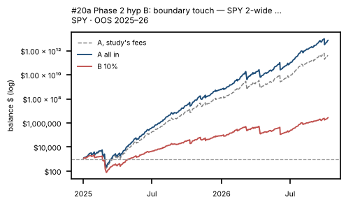{width=24%}
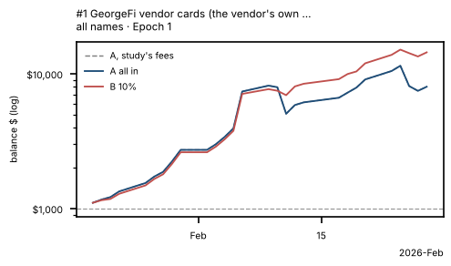{width=24%}
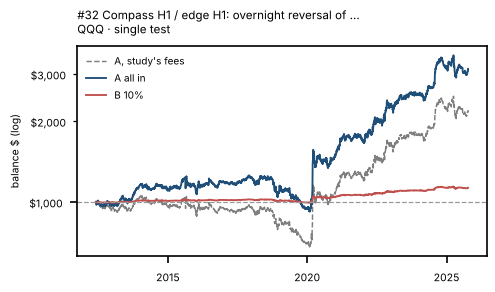{width=24%}
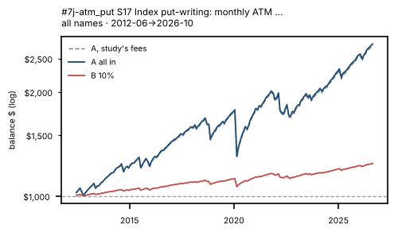{width=24%}
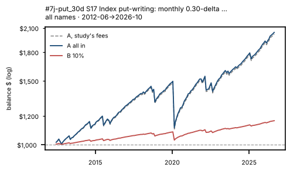{width=24%}
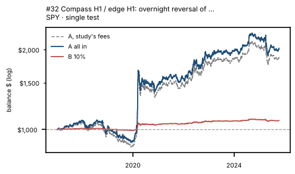{width=24%}
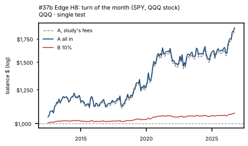{width=24%}
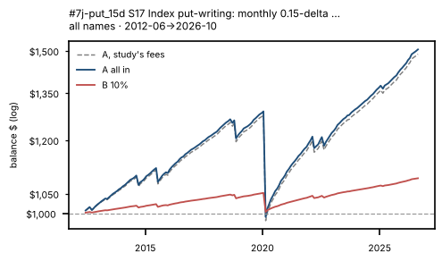{width=24%}
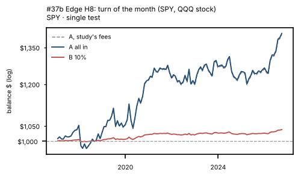{width=24%}
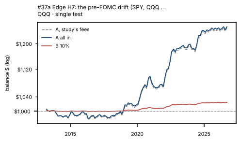{width=24%}
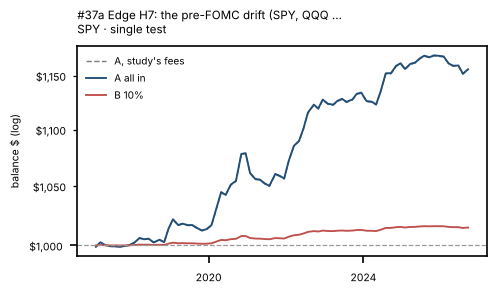{width=24%}
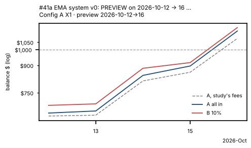{width=24%}
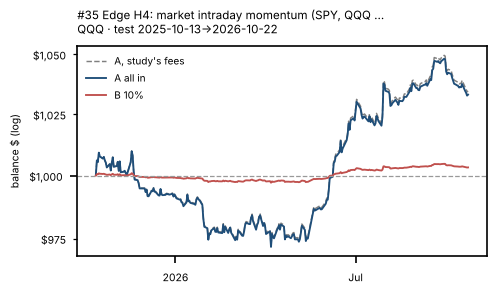{width=24%}
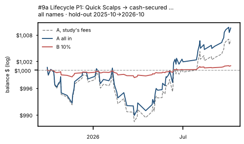{width=24%}
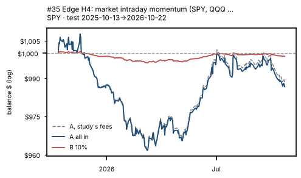{width=24%}
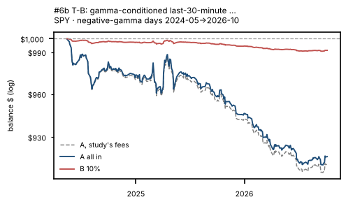{width=24%}
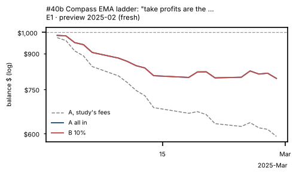{width=24%}
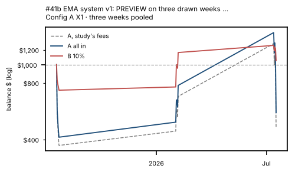{width=24%}
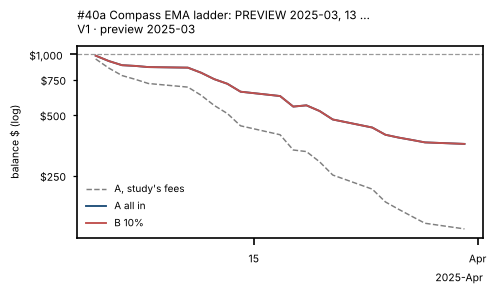{width=24%}
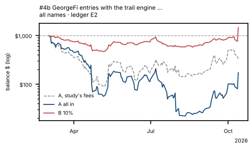{width=24%}
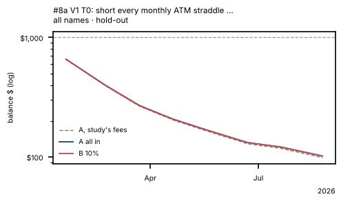{width=24%}
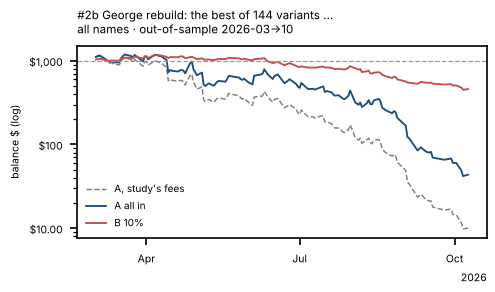{width=24%}
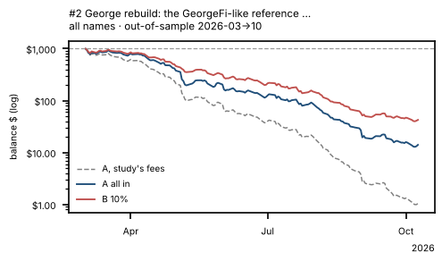{width=24%}
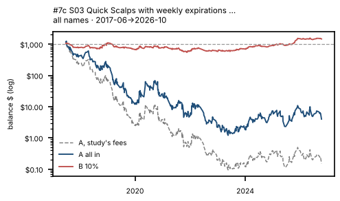{width=24%}
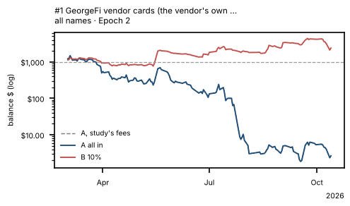{width=24%}
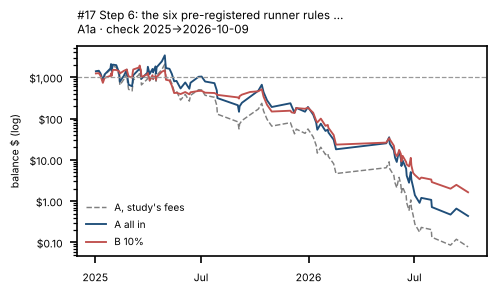{width=24%}
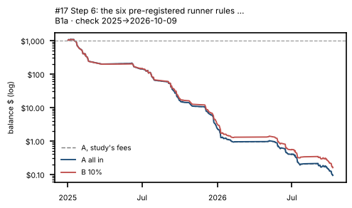{width=24%}
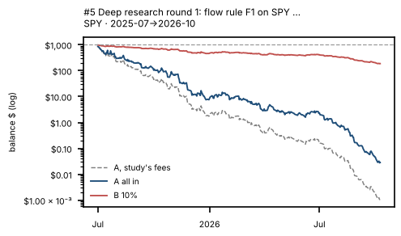{width=24%}
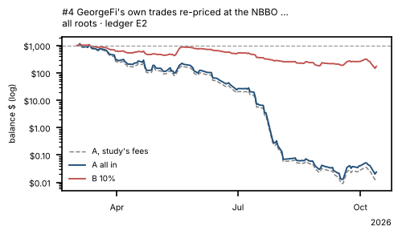{width=24%}
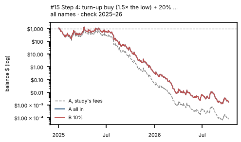{width=24%}
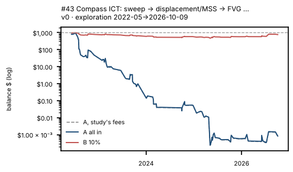{width=24%}
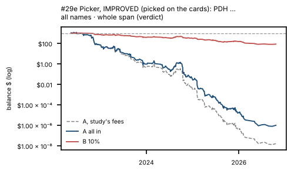{width=24%}
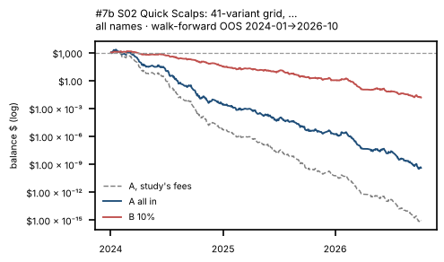{width=24%}
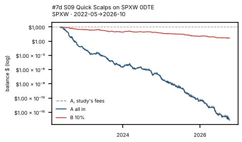{width=24%}
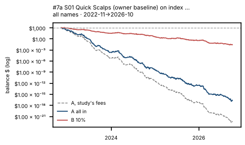{width=24%}
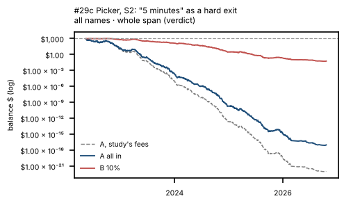{width=24%}
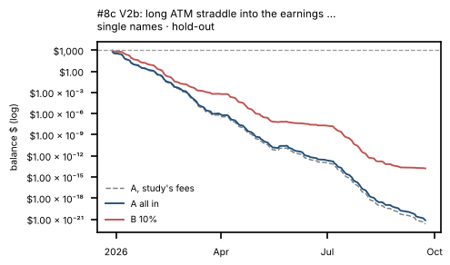{width=24%}
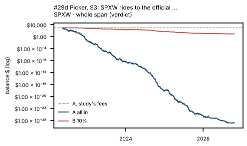{width=24%}
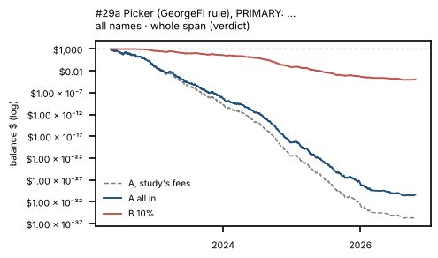{width=24%}
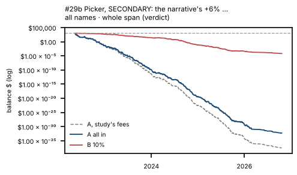{width=24%}
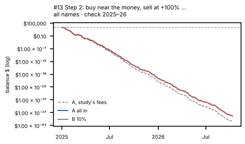{width=24%}
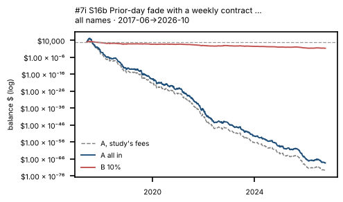{width=24%}
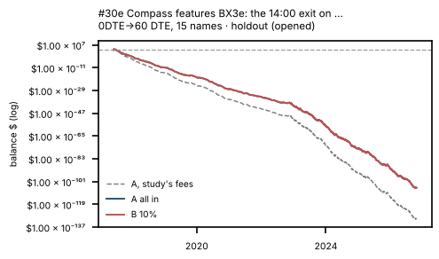{width=24%}
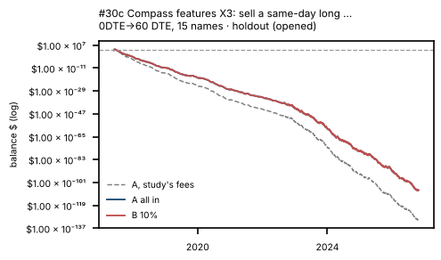{width=24%}
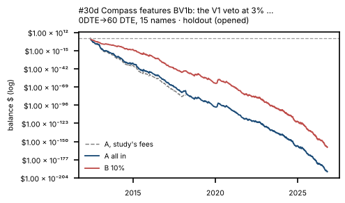{width=24%}
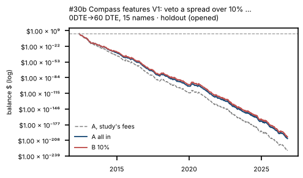{width=24%}
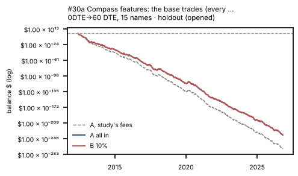{width=24%}
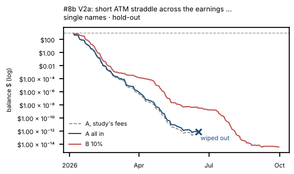{width=24%}
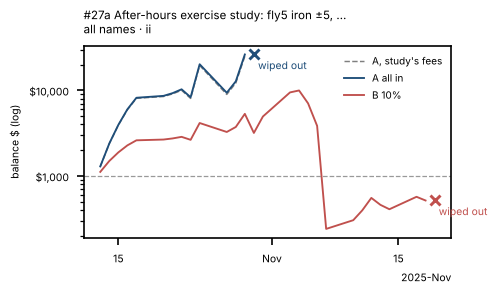{width=24%}
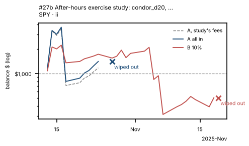{width=24%}
{width=24%}
{width=24%}
{width=24%}
{width=24%}
{width=24%}
{width=24%}
{width=24%}
{width=24%}
{width=24%}
{width=24%}
{width=24%}
{width=24%}
{width=24%}
{width=24%}
{width=24%}
{width=24%}
{width=24%}
{width=24%}
{width=24%}
{width=24%}
{width=24%}
{width=24%}
{width=24%}
{width=24%}
{width=24%}

